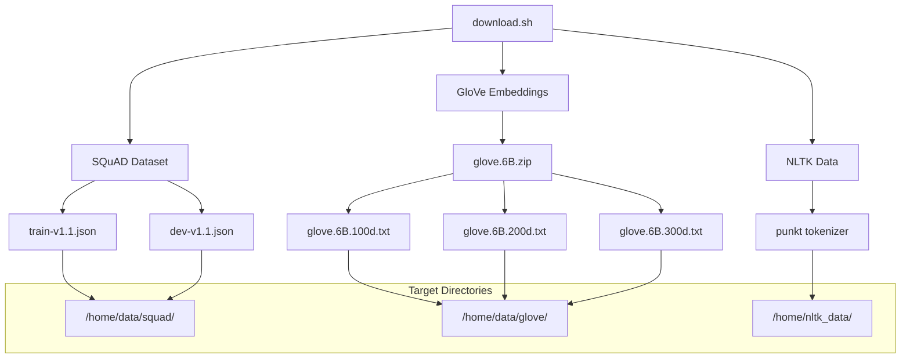
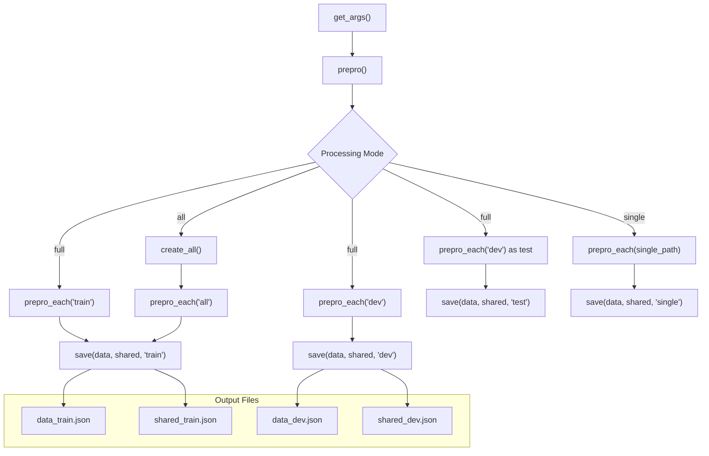
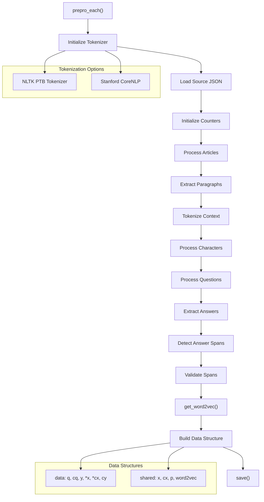
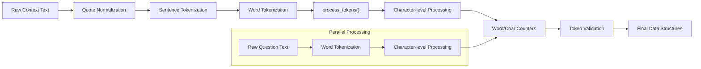
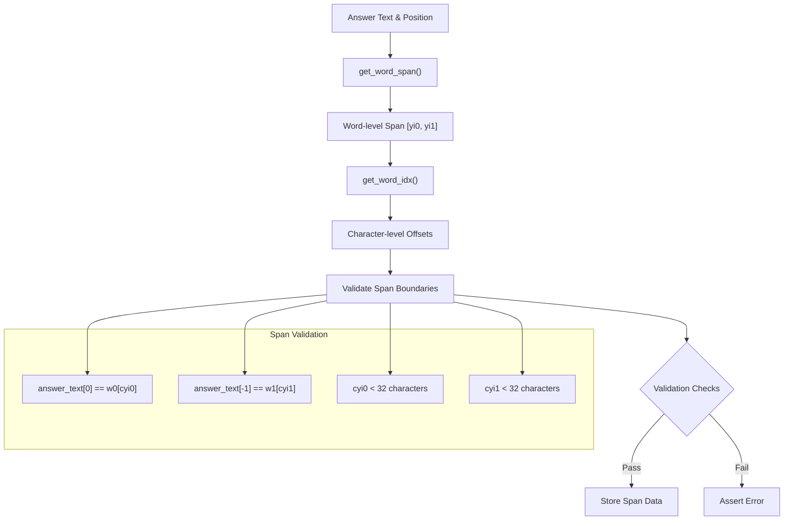
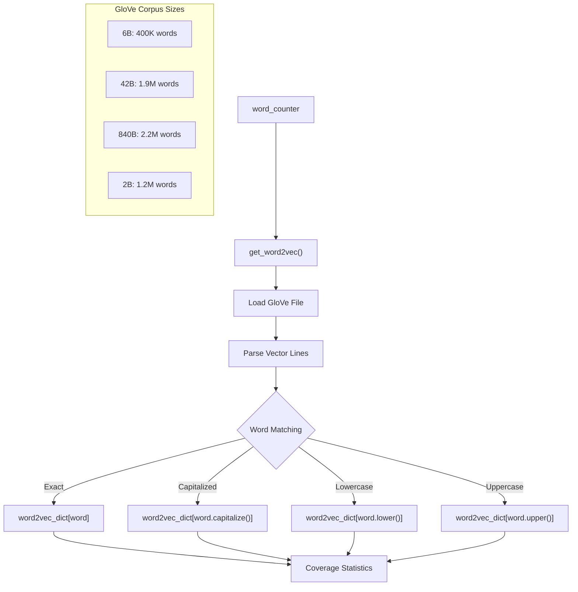
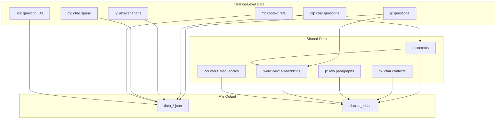

<!-- source: DeepWiki mcp.deepwiki.com · repo allenai/bi-att-flow · page 3.2 SQuAD Preprocessing · fetched 2026-10-26 -->

# SQuAD Preprocessing

<details>
<summary>Relevant source files</summary>

The following files were used as context for generating this wiki page:

- [download.sh](download.sh)
- [my/zip_save.py](my/zip_save.py)
- [squad/prepro.py](squad/prepro.py)
- [tree/test.ipynb](tree/test.ipynb)

</details>


This document covers the preprocessing pipeline that transforms raw SQuAD (Stanford Question Answering Dataset) data into the format required by the BiDAF model. The preprocessing system handles tokenization, embedding integration, answer span detection, and data structure conversion.

For information about loading the preprocessed data during training, see [Data Loading and Management](#3.1). For details about the overall data pipeline architecture, see [Data Pipeline](#3).

## Overview

The SQuAD preprocessing system is implemented primarily in `squad/prepro.py` and converts raw SQuAD JSON files into structured data suitable for neural network training. The system performs tokenization, integrates GloVe word embeddings, detects answer spans, and generates both word-level and character-level representations.

Sources: [squad/prepro.py:1-232]()

## Data Acquisition and Setup

### Data Download Pipeline

The preprocessing system requires several external resources that are automatically downloaded via the `download.sh` script:



The download script creates the following directory structure:
- `$HOME/data/squad/` - SQuAD JSON files
- `$HOME/data/glove/` - GloVe word embedding files
- `$HOME/nltk_data/` - NLTK tokenization data

Sources: [download.sh:1-26]()

### Configuration Arguments

The preprocessing system accepts multiple configuration options through command-line arguments:

| Argument | Default | Description |
|----------|---------|-------------|
| `--source_dir` | `~/data/squad` | Directory containing raw SQuAD files |
| `--target_dir` | `data/squad` | Output directory for processed files |
| `--glove_dir` | `~/data/glove` | Directory containing GloVe embeddings |
| `--glove_corpus` | `6B` | GloVe corpus version (6B, 42B, 840B, 2B) |
| `--glove_vec_size` | `100` | GloVe vector dimensionality |
| `--mode` | `full` | Processing mode (full, all, single) |
| `--tokenizer` | `PTB` | Tokenization method (PTB, Stanford) |
| `--train_ratio` | `0.9` | Training data ratio for splitting |

Sources: [squad/prepro.py:19-39]()

## Preprocessing Pipeline Architecture

### Main Processing Flow



The `prepro()` function orchestrates the entire preprocessing pipeline, supporting three main modes:
- **full**: Processes train and dev sets separately
- **all**: Combines train and dev sets for training
- **single**: Processes a single custom file

Sources: [squad/prepro.py:55-75]()

### Core Processing Function

The `prepro_each()` function performs the detailed preprocessing for each dataset split:



Sources: [squad/prepro.py:107-228]()

## Tokenization and Text Processing

### Tokenizer Configuration

The system supports two tokenization approaches:

**PTB Tokenizer (Default)**:
```python
import nltk
sent_tokenize = nltk.sent_tokenize
word_tokenize = nltk.word_tokenize
```

**Stanford CoreNLP Tokenizer**:
```python
from my.corenlp_interface import CoreNLPInterface
interface = CoreNLPInterface(args.url, args.port)
sent_tokenize = interface.split_doc
word_tokenize = interface.split_sent
```

Sources: [squad/prepro.py:108-119]()

### Text Processing Pipeline



The system processes both context and question text through:
1. **Quote normalization**: Converts `''` and ``` `` ``` to standard quotes
2. **Sentence tokenization**: Splits paragraphs into sentences
3. **Word tokenization**: Splits sentences into words
4. **Character processing**: Creates character-level representations
5. **Token counting**: Maintains frequency counters for vocabulary

Sources: [squad/prepro.py:143-160](), [squad/prepro.py:165-201]()

## Answer Span Detection

### Span Detection Process

The system performs precise answer span detection to map character-level answer positions to word-level indices:



The span detection process:
1. Uses `get_word_span()` to find word-level boundaries
2. Calculates character offsets within start/end words
3. Validates that extracted text matches original answer
4. Ensures character offsets are within reasonable bounds

Sources: [squad/prepro.py:177-195]()

## Embedding Integration

### GloVe Embedding Loading

The `get_word2vec()` function loads pre-trained GloVe embeddings and matches them to the vocabulary:



The system attempts multiple case variations to maximize vocabulary coverage and reports the percentage of words found in the GloVe embeddings.

Sources: [squad/prepro.py:84-104]()

## Data Structure Generation

### Output Data Format

The preprocessing generates two main output files per dataset split:

**Data File (`data_*.json`)**:
```json
{
  "q": "questions (word-tokenized)",
  "cq": "questions (character-level)",
  "y": "answer spans (word-level)",
  "cy": "answer spans (character-level)",
  "*x": "context references",
  "*cx": "context references (char)",
  "ids": "question IDs",
  "idxs": "question indices",
  "answerss": "answer texts"
}
```

**Shared File (`shared_*.json`)**:
```json
{
  "x": "contexts (word-tokenized)",
  "cx": "contexts (character-level)",
  "p": "raw context paragraphs",
  "word_counter": "word frequency counts",
  "char_counter": "character frequency counts",
  "word2vec": "GloVe embeddings",
  "lower_word2vec": "lowercase GloVe embeddings"
}
```

Sources: [squad/prepro.py:220-224]()

### Data Structure Relationships



The data structure separates instance-specific information (questions, answers) from shared resources (contexts, embeddings) to optimize storage and loading efficiency.

Sources: [squad/prepro.py:77-81](), [squad/prepro.py:220-227]()

## Processing Modes and Flexibility

### Mode Comparison

| Mode | Train Data | Dev Data | Test Data | Use Case |
|------|------------|----------|-----------|----------|
| `full` | train-v1.1.json | dev-v1.1.json | dev-v1.1.json | Standard training |
| `all` | train+dev combined | dev-v1.1.json | dev-v1.1.json | Maximum training data |
| `single` | custom file | - | - | Custom dataset processing |

### Advanced Options

The system supports additional processing options:
- **Debug mode**: Processes only the first paragraph for testing
- **Split control**: Adjustable train/dev ratios
- **Sentence splitting**: Optional sentence boundary detection
- **Custom tokenization**: Pluggable tokenizer interfaces

Sources: [squad/prepro.py:59-74](), [squad/prepro.py:213-214]()

---

