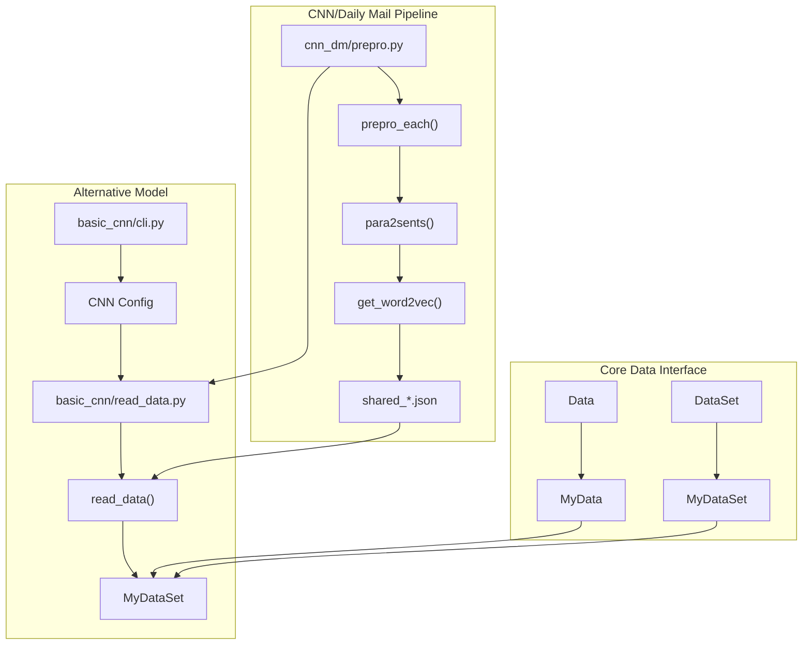
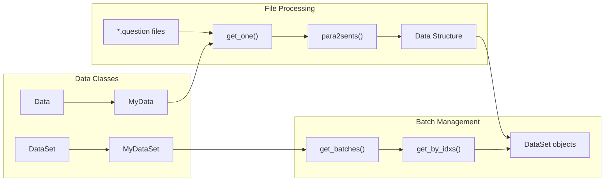
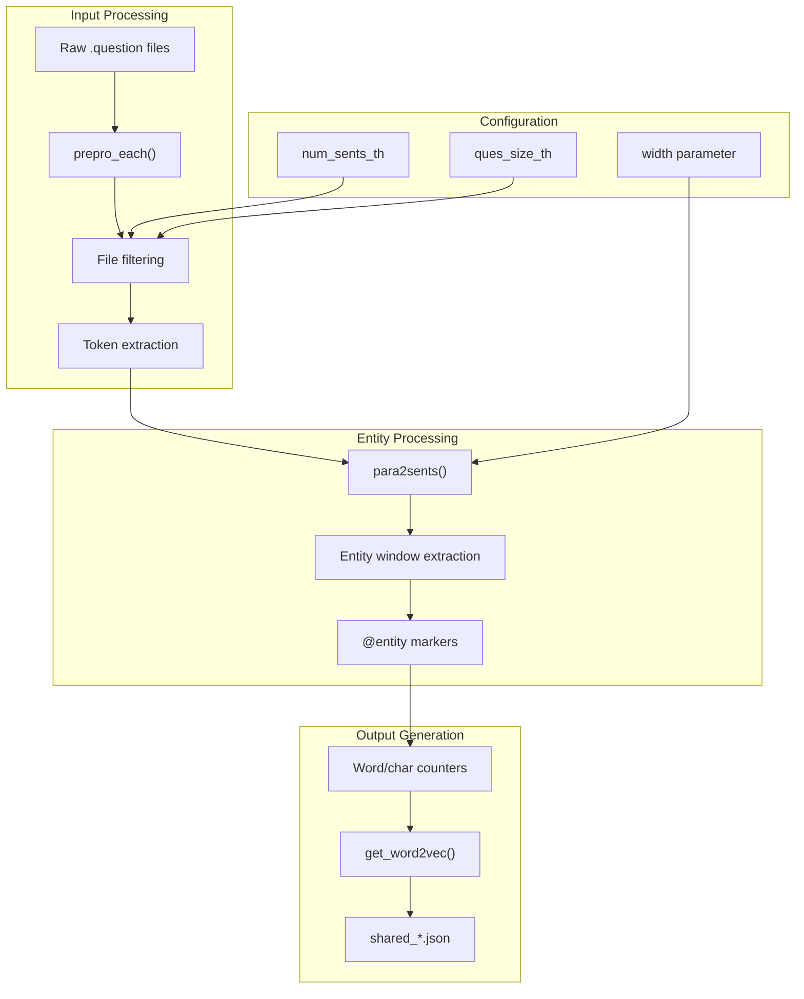
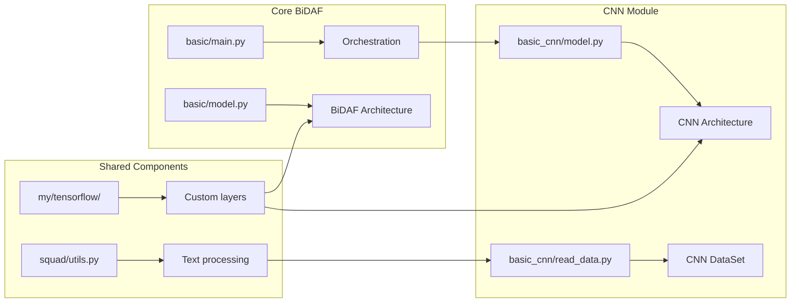

<!-- source: DeepWiki mcp.deepwiki.com · repo allenai/bi-att-flow · page 3.3 Alternative Dataset Support · fetched 2026-10-26 -->

# Alternative Dataset Support

<details>
<summary>Relevant source files</summary>

The following files were used as context for generating this wiki page:

- [basic/ensemble_fast.py](basic/ensemble_fast.py)
- [basic_cnn/cli.py](basic_cnn/cli.py)
- [basic_cnn/read_data.py](basic_cnn/read_data.py)
- [cnn_dm/eda.ipynb](cnn_dm/eda.ipynb)
- [cnn_dm/prepro.py](cnn_dm/prepro.py)
- [squad/utils.py](squad/utils.py)

</details>


This document covers the system's support for datasets beyond SQuAD, including CNN/Daily Mail and custom data formats. For information about the core SQuAD data pipeline, see [SQuAD Preprocessing](#3.2).

## Overview

The BiDAF system extends beyond SQuAD to support alternative datasets through modular data loading and preprocessing components. The primary alternative implementation targets the CNN/Daily Mail dataset with entity-centric question answering.

**Alternative Dataset Architecture**



Sources: [basic_cnn/read_data.py:15-271](), [cnn_dm/prepro.py:1-185](), [basic_cnn/cli.py:1-103]()

## CNN/Daily Mail Dataset Support

The system provides specialized support for the CNN/Daily Mail dataset through the `basic_cnn` module. This dataset focuses on entity-centric reading comprehension where questions involve anonymized entities marked with `@entity` tokens.

**Data Format Structure**

| Component | Description | Example |
|-----------|-------------|---------|
| Context | Paragraph with entity markers | `"The @entity1 won the game against @entity2"` |
| Question | Query with entity placeholders | `"Who won the game?"` |
| Answer | Target entity | `@entity1` |
| Candidates | List of possible entities | `["@entity1:TeamA", "@entity2:TeamB"]` |

### Data Loading Architecture

The CNN/Daily Mail data loader implements a custom hierarchy extending the base data interface:



The `MyData` class handles individual file processing while `MyDataSet` manages batch operations and metadata:

- `MyData.get_one()` [basic_cnn/read_data.py:47-71]() extracts structured data from question files
- `para2sents()` [cnn_dm/prepro.py:53-68]() converts paragraphs to entity-focused sentences
- `MyDataSet` [basic_cnn/read_data.py:199-206]() extends `DataSet` with CNN-specific metadata

Sources: [basic_cnn/read_data.py:15-81](), [cnn_dm/prepro.py:53-68]()

## Preprocessing Pipeline

The CNN/Daily Mail preprocessing follows a multi-stage pipeline that differs significantly from SQuAD preprocessing:

**CNN/Daily Mail Preprocessing Flow**



### Entity-Centric Sentence Generation

The key difference from SQuAD is the `para2sents()` function [cnn_dm/prepro.py:53-68](), which creates sentences by extracting word windows around entities:

```python
# Simplified logic from para2sents
words = para.split(" ")
for i, word in enumerate(words):
    if word.startswith("@"):
        start = max(i - width, 0)
        stop = min(i + width + 1, len(words))
        sent = words[start:stop]
```

The `width` parameter [basic_cnn/cli.py:92]() controls the context window size around each entity, typically set to 5 words.

Sources: [cnn_dm/prepro.py:53-68](), [basic_cnn/cli.py:92]()

## Configuration and Usage

Alternative dataset support requires specific configuration through the CNN module's command-line interface:

### Key Configuration Parameters

| Parameter | Purpose | Default | File Reference |
|-----------|---------|---------|----------------|
| `data_dir` | CNN data directory | `"data/cnn"` | [basic_cnn/cli.py:10]() |
| `root_dir` | Source question files | User-specific path | [basic_cnn/cli.py:11]() |
| `width` | Entity context window | `5` | [basic_cnn/cli.py:92]() |
| `num_sents_th` | Max sentences per document | `200` | [basic_cnn/cli.py:49]() |
| `ques_size_th` | Max question length | `30` | [basic_cnn/cli.py:50]() |

### Data Processing Workflow

The alternative dataset processing follows this sequence:

1. **Preprocessing**: Run `cnn_dm/prepro.py` to generate processed data files
2. **Data Loading**: Use `basic_cnn/read_data.py` to load and batch data
3. **Model Training**: Execute with CNN-specific configuration via `basic_cnn/cli.py`

The `read_data()` function [basic_cnn/read_data.py:208-270]() serves as the main entry point, handling vocabulary construction and data filtering based on the configuration parameters.

**Integration with Core System**



The alternative dataset support integrates with the core system by sharing utility functions and TensorFlow components while maintaining separate model architectures and data processing pipelines.

Sources: [basic_cnn/read_data.py:208-270](), [basic_cnn/cli.py:9-103](), [squad/utils.py:70-79]()

---

