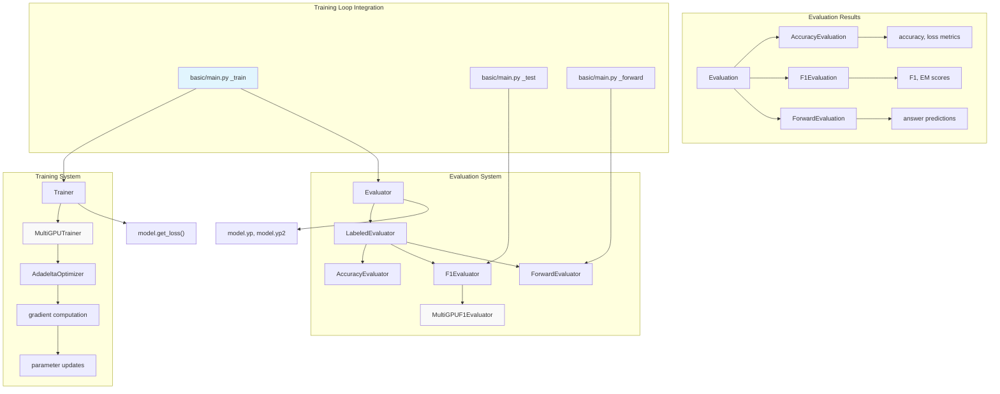
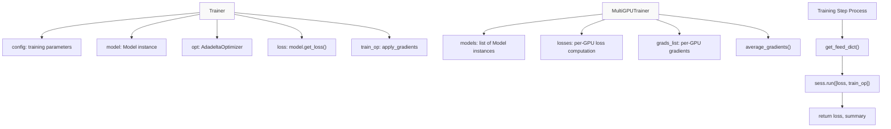
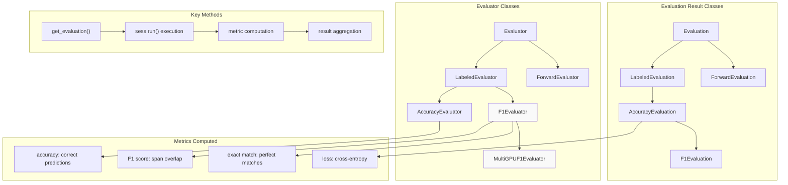
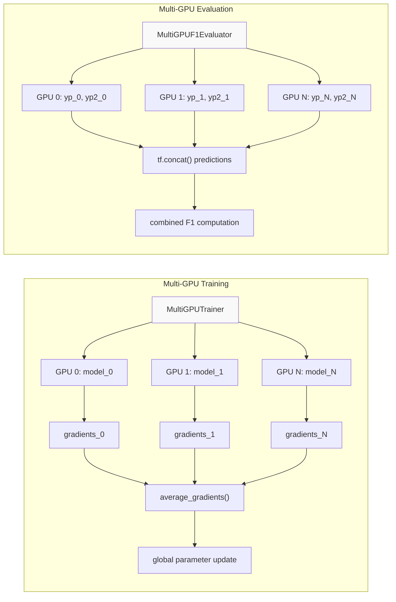
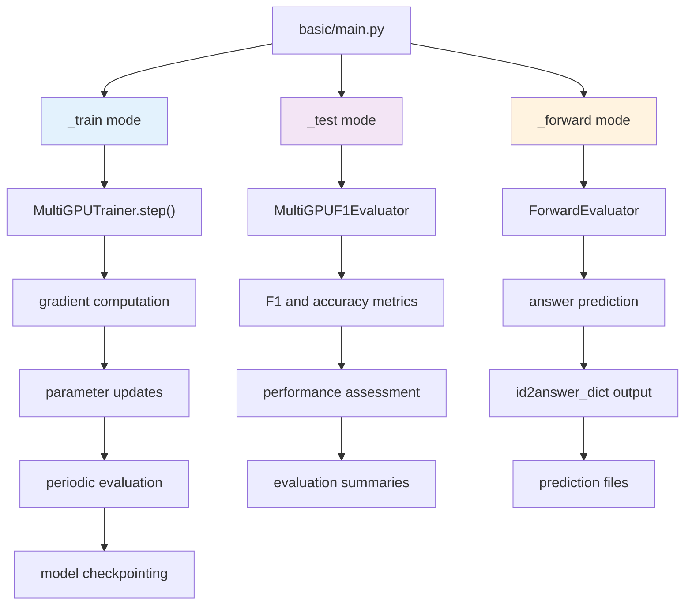

<!-- source: DeepWiki mcp.deepwiki.com · repo allenai/bi-att-flow · page 4 Training and Evaluation · fetched 2026-10-26 -->

# Training and Evaluation

Relevant source files

The following files were used as context for generating this wiki page:

- [basic/evaluator.py](basic/evaluator.py)
- [basic/trainer.py](basic/trainer.py)

This document covers the training and evaluation systems in the BiDAF codebase, including the core training loops, evaluation metrics, and multi-GPU support. It provides an overview of how models are trained and assessed for performance on question answering tasks.

For detailed information about the training pipeline implementation, see [Training Pipeline](#4.1). For comprehensive coverage of evaluation metrics and assessment frameworks, see [Evaluation Framework](#4.2). For tools to analyze and visualize training results, see [Visualization and Analysis](#4.3).

## Training and Evaluation Pipeline Overview

The BiDAF system implements a comprehensive training and evaluation pipeline that supports both single-GPU and multi-GPU configurations. The system is designed around separate but coordinated training and evaluation phases that work together to optimize and assess model performance.

### Training and Evaluation Architecture

Sources: [basic/trainer.py:1-74](), [basic/evaluator.py:1-423]()

## Training System Components

The training system is built around two main trainer classes that handle optimization and gradient computation for both single and multi-GPU scenarios.

### Core Training Classes

| Class | Purpose | Key Features |
|-------|---------|-------------|
| `Trainer` | Single-GPU training | Basic gradient computation and optimization |
| `MultiGPUTrainer` | Distributed training | Gradient averaging across multiple GPUs |

### Training Class Hierarchy

Sources: [basic/trainer.py:7-35](), [basic/trainer.py:36-74]()

The `Trainer` class handles single-GPU training with Adadelta optimization [basic/trainer.py:12](), while `MultiGPUTrainer` coordinates training across multiple GPUs using gradient averaging [basic/trainer.py:57]().

## Evaluation System Components

The evaluation system provides multiple evaluation strategies and metrics for assessing model performance on question answering tasks.

### Evaluation Class Architecture

Sources: [basic/evaluator.py:11-48](), [basic/evaluator.py:99-119](), [basic/evaluator.py:236-333]()

### Evaluation Metrics and Processing

The evaluation system computes several key metrics:

- **Accuracy**: Exact match between predicted and ground truth answer spans [basic/evaluator.py:149-159]()
- **F1 Score**: Token-level overlap between predicted and ground truth spans [basic/evaluator.py:322-331]()
- **Loss**: Cross-entropy loss for training optimization [basic/evaluator.py:146]()

The `F1Evaluator` performs span extraction using `get_best_span()` [basic/evaluator.py:272]() and computes F1 scores using span overlap analysis [basic/evaluator.py:293]().

## Multi-GPU Training and Evaluation

The system provides comprehensive multi-GPU support for both training and evaluation phases.

### Multi-GPU Processing Flow

Sources: [basic/trainer.py:49-58](), [basic/evaluator.py:334-355]()

The `MultiGPUTrainer` distributes batches across GPUs and averages gradients [basic/trainer.py:57](), while `MultiGPUF1Evaluator` concatenates predictions from multiple GPUs [basic/evaluator.py:340-342]().

## Training and Evaluation Integration

The training and evaluation systems are integrated through the main orchestration system, which coordinates different execution modes.

### Execution Mode Integration

Sources: [basic/trainer.py:23-33](), [basic/evaluator.py:242-297](), [basic/evaluator.py:363-392]()

The system supports three primary execution modes:
- **Training mode**: Uses `MultiGPUTrainer` for model optimization
- **Test mode**: Uses `MultiGPUF1Evaluator` for performance assessment  
- **Forward mode**: Uses `ForwardEvaluator` for answer prediction generation

Each mode leverages the appropriate trainer or evaluator class to accomplish its specific objectives while maintaining consistent interfaces for model interaction and result processing.

---

