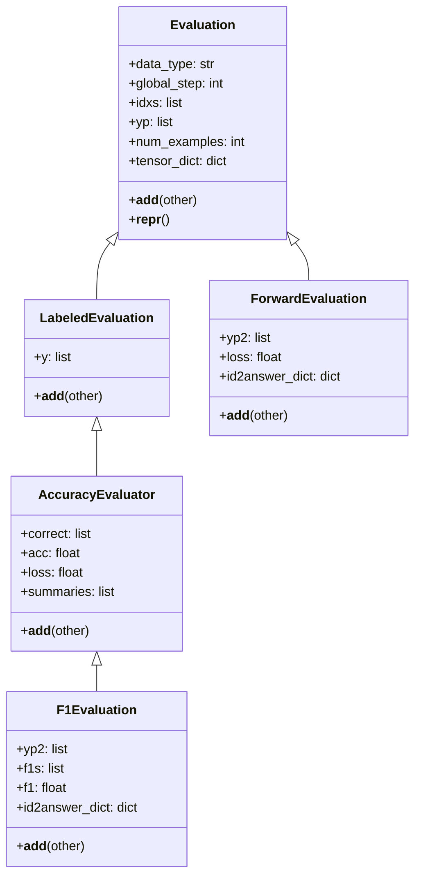
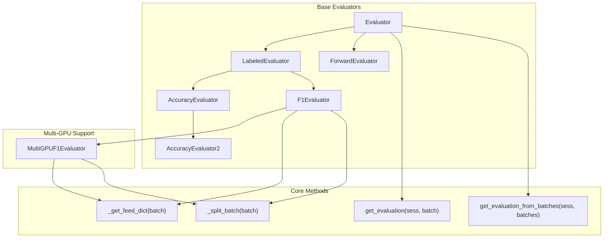
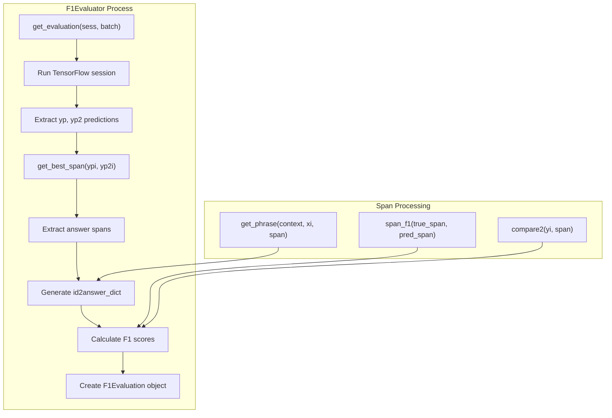
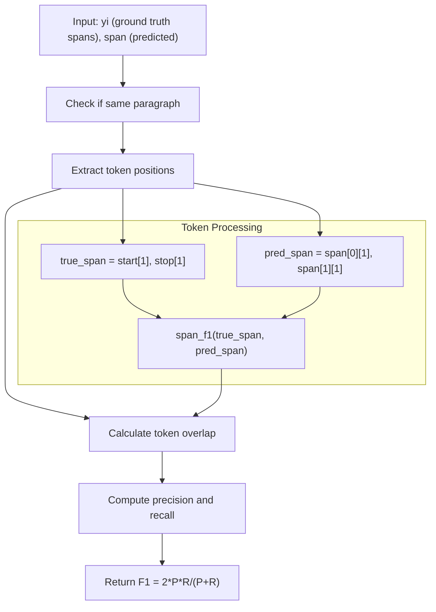
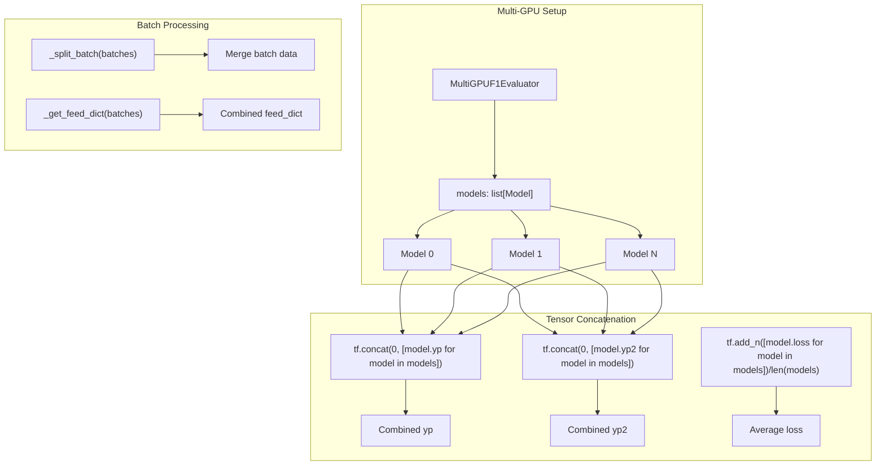
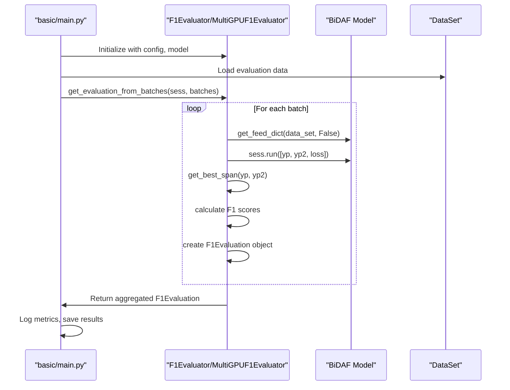
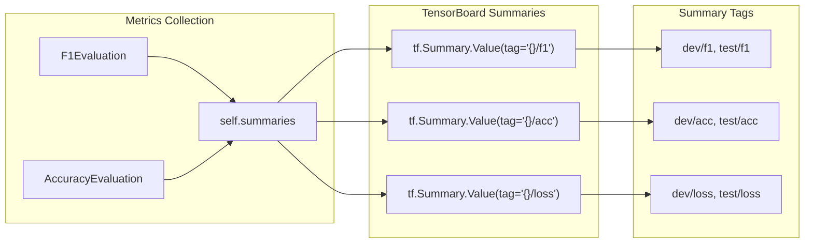

<!-- source: DeepWiki mcp.deepwiki.com · repo allenai/bi-att-flow · page 4.2 Evaluation Framework · fetched 2026-10-26 -->

# Evaluation Framework

Relevant source files

The following files were used as context for generating this wiki page:

- [basic/evaluator.py](basic/evaluator.py)
- [my/utils.py](my/utils.py)
- [squad/evaluate-v1.1.py](squad/evaluate-v1.1.py)

The evaluation framework provides comprehensive performance assessment capabilities for the BiDAF question answering model. It supports multiple evaluation modes including accuracy measurement, F1 scoring, and forward inference, with built-in support for multi-GPU evaluation and integration with the official SQuAD evaluation metrics.

For information about training metrics and optimization, see [Training Pipeline](#4.1). For visualization of evaluation results, see [Visualization and Analysis](#4.3).

## Evaluation Data Structures

The framework uses a hierarchical set of classes to store and aggregate evaluation results across batches and different evaluation modes.

### Core Evaluation Classes

The `Evaluation` class serves as the base container for evaluation results, storing predictions (`yp`), example indices (`idxs`), and optional tensor outputs. Each evaluation type extends this base with specific metrics and comparison methods.

Sources: [basic/evaluator.py:11-47]()

### Evaluation Result Aggregation

The evaluation classes implement `__add__` methods to enable aggregation of results across batches:

| Class | Aggregation Strategy |
|-------|---------------------|
| `Evaluation` | Concatenates predictions and indices |
| `AccuracyEvaluation` | Computes weighted average loss, combines accuracy lists |
| `F1Evaluation` | Merges F1 scores, combines answer dictionaries |
| `ForwardEvaluation` | Aggregates predictions and answer mappings |

Sources: [basic/evaluator.py:33-46](), [basic/evaluator.py:84-96](), [basic/evaluator.py:215-230]()

## Core Evaluator Classes

The evaluator hierarchy provides different evaluation strategies for various model usage patterns.

### Evaluator Class Architecture

Sources: [basic/evaluator.py:99-119](), [basic/evaluator.py:121-135](), [basic/evaluator.py:334-355]()

### F1Evaluator Implementation

The `F1Evaluator` class is the primary evaluator for question answering tasks, implementing span-based F1 scoring:

The evaluator processes model predictions through several key steps:

1. **Prediction Extraction**: Retrieves `yp` (start logits) and `yp2` (end logits) from the model
2. **Span Calculation**: Uses `get_best_span` to find optimal answer spans from logit matrices
3. **Answer Generation**: Converts spans to text using `get_phrase` with original context
4. **Metric Calculation**: Computes F1 scores using `span_f1` and exact match using `compare2`

Sources: [basic/evaluator.py:242-297](), [basic/evaluator.py:322-331]()

## Metrics and Scoring

The framework implements multiple evaluation metrics tailored for question answering tasks.

### Span-Based F1 Scoring

The core F1 calculation uses token-level overlap between predicted and ground truth spans:

| Metric Function | Purpose | Implementation |
|----------------|---------|----------------|
| `span_f1(yi, span)` | Token-level F1 for spans | [basic/evaluator.py:322-331]() |
| `compare2(yi, span)` | Exact span match | [basic/evaluator.py:315-320]() |
| `get_best_span(ypi, yp2i)` | Optimal span extraction | [squad/utils.py]() |

The `span_f1` method computes F1 scores by finding the maximum overlap between any ground truth span and the predicted span within the same paragraph:

Sources: [basic/evaluator.py:322-331](), [my/nltk_utils.py]()

### Official SQuAD Evaluation Integration

The framework integrates with the official SQuAD v1.1 evaluation script for standardized metrics:

| Metric | Description | Normalization |
|--------|-------------|---------------|
| Exact Match (EM) | Binary match after normalization | Remove articles, punctuation, extra whitespace |
| F1 Score | Token-level F1 after normalization | Same normalization as EM |

The official evaluator applies text normalization before comparison:
- Converts to lowercase
- Removes articles (a, an, the)
- Removes punctuation
- Normalizes whitespace

Sources: [squad/evaluate-v1.1.py:11-26](), [squad/evaluate-v1.1.py:29-39](), [squad/evaluate-v1.1.py:42-43]()

## Multi-GPU Evaluation

The `MultiGPUF1Evaluator` extends single-GPU evaluation to support distributed model inference across multiple GPUs.

### Multi-GPU Architecture

The multi-GPU evaluator manages evaluation across multiple model replicas:

1. **Tensor Concatenation**: Combines predictions from all GPU models using `tf.concat`
2. **Batch Splitting**: Merges batches from different GPUs using `_split_batch`
3. **Feed Dictionary**: Combines feed dictionaries for all models using `_get_feed_dict`
4. **Loss Averaging**: Computes average loss across all model replicas

Sources: [basic/evaluator.py:334-355](), [basic/evaluator.py:338-342]()

## Evaluation Pipeline Integration

The evaluation framework integrates with the main training and inference pipeline through standardized interfaces.

### Evaluation Mode Flow

The evaluation process follows a consistent pattern:

1. **Initialization**: Create evaluator with model configuration
2. **Batch Processing**: Process evaluation data in batches
3. **Prediction Generation**: Run model inference to get answer spans
4. **Metric Calculation**: Compute F1 and exact match scores
5. **Result Aggregation**: Combine results across all batches
6. **Output Generation**: Create answer dictionaries for external evaluation

Sources: [basic/evaluator.py:116-118](), [basic/evaluator.py:242-297]()

### TensorBoard Integration

Evaluation results are automatically integrated with TensorBoard for monitoring:

Sources: [basic/evaluator.py:77-79](), [basic/evaluator.py:212-213]()

---

