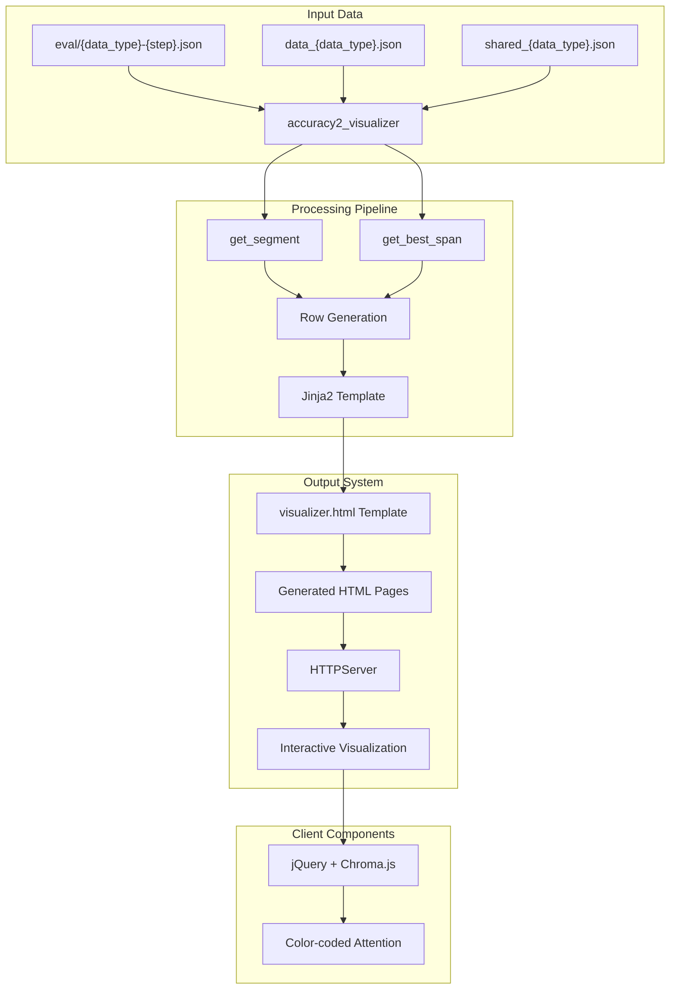
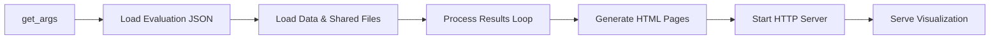
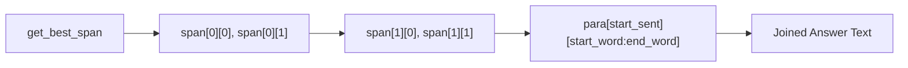
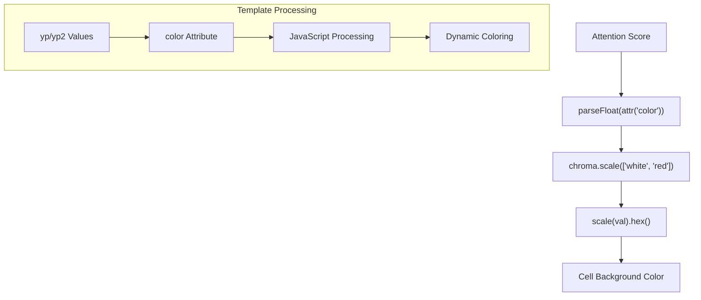
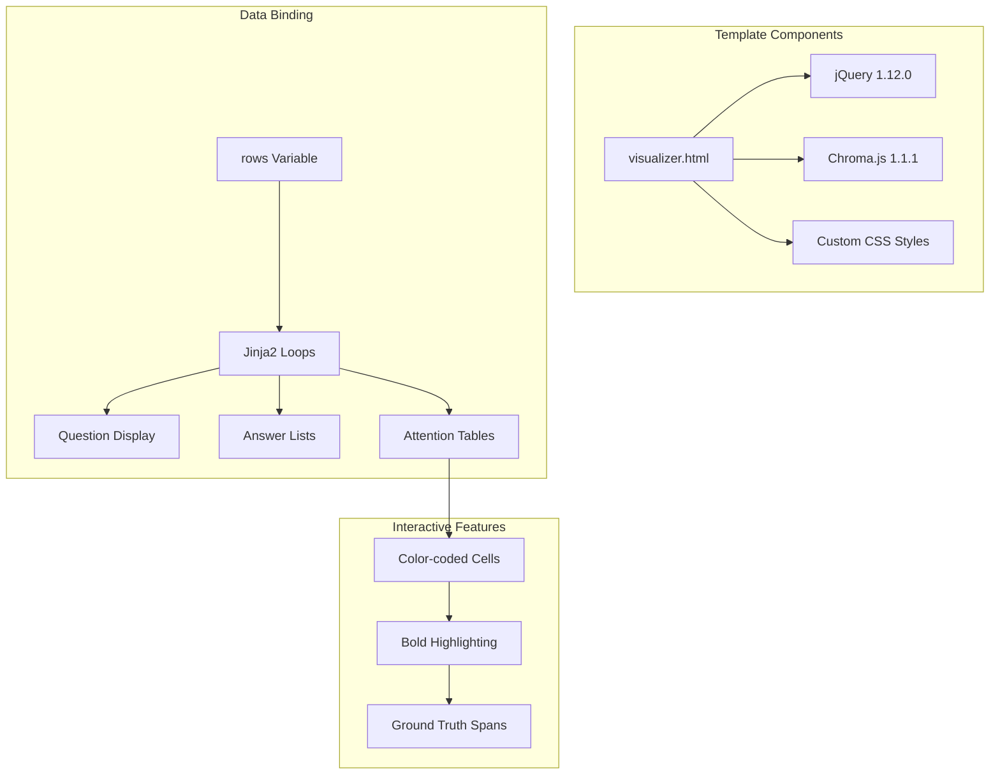
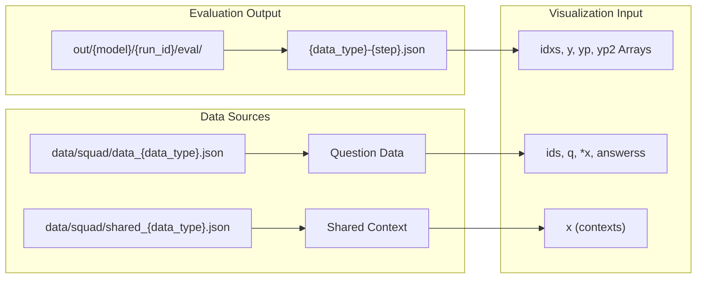

<!-- source: DeepWiki mcp.deepwiki.com · repo allenai/bi-att-flow · page 4.3 Visualization and Analysis · fetched 2026-10-26 -->

# Visualization and Analysis

Relevant source files

The following files were used as context for generating this wiki page:

- [basic/templates/visualizer.html](basic/templates/visualizer.html)
- [basic/visualizer.py](basic/visualizer.py)
- [basic_cnn/superhighway.py](basic_cnn/superhighway.py)
- [basic_cnn/templates/visualizer.html](basic_cnn/templates/visualizer.html)
- [basic_cnn/trainer.py](basic_cnn/trainer.py)
- [basic_cnn/visualizer.py](basic_cnn/visualizer.py)

The visualization and analysis system provides interactive HTML-based tools for examining model predictions, attention weights, and performance on question-answering tasks. This system transforms evaluation results into color-coded visual representations that help understand model behavior and debug performance issues. For information about generating evaluation results, see [Evaluation Framework](#4.2).

## Visualization System Architecture

The visualization system consists of a standalone tool that processes evaluation JSON files and generates interactive HTML pages served via a local web server.

**Visualization Data Flow**

Sources: [basic/visualizer.py:45-129]()

## Using the Visualizer

The visualizer is executed as a standalone script with configurable parameters for model selection, data type, and server settings.

### Command Line Interface

| Parameter | Default | Description |
|-----------|---------|-------------|
| `--model_name` | `'basic'` | Model type to visualize |
| `--data_type` | `'dev'` | Dataset split (dev/test) |
| `--step` | `5000` | Training step checkpoint |
| `--template_name` | `'visualizer.html'` | HTML template file |
| `--num_per_page` | `100` | Results per HTML page |
| `--port` | `8000` | Server port |
| `--host` | `'0.0.0.0'` | Server host address |

### Execution Process

The visualizer follows this execution sequence:

**Command Line and Server Setup**

Sources: [basic/visualizer.py:25-39](), [basic/visualizer.py:117-129]()

## Visualization Components

The visualization system renders structured data about model predictions and attention weights in an interactive HTML table format.

### Row Data Structure

Each visualization row contains the following components processed by the `accuracy2_visualizer` function:

| Component | Source | Description |
|-----------|--------|-------------|
| `id` | `data['ids'][idx]` | Question ID |
| `ques` | `data['q'][idx]` | Question text |
| `para` | `shared['x'][rx[0]][rx[1]]` | Context paragraph |
| `a` | `data['answerss'][idx]` | Ground truth answers |
| `ap` | `get_segment(para, span)` | Predicted answer |
| `yp` | `eval_['yp']` | Start position probabilities |
| `yp2` | `eval_['yp2']` | End position probabilities |
| `score` | `ypi[span] * yp2i[span]` | Prediction confidence |

### Answer Span Extraction

The `get_segment` function extracts the predicted answer text from the paragraph using span indices:

**Row Processing and Answer Extraction**

Sources: [basic/visualizer.py:81-104](), [basic/visualizer.py:132-133]()

## Attention Weight Visualization

The HTML template uses JavaScript and CSS to create color-coded visualizations of attention weights, providing visual insight into model attention patterns.

### Color Mapping System

**JavaScript Color Processing**

The client-side JavaScript processes attention weights using the Chroma.js library:

- Reads attention values from `color` attributes on table cells with class `att`
- Maps values to a white-to-red color scale
- Applies background colors dynamically to visualize attention intensity

### HTML Structure

The template generates a nested table structure where:
- Outer table contains questions, answers, and predictions
- Inner table represents the paragraph with attention-colored cells
- Two rows per sentence: one for start probabilities (`yp`), one for end probabilities (`yp2`)

Sources: [basic/templates/visualizer.html:8-18](), [basic/templates/visualizer.html:50-70]()

## HTML Template System

The visualization uses Jinja2 templating to generate dynamic HTML content with embedded attention data and interactive features.

### Template Architecture

**Template Structure and Features**

### Key Template Features

| Feature | Implementation | Purpose |
|---------|----------------|---------|
| Attention Coloring | `class="att" color="{{ value }}"` | Visual attention weights |
| Ground Truth Highlighting | `<b>{{ word }}</b>` conditions | Show correct answers |
| Nested Tables | Inner paragraph tables | Structured text display |
| Dynamic Lists | `` | Multiple answer display |

The template processes attention data through nested loops, creating a two-dimensional representation where each word's attention weight is visually encoded through background color intensity.

Sources: [basic/templates/visualizer.html:34-73](), [basic/templates/visualizer.html:1-33]()

## Integration with Evaluation Results

The visualizer integrates with the evaluation framework by consuming JSON output files generated during model evaluation phases.

### File Dependencies

**Data Integration and File Structure**

### Evaluation Data Format

The visualizer expects specific keys in the evaluation JSON:
- `idxs`: Example indices
- `y`: Ground truth answer spans
- `yp`: Start position probability distributions
- `yp2`: End position probability distributions

These arrays are synchronized by index, allowing the visualizer to match predictions with ground truth data and original text content.

### Multi-Model Support

The system supports visualization for different model architectures through separate visualizer implementations:
- `basic/visualizer.py` for the main BiDAF model
- `basic_cnn/visualizer.py` for CNN-based variants

Both implementations share the same template structure and visualization logic, ensuring consistent analysis capabilities across model types.

Sources: [basic/visualizer.py:53-56](), [basic/visualizer.py:73-84](), [basic_cnn/visualizer.py:53-56]()

---

