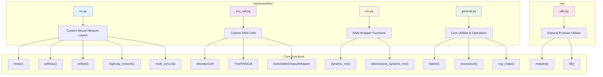
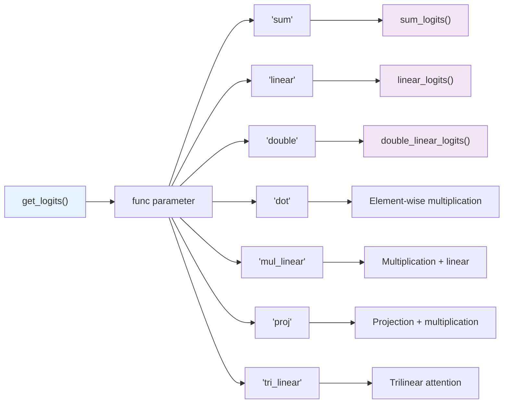
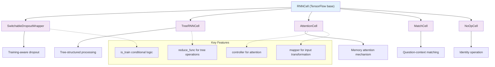
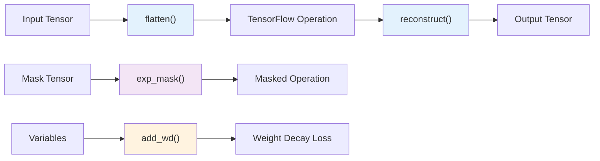
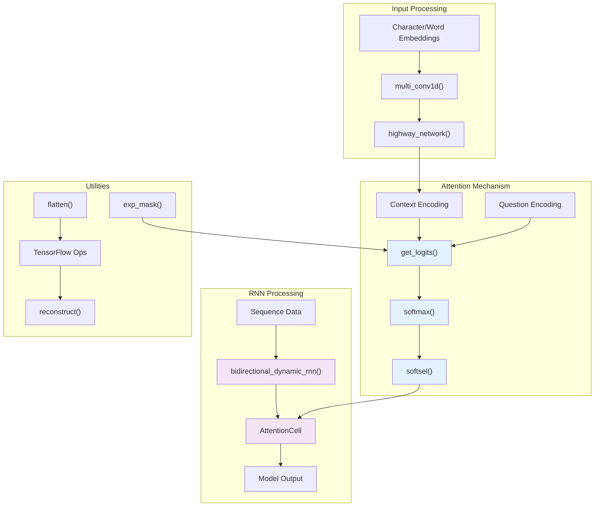

<!-- source: DeepWiki mcp.deepwiki.com · repo allenai/bi-att-flow · page 5 TensorFlow Extensions · fetched 2026-10-26 -->

# TensorFlow Extensions

<details>
<summary>Relevant source files</summary>

The following files were used as context for generating this wiki page:

- [my/tensorflow/general.py](my/tensorflow/general.py)
- [my/tensorflow/nn.py](my/tensorflow/nn.py)
- [my/tensorflow/rnn.py](my/tensorflow/rnn.py)
- [my/tensorflow/rnn_cell.py](my/tensorflow/rnn_cell.py)
- [my/utils.py](my/utils.py)
- [squad/evaluate-v1.1.py](squad/evaluate-v1.1.py)

</details>


The TensorFlow Extensions module provides custom neural network components that extend TensorFlow's functionality specifically for the BiDAF question answering system. This module implements specialized layers, RNN cells, and utility functions that are not available in standard TensorFlow but are essential for the bidirectional attention flow architecture.

The extensions are organized into several key areas: custom neural network layers for attention mechanisms and specialized operations, custom RNN cells for advanced sequence modeling, tensor manipulation utilities, and general-purpose helper functions. For information about how these extensions are used within the core BiDAF model architecture, see [Model Architecture](#2.1). For details on alternative model implementations that also use these extensions, see [Alternative Models](#6).

## Extension Module Architecture

The TensorFlow extensions are organized into a modular structure where each component serves a specific purpose in the neural network pipeline.

**TensorFlow Extensions Module Structure**


Sources: [my/tensorflow/nn.py:1-180](), [my/tensorflow/rnn_cell.py:1-224](), [my/tensorflow/rnn.py:1-83](), [my/tensorflow/general.py:1-168](), [my/utils.py:1-59]()

## Custom Neural Network Layers

The `nn.py` module provides specialized neural network layers that implement attention mechanisms, highway networks, and other operations crucial for the BiDAF architecture.

### Core Layer Functions

| Function | Purpose | Key Parameters |
|----------|---------|----------------|
| `linear()` | Enhanced linear transformation with dropout and weight decay | `args`, `output_size`, `wd`, `input_keep_prob` |
| `highway_layer()` | Single highway network layer with gating mechanism | `arg`, `bias`, `scope` |
| `highway_network()` | Multi-layer highway network | `arg`, `num_layers`, `bias` |
| `softmax()` | Masked softmax operation | `logits`, `mask` |
| `softsel()` | Soft selection using attention weights | `target`, `logits`, `mask` |
| `multi_conv1d()` | Multi-scale 1D convolution | `in_`, `filter_sizes`, `heights` |

### Attention and Logit Functions

The module implements several methods for computing attention logits, which are essential for the bidirectional attention mechanism:

**Attention Logit Computation Methods**


Sources: [my/tensorflow/nn.py:8-27](), [my/tensorflow/nn.py:39-47](), [my/tensorflow/nn.py:50-63](), [my/tensorflow/nn.py:99-131](), [my/tensorflow/nn.py:134-153](), [my/tensorflow/nn.py:156-179]()

### Highway Networks

Highway networks allow information to flow across layers with learned gating mechanisms. The implementation includes both single layers and multi-layer networks:

- `highway_layer()` [my/tensorflow/nn.py:134-142]() implements a single highway layer with transform and gate components
- `highway_network()` [my/tensorflow/nn.py:145-153]() stacks multiple highway layers for deep information processing

### Convolutional Operations

The `multi_conv1d()` function [my/tensorflow/nn.py:169-179]() implements character-level convolutions with multiple filter sizes, commonly used for character embedding in NLP models.

Sources: [my/tensorflow/nn.py:134-179]()

## RNN Components  

The RNN components provide specialized recurrent neural network cells and wrapper functions that enable advanced sequence modeling capabilities.

### Custom RNN Cells

**RNN Cell Hierarchy**


Sources: [my/tensorflow/rnn_cell.py:8-26](), [my/tensorflow/rnn_cell.py:28-60](), [my/tensorflow/rnn_cell.py:116-224](), [my/tensorflow/rnn_cell.py:78-114](), [my/tensorflow/rnn_cell.py:62-76]()

### SwitchableDropoutWrapper

The `SwitchableDropoutWrapper` [my/tensorflow/rnn_cell.py:8-26]() extends TensorFlow's `DropoutWrapper` to conditionally apply dropout based on training state. This allows the same model to behave differently during training and inference without rebuilding the graph.

### AttentionCell

The `AttentionCell` [my/tensorflow/rnn_cell.py:116-224]() implements early fusion attention where the cell uses inputs and previous state to attend over memory:

- **Controller**: Computes attention logits from inputs, state, and memory
- **Mapper**: Transforms inputs and state based on selected memory
- **Memory**: External memory tensor that the cell attends over

The cell provides several pre-built controllers and mappers:
- `get_linear_controller()` and `get_double_linear_controller()` for computing attention
- `get_concat_mapper()` and `get_sim_mapper()` for input transformation

### RNN Wrapper Functions

The `rnn.py` module provides wrapper functions that handle tensor reshaping for batch processing:

| Function | Purpose | Key Feature |
|----------|---------|-------------|
| `dynamic_rnn()` | Enhanced dynamic RNN with reshaping | Flattens inputs, reconstructs outputs |
| `bidirectional_dynamic_rnn()` | Bidirectional RNN wrapper | Handles forward/backward cell coordination |
| `bw_dynamic_rnn()` | Backward-only RNN | Sequence reversal for backward processing |

These wrappers use `flatten()` and `reconstruct()` utilities to handle arbitrary tensor dimensions while maintaining compatibility with TensorFlow's RNN functions.

Sources: [my/tensorflow/rnn.py:9-22](), [my/tensorflow/rnn.py:46-64](), [my/tensorflow/rnn.py:25-43]()

## Utility Functions

The utility functions provide fundamental operations for tensor manipulation, masking, and general-purpose helpers.

### Tensor Operations

**Core Tensor Manipulation Flow**


Sources: [my/tensorflow/general.py:121-141](), [my/tensorflow/general.py:104-118](), [my/tensorflow/general.py:144-151]()

### Key Utility Functions

| Function | Purpose | Location |
|----------|---------|----------|
| `flatten()` | Reshapes tensor while preserving last N dimensions | [my/tensorflow/general.py:121-127]() |
| `reconstruct()` | Restores original tensor shape after flattening | [my/tensorflow/general.py:130-141]() |
| `exp_mask()` | Applies exponential masking for softmax operations | [my/tensorflow/general.py:104-118]() |
| `add_wd()` | Adds weight decay to trainable variables | [my/tensorflow/general.py:144-151]() |
| `average_gradients()` | Averages gradients across multiple GPUs | [my/tensorflow/general.py:59-95]() |

### General Purpose Utilities

The `my/utils.py` module provides non-TensorFlow specific utilities:

- `mytqdm()` [my/utils.py:8-13](): Progress bar wrapper with optional display
- `fill()` [my/utils.py:24-35](): Fills numpy arrays from nested lists
- `json_pretty_dump()` [my/utils.py:16-17](): Pretty-prints JSON with consistent formatting
- `argmax()` [my/utils.py:55-56](): Multi-dimensional argmax operation

### Constants and Initialization

The `general.py` module defines important constants used throughout the system:

```python
VERY_BIG_NUMBER = 1e30
VERY_SMALL_NUMBER = 1e-30
VERY_POSITIVE_NUMBER = VERY_BIG_NUMBER
VERY_NEGATIVE_NUMBER = -VERY_BIG_NUMBER
```

These constants are used in masking operations and numerical stability measures.

Sources: [my/tensorflow/general.py:8-11](), [my/utils.py:8-56]()

## Integration with BiDAF Architecture

The TensorFlow extensions integrate seamlessly with the core BiDAF model to provide essential functionality:

**Extension Usage in BiDAF Pipeline**


The extensions provide the building blocks that make the BiDAF attention mechanism possible, from basic tensor operations to complex attention cells. These components work together to enable the bidirectional attention flow that gives the model its name.

Sources: [my/tensorflow/nn.py:1-180](), [my/tensorflow/rnn_cell.py:1-224](), [my/tensorflow/rnn.py:1-83](), [my/tensorflow/general.py:1-168]()

---

