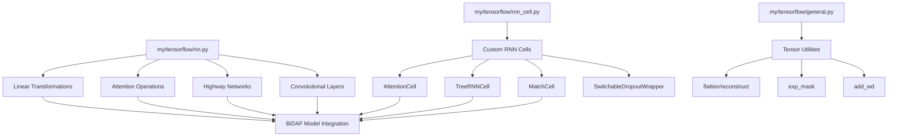
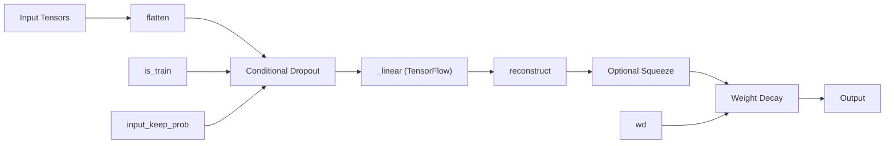
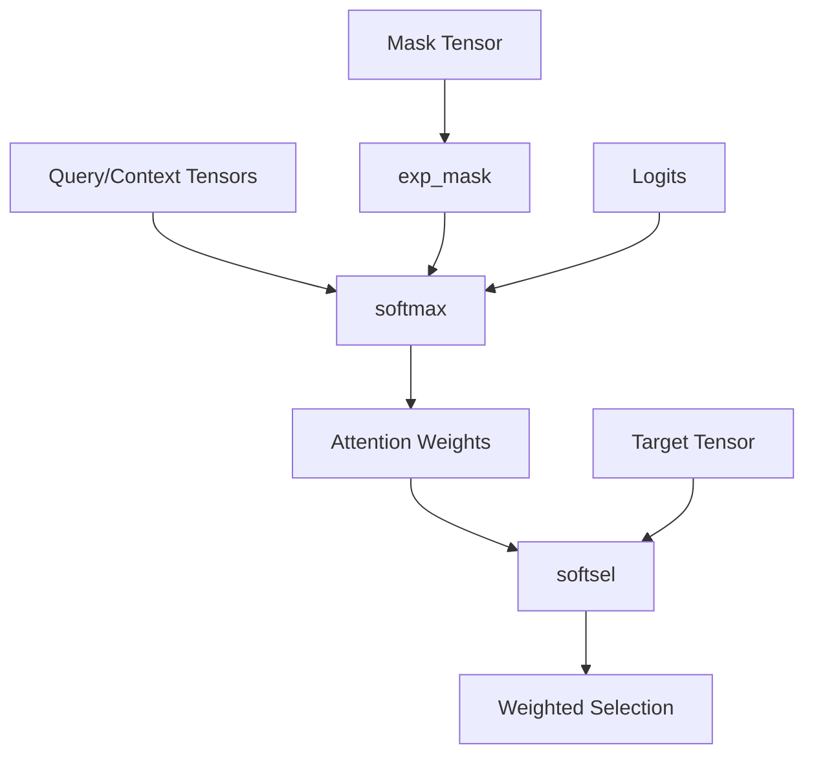
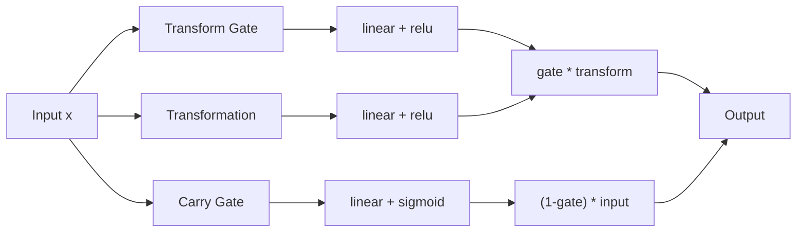
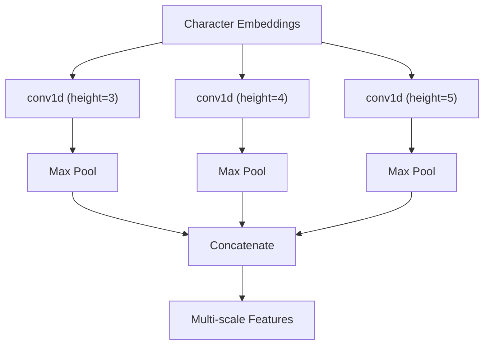
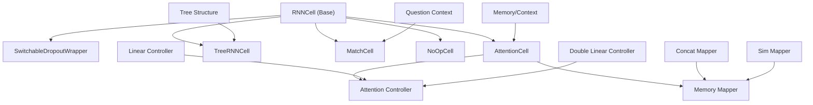
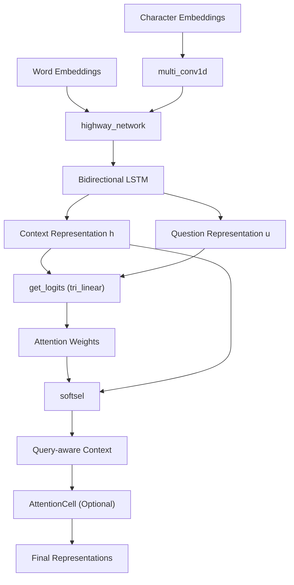

<!-- source: DeepWiki mcp.deepwiki.com · repo allenai/bi-att-flow · page 5.1 Custom Neural Network Layers · fetched 2026-10-26 -->

# Custom Neural Network Layers

<details>
<summary>Relevant source files</summary>

The following files were used as context for generating this wiki page:

- [my/tensorflow/general.py](my/tensorflow/general.py)
- [my/tensorflow/nn.py](my/tensorflow/nn.py)
- [my/tensorflow/rnn.py](my/tensorflow/rnn.py)
- [my/tensorflow/rnn_cell.py](my/tensorflow/rnn_cell.py)

</details>


This document covers the custom neural network layers and operations implemented in the BiDAF repository. These layers extend TensorFlow's functionality with domain-specific operations for question answering, particularly attention mechanisms, highway networks, and specialized RNN cells. For RNN wrapper functions and sequence processing, see [RNN Components](#5.2). For general utility functions, see [Utility Functions](#5.3).

## Core Layer Architecture

The custom layers in BiDAF are organized into several categories that work together to implement the bidirectional attention flow mechanism. The primary implementations are located in the `my/tensorflow/` package.

### Layer Type Hierarchy



Sources: [my/tensorflow/nn.py:1-180](), [my/tensorflow/rnn_cell.py:1-224](), [my/tensorflow/general.py:1-168]()

## Linear Transformation Layers

The foundation of the custom layer system is the enhanced `linear` function, which extends TensorFlow's basic linear operations with additional features like weight decay, dropout, and tensor shape handling.

### Enhanced Linear Layer

| Function | Purpose | Key Features |
|----------|---------|--------------|
| `linear` | Linear transformation with extensions | Dropout, weight decay, shape preservation |
| `double_linear_logits` | Two-layer linear transformation | Tanh activation, masking support |
| `linear_logits` | Single linear layer for logits | Masking, squeeze option |
| `get_logits` | Unified logit computation | Multiple computation methods |

The `linear` function at [my/tensorflow/nn.py:8-27]() serves as the core building block, handling tensor flattening and reconstruction while supporting conditional dropout and weight decay.



Sources: [my/tensorflow/nn.py:8-27](), [my/tensorflow/general.py:121-141]()

### Logit Computation Methods

The `get_logits` function at [my/tensorflow/nn.py:99-131]() provides a unified interface for different logit computation strategies:

| Method | Implementation | Use Case |
|--------|---------------|----------|
| `sum` | `sum_logits` | Simple summation |
| `linear` | `linear_logits` | Single linear transformation |
| `double` | `double_linear_logits` | Two-layer with tanh |
| `dot` | Element-wise multiplication | Direct similarity |
| `mul_linear` | Multiplication + linear | Enhanced similarity |
| `proj` | Projection-based | Dimensional alignment |
| `tri_linear` | Trilinear attention | BiDAF attention mechanism |

Sources: [my/tensorflow/nn.py:99-131](), [my/tensorflow/nn.py:66-84](), [my/tensorflow/nn.py:77-83]()

## Attention Mechanisms

The attention operations form the core of the BiDAF model's bidirectional attention flow. These operations handle the computation of attention weights and the selection of relevant information.

### Attention Operation Flow



The `softsel` function at [my/tensorflow/nn.py:50-63]() implements soft selection using attention weights:
- Takes target tensor `[..., J, d]` and logits `[..., J]`
- Applies softmax to logits with optional masking
- Returns weighted sum `[..., d]`

The `exp_mask` function at [my/tensorflow/general.py:104-118]() enables attention masking by assigning very negative values to masked positions, effectively zeroing them in softmax computation.

Sources: [my/tensorflow/nn.py:39-63](), [my/tensorflow/general.py:104-118]()

## Highway Networks

Highway networks allow for the flow of information through deep architectures by providing learned gating mechanisms. The implementation includes both single layers and multi-layer networks.

### Highway Layer Structure



The `highway_layer` at [my/tensorflow/nn.py:134-142]() implements:
- Transform gate: `sigmoid(linear(x))`
- Transformation: `relu(linear(x))`
- Output: `gate * transform + (1 - gate) * x`

The `highway_network` at [my/tensorflow/nn.py:145-153]() stacks multiple highway layers for deeper processing.

Sources: [my/tensorflow/nn.py:134-153]()

## Convolutional Layers

The convolutional operations provide character-level feature extraction, particularly useful for handling out-of-vocabulary words and morphological variations.

### Multi-Scale Convolution

| Layer | Input/Output | Operation |
|-------|--------------|-----------|
| `conv1d` | `[N, J, d]` → `[N, J, filter_size]` | Single filter convolution |
| `multi_conv1d` | `[N, J, d]` → `[N, J, sum(filter_sizes)]` | Multiple filter sizes |

The `multi_conv1d` function at [my/tensorflow/nn.py:169-179]() applies convolutions with different filter heights simultaneously and concatenates the results, enabling the capture of features at multiple scales.



Sources: [my/tensorflow/nn.py:156-179]()

## Custom RNN Cells

The repository implements several specialized RNN cells that extend TensorFlow's basic RNN functionality with attention mechanisms and tree structures.

### RNN Cell Hierarchy



Sources: [my/tensorflow/rnn_cell.py:8-224]()

### AttentionCell Implementation

The `AttentionCell` at [my/tensorflow/rnn_cell.py:116-224]() implements early fusion attention:

**Components:**
- **Controller**: Computes attention logits from inputs, state, and memory
- **Mapper**: Combines inputs with selected memory
- **Base Cell**: Processes the combined information

**Controller Types:**
- `get_linear_controller`: Single linear transformation
- `get_double_linear_controller`: Two-layer transformation with configurable size

**Mapper Types:**
- `get_concat_mapper`: Simple concatenation of inputs and selected memory
- `get_sim_mapper`: Similarity-based mapping with element-wise operations

Sources: [my/tensorflow/rnn_cell.py:116-224]()

### Specialized Cell Types

| Cell Type | Purpose | Key Features |
|-----------|---------|--------------|
| `TreeRNNCell` | Tree-structured processing | Hierarchical state reduction |
| `MatchCell` | Question-context matching | Question-aware processing |
| `SwitchableDropoutWrapper` | Training-aware dropout | Conditional dropout application |
| `NoOpCell` | Identity operation | State passthrough |

The `TreeRNNCell` at [my/tensorflow/rnn_cell.py:28-60]() processes tree structures by:
1. Extracting input features and binary mask
2. Reshaping state for tree computation
3. Applying reduction function with masking
4. Processing through base cell

Sources: [my/tensorflow/rnn_cell.py:28-76](), [my/tensorflow/rnn_cell.py:78-114]()

## Integration with BiDAF Architecture

These custom layers integrate into the BiDAF model architecture to implement the bidirectional attention flow mechanism.

### Layer Usage in BiDAF



**Key Integration Points:**
- Character-level features via `multi_conv1d`
- Information flow control via `highway_network`
- Attention computation via `get_logits` with `tri_linear` method
- Soft selection via `softsel`
- Enhanced RNN processing via `AttentionCell`

The trilinear attention mechanism uses the formula implemented in `get_logits` at [my/tensorflow/nn.py:125-129]():
```
logits = linear([h, u, h*u], bias=True)
```

Sources: [my/tensorflow/nn.py:125-129](), [my/tensorflow/nn.py:169-179](), [my/tensorflow/nn.py:145-153](), [my/tensorflow/rnn_cell.py:116-153]()

---

