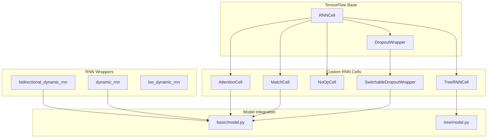
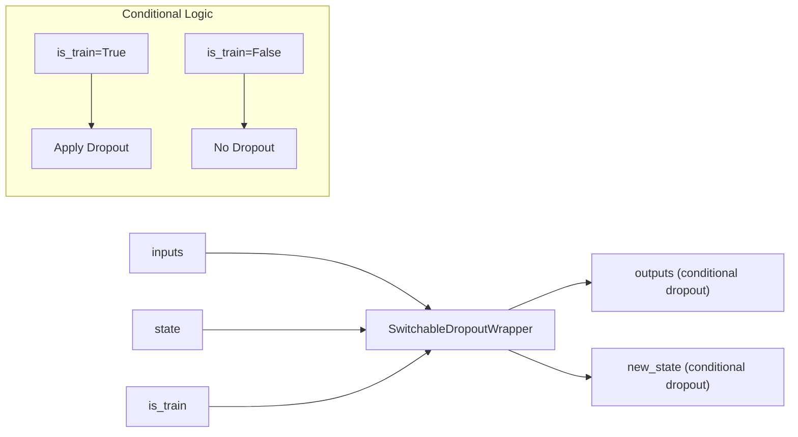
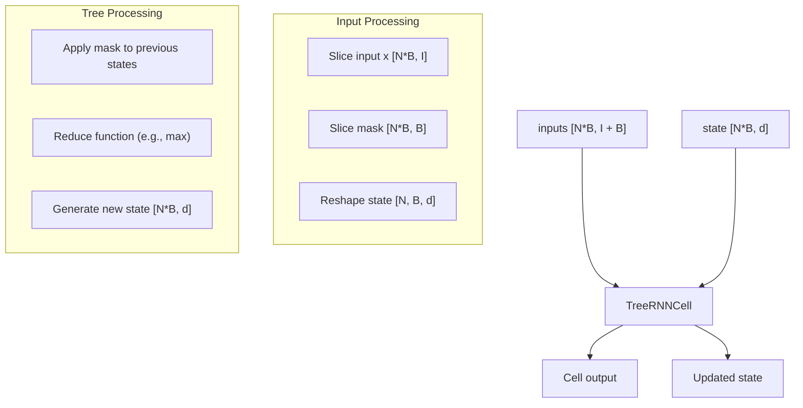
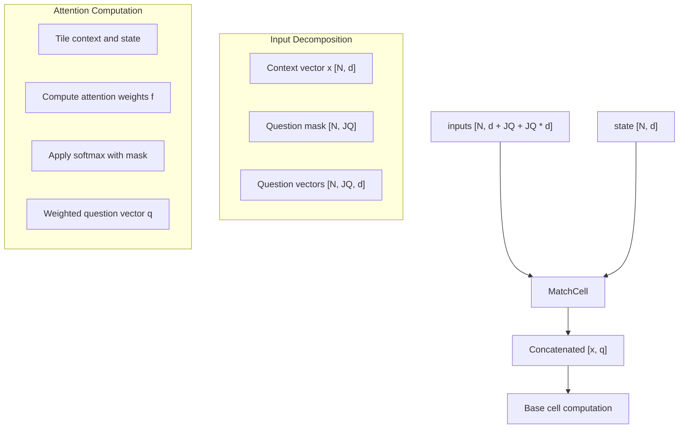
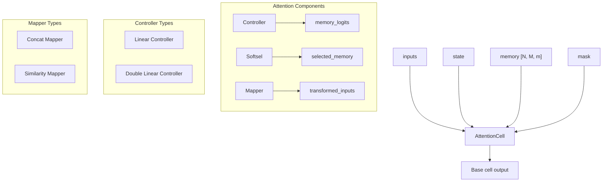
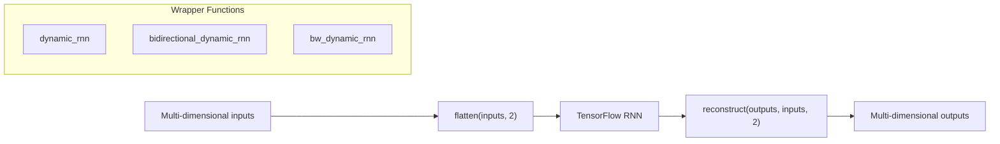
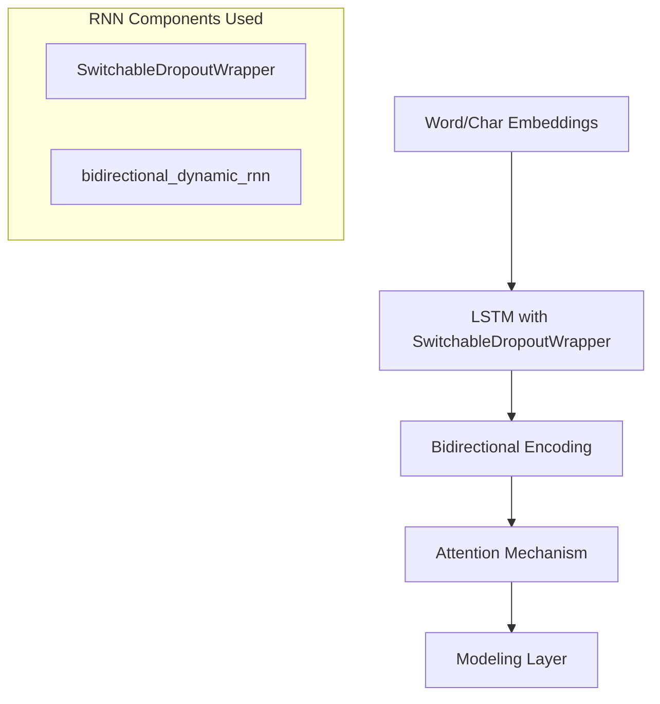
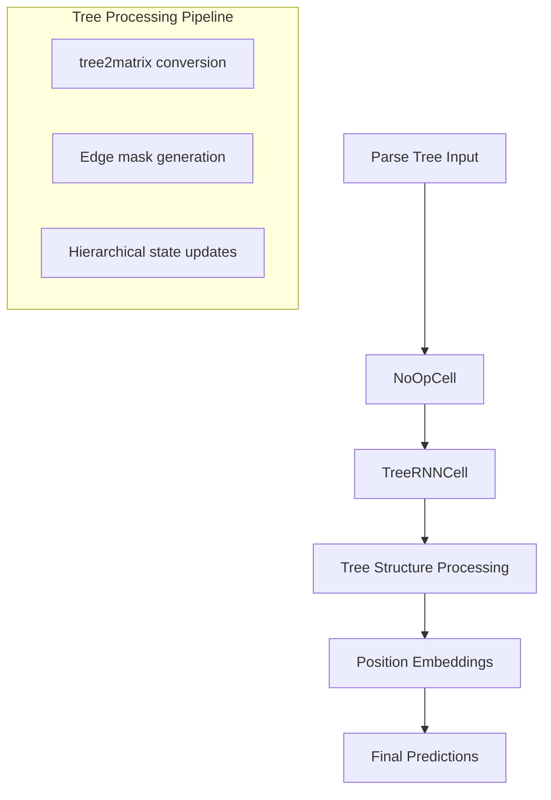

<!-- source: DeepWiki mcp.deepwiki.com · repo allenai/bi-att-flow · page 5.2 RNN Components · fetched 2026-10-26 -->

# RNN Components

Relevant source files

The following files were used as context for generating this wiki page:

- [my/nltk_utils.py](my/nltk_utils.py)
- [my/tensorflow/general.py](my/tensorflow/general.py)
- [my/tensorflow/nn.py](my/tensorflow/nn.py)
- [my/tensorflow/rnn.py](my/tensorflow/rnn.py)
- [my/tensorflow/rnn_cell.py](my/tensorflow/rnn_cell.py)
- [tree/cli.py](tree/cli.py)
- [tree/main.py](tree/main.py)
- [tree/model.py](tree/model.py)
- [tree/read_data.py](tree/read_data.py)

This document covers the custom RNN (Recurrent Neural Network) components and cells implemented in the BiDAF system's TensorFlow extensions. These components extend TensorFlow's standard RNN functionality with specialized cells for attention mechanisms, tree processing, and training-aware dropout.

For information about general neural network layers and operations, see [Custom Neural Network Layers](#5.1). For utility functions used across the system, see [Utility Functions](#5.3).

## Overview

The BiDAF system implements several custom RNN components that extend TensorFlow's base `RNNCell` class to provide specialized functionality for question answering tasks. These components are primarily located in `my/tensorflow/rnn_cell.py` and include cells for attention mechanisms, tree-structured data processing, and enhanced dropout control.

Sources: [my/tensorflow/rnn_cell.py:1-224](), [my/tensorflow/rnn.py:1-83]()

## Core RNN Cell Extensions

### SwitchableDropoutWrapper

The `SwitchableDropoutWrapper` extends TensorFlow's `DropoutWrapper` to provide training-aware dropout that can be conditionally enabled or disabled based on a boolean tensor.

Key features:
- Conditionally applies dropout based on `is_train` boolean tensor
- Supports both input and output dropout
- Maintains proper state handling for tuple states (like LSTM)

**Implementation Details:**
- Inherits from `DropoutWrapper` [my/tensorflow/rnn_cell.py:8-26]()
- Uses `tf.cond` to switch between dropout and no-dropout execution paths
- Handles complex state structures (tuples) appropriately

Sources: [my/tensorflow/rnn_cell.py:8-26]()

### TreeRNNCell

The `TreeRNNCell` processes tree-structured data by applying reduction operations over child nodes. It's specifically designed for parsing tree inputs in the tree-based question answering model.

Key features:
- Processes inputs containing both feature vectors and adjacency masks
- Applies configurable reduction functions (e.g., `tf.reduce_max`)
- Handles variable tree structures through masking

**Implementation Details:**
- Takes `cell`, `input_size`, and `reduce_func` parameters [my/tensorflow/rnn_cell.py:28-60]()
- Splits input into feature vector and binary mask components
- Uses `exp_mask` to handle variable tree structures

Sources: [my/tensorflow/rnn_cell.py:28-60](), [tree/model.py:108-115]()

### NoOpCell

The `NoOpCell` is a pass-through RNN cell that returns its input state unchanged. It's used in scenarios where RNN structure is needed but no computation should be performed.

| Property | Value |
|----------|-------|
| Input | `inputs, state` |
| Output | `state, state` |
| Use Case | Placeholder in RNN sequences |

**Implementation:**
- Simply returns the input state as both output and next state [my/tensorflow/rnn_cell.py:62-76]()
- Maintains proper RNN cell interface

Sources: [my/tensorflow/rnn_cell.py:62-76](), [tree/model.py:107]()

### MatchCell

The `MatchCell` implements attention-based matching between context and question representations, specifically designed for reading comprehension tasks.

Key features:
- Decomposes complex input into context, question mask, and question vectors
- Computes attention weights using linear transformations
- Applies masked softmax for proper attention computation

**Implementation Details:**
- Processes inputs with structure `[context, question_mask, question_vectors]` [my/tensorflow/rnn_cell.py:78-114]()
- Uses `linear` function for attention weight computation
- Applies `exp_mask` and `softmax` for attention distribution

Sources: [my/tensorflow/rnn_cell.py:78-114]()

### AttentionCell

The `AttentionCell` implements a general-purpose attention mechanism that can be configured with different controllers and mappers for various attention strategies.

Key features:
- Configurable controller functions for computing attention weights
- Configurable mapper functions for integrating attended memory
- Supports multiple attention strategies (linear, double linear)
- Provides different input transformation strategies (concat, similarity)

**Implementation Details:**
- Uses `softsel` function for memory selection [my/tensorflow/rnn_cell.py:151]()
- Provides static methods for different controller types [my/tensorflow/rnn_cell.py:156-198]()
- Supports concat and similarity-based input mapping [my/tensorflow/rnn_cell.py:200-224]()

Sources: [my/tensorflow/rnn_cell.py:116-224]()

## RNN Wrapper Functions

The system provides custom RNN wrapper functions that handle tensor reshaping for multi-dimensional inputs while maintaining compatibility with TensorFlow's RNN functions.

### Dynamic RNN Wrappers

Key wrapper functions:

| Function | Purpose | Key Features |
|----------|---------|--------------|
| `dynamic_rnn` | Standard RNN processing | Handles multi-dimensional inputs via flatten/reconstruct |
| `bidirectional_dynamic_rnn` | Bidirectional RNN processing | Processes forward and backward simultaneously |
| `bw_dynamic_rnn` | Backward-only RNN | Reverses sequence for backward processing |

**Implementation Pattern:**
1. Flatten multi-dimensional inputs to 2D [my/tensorflow/rnn.py:13]()
2. Call corresponding TensorFlow RNN function
3. Reconstruct outputs to original dimensionality [my/tensorflow/rnn.py:21]()

Sources: [my/tensorflow/rnn.py:9-83]()

## Integration with Models

### Basic BiDAF Model Integration

The basic BiDAF model uses `SwitchableDropoutWrapper` and `AttentionCell` for its core processing:

### Tree Model Integration

The tree-based model demonstrates advanced usage of `TreeRNNCell` and `NoOpCell`:

**Tree Model Usage Example:**
- Creates `NoOpCell` as base cell [tree/model.py:107]()
- Wraps with `TreeRNNCell` using `tf.reduce_max` reduction [tree/model.py:108]()
- Processes tree structure through `dynamic_rnn` [tree/model.py:114]()

Sources: [basic/model.py](), [tree/model.py:107-115]()

---

