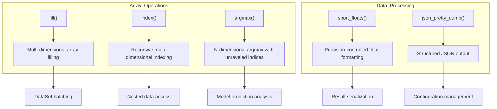
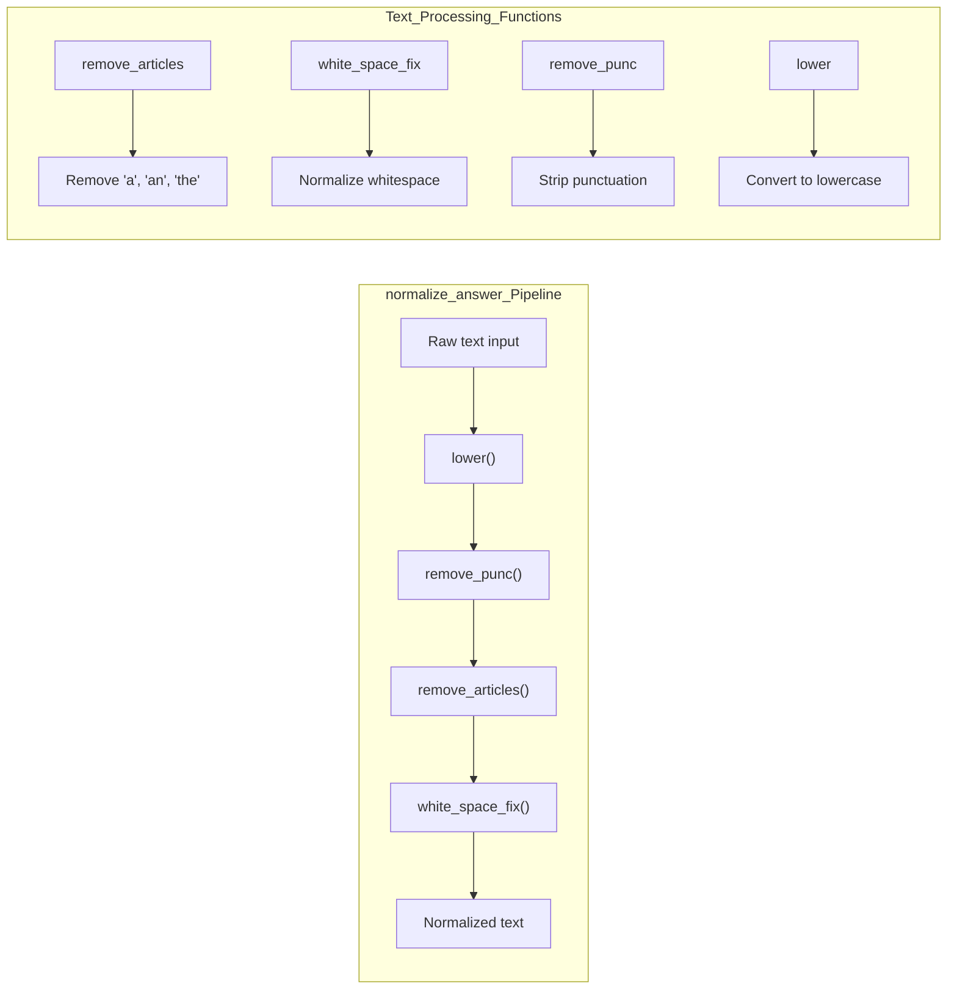
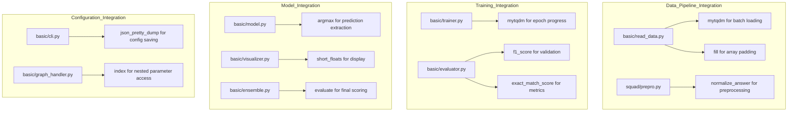

<!-- source: DeepWiki mcp.deepwiki.com · repo allenai/bi-att-flow · page 5.3 Utility Functions · fetched 2026-10-26 -->

# Utility Functions

Relevant source files

The following files were used as context for generating this wiki page:

- [my/utils.py](my/utils.py)
- [squad/evaluate-v1.1.py](squad/evaluate-v1.1.py)

This page documents the general-purpose utility functions that support various operations throughout the BiDAF codebase. These utilities handle array operations, progress tracking, text processing, and evaluation metrics. For custom TensorFlow neural network layers, see [Custom Neural Network Layers](#5.1). For RNN-specific components, see [RNN Components](#5.2).

The utility functions are organized into two main categories: general-purpose utilities in `my/utils.py` and specialized text processing and evaluation utilities in `squad/evaluate-v1.1.py`.

## Core Utility Functions

The primary utility functions are located in [my/utils.py:1-59]() and provide essential operations for data manipulation, progress tracking, and formatting throughout the BiDAF system.

### Progress Tracking and Display

The `mytqdm` function provides a conditional progress bar wrapper around the popular `tqdm` library:

| Function | Purpose | Usage Context |
|----------|---------|---------------|
| `mytqdm` | Conditional progress bar display | Data loading, batch processing, training loops |
| `json_pretty_dump` | Formatted JSON output | Configuration saving, result serialization |

The `mytqdm` function at [my/utils.py:8-13]() enables or disables progress bars based on a boolean flag, allowing for clean output in both interactive and batch processing scenarios.

### Array Operations and Data Manipulation

Several functions handle multi-dimensional array operations that are common in deep learning workflows:

The `fill` function at [my/utils.py:24-35]() uses a deque-based approach to populate multi-dimensional numpy arrays from nested Python lists, handling variable-length sequences efficiently.

The `index` function at [my/utils.py:20-21]() provides recursive indexing for nested data structures, commonly used when accessing hierarchical model outputs or configuration parameters.

Sources: [my/utils.py:1-59]()

## Text Processing and Evaluation Utilities

The SQuAD evaluation utilities in [squad/evaluate-v1.1.py:1-95]() implement the official scoring metrics for question answering systems, providing standardized text processing and evaluation functions.

### Text Normalization Pipeline

The text normalization process follows a structured pipeline to ensure consistent evaluation:

The `normalize_answer` function at [squad/evaluate-v1.1.py:11-26]() applies four sequential transformations to ensure consistent text comparison between predictions and ground truth answers.

### Evaluation Metrics Implementation

The evaluation system implements two primary metrics used in question answering:

| Metric | Function | Calculation Method |
|--------|----------|-------------------|
| Exact Match | `exact_match_score` | Binary match after normalization |
| F1 Score | `f1_score` | Token-level precision and recall |

The F1 score calculation at [squad/evaluate-v1.1.py:29-39]() uses token-level overlap between prediction and ground truth, computing precision and recall based on common tokens identified through `Counter` intersection.

Sources: [squad/evaluate-v1.1.py:11-95]()

## Integration with BiDAF System

These utility functions integrate throughout the BiDAF architecture to support various system operations:

### Usage Patterns

The utility functions follow specific usage patterns throughout the codebase:

1. **Progress Tracking**: `mytqdm` wraps iterators in data loading and training loops
2. **Array Processing**: `fill` and `index` handle variable-length sequence data
3. **Evaluation**: `f1_score` and `exact_match_score` compute standard QA metrics
4. **Serialization**: `json_pretty_dump` and `short_floats` format output data

The `metric_max_over_ground_truths` function at [squad/evaluate-v1.1.py:46-51]() implements the SQuAD evaluation protocol where multiple acceptable answers exist for a single question, taking the maximum score across all ground truth answers.

Sources: [my/utils.py:1-59](), [squad/evaluate-v1.1.py:1-95]()

## Function Reference

### Core Utilities (`my/utils.py`)

| Function | Parameters | Return Type | Description |
|----------|------------|-------------|-------------|
| `mytqdm` | `list_`, `desc`, `show` | Iterator | Conditional progress bar wrapper |
| `json_pretty_dump` | `obj`, `fh` | None | Pretty-print JSON to file handle |
| `index` | `l`, `i` | Any | Recursive multi-dimensional indexing |
| `fill` | `l`, `shape`, `dtype` | numpy.ndarray | Fill array from nested lists |
| `short_floats` | `o`, `precision` | Object | Format floats with limited precision |
| `argmax` | `x` | Tuple | N-dimensional argmax indices |

### Evaluation Utilities (`squad/evaluate-v1.1.py`)

| Function | Parameters | Return Type | Description |
|----------|------------|-------------|-------------|
| `normalize_answer` | `s` | String | Standardize text for comparison |
| `f1_score` | `prediction`, `ground_truth` | Float | Token-level F1 score |
| `exact_match_score` | `prediction`, `ground_truth` | Boolean | Exact string match after normalization |
| `evaluate` | `dataset`, `predictions` | Dict | Complete SQuAD evaluation metrics |

These utilities provide the foundational operations that enable the BiDAF system to process data efficiently, track progress during long-running operations, and evaluate model performance using standard metrics.

Sources: [my/utils.py:1-59](), [squad/evaluate-v1.1.py:1-95]()

---

