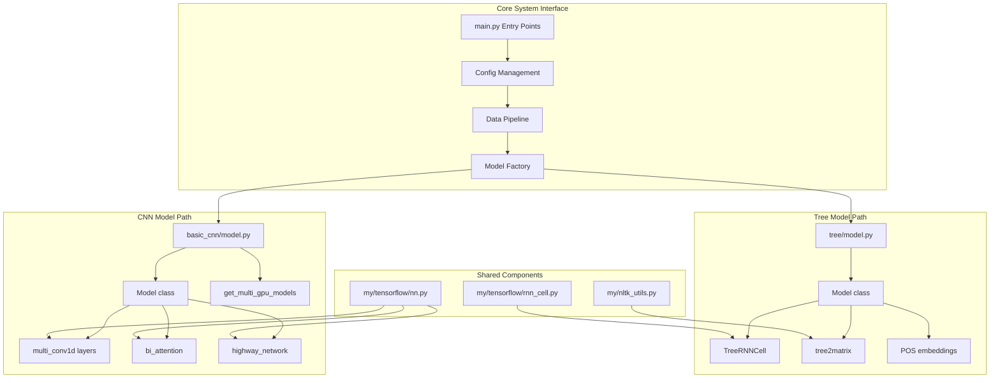
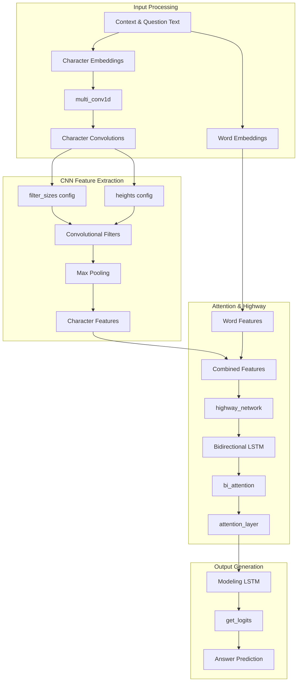
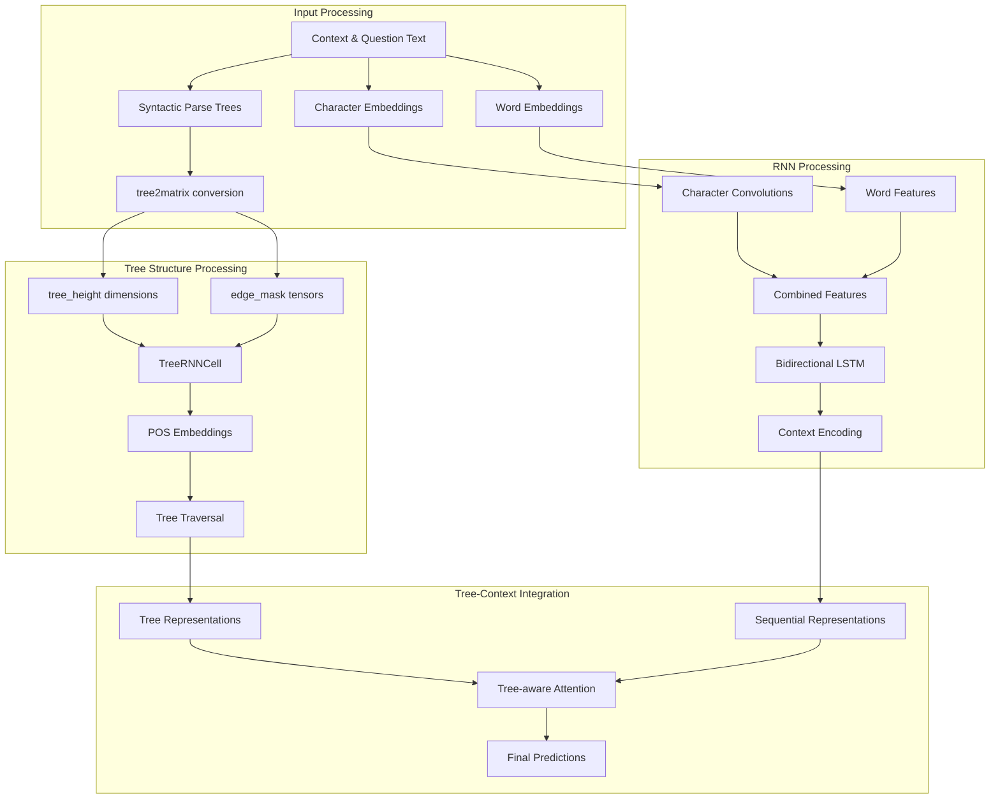
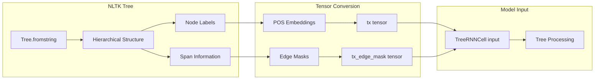

<!-- source: DeepWiki mcp.deepwiki.com · repo allenai/bi-att-flow · page 6 Alternative Models · fetched 2026-10-26 -->

# Alternative Models

<details>
<summary>Relevant source files</summary>

The following files were used as context for generating this wiki page:

- [basic_cnn/main.py](basic_cnn/main.py)
- [basic_cnn/model.py](basic_cnn/model.py)
- [my/nltk_utils.py](my/nltk_utils.py)
- [tree/cli.py](tree/cli.py)
- [tree/main.py](tree/main.py)
- [tree/model.py](tree/model.py)
- [tree/read_data.py](tree/read_data.py)

</details>


This document covers the alternative model architectures provided in the BiDAF repository beyond the core bidirectional attention flow model. The repository includes two main alternative implementations: a CNN-based variant and a tree-based variant that processes syntactic parse trees.

For information about the core BiDAF model architecture, see [Model Architecture](#2.1). For training and evaluation procedures that apply to all models, see [Training Pipeline](#4.1).

## Overview

The alternative models maintain the same question-answering objective as the core BiDAF model but employ different neural architectures to process the input text. Both alternatives are designed to be drop-in replacements for the core model while exploring different representational approaches.

### Alternative Model Architecture



Sources: [basic_cnn/model.py:1-376](), [tree/model.py:1-249](), [basic_cnn/main.py:1-239](), [tree/main.py:1-188]()

## CNN-Based Model

The CNN-based model (`basic_cnn/`) replaces the standard BiDAF architecture with convolutional layers for character-level processing and maintains the bidirectional attention mechanism.

### CNN Model Architecture



Sources: [basic_cnn/model.py:123-170](), [basic_cnn/model.py:17-71]()

### Key CNN Components

| Component | Location | Purpose |
|-----------|----------|---------|
| `multi_conv1d` | [basic_cnn/model.py:137-142]() | Character-level convolutions with multiple filter sizes |
| `bi_attention` | [basic_cnn/model.py:17-61]() | Bidirectional attention between context and question |
| `attention_layer` | [basic_cnn/model.py:64-71]() | Combines attention outputs with original representations |
| `highway_network` | [basic_cnn/model.py:164-167]() | Information highway for better gradient flow |

The CNN model uses configurable filter sizes and heights specified in `config.out_channel_dims` and `config.filter_heights`. Character embeddings are processed through multiple convolutional filters before being combined with word embeddings.

### CNN Configuration

The CNN model introduces several configuration parameters:

- `out_channel_dims`: Comma-separated filter sizes for character convolutions
- `filter_heights`: Comma-separated filter heights 
- `share_cnn_weights`: Whether to share weights between context and question CNN processing
- `char_out_size`: Output dimension of character-level features

Sources: [basic_cnn/model.py:133-144]()

## Tree-Based Model

The tree-based model (`tree/`) processes syntactic parse trees using a specialized TreeRNN architecture. It operates on the hierarchical structure of sentences rather than just sequential tokens.

### Tree Model Architecture



Sources: [tree/model.py:49-122](), [my/nltk_utils.py:83-106]()

### Tree Processing Components

| Component | Location | Purpose |
|-----------|----------|---------|
| `TreeRNNCell` | [tree/model.py:108]() | Processes tree structures recursively |
| `tree2matrix` | [my/nltk_utils.py:83-106]() | Converts NLTK trees to tensor representations |
| `set_span` | [my/nltk_utils.py:21-27]() | Sets span information for tree nodes |
| `find_max_f1_subtree` | [my/nltk_utils.py:79-80]() | Finds optimal subtree for answer spans |

### Tree Data Representation

The tree model uses a specialized tensor representation for parse trees:



Sources: [tree/model.py:169-246](), [my/nltk_utils.py:83-106]()

The tree model represents parse trees as matrices with dimensions `[batch_size, max_num_sents, max_tree_height, max_sent_size]`, where each position contains POS tag embeddings and edge connectivity information.

## Data Pipeline Differences

### CNN Model Data Handling

The CNN model uses the same data format as the core BiDAF model but with additional character-level processing configurations:

```python
# From basic_cnn/model.py
filter_sizes = list(map(int, config.out_channel_dims.split(',')))
heights = list(map(int, config.filter_heights.split(',')))
```

Sources: [basic_cnn/model.py:133-134]()

### Tree Model Data Requirements

The tree model requires additional preprocessing to generate syntactic parse trees:

| Data Field | Purpose |
|------------|---------|
| `stx` | Serialized syntactic parse trees |
| `tx` | Tree tensor representation |
| `tx_edge_mask` | Tree connectivity masks |

The tree model's `get_feed_dict` method converts NLTK tree strings into tensor representations using the `tree2matrix` function.

Sources: [tree/model.py:223-246](), [tree/read_data.py:113-129]()

## Usage and Configuration

### Running CNN Model

```bash
# CNN model execution
python -m basic_cnn.main config.json
```

### Running Tree Model

```bash
# Tree model execution  
python -m tree.main config.json
# or via CLI
python -m tree.cli
```

### Model Selection

Both alternative models integrate with the same training and evaluation infrastructure as the core BiDAF model. The main differences are:

1. **Data preprocessing requirements**: Tree model needs parse trees
2. **Configuration parameters**: Each model has specific hyperparameters
3. **Memory requirements**: Tree model typically uses more memory due to tree representations

Sources: [basic_cnn/main.py:21-32](), [tree/main.py:20-29](), [tree/cli.py:49-54]()

### Configuration Differences

| Parameter | CNN Model | Tree Model | Purpose |
|-----------|-----------|------------|---------|
| `out_channel_dims` | Required | N/A | CNN filter dimensions |
| `filter_heights` | Required | N/A | CNN filter sizes |
| `tree_height_th` | N/A | Required | Maximum tree height threshold |
| `pos_vocab_size` | N/A | Required | POS tag vocabulary size |

Sources: [basic_cnn/model.py:133-135](), [tree/cli.py:32-46]()

---

