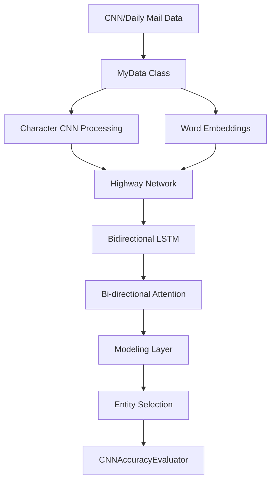
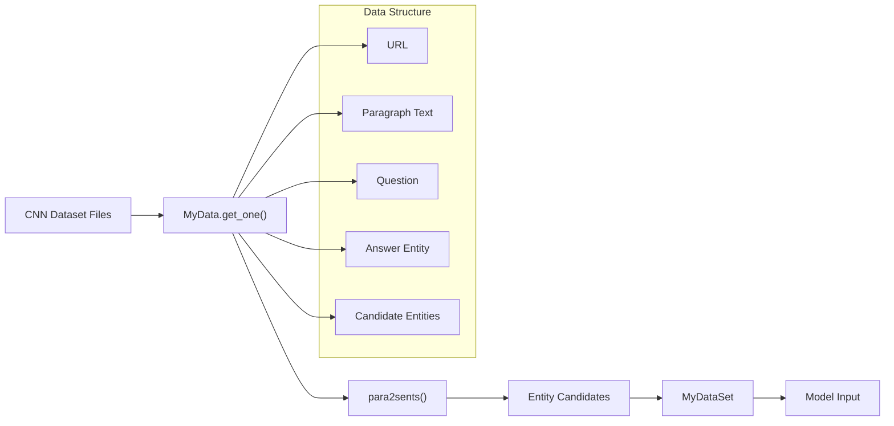
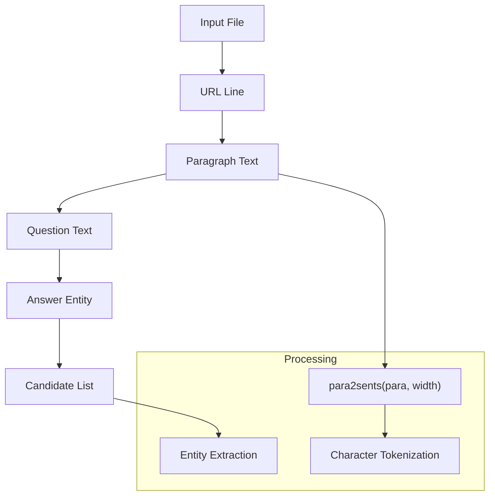
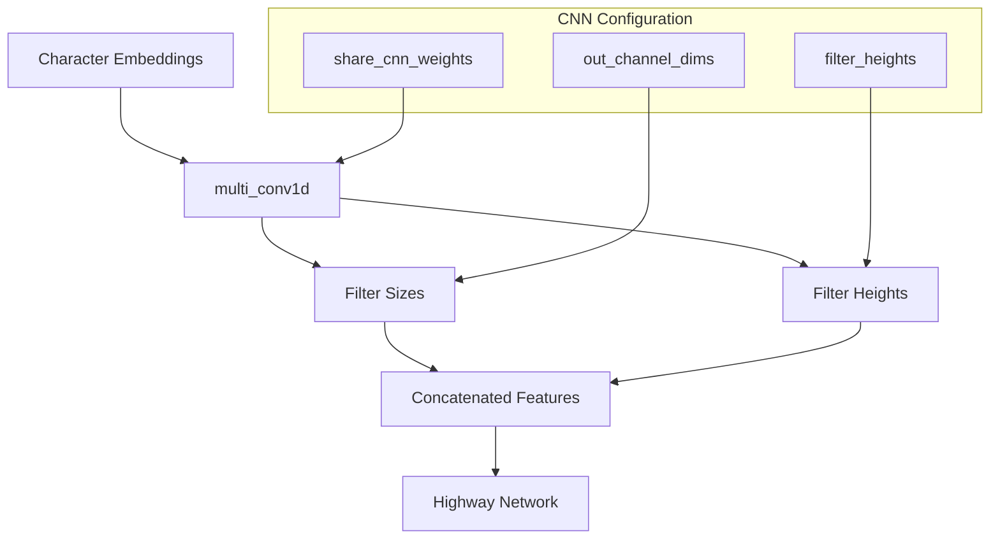
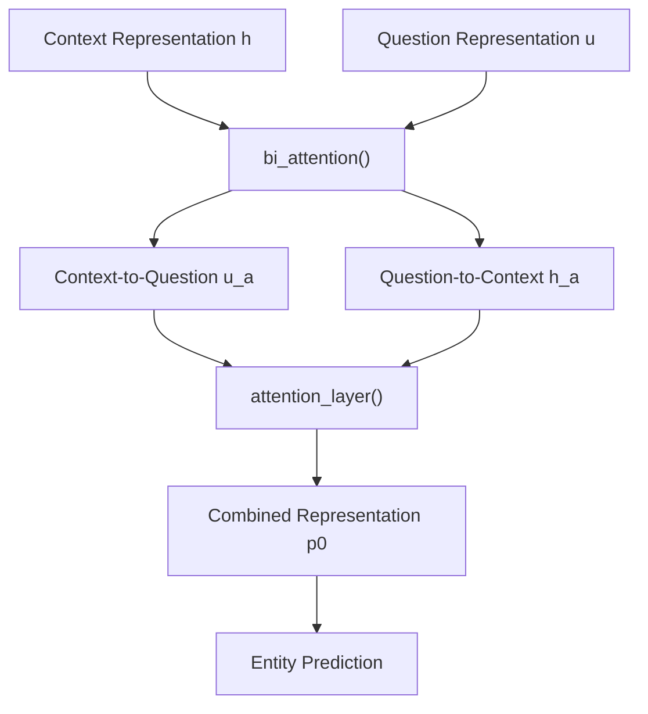
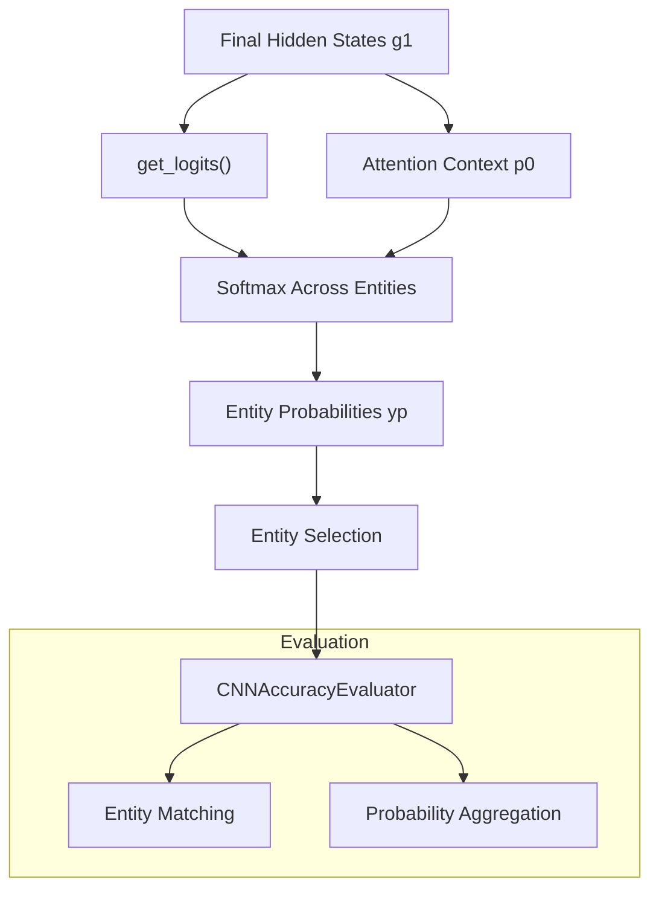
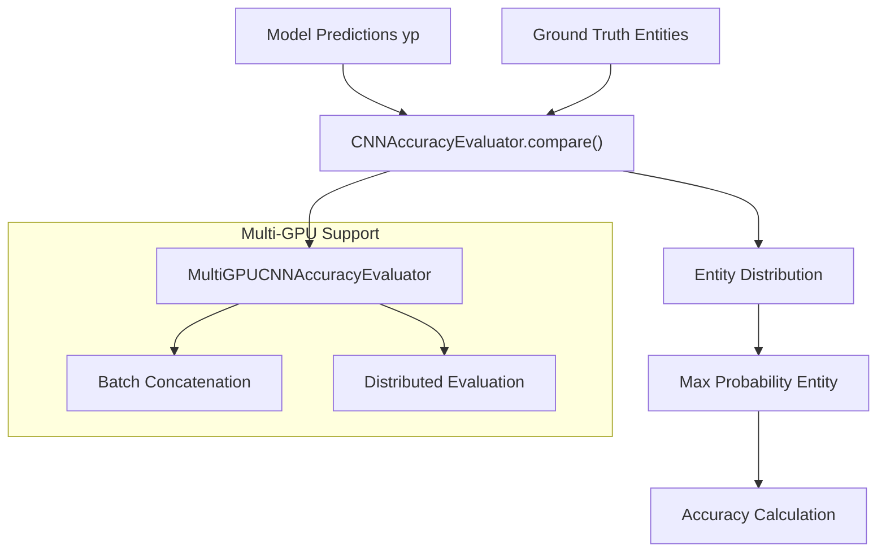
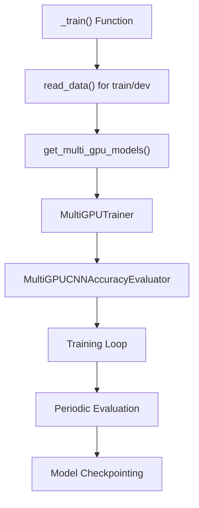
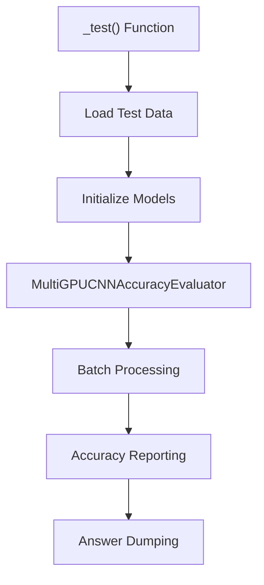
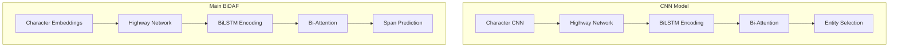

<!-- source: DeepWiki mcp.deepwiki.com · repo allenai/bi-att-flow · page 6.1 CNN-Based Model · fetched 2026-10-26 -->

# CNN-Based Model

Relevant source files

The following files were used as context for generating this wiki page:

- [basic_cnn/cli.py](basic_cnn/cli.py)
- [basic_cnn/evaluator.py](basic_cnn/evaluator.py)
- [basic_cnn/main.py](basic_cnn/main.py)
- [basic_cnn/model.py](basic_cnn/model.py)
- [basic_cnn/read_data.py](basic_cnn/read_data.py)

This document covers the CNN-based variant of the question answering model, which is an alternative architecture designed for entity selection tasks on CNN/Daily Mail datasets. This model differs from the core BiDAF system by using convolutional layers for character processing and predicting entity candidates rather than extracting text spans.

For information about the main BiDAF architecture, see [Core BiDAF Model](#2). For general model training and evaluation concepts, see [Training and Evaluation](#4).

## Purpose and Architecture Overview

The CNN-based model adapts the bidirectional attention flow mechanism for entity-centric question answering tasks. Instead of predicting answer spans within context passages, this model selects the most likely entity from a predefined set of candidates.

### High-Level Architecture

**CNN Model Architecture Flow**

Sources: [basic_cnn/model.py:74-376](), [basic_cnn/main.py:21-32]()

## Data Pipeline

The CNN model processes data in a fundamentally different format from the main BiDAF system, handling entity candidates and sentence-level context rather than character-level span annotation.

### Data Loading Process

**CNN Data Loading Pipeline**

The `MyData` class handles the specialized data format:

| Component | Purpose | Key Method |
|-----------|---------|------------|
| `MyData` | File-based data loading | `get_one(idx)` |
| `para2sents` | Paragraph segmentation | From `cnn_dm.prepro` |
| Entity extraction | Candidate processing | Line parsing logic |

Sources: [basic_cnn/read_data.py:41-82](), [basic_cnn/read_data.py:208-271]()

### Data Format Structure

The CNN model expects specific data format with entity-marked text:

**Data Format Processing**

Sources: [basic_cnn/read_data.py:47-71]()

## Model Components

### Character-Level CNN Processing

The model uses convolutional layers for character-level feature extraction, differing from the main BiDAF approach:

**Character CNN Architecture**

The CNN processing uses configurable filter parameters defined in the CLI:

| Parameter | Default | Purpose |
|-----------|---------|---------|
| `out_channel_dims` | "100" | Output channel dimensions |
| `filter_heights` | "5" | Convolutional filter heights |
| `share_cnn_weights` | True | Weight sharing between context/question |

Sources: [basic_cnn/model.py:127-145](), [basic_cnn/cli.py:72-76]()

### Attention Mechanism

The bidirectional attention mechanism is adapted for entity selection:

**Bidirectional Attention for Entity Selection**

Sources: [basic_cnn/model.py:17-72](), [basic_cnn/model.py:199-210]()

### Entity Prediction Layer

Unlike span prediction, the CNN model outputs entity selection probabilities:

**Entity Prediction Process**

Sources: [basic_cnn/model.py:207-227](), [basic_cnn/evaluator.py:187-202]()

## Training and Evaluation

### Training Configuration

The CNN model uses specific hyperparameters optimized for entity selection:

| Parameter | Default | Description |
|-----------|---------|-------------|
| `batch_size` | 60 | Training batch size |
| `hidden_size` | 100 | LSTM hidden dimension |
| `width` | 5 | Context window around entities |
| `highway_num_layers` | 2 | Highway network depth |

Sources: [basic_cnn/cli.py:15-93]()

### Evaluation Process

**CNN Model Evaluation Pipeline**

The evaluation process aggregates predictions across sentences for entity-marked tokens:

1. **Entity Aggregation**: Sums probabilities for tokens starting with "@"
2. **Prediction Selection**: Chooses entity with highest aggregated probability  
3. **Accuracy Calculation**: Compares predicted entity with ground truth

Sources: [basic_cnn/evaluator.py:187-202](), [basic_cnn/evaluator.py:386-406]()

## Execution Modes

### Training Mode

**Training Pipeline**

Sources: [basic_cnn/main.py:43-113]()

### Testing Mode  

**Testing Pipeline**

Sources: [basic_cnn/main.py:115-159]()

## Key Differences from Main BiDAF

| Aspect | CNN Model | Main BiDAF |
|--------|-----------|------------|
| **Task Type** | Entity selection | Span extraction |
| **Dataset** | CNN/Daily Mail | SQuAD |
| **Output** | Entity probabilities | Start/end positions |
| **Evaluation** | Entity accuracy | F1/EM scores |
| **Character Processing** | CNN layers | Character embeddings |
| **Data Loading** | `MyData` class | Standard BiDAF format |

### Architecture Comparison

**Architectural Differences**

Sources: [basic_cnn/model.py:114-227](), comparison with core BiDAF architecture

The CNN-based model provides an alternative approach to question answering that focuses on entity selection tasks, utilizing convolutional character processing and specialized evaluation metrics for entity-centric datasets.

---

