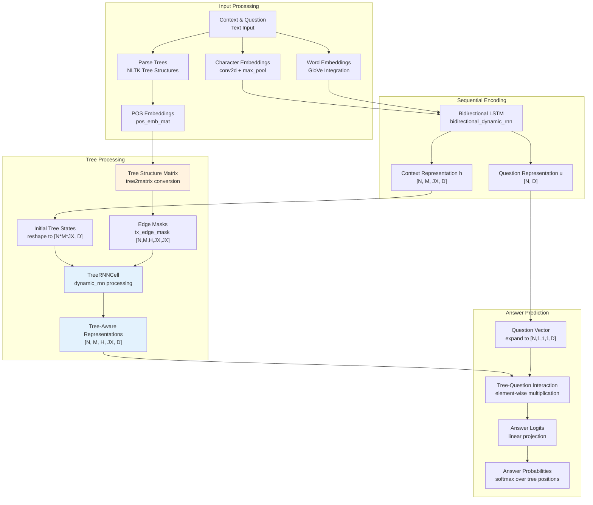
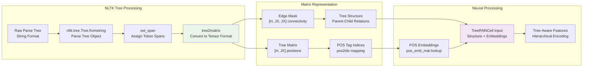
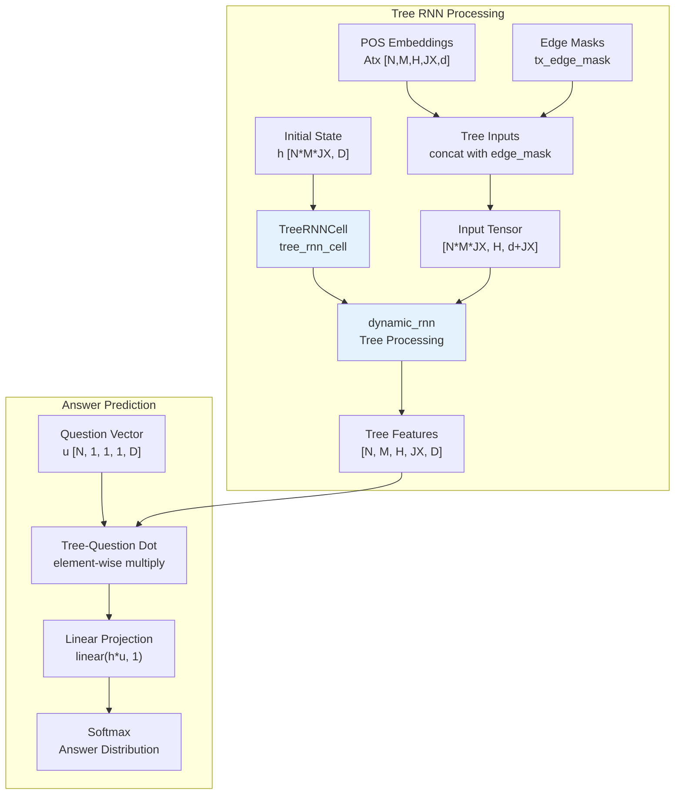
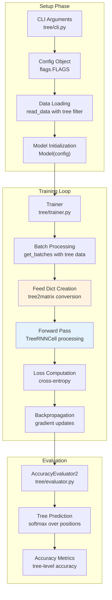
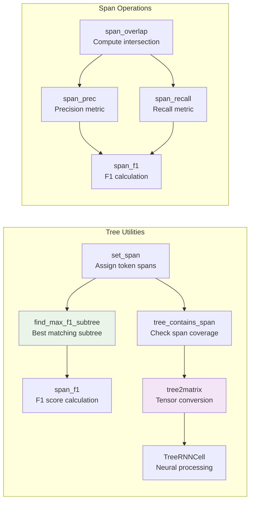

<!-- source: DeepWiki mcp.deepwiki.com · repo allenai/bi-att-flow · page 6.2 Tree-Based Model · fetched 2026-10-26 -->

# Tree-Based Model

<details>
<summary>Relevant source files</summary>

The following files were used as context for generating this wiki page:

- [my/nltk_utils.py](my/nltk_utils.py)
- [tree/cli.py](tree/cli.py)
- [tree/main.py](tree/main.py)
- [tree/model.py](tree/model.py)
- [tree/read_data.py](tree/read_data.py)

</details>


This document covers the tree-based question answering model variant in the BiDAF repository. The tree-based model processes syntactic parse trees to leverage linguistic structure for question answering, representing an alternative to the standard sequential BiDAF architecture. For information about the core BiDAF model, see [Core BiDAF Model](#2). For CNN-based alternatives, see [CNN-Based Model](#6.1).

## Architecture Overview

The tree-based model extends the BiDAF approach by incorporating syntactic parse trees into the neural architecture. Instead of processing sentences as flat sequences, it leverages tree structures to capture hierarchical linguistic relationships.

### Core Model Architecture



Sources: [tree/model.py:49-122]()

### Tree Data Structure Processing



Sources: [my/nltk_utils.py:83-106](), [tree/model.py:223-227]()

## Data Pipeline

The tree-based model requires specialized data loading to handle parse trees alongside traditional text data.

### DataSet Management

The `SquadDataSet` class in [tree/read_data.py:46-49]() extends the base `DataSet` class to handle tree-structured data. Key data structures include:

| Field | Description | Shape |
|-------|-------------|-------|
| `x` | Word indices | `[N, M, JX]` |
| `cx` | Character indices | `[N, M, JX, W]` |
| `q` | Question word indices | `[N, JQ]` |
| `stx` | Syntactic tree strings | `[N, M]` |
| `tx` | Tree position matrices | `[N, M, H, JX]` |
| `tx_edge_mask` | Tree connectivity masks | `[N, M, H, JX, JX]` |

Sources: [tree/read_data.py:13-44](), [tree/model.py:21-31]()

### Tree Filtering and Validation

The data pipeline includes specialized filtering for tree structures:

```python
def get_squad_data_filter(config):
    def data_filter(data_point, shared):
        # Filter by tree height threshold
        stxi = stx[rx[0]][rx[1]]
        if any(nltk.tree.Tree.fromstring(s).height() > config.tree_height_th for s in stxi):
            return False
        return True
```

This filtering ensures trees don't exceed the maximum height threshold (`tree_height_th`) defined in [tree/cli.py:46]().

Sources: [tree/read_data.py:113-129]()

## Model Components

### TreeRNNCell Integration

The core innovation is the use of `TreeRNNCell` from [my/tensorflow/rnn_cell.py]() to process tree structures:



Sources: [tree/model.py:107-121]()

### Loss Computation and Training

The model uses cross-entropy loss over tree positions:

- **Loss Function**: Softmax cross-entropy over flattened tree positions `[N, M * H * JX]`
- **Target Generation**: Uses `find_max_f1_subtree` to find optimal subtree matching answer spans
- **Supervision**: Binary labels indicating correct tree nodes for answer spans

Sources: [tree/model.py:123-135](), [tree/model.py:238-246]()

## Execution Pipeline

### Training Process



Sources: [tree/main.py:41-104](), [tree/cli.py:8-47]()

### Configuration Parameters

Key tree-specific configuration parameters:

| Parameter | Default | Description |
|-----------|---------|-------------|
| `tree_height_th` | 16 | Maximum tree height threshold |
| `hidden_size` | 32 | RNN hidden state size |
| `char_emb_size` | 8 | Character embedding dimension |
| `input_keep_prob` | 0.5 | Dropout keep probability |

Sources: [tree/cli.py:32-46]()

## Tree Processing Utilities

### NLTK Integration

The system relies heavily on NLTK tree processing utilities:



### Key Functions

- **`set_span`**: Associates token spans with tree nodes [my/nltk_utils.py:21-28]()
- **`tree2matrix`**: Converts trees to tensor format for neural processing [my/nltk_utils.py:83-106]()
- **`find_max_f1_subtree`**: Finds subtree with maximum F1 overlap with answer span [my/nltk_utils.py:79-81]()
- **`load_compressed_tree`**: Loads and compresses tree structures [my/nltk_utils.py:109-127]()

Sources: [my/nltk_utils.py:1-130]()

## Implementation Notes

The tree-based model represents a research-oriented extension that leverages linguistic structure through parse trees. The architecture maintains compatibility with the broader BiDAF framework while introducing tree-specific processing through `TreeRNNCell` and specialized data handling.

Key implementation considerations:
- Tree height limitations require filtering during data loading
- Matrix representation enables batch processing of variable tree structures  
- POS tag embeddings provide semantic information for internal tree nodes
- F1-based subtree matching enables supervision at the tree structure level

Sources: [tree/model.py:1-249](), [tree/read_data.py:1-160](), [my/nltk_utils.py:1-130]()

---

