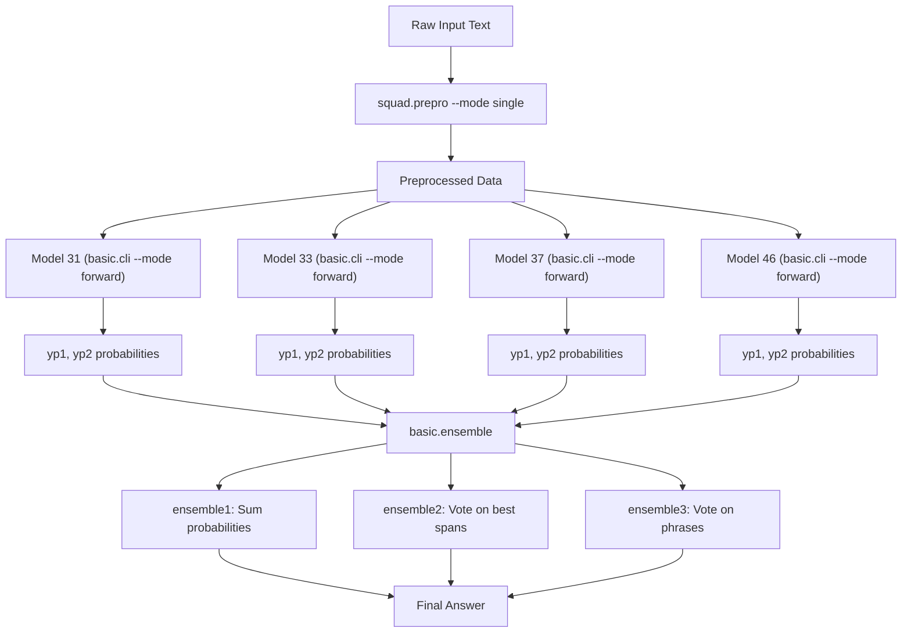
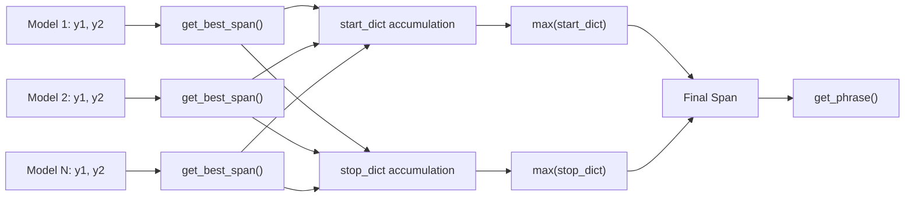
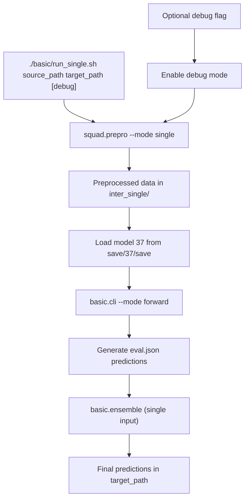
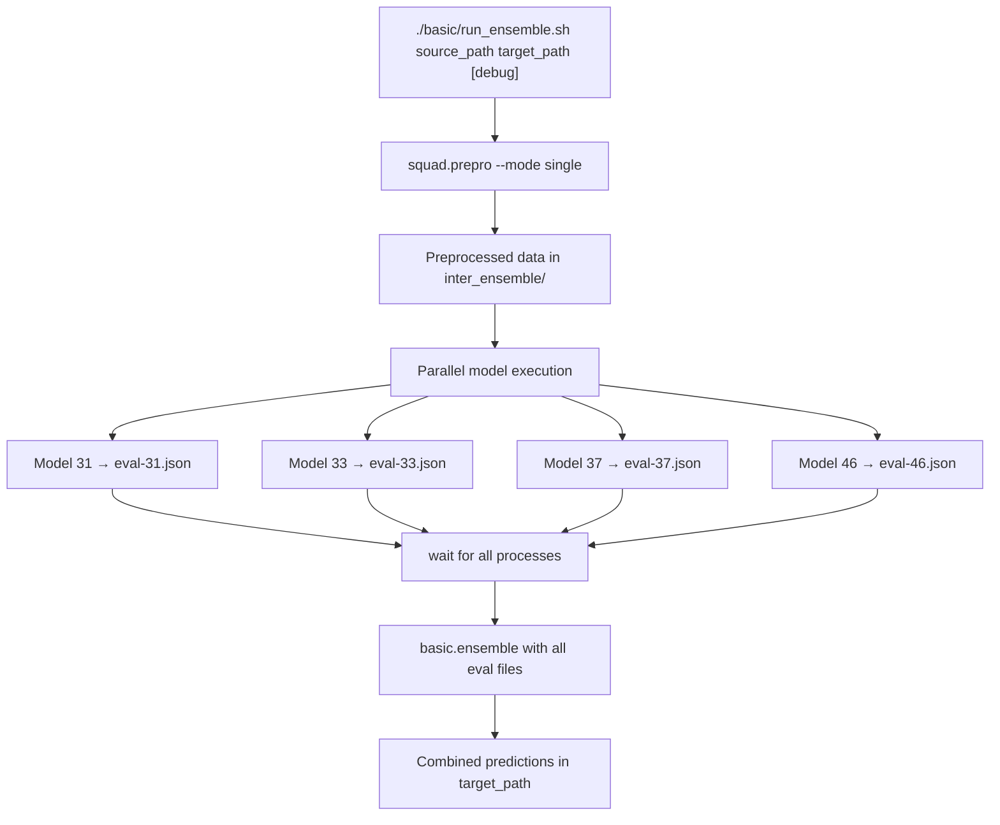
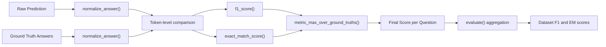

<!-- source: DeepWiki mcp.deepwiki.com · repo allenai/bi-att-flow · page 7 Ensemble and Deployment · fetched 2026-10-26 -->

# Ensemble and Deployment

<details>
<summary>Relevant source files</summary>

The following files were used as context for generating this wiki page:

- [basic/ensemble.py](basic/ensemble.py)
- [basic/run_ensemble.sh](basic/run_ensemble.sh)
- [basic/run_single.sh](basic/run_single.sh)
- [squad/evaluate.py](squad/evaluate.py)

</details>


This section covers the ensemble methods and deployment infrastructure for the BiDAF question answering system. It explains how to combine predictions from multiple trained models to achieve better performance and how to deploy models for production inference.

For details about individual model training, see [Training Pipeline](#4.1). For information about model architecture specifics, see [Model Architecture](#2.1).

## Overview

The ensemble and deployment system provides two main capabilities:

1. **Model Ensembling**: Combining predictions from multiple trained BiDAF models to improve accuracy through the `ensemble.py` module
2. **Production Deployment**: Ready-to-use shell scripts (`run_single.sh`, `run_ensemble.sh`) that handle the complete pipeline from raw input to final predictions

The system supports both single-model and multi-model inference workflows, with built-in preprocessing, model loading, and prediction aggregation.

## Ensemble Strategies

The ensemble system implements three different strategies for combining predictions from multiple models, each with distinct advantages for different scenarios.

### Ensemble Architecture



Sources: [basic/ensemble.py:23-50](), [basic/run_ensemble.sh:19-25]()

### Probability-Based Ensemble (ensemble1)

The `ensemble1` function combines probability distributions directly by summing the start and end position probabilities across all models before extracting the best span.

| Step | Function | Purpose |
|------|----------|---------|
| 1 | `combine_y_list(y1_list)` | Sum start position probabilities |
| 2 | `combine_y_list(y2_list)` | Sum end position probabilities |
| 3 | `get_best_span(sum_y1, sum_y2)` | Extract optimal span from combined probabilities |
| 4 | `get_phrase(context, wordss, span)` | Convert span to text answer |

Sources: [basic/ensemble.py:52-64]()

### Span-Based Ensemble (ensemble2)

The `ensemble2` function first extracts the best span from each individual model, then votes on the most confident start and end positions separately.



Sources: [basic/ensemble.py:67-77]()

### Phrase-Based Ensemble (ensemble3)

The `ensemble3` function generates the final phrase from each model independently, then votes on the most frequently occurring phrase weighted by confidence scores.

This approach is particularly robust to minor tokenization differences between models and tends to produce the most reliable results in practice.

Sources: [basic/ensemble.py:80-86]()

### Probability Combination Methods

The `combine_y_list` function supports different mathematical operations for combining probability lists:

- **Multiplication (`'*'`)**: Default method using `functools.reduce(mul, l)` for geometric mean-like behavior
- **Addition (`'+'`)**: Simple summation using `sum()` function
- **Custom operators**: Support for user-defined combination functions

Sources: [basic/ensemble.py:89-96]()

## Deployment Scripts

The deployment system provides two shell scripts that handle the complete inference pipeline from raw text input to final predictions.

### Single Model Deployment

The `run_single.sh` script provides a streamlined workflow for deploying a single trained model:



The script performs these operations:
1. **Preprocessing**: Uses `squad.prepro --mode single` to tokenize input text
2. **Model Loading**: Loads model 37 configuration from `save/37/shared.json` and weights from `save/37/save`
3. **Inference**: Runs forward pass with optimizations (`--len_opt --cluster --cpu_opt --load_ema`)
4. **Output**: Applies ensemble logic even for single model to maintain consistent output format

Sources: [basic/run_single.sh:1-26]()

### Multi-Model Ensemble Deployment

The `run_ensemble.sh` script orchestrates prediction generation from multiple models and combines their outputs:

| Model ID | Purpose | Load Path |
|----------|---------|-----------|
| 31, 33, 34, 35 | Base models | `save/{id}/save` |
| 36, 37, 40, 41 | Optimized variants | `save/{id}/save` |
| 43, 44, 45, 46 | Additional ensemble members | `save/{id}/save` |

The ensemble process runs all models in parallel using background processes (`&`) and waits for completion before combining results.



Sources: [basic/run_ensemble.sh:19-29]()

### Command-Line Interface Integration

Both deployment scripts integrate with the main CLI system through `basic.cli` with these key parameters:

- `--mode forward`: Enables inference-only mode without training
- `--nodump_answer`: Suppresses intermediate answer dumping for efficiency
- `--batch_size 1`: Processes single examples for deployment
- `--load_ema`: Uses exponential moving average weights for better stability
- `--cpu_opt`: Enables CPU optimizations for deployment environments

Sources: [basic/run_single.sh:22](), [basic/run_ensemble.sh:24]()

## Model Management

### Model Loading and Configuration

The deployment system manages trained models through a standardized directory structure:

```
save/
├── {model_id}/
│   ├── save/           # Model weights and checkpoint
│   └── shared.json     # Model configuration and metadata
└── inter_{single|ensemble}/
    ├── data_single.json    # Preprocessed input data
    ├── shared_single.json  # Shared preprocessing metadata
    └── eval-{id}.json      # Individual model predictions
```

Each model requires both weight files (`load_path`) and configuration (`shared_path`) to ensure proper initialization during deployment.

Sources: [basic/run_single.sh:19-20](), [basic/run_ensemble.sh:20-21]()

### Evaluation and Metrics

The system integrates with the official SQuAD evaluation metrics through the `squad.evaluate` module:

#### Evaluation Functions

| Function | Purpose | Implementation |
|----------|---------|----------------|
| `normalize_answer()` | Text preprocessing | Removes articles, punctuation, extra whitespace |
| `f1_score()` | Token-level F1 score | Precision and recall over word tokens |
| `exact_match_score()` | Exact string match | Binary match after normalization |
| `evaluate()` | Dataset-level metrics | Aggregates scores across all questions |

The evaluation system handles multiple ground truth answers per question by taking the maximum score across all valid answers.

Sources: [squad/evaluate.py:11-26](), [squad/evaluate.py:29-51](), [squad/evaluate.py:54-75]()

#### Metric Calculation Process



Sources: [squad/evaluate.py:46-51]()

## Production Workflow

### End-to-End Deployment Process

The complete production workflow follows this sequence:

1. **Input Processing**: Raw text files are preprocessed using `squad.prepro --mode single`
2. **Model Execution**: Trained models generate predictions in parallel for ensemble or sequentially for single-model deployment
3. **Prediction Combination**: The `basic.ensemble` module combines multiple predictions using configurable strategies
4. **Output Generation**: Final answers are written to the specified target path in JSON format

### Debug Mode Support

Both deployment scripts support an optional debug flag that:
- Adds `-d` flag to preprocessing for reduced dataset size
- Adds `--debug` flag to model execution for verbose logging
- Enables faster iteration during development and testing

Sources: [basic/run_single.sh:9-13](), [basic/run_ensemble.sh:9-13]()

### Performance Optimizations

The deployment system includes several optimizations for production use:

- **Parallel Processing**: Ensemble script runs multiple models concurrently
- **Memory Optimization**: `--cpu_opt` flag enables CPU-specific optimizations
- **Length Optimization**: `--len_opt` flag optimizes processing for variable-length inputs
- **EMA Weights**: `--load_ema` provides more stable model predictions
- **Clustering**: `--cluster` flag enables distributed processing capabilities

Sources: [basic/run_ensemble.sh:24]()

---

