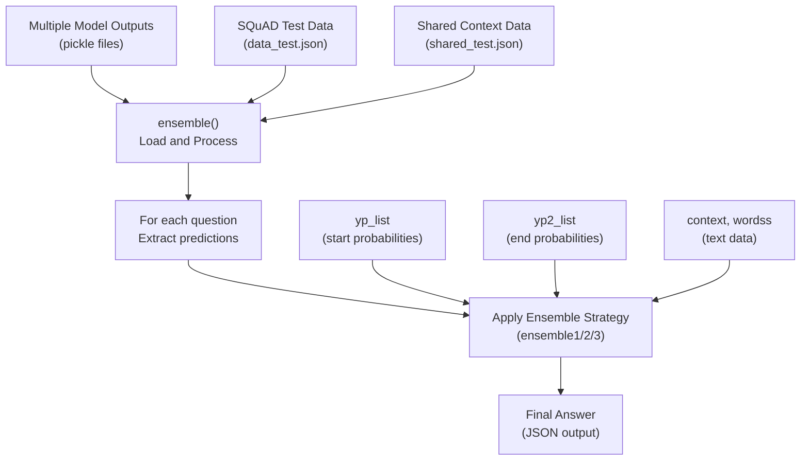
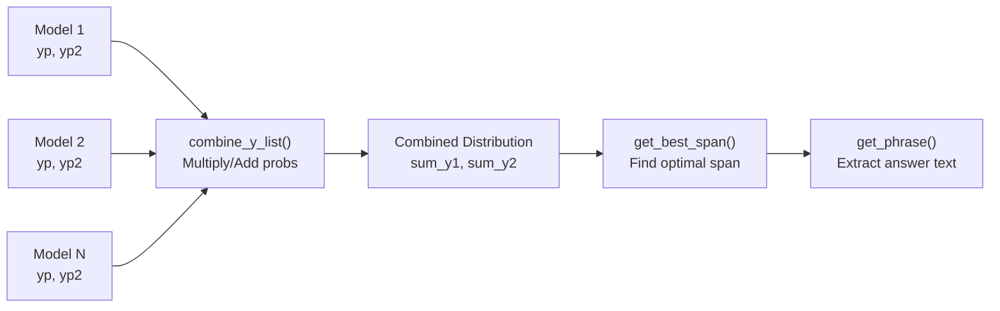
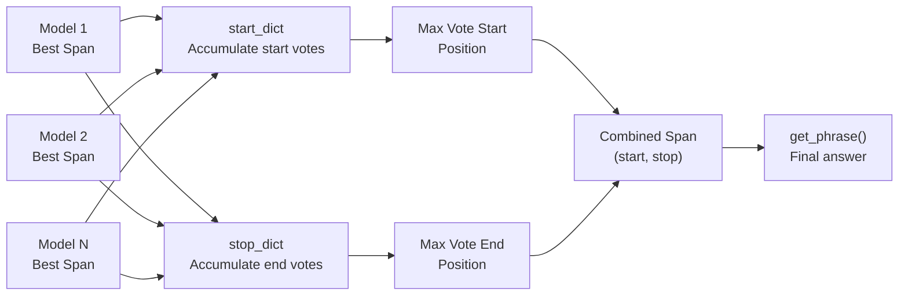
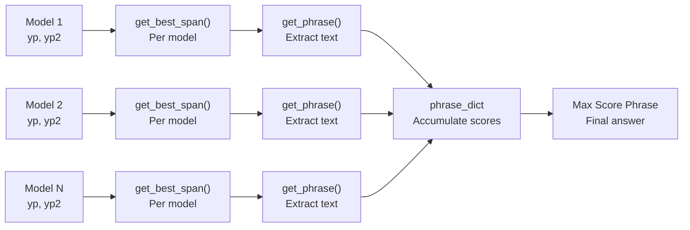
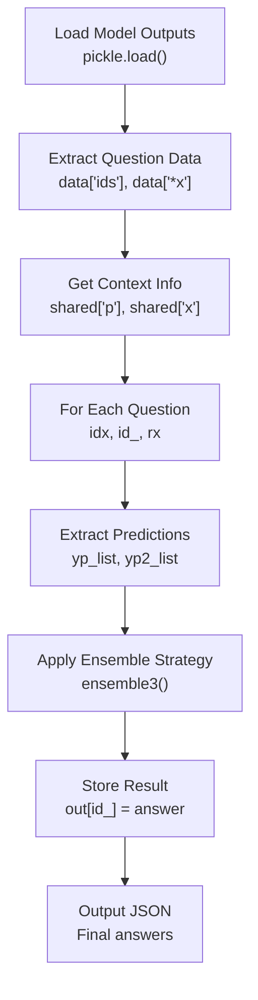

<!-- source: DeepWiki mcp.deepwiki.com · repo allenai/bi-att-flow · page 7.1 Model Ensembling · fetched 2026-10-26 -->

# Model Ensembling

<details>
<summary>Relevant source files</summary>

The following files were used as context for generating this wiki page:

- [basic/ensemble.py](basic/ensemble.py)

</details>


## Purpose and Scope

This document covers the model ensembling system in the BiDAF repository, which combines predictions from multiple trained models to improve question answering accuracy. The ensembling system provides three different strategies for aggregating model outputs and produces final answer predictions that typically outperform individual models.

For information about training individual models, see [Training Pipeline](#4.1). For deployment of ensemble models, see [Execution Scripts](#7.2).

## Overview

The ensemble system operates on the outputs of multiple trained BiDAF models, combining their probability distributions and span predictions to generate improved answers. The system supports three distinct ensemble strategies, each with different approaches to aggregating model predictions.

### Ensemble Pipeline



Sources: [basic/ensemble.py:23-50]()

## Ensemble Strategies

The system implements three ensemble strategies, each with different approaches to combining model predictions:

### Strategy Comparison

| Strategy | Method | Combination Level | Use Case |
|----------|--------|------------------|----------|
| `ensemble1` | Probability averaging | Probability distributions | Best for similar models |
| `ensemble2` | Span voting | Individual spans | Good for diverse models |
| `ensemble3` | Phrase voting | Final text phrases | Most robust approach |

### Strategy 1: Probability Distribution Combination



This strategy combines probability distributions from all models before finding the best span:

```python
def ensemble1(context, wordss, y1_list, y2_list):
    sum_y1 = combine_y_list(y1_list)
    sum_y2 = combine_y_list(y2_list)
    span, score = get_best_span(sum_y1, sum_y2)
    return get_phrase(context, wordss, span)
```

Sources: [basic/ensemble.py:52-64](), [basic/ensemble.py:89-96]()

### Strategy 2: Span Position Voting



This strategy finds the best span for each model individually, then votes on start and end positions:

Sources: [basic/ensemble.py:67-77]()

### Strategy 3: Phrase-Level Voting



This strategy extracts complete phrases from each model and votes based on confidence scores:

Sources: [basic/ensemble.py:80-86]()

## Data Flow and File Formats

### Input Requirements

The ensemble system requires specific input files and formats:

| File Type | Purpose | Format | Source |
|-----------|---------|--------|--------|
| Model outputs | Prediction probabilities | Gzipped pickle | Model forward pass |
| Test data | Question-answer pairs | JSON | SQuAD preprocessing |
| Shared data | Context and tokenization | JSON | SQuAD preprocessing |

### Model Output Structure

Each model output pickle file contains:
- `yp`: Start position probability distributions `[N, M, K]`
- `yp2`: End position probability distributions `[N, M, K]`

Where:
- `N`: Number of questions
- `M`: Number of sentences per question  
- `K`: Number of tokens per sentence

Sources: [basic/ensemble.py:37-44]()

### Processing Pipeline



Sources: [basic/ensemble.py:30-49]()

## Implementation Details

### Probability Combination

The `combine_y_list` function supports different combination operators:

```python
def combine_y_list(y_list, op='*'):
    if op == '+':
        func = sum
    elif op == '*':
        def func(l): return functools.reduce(mul, l)
    else:
        func = op
    return [[func(yij_list) for yij_list in zip(*yi_list)] 
            for yi_list in zip(*y_list)]
```

- Default operation: Element-wise multiplication (`*`)
- Alternative: Element-wise addition (`+`)
- Custom: User-defined function

Sources: [basic/ensemble.py:89-96]()

### Command Line Interface

The ensemble system is executed via command line with the following arguments:

| Argument | Description | Default |
|----------|-------------|---------|
| `paths` | Model output pickle files | Required |
| `-o, --out` | Output JSON file | `ensemble.json` |
| `--data_path` | Test data JSON | `data/squad/data_test.json` |
| `--shared_path` | Shared context JSON | `data/squad/shared_test.json` |

Example usage:
```bash
python basic/ensemble.py model1.pkl model2.pkl model3.pkl -o results.json
```

Sources: [basic/ensemble.py:13-20]()

## Dependencies and Integration

The ensemble system integrates with other BiDAF components:

- **SQuAD utilities**: Uses `get_phrase()` and `get_best_span()` from `squad.utils`
- **Data format**: Compatible with output from BiDAF forward evaluation mode
- **Evaluation**: Output format compatible with official SQuAD evaluation scripts

The system expects model outputs generated by the forward evaluation mode, typically produced by running multiple trained models on the same test set.

Sources: [basic/ensemble.py:1-11]()

---

