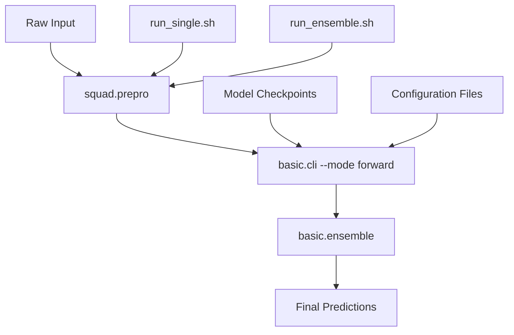
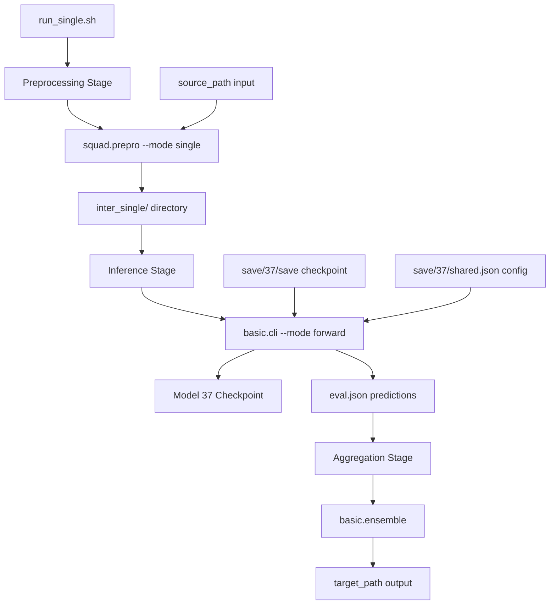
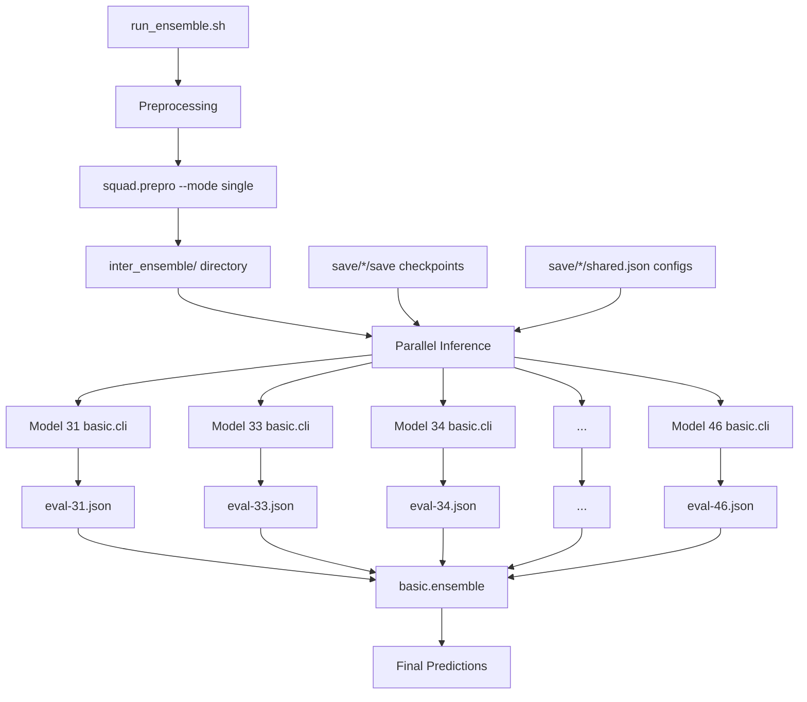
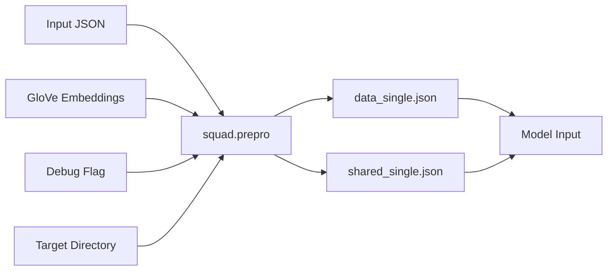
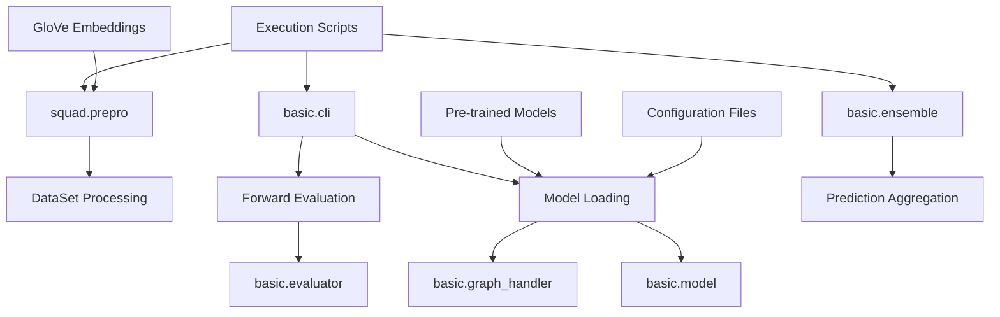

<!-- source: DeepWiki mcp.deepwiki.com · repo allenai/bi-att-flow · page 7.2 Execution Scripts · fetched 2026-10-26 -->

# Execution Scripts

<details>
<summary>Relevant source files</summary>

The following files were used as context for generating this wiki page:

- [basic/run_ensemble.sh](basic/run_ensemble.sh)
- [basic/run_single.sh](basic/run_single.sh)
- [squad/evaluate.py](squad/evaluate.py)

</details>


This document covers the production-ready execution scripts that provide simplified interfaces for running BiDAF models on new data. These scripts handle the complete pipeline from raw input to final predictions, including data preprocessing, model inference, and result aggregation.

For information about the underlying ensemble methodology, see [Model Ensembling](#7.1). For details about model persistence and checkpoint management, see [Model Management](#7.3).

## Overview

The execution scripts provide two main deployment modes for the BiDAF question answering system:

| Script | Purpose | Models Used | Output |
|--------|---------|-------------|--------|
| `run_single.sh` | Single model inference | Model 37 only | Individual predictions |
| `run_ensemble.sh` | Ensemble inference | 12 pre-trained models | Aggregated predictions |

Both scripts follow a standardized three-stage pipeline: data preprocessing, model inference, and result aggregation. They are designed for production use where users need to process new question-context pairs without manual configuration.

**Execution Pipeline Overview**



Sources: [basic/run_single.sh:1-28](), [basic/run_ensemble.sh:1-30]()

## Single Model Execution

The `run_single.sh` script provides a streamlined interface for running inference with a single pre-trained BiDAF model. It uses model 37 as the default configuration, which represents one of the best-performing individual models.

### Command Interface

```bash
./run_single.sh <source_path> <target_path> [debug]
```

**Parameters:**
- `source_path`: Path to input JSON file containing question-context pairs
- `target_path`: Path where final predictions will be written
- `debug`: Optional flag to enable debug mode

### Execution Flow



The script performs these operations sequentially:

1. **Preprocessing**: Converts input data to BiDAF format using [squad/prepro.py]() with single-file mode
2. **Model Loading**: Loads model 37 from `save/37/save` with configuration from `save/37/shared.json`
3. **Inference**: Runs forward pass with optimizations (`--len_opt --cluster --cpu_opt --load_ema`)
4. **Output**: Uses ensemble module to format single model output

**Key Configuration Parameters:**

The script uses these optimization flags: [basic/run_single.sh:22]()
- `--len_opt`: Length-based optimization for variable sequence lengths
- `--cluster`: Clustering optimization for batch processing  
- `--cpu_opt`: CPU-specific optimizations
- `--load_ema`: Load exponential moving average weights

Sources: [basic/run_single.sh:1-28]()

## Ensemble Execution

The `run_ensemble.sh` script orchestrates multiple BiDAF models to produce ensemble predictions. It runs 12 different pre-trained models in parallel and aggregates their outputs for improved accuracy.

### Model Configuration

The ensemble uses these pre-trained model numbers: [basic/run_ensemble.sh:19]()
```
31, 33, 34, 35, 36, 37, 40, 41, 43, 44, 45, 46
```

Each model represents a different training configuration or checkpoint, providing diversity for ensemble aggregation.

### Parallel Execution Flow



### Parallel Processing Implementation

The script implements parallel execution using shell background processes: [basic/run_ensemble.sh:24]()

```bash
python3 -m basic.cli --data_dir $inter_dir --eval_path $eval_path \
    --nodump_answer --load_path $load_path --shared_path $shared_path \
    $marg --eval_num_batches 0 --mode forward --batch_size 1 \
    --len_opt --cluster --cpu_opt --load_ema &
```

The `&` operator runs each model inference in the background, and `wait` synchronizes completion before ensemble aggregation.

**Resource Management:**
- Each model runs with `--batch_size 1` to minimize memory usage
- All models use identical optimization flags for consistency
- Parallel execution reduces total inference time significantly

Sources: [basic/run_ensemble.sh:1-30]()

## Common Preprocessing Pipeline  

Both execution scripts use identical preprocessing through the `squad.prepro` module in single-file mode. This ensures consistent data formatting regardless of execution mode.

### Preprocessing Configuration



**Command Structure:** [basic/run_single.sh:16](), [basic/run_ensemble.sh:16]()
```bash
python3 -m squad.prepro --mode single --single_path $source_path \
    $parg --target_dir $inter_dir --glove_dir .
```

**Key Parameters:**
- `--mode single`: Process single input file (vs. standard SQuAD dataset)
- `--single_path`: Path to input JSON file
- `--target_dir`: Output directory (`inter_single/` or `inter_ensemble/`)
- `--glove_dir`: Location of GloVe embeddings (current directory)

### Debug Mode Support

Both scripts support debug mode through the third command-line argument: [basic/run_single.sh:9-13]()

```bash
if [ "$3" = "debug" ]
then
    parg="-d"
    marg="--debug"
fi
```

Debug mode affects:
- Preprocessing: Adds `-d` flag for reduced data processing
- Inference: Adds `--debug` flag for verbose output and additional logging

Sources: [basic/run_single.sh:9-16](), [basic/run_ensemble.sh:9-16]()

## Integration with BiDAF System

The execution scripts serve as high-level interfaces that integrate multiple BiDAF components into streamlined workflows.

### Component Integration



### File System Organization

The scripts expect a specific directory structure for model checkpoints:

```
save/
├── 31/
│   ├── save/          # Model checkpoint
│   └── shared.json    # Configuration
├── 33/
│   ├── save/
│   └── shared.json
...
├── 46/
    ├── save/
    └── shared.json
```

**Working Directories:**
- `inter_single/`: Temporary files for single model execution
- `inter_ensemble/`: Temporary files for ensemble execution
- Generated files include `data_single.json`, `shared_single.json`, and prediction files

### Error Handling and Optimization

Both scripts implement production-ready optimizations:

1. **Memory Optimization**: `--batch_size 1` prevents out-of-memory errors
2. **CPU Optimization**: `--cpu_opt` flag enables CPU-specific optimizations  
3. **Length Optimization**: `--len_opt` handles variable sequence lengths efficiently
4. **EMA Loading**: `--load_ema` uses exponential moving average weights for better performance

**Evaluation Configuration**: [basic/run_single.sh:22]()
- `--eval_num_batches 0`: Process all available data
- `--nodump_answer`: Skip intermediate answer dumps
- `--mode forward`: Run inference only (no training)

Sources: [basic/run_single.sh:18-25](), [basic/run_ensemble.sh:18-29]()

---

