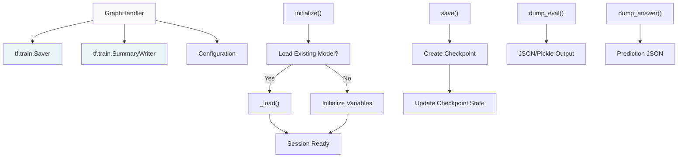
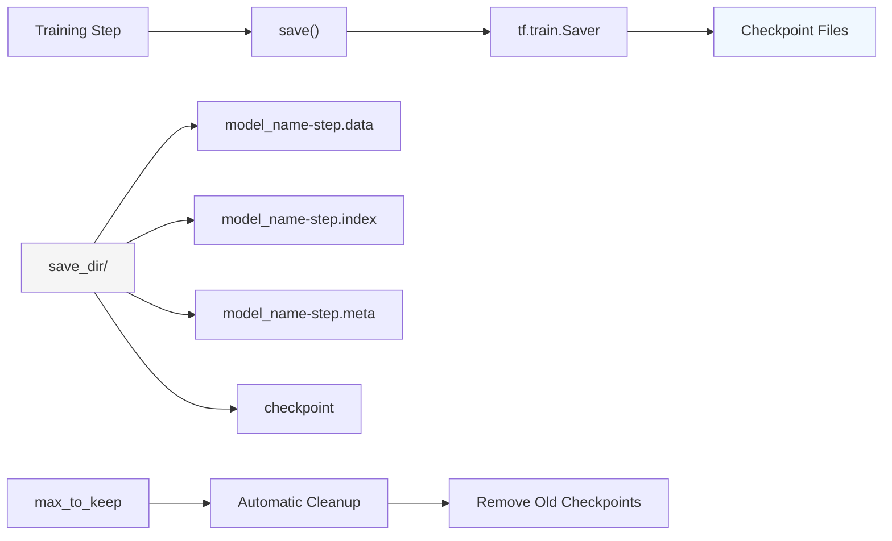
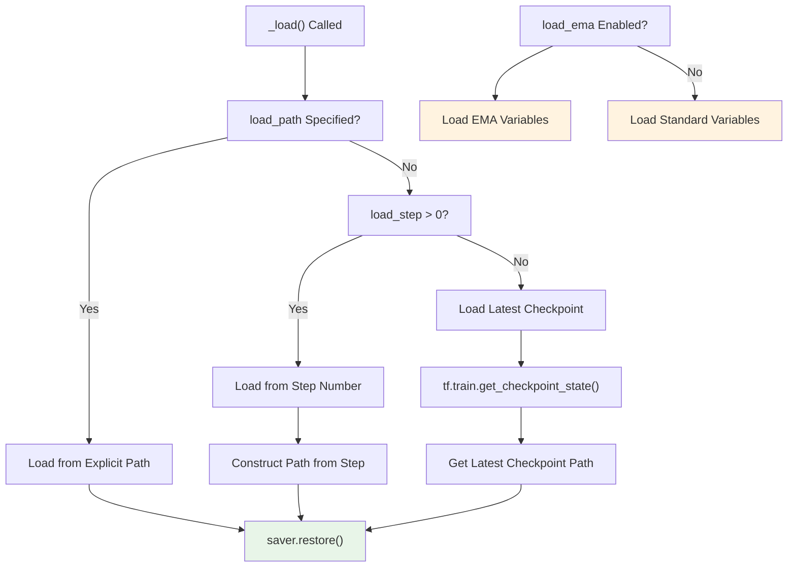
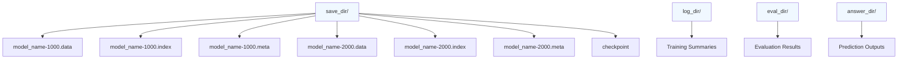
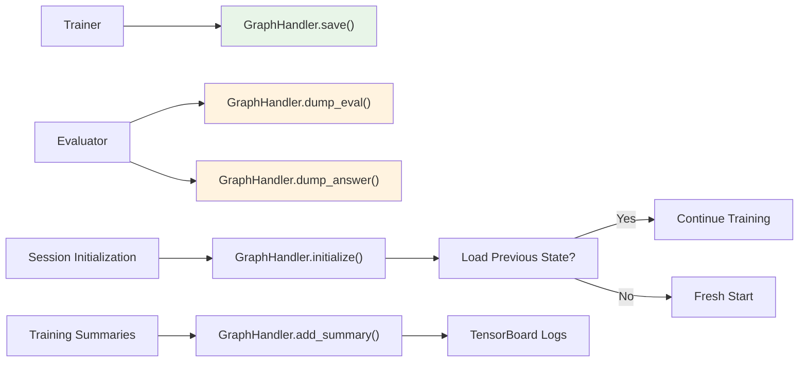

<!-- source: DeepWiki mcp.deepwiki.com · repo allenai/bi-att-flow · page 7.3 Model Management · fetched 2026-10-26 -->

# Model Management

<details>
<summary>Relevant source files</summary>

The following files were used as context for generating this wiki page:

- [README.md](README.md)
- [basic/graph_handler.py](basic/graph_handler.py)
- [basic_cnn/__init__.py](basic_cnn/__init__.py)
- [basic_cnn/graph_handler.py](basic_cnn/graph_handler.py)

</details>


This document covers the model checkpoint and state management system in the BiDAF repository. The model management system handles saving, loading, and persisting trained models, their configurations, and associated evaluation outputs. For information about combining multiple models, see [Model Ensembling](#7.1). For deployment scripts that utilize saved models, see [Execution Scripts](#7.2).

## GraphHandler Architecture

The model management system is centered around the `GraphHandler` class, which provides a unified interface for all model persistence operations. Two implementations exist: one for the main BiDAF model and another for the CNN variant.



**GraphHandler Components**

The `GraphHandler` class manages several key components:

| Component | Purpose | Configuration |
|-----------|---------|---------------|
| `tf.train.Saver` | Model checkpoint persistence | `max_to_keep` parameter |
| `tf.train.SummaryWriter` | Training logs and graphs | `log_dir` path |
| Model reference | Access to model variables | Passed during initialization |
| Save path | Target directory for checkpoints | `save_dir + model_name` |

Sources: [basic/graph_handler.py:14-21](), [basic_cnn/graph_handler.py:14-20]()

## Model Saving Operations

The system provides automatic and manual model saving capabilities with configurable retention policies.



**Checkpoint File Structure**

When a model is saved, TensorFlow creates multiple files:

- **Data file** (`model_name-step.data-*`): Contains variable values
- **Index file** (`model_name-step.index`): Variable name to tensor mapping
- **Meta file** (`model_name-step.meta`): Graph structure definition
- **Checkpoint file** (`checkpoint`): Lists available checkpoints

The `max_to_keep` configuration parameter controls automatic cleanup of old checkpoints, preventing disk space exhaustion during long training runs.

Sources: [basic/graph_handler.py:30-33](), [basic_cnn/graph_handler.py:30-32]()

## Model Loading Strategies

The model loading system supports multiple loading strategies with automatic fallback mechanisms.



**Loading Priority Order**

1. **Explicit Path** (`load_path`): Direct path to checkpoint files
2. **Step Number** (`load_step`): Constructs path using step number
3. **Latest Checkpoint**: Automatically finds most recent checkpoint

**Exponential Moving Average Support**

The system supports loading exponential moving averages (EMA) of model parameters when `load_ema` is enabled. This replaces trainable variables with their EMA counterparts for improved inference performance.

Sources: [basic/graph_handler.py:34-55](), [basic_cnn/graph_handler.py:33-46]()

## Configuration Management

Model management integrates with the configuration system to control saving and loading behavior.

**Key Configuration Parameters**

| Parameter | Type | Purpose | Default Behavior |
|-----------|------|---------|------------------|
| `save_dir` | string | Checkpoint directory | Combined with `model_name` |
| `model_name` | string | Model identifier | Used in checkpoint filenames |
| `load` | boolean | Whether to load existing model | Controls initialization |
| `load_path` | string | Explicit load path | Overrides other load options |
| `load_step` | integer | Specific step to load | Zero means load latest |
| `max_to_keep` | integer | Checkpoint retention count | Prevents disk overflow |
| `load_ema` | boolean | Load EMA variables | For inference optimization |

**Directory Structure**



Sources: [basic/graph_handler.py:15-21](), [basic/graph_handler.py:44-52]()

## Evaluation and Prediction Output Management

The system provides specialized methods for persisting evaluation results and model predictions in standardized formats.

**Evaluation Output Formats**

The `dump_eval()` method supports two output formats:

- **JSON Format**: Human-readable, configurable precision
- **Pickle Format**: Compressed binary format for large datasets

```python
# JSON output path pattern
eval_dir/{data_type}-{global_step:06d}.json

# Pickle output path pattern  
eval_dir/{data_type}-{global_step:06d}.pklz
```

**Prediction Output Structure**

The `dump_answer()` method generates JSON files containing question ID to answer mappings:

```python
# Answer output path pattern
answer_dir/{data_type}-{global_step:06d}.json

# Content format: {"question_id": "predicted_answer", ...}
```

**Output Management Methods**

| Method | Purpose | Output Format | Compression |
|--------|---------|---------------|-------------|
| `dump_eval()` | Evaluation metrics | JSON/Pickle | Optional gzip |
| `dump_answer()` | Model predictions | JSON | None |
| `add_summary()` | Training logs | TensorBoard | Built-in |

Sources: [basic/graph_handler.py:63-79](), [basic/graph_handler.py:56-62]()

## Multi-GPU Model Management

The model management system handles multi-GPU training scenarios with specialized variable handling for distributed setups.

**Variable Management in Multi-GPU**

When using multiple GPUs, the system manages variables across devices while maintaining a single checkpoint format. The EMA loading mechanism becomes particularly important for multi-GPU inference to ensure consistent performance across all devices.

**Checkpoint Compatibility**

Models trained on multiple GPUs can be loaded for single-GPU inference and vice versa, as the checkpoint format abstracts the device placement details.

Sources: [basic/graph_handler.py:36-42]()

## Integration with Training Pipeline

The model management system integrates seamlessly with the training and evaluation pipeline through standardized interfaces.



**Automatic Integration Points**

- **Training initialization**: Automatic model loading when `load=True`
- **Periodic saving**: Checkpoint creation at specified intervals
- **Evaluation persistence**: Automatic result saving after evaluation
- **Summary logging**: Training metrics sent to TensorBoard

The model management system provides the foundation for reproducible experiments and deployment-ready model artifacts throughout the BiDAF training and evaluation process.

Sources: [basic/graph_handler.py:22-29](), [basic/graph_handler.py:56-79]()

---

