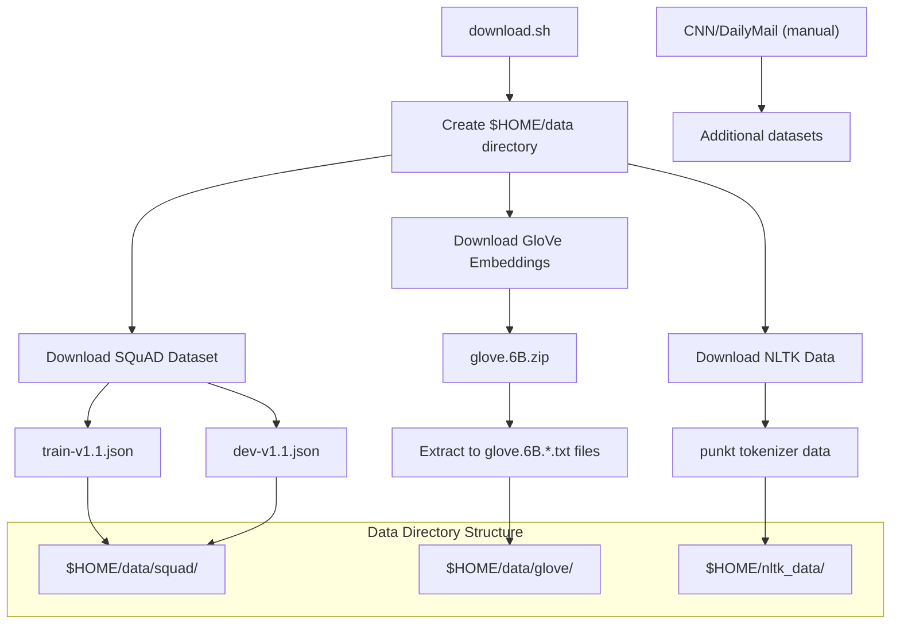
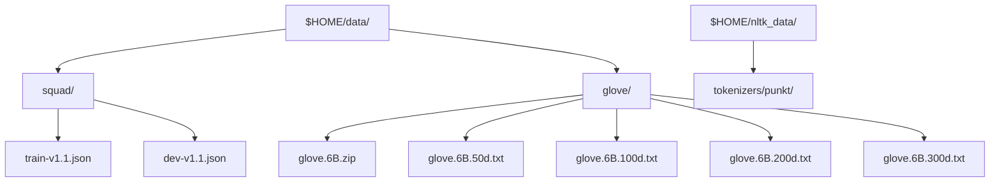
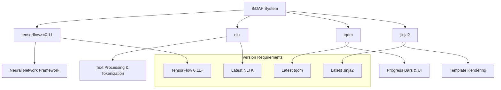
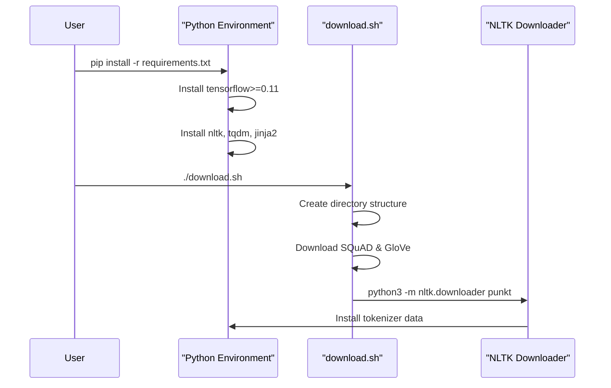
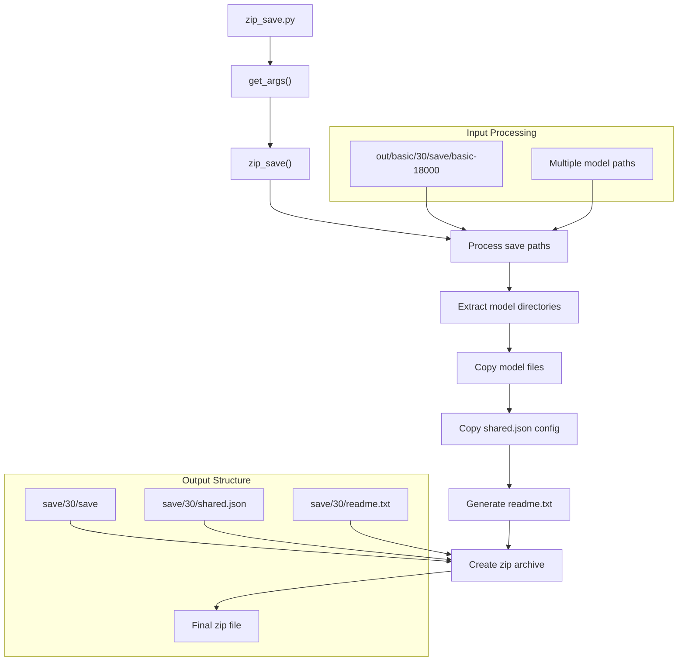
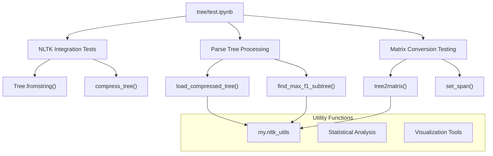
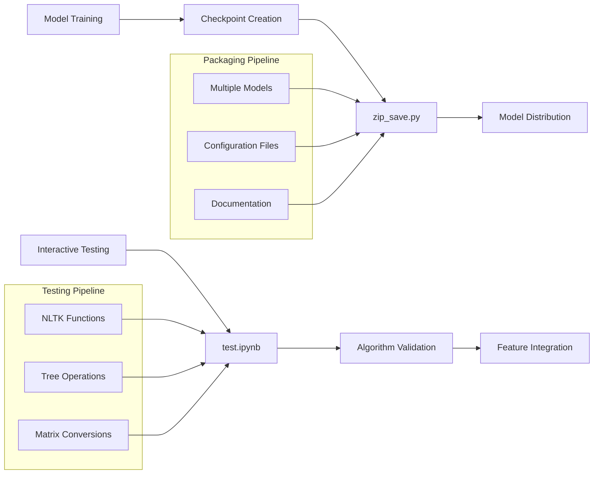

<!-- source: DeepWiki mcp.deepwiki.com · repo allenai/bi-att-flow · page 8 Infrastructure and Tools · fetched 2026-10-26 -->

# Infrastructure and Tools

Relevant source files

The following files were used as context for generating this wiki page:

- [download.sh](download.sh)
- [my/zip_save.py](my/zip_save.py)
- [requirements.txt](requirements.txt)
- [tree/test.ipynb](tree/test.ipynb)

This page documents the supporting infrastructure that enables the BiDAF question answering system to function effectively. It covers data acquisition scripts, environment dependencies, and development utilities that facilitate model training, evaluation, and deployment.

For core model architecture details, see [Core BiDAF Model](#2). For data processing pipelines, see [Data Pipeline](#3). For deployment and execution, see [Ensemble and Deployment](#7).

## Data Acquisition Infrastructure

The BiDAF system requires several external datasets and resources to function. The primary data acquisition is handled through an automated download script that retrieves all necessary components.

### Download Workflow

The `download.sh` script creates a standardized data directory structure and retrieves three main categories of resources:

| Resource Type | Source | Destination | Purpose |
|---------------|--------|-------------|---------|
| SQuAD Dataset | Stanford Question Answering Dataset | `$HOME/data/squad/` | Training and evaluation data |
| GloVe Embeddings | Stanford NLP Group | `$HOME/data/glove/` | Pre-trained word vectors |
| NLTK Data | Natural Language Toolkit | `$HOME/nltk_data/` | Tokenization utilities |

The script handles the complete setup process: [download.sh:3-4]() creates the base data directory, [download.sh:6-10]() downloads SQuAD training and development sets, [download.sh:17-21]() retrieves and extracts GloVe embeddings, and [download.sh:23-25]() installs NLTK tokenizer data.

**Sources:** download.sh

### Data Directory Structure

The automated setup creates a consistent directory hierarchy:

This structure is referenced throughout the codebase for consistent data access. The CNN/DailyMail dataset mentioned in [download.sh:13-14]() requires manual download from external sources.

**Sources:** download.sh

## Dependencies and Environment

The BiDAF system requires specific Python packages and versions to function correctly. These dependencies are managed through standard Python packaging tools.

### Core Dependencies

The dependency specification in `requirements.txt` defines four essential packages:

| Package | Version Constraint | Primary Use Cases |
|---------|-------------------|-------------------|
| `tensorflow` | `>=0.11` | Neural network computations, model training |
| `nltk` | Latest | Text tokenization, linguistic processing |
| `tqdm` | Latest | Progress tracking during data processing |
| `jinja2` | Latest | HTML template rendering for visualizations |

The TensorFlow version constraint [requirements.txt:1]() ensures compatibility with the custom neural network layers and operations used throughout the codebase. NLTK integration [requirements.txt:2]() provides tokenization capabilities required by the preprocessing pipeline.

**Sources:** requirements.txt, download.sh

### Environment Setup Process

The environment setup involves both Python package installation and external data acquisition:

The setup process requires both dependency installation and data acquisition to be completed before the system can function properly.

**Sources:** requirements.txt, download.sh

## Development and Utility Tools

The BiDAF repository includes several development tools that facilitate model experimentation, debugging, and result packaging.

### Model Packaging Utilities

The `zip_save.py` utility provides functionality for packaging trained models and their configurations into distributable archives:

The packaging process handles multiple model saves simultaneously: [my/zip_save.py:23-41]() iterates through provided paths, extracts model names, copies both the model checkpoint and configuration files, and generates documentation. The final archive contains a structured directory layout suitable for model distribution.

**Sources:** my/zip_save.py

### Interactive Development Tools

The repository includes Jupyter notebooks for interactive experimentation and testing:

The test notebook demonstrates integration with NLTK parsing capabilities and validates tree processing utilities. It includes examples of parse tree compression [tree/test.ipynb:41-54](), matrix conversion operations [tree/test.ipynb:249-261](), and statistical analysis of linguistic features.

**Sources:** tree/test.ipynb

### Development Workflow Integration

The development tools integrate with the main system workflow to support experimentation and model management:

These tools provide essential support for the development lifecycle, from initial experimentation through model deployment preparation.

**Sources:** my/zip_save.py, tree/test.ipynb

---

