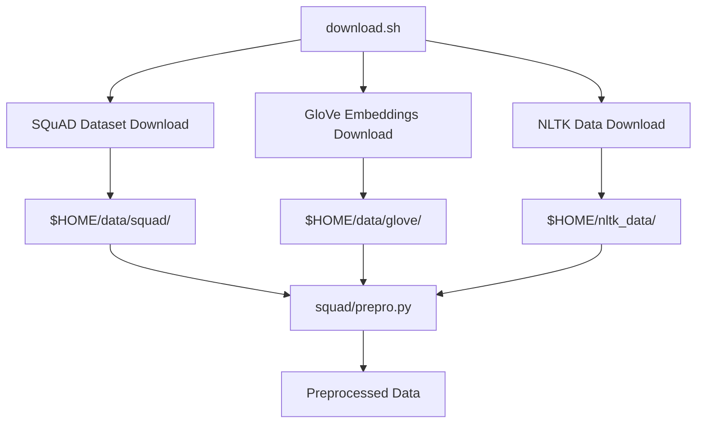
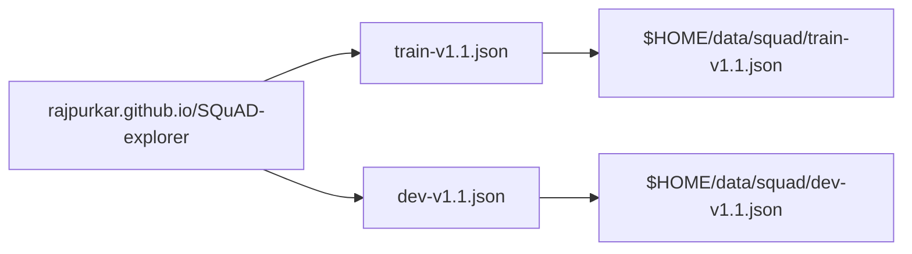
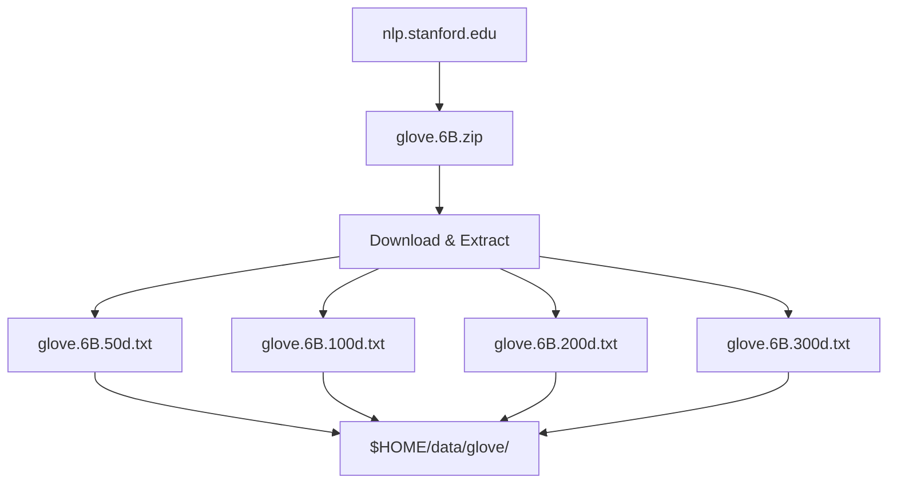
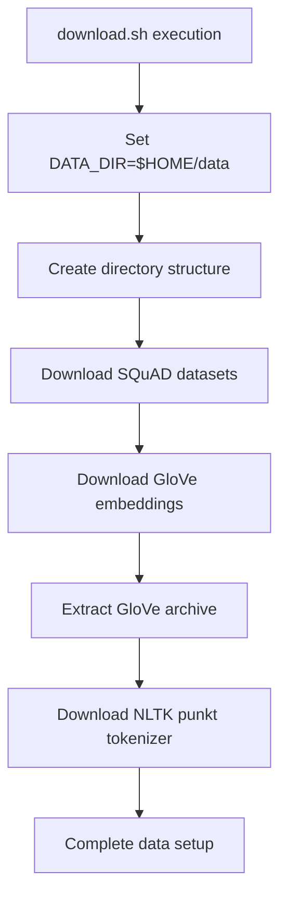

<!-- source: DeepWiki mcp.deepwiki.com · repo allenai/bi-att-flow · page 8.1 Data Acquisition · fetched 2026-10-26 -->

# Data Acquisition

<details>
<summary>Relevant source files</summary>

The following files were used as context for generating this wiki page:

- [download.sh](download.sh)
- [my/zip_save.py](my/zip_save.py)
- [tree/test.ipynb](tree/test.ipynb)

</details>


This document covers the automated scripts and processes for downloading the required datasets and external resources needed to run the BiDAF question answering system. The data acquisition system handles downloading SQuAD datasets, GloVe word embeddings, and NLTK linguistic resources that serve as inputs to the preprocessing pipeline.

For information about how this data is processed after acquisition, see [SQuAD Preprocessing](#3.2). For details on alternative dataset support beyond SQuAD, see [Alternative Dataset Support](#3.3).

## Overview

The BiDAF system requires several external data sources to function properly. The data acquisition process downloads and organizes these resources into a standardized directory structure that can be consumed by the preprocessing and training pipelines.



**Data Acquisition Flow**

Sources: [download.sh:1-26]()

## Required Data Sources

The system depends on three primary external data sources that must be acquired before training or evaluation can begin:

| Data Source | Purpose | Size | Format |
|-------------|---------|------|--------|
| SQuAD v1.1 | Training and evaluation datasets | ~30MB | JSON |
| GloVe 6B | Pre-trained word embeddings | ~800MB | Text vectors |
| NLTK | Tokenization resources | ~5MB | NLTK data |

### SQuAD Dataset

The Stanford Question Answering Dataset provides the core training and evaluation data for the question answering task. The acquisition process downloads both training and development sets directly from the official SQuAD repository.



**SQuAD Data Download Process**

The download process creates the squad directory and retrieves both dataset files:

- Training set: `train-v1.1.json` containing 87,599 questions
- Development set: `dev-v1.1.json` containing 10,570 questions

Sources: [download.sh:6-10]()

### GloVe Word Embeddings

Global Vectors for Word Representation (GloVe) provide pre-trained word embeddings that serve as the initial word representations for the neural network. The system downloads the 6 billion token version with multiple dimensionalities.



**GloVe Download and Extraction Process**

The GloVe download includes vectors of different dimensions (50d, 100d, 200d, 300d) to support various model configurations.

Sources: [download.sh:17-21]()

### NLTK Linguistic Resources

The Natural Language Toolkit provides essential tokenization capabilities through the Punkt sentence tokenizer. This resource is downloaded directly through NLTK's built-in download mechanism.

Sources: [download.sh:23-25]()

## Automated Download Script

The primary data acquisition mechanism is the `download.sh` script, which orchestrates the download of all required resources in a single execution.



**Download Script Execution Flow**

### Directory Structure Creation

The script establishes a standardized directory hierarchy under `$HOME/data`:

```
$HOME/data/
├── squad/
│   ├── train-v1.1.json
│   └── dev-v1.1.json
├── glove/
│   ├── glove.6B.50d.txt
│   ├── glove.6B.100d.txt
│   ├── glove.6B.200d.txt
│   ├── glove.6B.300d.txt
│   └── glove.6B.zip
└── nltk_data/
    └── tokenizers/
        └── punkt/
```

Sources: [download.sh:3-4](), [download.sh:7-8](), [download.sh:18-19]()

### Download Implementation Details

The script uses `wget` for HTTP downloads and `unzip` for archive extraction:

- **SQuAD datasets**: Direct download using `wget` with explicit output filenames
- **GloVe embeddings**: Download compressed archive followed by extraction to target directory  
- **NLTK data**: Python module invocation with specific target directory and tokenizer specification

Sources: [download.sh:9-10](), [download.sh:20-21](), [download.sh:25]()

## Alternative Dataset Support

While the automated script focuses on SQuAD, the system architecture supports additional datasets through manual acquisition processes.

### CNN/Daily Mail Dataset

The script includes commented references to the CNN and Daily Mail datasets for reading comprehension tasks. These must be downloaded manually from the specified source due to licensing requirements.

```bash
# Download CNN and DailyMail  
# Download at: http://cs.nyu.edu/~kcho/DMQA/
```

This dataset requires separate preprocessing pipelines and is not automatically integrated into the standard workflow.

Sources: [download.sh:13-14]()

## Data Verification and Troubleshooting

### Prerequisites Verification

Before running the download script, ensure the following requirements are met:

- **Network connectivity**: Required for downloading from external repositories
- **Disk space**: Minimum 1GB free space for all datasets
- **Python environment**: NLTK package must be installed for tokenizer download
- **System tools**: `wget` and `unzip` must be available in system PATH

### Common Issues

| Issue | Cause | Solution |
|-------|-------|----------|
| Download timeouts | Network connectivity | Retry download or use alternative mirrors |
| Permission errors | Directory creation rights | Ensure write permissions to `$HOME/data` |
| NLTK download fails | Missing NLTK installation | Install NLTK: `pip install nltk` |
| Extraction errors | Corrupted archive | Re-download GloVe archive |

Sources: [download.sh:24-25]()

---

