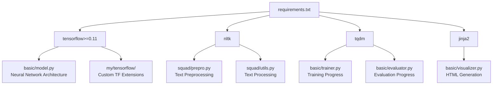
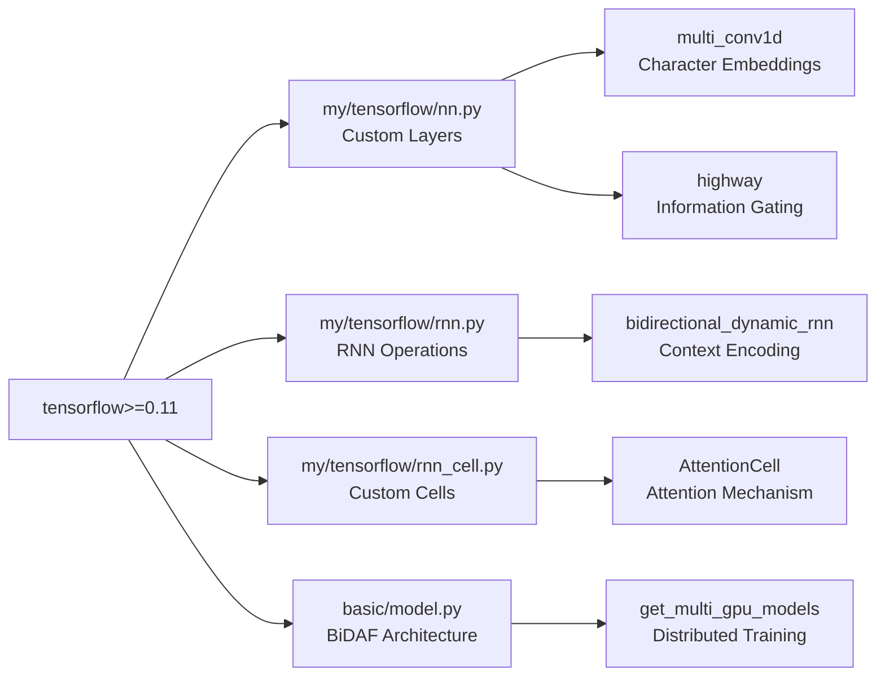
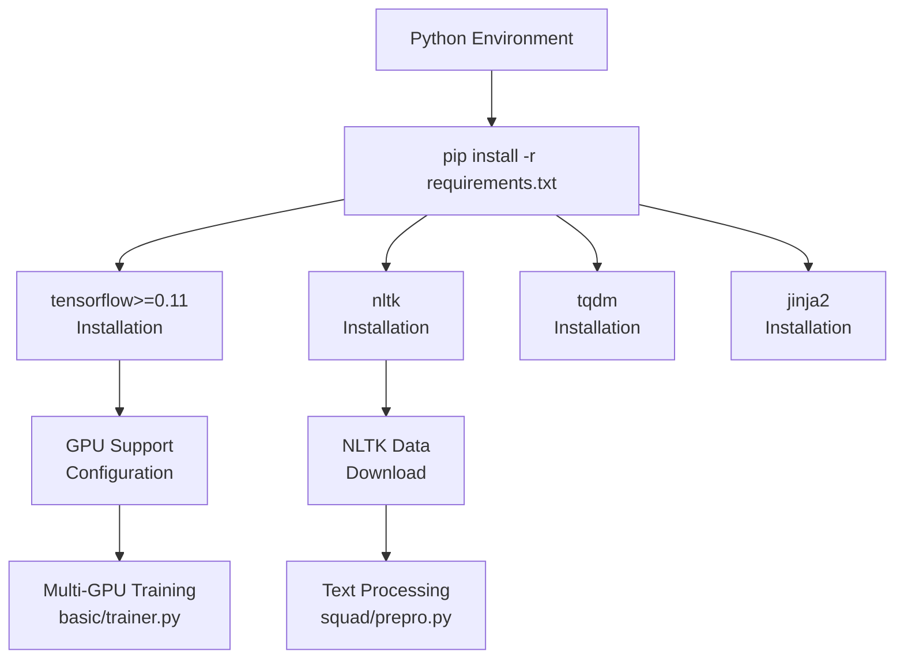
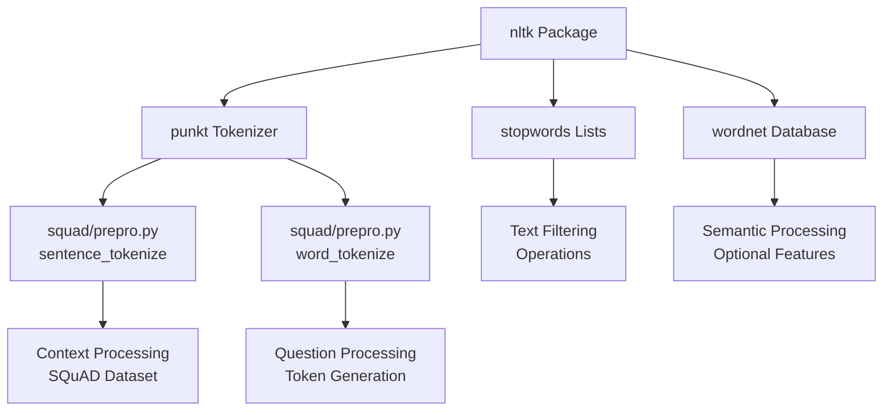
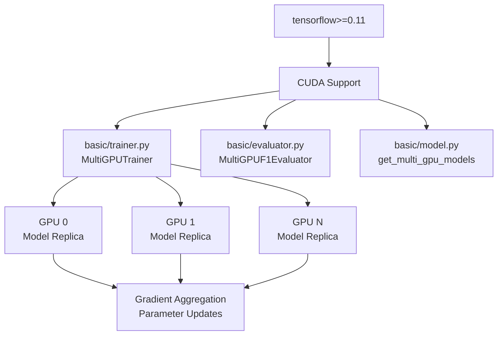
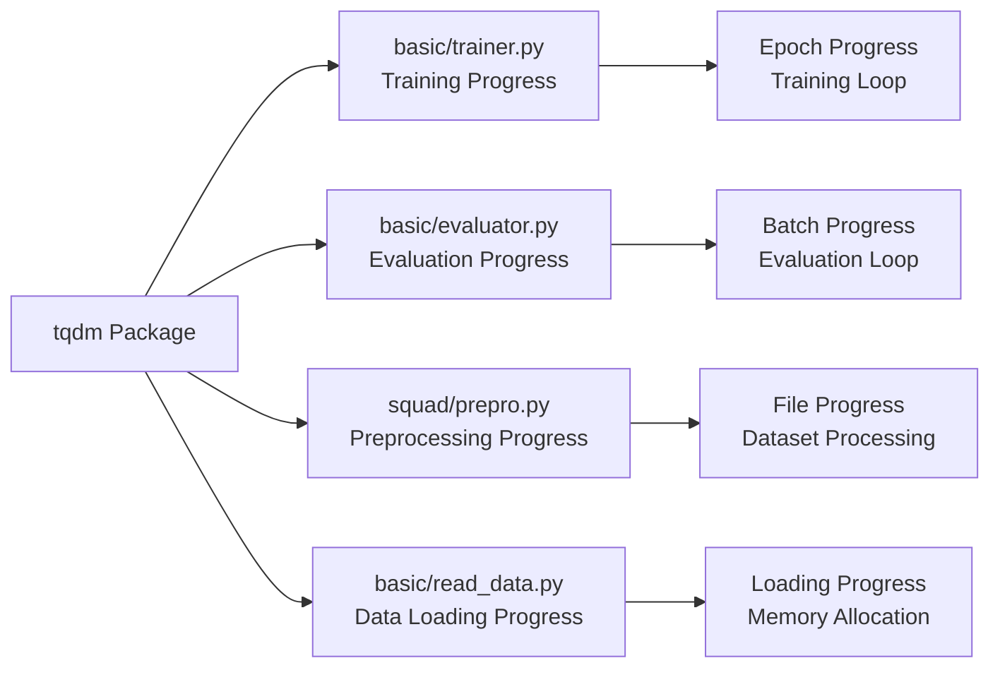
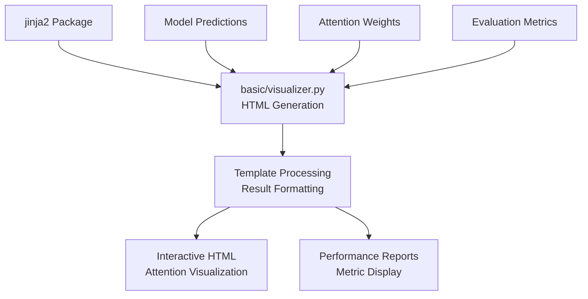

<!-- source: DeepWiki mcp.deepwiki.com · repo allenai/bi-att-flow · page 8.2 Dependencies and Environment · fetched 2026-10-26 -->

# Dependencies and Environment

Relevant source files

The following files were used as context for generating this wiki page:

- [requirements.txt](requirements.txt)

This document covers the software dependencies, environment setup, and infrastructure requirements for the BiDAF question answering system. It details the required Python packages, TensorFlow configuration, and system-level dependencies needed to run training, evaluation, and inference pipelines.

For information about data acquisition and downloading external resources, see [Data Acquisition](#8.1). For development and debugging tools, see [Development Tools](#8.3).

## Core Dependencies

The BiDAF system relies on several key Python packages specified in the requirements file. These dependencies enable deep learning functionality, natural language processing, progress tracking, and template rendering.

### Primary Dependencies

| Package | Version Requirement | Purpose |
|---------|-------------------|---------|
| `tensorflow` | `>=0.11` | Deep learning framework for neural network implementation |
| `nltk` | Latest | Natural language processing toolkit for tokenization and text processing |
| `tqdm` | Latest | Progress bar library for training and evaluation loops |
| `jinja2` | Latest | Template engine for generating HTML visualization output |

**Dependency Specification**

Sources: [requirements.txt:1-4]()

### TensorFlow Integration

The system requires TensorFlow version 0.11 or higher and integrates deeply with TensorFlow's computational graph system. The custom TensorFlow extensions provide specialized neural network components.

**TensorFlow Dependency Flow**

Sources: [requirements.txt:1]()

## Environment Configuration

### Python Environment Setup

The system assumes a Python environment with the specified dependencies installed. The recommended approach is to use a virtual environment to isolate package versions.

**Environment Setup Process**

Sources: [requirements.txt:1-4]()

### NLTK Data Requirements

The Natural Language Toolkit requires additional data downloads for tokenization and text processing functionality used throughout the preprocessing pipeline.

**NLTK Integration Points**

Sources: [requirements.txt:2]()

## System Requirements

### Hardware Considerations

The BiDAF system is designed to leverage GPU acceleration and supports multi-GPU training configurations. The hardware requirements depend on the intended use case and dataset size.

| Component | Minimum | Recommended |
|-----------|---------|-------------|
| GPU Memory | 4GB | 8GB+ per GPU |
| System RAM | 8GB | 16GB+ |
| Storage | 10GB | 50GB+ (for datasets) |
| CPU Cores | 4 | 8+ |

### Multi-GPU Support

The system includes specialized components for distributed training across multiple GPUs, requiring appropriate CUDA and cuDNN installations.

**Multi-GPU Architecture**

Sources: [requirements.txt:1]()

## Progress Tracking and Visualization

### Progress Monitoring

The `tqdm` library provides progress bars for long-running operations including training epochs, batch processing, and evaluation runs.

**Progress Tracking Integration**

Sources: [requirements.txt:3]()

### HTML Visualization

The `jinja2` template engine enables the generation of interactive HTML reports for result visualization and attention analysis.

**Visualization Pipeline**

Sources: [requirements.txt:4]()

## Dependency Management

### Version Compatibility

The system specifies minimum version requirements to ensure compatibility with the neural network architecture and custom TensorFlow extensions. The TensorFlow version requirement reflects the APIs used in the model implementation.

### Installation Verification

After installing dependencies, the system components can be verified by importing key modules and checking for proper integration with the TensorFlow computational graph system.

Sources: [requirements.txt:1-4]()

---

