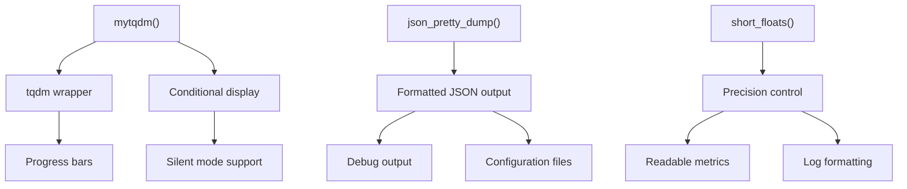
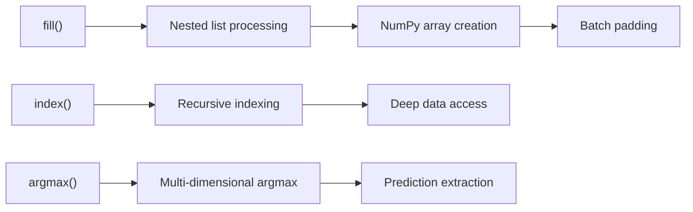
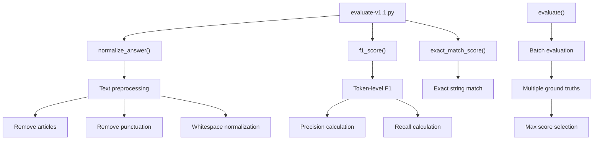
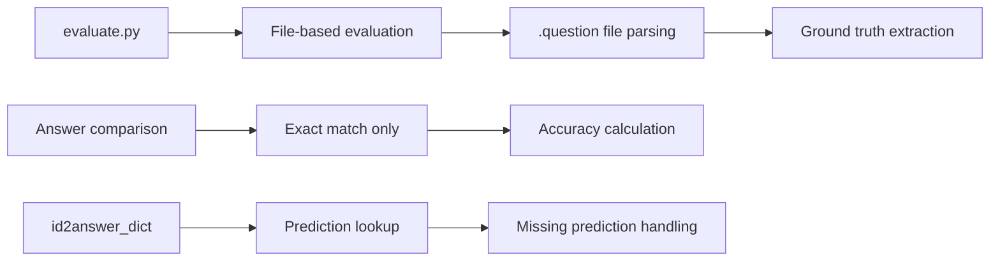
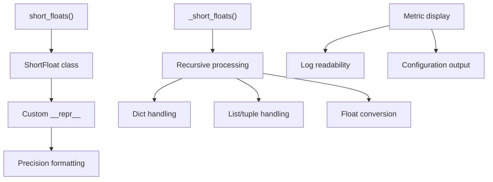

<!-- source: DeepWiki mcp.deepwiki.com · repo allenai/bi-att-flow · page 8.3 Development Tools · fetched 2026-10-26 -->

# Development Tools

Relevant source files

The following files were used as context for generating this wiki page:

- [cnn_dm/evaluate.py](cnn_dm/evaluate.py)
- [my/utils.py](my/utils.py)
- [squad/evaluate-v1.1.py](squad/evaluate-v1.1.py)

This document covers the development tools and utilities provided in the BiDAF repository that support the development, debugging, and evaluation workflows. These tools complement the core model training and inference functionality by providing utilities for progress tracking, data manipulation, specialized evaluation metrics, and development workflow automation.

For information about model training and evaluation pipelines, see [Training and Evaluation](#4). For details about data acquisition scripts, see [Data Acquisition](#8.1).

## General Development Utilities

The BiDAF repository includes a comprehensive set of development utilities in [my/utils.py:1-59]() that provide common functionality used throughout the codebase for debugging, data processing, and output formatting.

### Progress Tracking and Display

**Development Utilities Architecture**

The `mytqdm` function [my/utils.py:8-13]() provides a conditional progress bar wrapper that can be disabled for batch processing or quiet modes. This is extensively used throughout the training and evaluation pipelines to provide user feedback during long-running operations.

The `json_pretty_dump` function [my/utils.py:16-17]() standardizes JSON output formatting across the codebase, ensuring consistent indentation and key sorting for readable configuration files and debug output.

**Sources:** [my/utils.py:1-59]()

### Array and Data Manipulation

**Array Processing Functions**

The `fill` function [my/utils.py:24-35]() converts nested lists into NumPy arrays with proper shape handling, commonly used for batch processing where sequences have varying lengths and need padding to uniform dimensions.

The `index` function [my/utils.py:20-21]() provides recursive indexing for nested data structures, enabling clean access to deeply nested configuration or data elements.

The `argmax` function [my/utils.py:55-56]() wraps NumPy's `unravel_index` to find multi-dimensional maxima, particularly useful for extracting answer span predictions from model outputs.

**Sources:** [my/utils.py:20-35](), [my/utils.py:55-56]()

## Evaluation Tools

The repository provides specialized evaluation tools for different datasets and evaluation scenarios, implementing both custom metrics and standard benchmark evaluations.

### SQuAD Official Evaluation

**SQuAD Evaluation Pipeline**

The official SQuAD evaluation script [squad/evaluate-v1.1.py:1-95]() implements the standard evaluation metrics used in the SQuAD benchmark. The `normalize_answer` function [squad/evaluate-v1.1.py:11-26]() performs text preprocessing including article removal, punctuation removal, and whitespace normalization to ensure fair comparison between predictions and ground truth answers.

The evaluation system supports multiple ground truth answers per question through the `metric_max_over_ground_truths` function [squad/evaluate-v1.1.py:46-51](), which computes the maximum score across all valid answers for each question.

**Sources:** [squad/evaluate-v1.1.py:1-95]()

### CNN/Daily Mail Evaluation

**CNN/Daily Mail Evaluation System**

The CNN/Daily Mail evaluation tool [cnn_dm/evaluate.py:1-38]() provides a specialized evaluation framework for the CNN/Daily Mail dataset format. Unlike SQuAD's span-based answers, this evaluator performs exact string matching between predicted and ground truth answers extracted from `.question` files.

The evaluation process iterates through question files in a directory, extracts ground truth answers, and compares them against a JSON file containing model predictions keyed by file names.

**Sources:** [cnn_dm/evaluate.py:1-38]()

## Development Workflow Tools

The development utilities support various aspects of the development workflow including debugging, testing, and result analysis.

### Float Precision Control

**Precision Control System**

The `short_floats` function [my/utils.py:38-52]() provides sophisticated float precision control for debugging and display purposes. It recursively processes nested data structures, converting all float values to a custom `ShortFloat` class that renders with specified precision, making logs and configuration files more readable.

This utility is particularly valuable when working with model metrics, hyperparameters, and debug output where full float precision creates visual clutter without adding meaningful information.

**Sources:** [my/utils.py:38-52]()

### Debug and Analysis Support

| Tool | Purpose | Usage Context |
|------|---------|---------------|
| `mytqdm` | Progress tracking | Long-running operations |
| `json_pretty_dump` | Structured output | Configuration, results |
| `fill` | Data preprocessing | Batch preparation |
| `short_floats` | Readable metrics | Logging, analysis |
| `argmax` | Result extraction | Prediction analysis |

The development tools provide comprehensive support for common development tasks while maintaining consistency across the codebase. These utilities abstract away repetitive operations and provide standardized interfaces for common debugging and analysis tasks.

**Sources:** [my/utils.py:1-59](), [squad/evaluate-v1.1.py:1-95](), [cnn_dm/evaluate.py:1-38]()