# Page: Overview

# Overview

<details>
<summary>Relevant source files</summary>

The following files were used as context for generating this wiki page:

- [README.md](README.md)
- [basic/cli.py](basic/cli.py)
- [basic/graph_handler.py](basic/graph_handler.py)
- [basic/model.py](basic/model.py)

</details>


This document provides a comprehensive overview of the BiDAF (Bi-directional Attention Flow) repository, a neural question answering system designed for machine reading comprehension tasks. The system implements the BiDAF architecture for extractive question answering, primarily targeting the Stanford Question Answering Dataset (SQuAD).

For detailed information about specific model architectures beyond the core BiDAF model, see [Alternative Models](#6). For training and evaluation procedures, see [Training and Evaluation](#4). For deployment and production usage, see [Ensemble and Deployment](#7).

## Purpose and Core Functionality

The BiDAF system is a deep learning framework that answers questions by reading and comprehending text passages. Given a context paragraph and a question, the system identifies the span of text in the context that best answers the question. The implementation supports:

- **Bidirectional attention mechanisms** for context-question interaction
- **Multi-GPU distributed training** and inference
- **Ensemble methods** for improved accuracy
- **Flexible model configurations** through command-line interfaces
- **Integration with standard datasets** like SQuAD

Sources: [README.md:1-8](), [basic/model.py:25-66]()

## System Architecture Overview

The BiDAF system follows a modular architecture with clear separation between data processing, model definition, training, and evaluation components.

### High-Level System Architecture

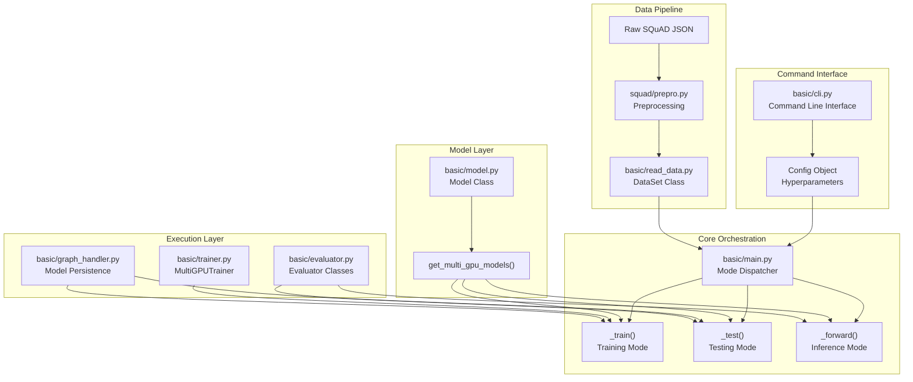

Sources: [basic/cli.py:101-109](), [basic/model.py:15-22](), [basic/graph_handler.py:14-21]()

### Core BiDAF Model Architecture

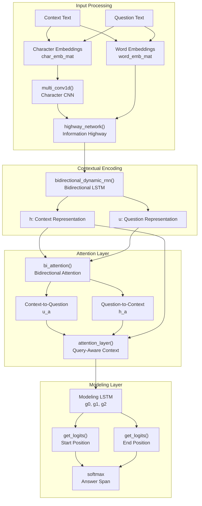

Sources: [basic/model.py:69-195](), [basic/model.py:380-425]()

## Core Components

### Model Class and Multi-GPU Support

The central `Model` class in [basic/model.py:25-378]() implements the BiDAF architecture. The system supports distributed training through the `get_multi_gpu_models()` function, which creates model replicas across multiple GPUs:

| Component | File | Key Functions | Purpose |
|-----------|------|---------------|---------|
| Model | `basic/model.py` | `__init__`, `_build_forward`, `_build_loss` | Core BiDAF implementation |
| Multi-GPU | `basic/model.py` | `get_multi_gpu_models` | Distributed model creation |
| Graph Handler | `basic/graph_handler.py` | `save`, `_load`, `dump_eval` | Model persistence and evaluation storage |

Sources: [basic/model.py:15-22](), [basic/graph_handler.py:14-80]()

### Configuration and Command Line Interface

The system uses TensorFlow's `flags` system for configuration management:

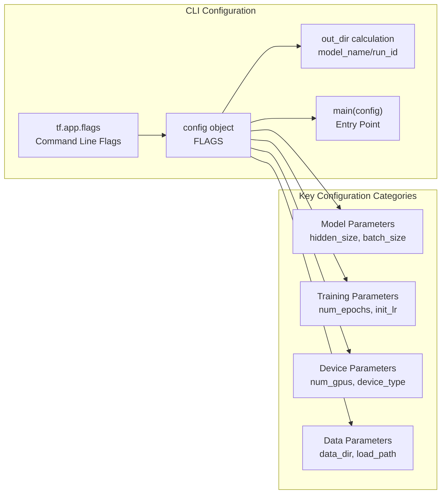

Key configuration parameters include:
- **Model architecture**: `hidden_size`, `char_emb_size`, `highway_num_layers`
- **Training**: `batch_size`, `num_epochs`, `init_lr`, `keep_prob`
- **Multi-GPU**: `num_gpus`, `device_type`
- **Data**: `data_dir`, `load_path`, `eval_path`

Sources: [basic/cli.py:7-99](), [basic/cli.py:101-109]()

### Data Processing Pipeline

The data pipeline transforms raw SQuAD JSON files into model-ready tensors:

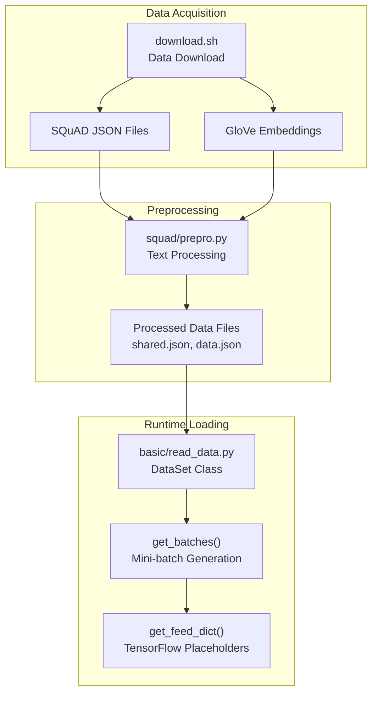

The `DataSet` class manages data loading and batching, while the `Model.get_feed_dict()` method converts data into TensorFlow placeholders.

Sources: [basic/model.py:245-377](), [basic/read_data.py]() (referenced in model.py)

## Execution Modes

The system supports three primary execution modes orchestrated by [basic/main.py]():

| Mode | Function | Purpose | Key Components |
|------|----------|---------|----------------|  
| `train` | `_train()` | Model training | `MultiGPUTrainer`, loss computation, checkpointing |
| `test` | `_test()` | Model evaluation | `MultiGPUF1Evaluator`, metrics calculation |
| `forward` | `_forward()` | Inference/prediction | `ForwardEvaluator`, answer generation |

Each mode utilizes the same underlying `Model` class but with different evaluator and trainer components.

Sources: [basic/cli.py:26](), [basic/main.py]() (referenced in cli.py)

## Getting Started

### Quick Start Sequence

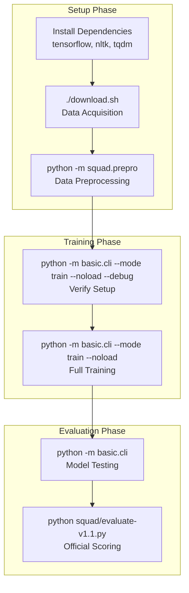

### System Requirements

- **GPU Memory**: Minimum 12GB for default batch size (60)
- **Training Time**: ~20 hours on NVIDIA Titan X
- **Model Size**: ~2.5M parameters
- **Multi-GPU**: Supported for distributed training

Sources: [README.md:8-57](), [README.md:138-151]()

### Performance Benchmarks

The system achieves the following performance on SQuAD:

| Model Type | Dev EM | Dev F1 | Test EM | Test F1 |
|------------|--------|--------|---------|---------|
| Single | 67.7% | 77.3% | 68.0% | 77.3% |
| Ensemble | 72.6% | 80.7% | 73.3% | 81.1% |

Sources: [README.md:104-122]()

## Integration Points

The BiDAF system integrates with several external tools and frameworks:

- **TensorFlow**: Core deep learning framework (r0.11 compatibility)
- **SQuAD Evaluation**: Official evaluation script at [squad/evaluate-v1.1.py]()
- **GloVe**: Pre-trained word embeddings for initialization
- **NLTK**: Natural language processing utilities

For advanced usage including ensemble methods and custom model variants, refer to the specialized documentation sections covering those topics.

Sources: [README.md:8-17](), [basic/model.py:1-13]()

---

# Page: Getting Started

# Getting Started

<details>
<summary>Relevant source files</summary>

The following files were used as context for generating this wiki page:

- [README.md](README.md)
- [basic/graph_handler.py](basic/graph_handler.py)
- [download.sh](download.sh)
- [my/zip_save.py](my/zip_save.py)
- [requirements.txt](requirements.txt)
- [tree/test.ipynb](tree/test.ipynb)

</details>


This guide provides a step-by-step walkthrough for setting up the BiDAF (Bi-directional Attention Flow) question answering system and running your first model. It covers environment setup, data preparation, and basic training and testing workflows.

For detailed information about the repository structure, see [Repository Structure](#1.2). For comprehensive configuration options, see [Configuration and CLI](#2.2). For in-depth preprocessing details, see [SQuAD Preprocessing](#3.2).

## Prerequisites and Requirements

The BiDAF system requires specific software dependencies and hardware specifications for optimal performance.

### System Requirements

| Component | Requirement | Notes |
|-----------|-------------|-------|
| Python | 3.5.2+ | Issues reported with Python 2 |
| GPU Memory | 12GB+ recommended | Required for default batch size |
| System Tools | `unzip`, `wget` | For automated data download |

### Python Dependencies

The core dependencies are defined in [requirements.txt:1-4]():

```
tensorflow>=0.11
nltk
tqdm
jinja2
```

**Essential packages:**
- `tensorflow` (r0.11) - Deep learning framework
- `nltk` (3.2.1+) - Natural language processing tools  
- `tqdm` (4.7.4+) - Progress bar functionality
- `jinja2` - Visualization support (optional for training/testing only)

Sources: [README.md:8-18](), [requirements.txt:1-4]()

## Environment Setup Workflow

The following diagram shows the complete setup and execution workflow:

### BiDAF Setup and Execution Flow
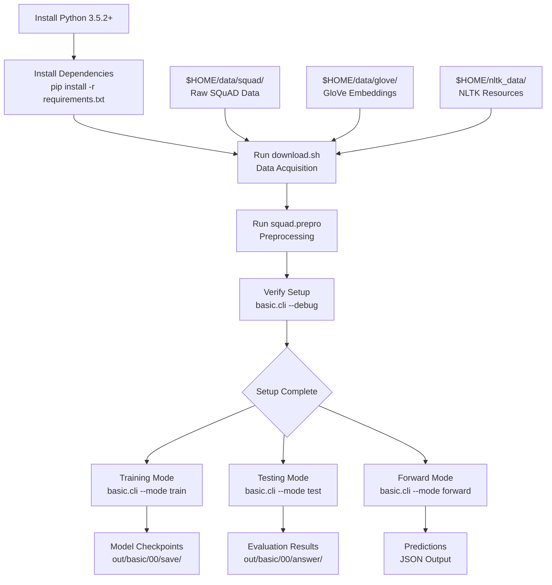

Sources: [README.md:19-57](), [download.sh:1-26]()

## Data Acquisition and Preprocessing

### Step 1: Download Required Data

Execute the automated download script to acquire SQuAD dataset, GloVe embeddings, and NLTK resources:

```bash
chmod +x download.sh
./download.sh
```

This script downloads approximately 850MB of data to `$HOME/data`, including:
- **SQuAD Dataset**: Training and development JSON files
- **GloVe Embeddings**: Pre-trained word vectors (6B tokens, 100d)
- **NLTK Data**: Punkt tokenizer resources

### Step 2: Preprocess SQuAD Data

Run the preprocessing pipeline to prepare data for model training:

```bash
python -m squad.prepro
```

This process (~5 minutes) tokenizes text, aligns embeddings, and saves processed data to `$PWD/data/squad`.

### Data Directory Structure After Setup
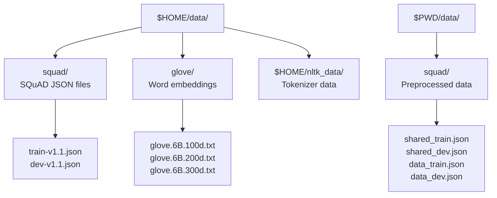

Sources: [download.sh:3-26](), [README.md:20-29]()

## Initial Verification

Before full training, verify the setup with a debug run to check memory requirements and configuration:

```bash
python -m basic.cli --mode train --noload --debug
```

This command performs a quick validation without loading pre-trained weights, ensuring:
- All dependencies are correctly installed
- GPU memory is sufficient (12GB+ recommended)
- Data preprocessing completed successfully
- Model architecture initializes properly

Sources: [README.md:39-42]()

## Training Your First Model

### Basic Training Command

Start full model training with the following command:

```bash
python -m basic.cli --mode train --noload
```

### Training with Optimization Flags

For faster training performance, use optimization flags:

```bash
python -m basic.cli --mode train --noload --len_opt --cluster
```

### Training Specifications

| Parameter | Value | Description |
|-----------|--------|-------------|
| Model Parameters | ~2.5M | Total trainable parameters |
| Training Steps | ~18k | Convergence point |
| Time per Step | ~4s | On Titan X Pascal |
| Total Training Time | ~20 hours | Full convergence |
| Memory Requirement | 12GB+ GPU | For default batch size |

### Command Flow for Training
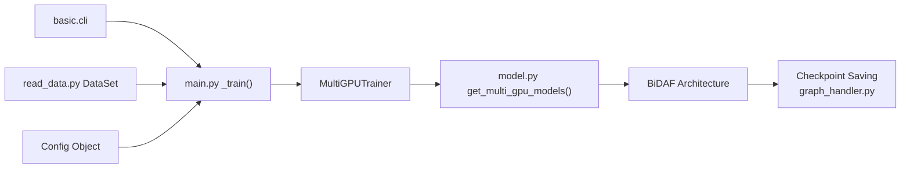

Sources: [README.md:31-54](), [basic/graph_handler.py:30-33]()

## Testing and Evaluation

### Basic Testing

Test a trained model using:

```bash
python -m basic.cli
```

### Testing with Optimization

For faster evaluation (5 minutes on dev data):

```bash
python -m basic.cli --len_opt --cluster
```

### Evaluation Output

The testing process generates:
- **Internal Scores**: F1 and EM metrics (printed to console)
- **Answer File**: JSON predictions in `$PWD/out/basic/00/answer/test-####.json`
- **Official Evaluation**: Use `squad/evaluate-v1.1.py` for standard metrics

### Official Evaluation Command

```bash
python squad/evaluate-v1.1.py $HOME/data/squad/dev-v1.1.json out/basic/00/answer/test-####.json
```

Sources: [README.md:60-79]()

## Multi-GPU Configuration

For systems with multiple GPUs or limited GPU memory, use distributed training:

### Multi-GPU Training Example

```bash
python -m basic.cli --mode train --noload --num_gpus 3 --batch_size 20
```

### Multi-GPU Testing Example

```bash
python -m basic.cli --num_gpus 3 --batch_size 20
```

This configuration distributes the default batch size of 60 across 3 GPUs (20 per GPU), combining gradients on CPU.

Sources: [README.md:138-151]()

## Expected Results

### Performance Benchmarks

| Model Type | Dev EM (%) | Dev F1 (%) | Test EM (%) | Test F1 (%) |
|------------|------------|------------|-------------|-------------|
| Single Model | 67.7 | 77.3 | 68.0 | 77.3 |
| Ensemble | 72.6 | 80.7 | 73.3 | 81.1 |

Sources: [README.md:102-122]()

## Next Steps

After successfully running your first model:

1. **Explore Configuration Options**: See [Configuration and CLI](#2.2) for detailed parameter tuning
2. **Understand Model Architecture**: Review [Model Architecture](#2.1) for technical details
3. **Advanced Training**: Consult [Training Pipeline](#4.1) for optimization strategies
4. **Model Ensembling**: See [Model Ensembling](#7.1) for combining multiple models
5. **Custom Data**: Review [Alternative Dataset Support](#3.3) for non-SQuAD datasets

Sources: [README.md:1-164]()

---

# Page: Repository Structure

# Repository Structure

<details>
<summary>Relevant source files</summary>

The following files were used as context for generating this wiki page:

- [basic/__init__.py](basic/__init__.py)
- [basic/cli.py](basic/cli.py)
- [basic/model.py](basic/model.py)
- [basic_cnn/main.py](basic_cnn/main.py)
- [basic_cnn/model.py](basic_cnn/model.py)

</details>


This document provides a comprehensive overview of the BiDAF repository's directory structure and organization. It explains the purpose of each major directory, the relationships between different components, and how they work together to implement the bidirectional attention flow model for question answering.

For information about the specific BiDAF model architecture and its neural network components, see [Model Architecture](#2.1). For details about training and evaluation processes, see [Training Pipeline](#4.1) and [Evaluation Framework](#4.2).

## Overview

The repository is organized into several main directories, each serving a distinct purpose in the BiDAF ecosystem. The structure supports multiple model variants, custom TensorFlow extensions, data processing pipelines, and comprehensive evaluation tools.

## Directory Structure

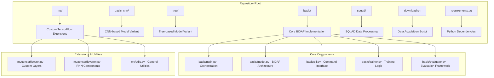

**Sources:** [basic/model.py:1-426](), [basic/cli.py:1-110](), [basic_cnn/model.py:1-376](), [my/tensorflow/nn.py](), [my/tensorflow/rnn.py](), [my/utils.py]()

## Core Directories

### basic/ - Primary BiDAF Implementation

The `basic/` directory contains the main BiDAF model implementation and serves as the primary entry point for the system.

| File | Purpose | Key Classes/Functions |
|------|---------|----------------------|
| `cli.py` | Command-line interface and configuration | `main()`, TensorFlow flags |
| `main.py` | Orchestration and execution modes | `_train()`, `_test()`, `_forward()` |
| `model.py` | BiDAF neural network architecture | `Model`, `get_multi_gpu_models()` |
| `trainer.py` | Training logic and optimization | `MultiGPUTrainer` |
| `evaluator.py` | Evaluation framework | `MultiGPUF1Evaluator` |
| `read_data.py` | Data loading and management | `DataSet` |
| `graph_handler.py` | Model persistence | `GraphHandler` |

**Sources:** [basic/cli.py:1-110](), [basic/model.py:1-426]()

### my/ - Custom TensorFlow Extensions

The `my/` directory provides custom TensorFlow components that extend the framework's capabilities for the BiDAF model.

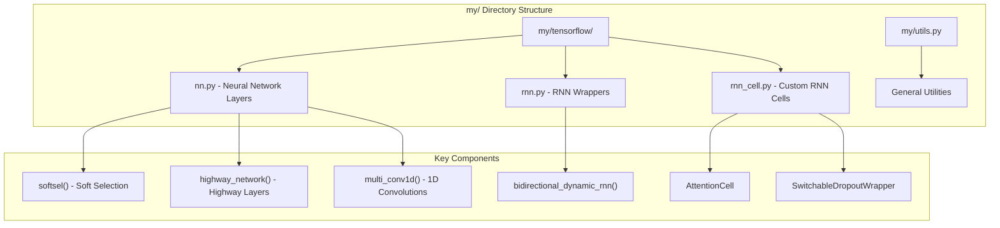

**Sources:** [basic/model.py:10-12](), [my/tensorflow/nn.py](), [my/tensorflow/rnn.py](), [my/tensorflow/rnn_cell.py]()

### squad/ - SQuAD Data Processing

The `squad/` directory handles SQuAD dataset-specific preprocessing and evaluation.

| Component | Purpose |
|-----------|---------|
| `prepro.py` | Tokenization and data preprocessing |
| `evaluate-v1.1.py` | Official SQuAD evaluation metrics |
| `utils.py` | Text processing utilities |

**Sources:** [squad/prepro.py](), [squad/evaluate-v1.1.py](), [squad/utils.py]()

## Alternative Model Implementations

### basic_cnn/ - CNN-based Variant

The `basic_cnn/` directory contains a CNN-based variant of the question answering model that shares the same overall structure as the main BiDAF implementation.

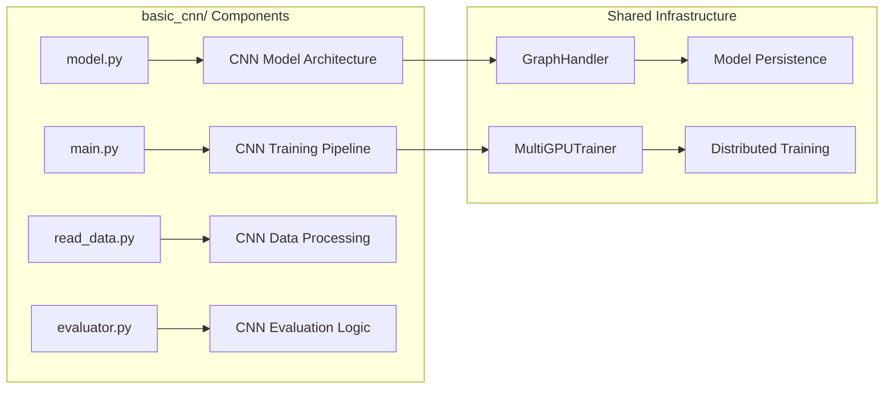

The CNN variant uses the same execution pattern with `get_multi_gpu_models()` function but implements a different neural architecture focused on convolutional layers rather than the bidirectional attention mechanism.

**Sources:** [basic_cnn/model.py:1-376](), [basic_cnn/main.py:1-239]()

### tree/ - Tree-based Model

The `tree/` directory implements a tree-structured neural network that processes syntactic parse trees for question answering.

**Sources:** [tree/model.py](), [tree/read_data.py]()

## Execution Flow and Entry Points

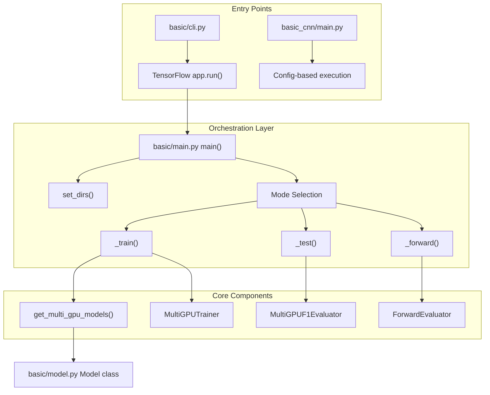

The main execution flow begins with command-line argument parsing in `basic/cli.py`, which configures the system through TensorFlow flags and calls the main orchestration function. The system supports three primary execution modes controlled by the `mode` parameter.

**Sources:** [basic/cli.py:101-110](), [basic/main.py]()

## Data Flow Architecture

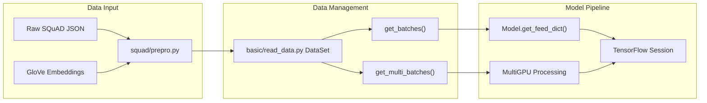

The data flows from raw JSON files through preprocessing, into DataSet objects that manage batching and feeding data to the TensorFlow models. The `DataSet` class in `basic/read_data.py` serves as the central data management component.

**Sources:** [basic/read_data.py](), [basic/model.py:245-377]()

## Configuration and Extensibility

The repository uses a comprehensive configuration system through TensorFlow flags defined in `basic/cli.py`. Key configuration categories include:

- **Model Architecture**: `hidden_size`, `char_emb_size`, `highway_num_layers`
- **Training Parameters**: `batch_size`, `num_epochs`, `init_lr`
- **Multi-GPU Settings**: `num_gpus`, `device_type`
- **Optimization Flags**: `len_opt`, `cpu_opt`, `cluster`

The modular design allows for easy extension through the plugin-style architecture where new model variants can be added by following the patterns established in `basic_cnn/` and `tree/` directories.

**Sources:** [basic/cli.py:9-99]()

---

# Page: Core BiDAF Model

# Core BiDAF Model

<details>
<summary>Relevant source files</summary>

The following files were used as context for generating this wiki page:

- [basic/cli.py](basic/cli.py)
- [basic/main.py](basic/main.py)
- [basic/model.py](basic/model.py)

</details>


This document covers the core BiDAF (Bidirectional Attention Flow) model architecture implemented in the `basic/model.py` file. It explains how the model processes question-context pairs to predict answer spans, including the embedding layers, attention mechanisms, and output generation. For information about alternative model architectures, see [Alternative Models](#6). For details about training and evaluation processes, see [Training and Evaluation](#4).

## Model Architecture Overview

The BiDAF model follows a hierarchical architecture that transforms raw text inputs through multiple processing stages to produce answer span predictions. The `Model` class in [basic/model.py:25-378]() implements this complete pipeline.

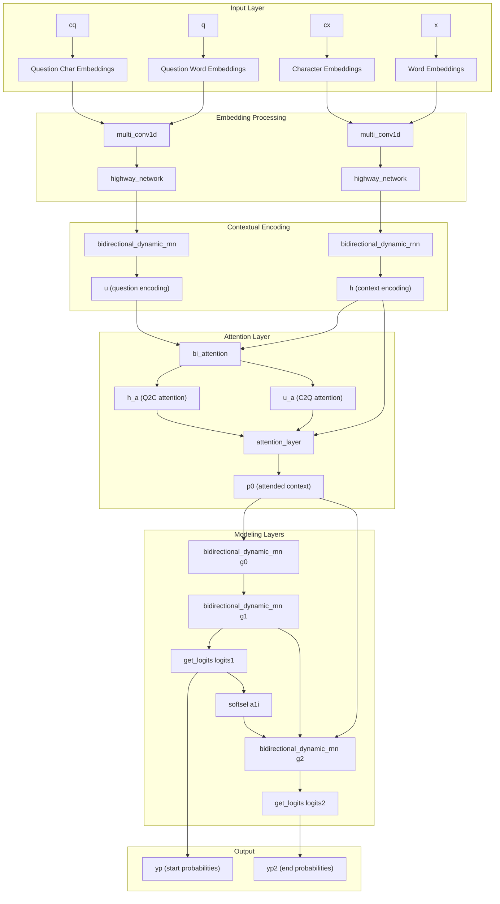

**Model Architecture Flow Diagram**

Sources: [basic/model.py:69-195]()

## Core Components

### Embedding Layer

The embedding layer processes both word-level and character-level representations. The implementation supports configurable embedding strategies through the `use_char_emb` and `use_word_emb` flags.

| Component | Input Shape | Output Shape | Purpose |
|-----------|-------------|--------------|---------|
| Character Embeddings | `[N, M, JX, W]` | `[N, M, JX, dco]` | Character-level word representations |
| Word Embeddings | `[N, M, JX]` | `[N, M, JX, dw]` | Pre-trained word vectors |
| Highway Network | `[N, M, JX, di]` | `[N, M, JX, di]` | Information flow control |

The character embedding processing uses `multi_conv1d` convolutions followed by max pooling to create character-aware word representations [basic/model.py:85-103](). Word embeddings utilize pre-trained GloVe vectors loaded through the `word_emb_mat` variable [basic/model.py:107-112]().

Sources: [basic/model.py:80-133]()

### Encoding Layer  

The encoding layer applies bidirectional LSTMs to create contextual representations for both the passage and question. The `BasicLSTMCell` with `SwitchableDropoutWrapper` provides regularization during training.

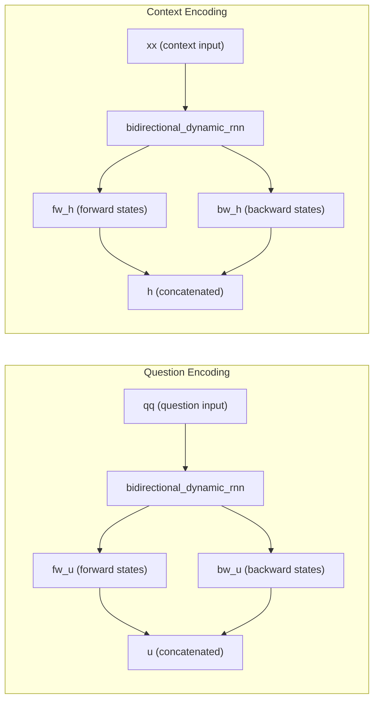

**Bidirectional Encoding Process**

The encoding phase creates representations `u` for questions and `h` for context paragraphs [basic/model.py:140-151](). The `share_lstm_weights` configuration option allows weight sharing between question and context encoders.

Sources: [basic/model.py:135-151]()

### Attention Layer

BiDAF's core innovation is the bidirectional attention mechanism implemented in the `bi_attention` and `attention_layer` functions. This creates query-aware context representations and context-aware query representations.

The attention computation follows these steps:

1. **Similarity Matrix**: Computes attention weights between every context word and question word
2. **Context-to-Question (C2Q)**: For each context word, identifies most relevant question words  
3. **Question-to-Context (Q2C)**: Identifies context words most relevant to the entire question

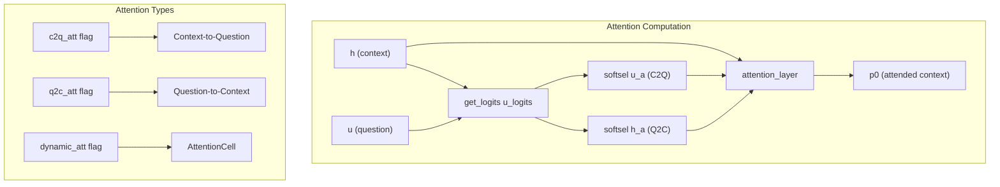

**Bidirectional Attention Mechanism**

The `bi_attention` function [basic/model.py:380-409]() computes the core attention matrices, while `attention_layer` [basic/model.py:412-425]() integrates them based on configuration flags `q2c_att` and `c2q_att`.

Sources: [basic/model.py:154-162](), [basic/model.py:380-425]()

### Modeling Layer  

The modeling layer consists of multiple bidirectional LSTM layers (`g0`, `g1`, `g2`) that progressively refine the attended context representation. Each layer builds on the previous one to model complex reasoning patterns.

The modeling process includes:
- **g0 layer**: Initial modeling over attended context `p0`
- **g1 layer**: Secondary modeling with start position awareness  
- **g2 layer**: Final modeling incorporating start position information via `a1i`

Answer span prediction uses the `get_logits` function with configurable answer functions specified by the `answer_func` parameter [basic/model.py:169-179]().

Sources: [basic/model.py:164-180]()

### Output Layer

The output layer generates probability distributions over start and end positions for the answer span. The model produces two separate predictions:

- `yp`: Start position probabilities from `logits`
- `yp2`: End position probabilities from `logits2`  

Both use softmax normalization over the flattened context representation [basic/model.py:181-194]().

Sources: [basic/model.py:181-194]()

## Multi-GPU Support

The `get_multi_gpu_models` function enables distributed training across multiple GPUs. Each GPU gets its own `Model` instance with shared variables after the first model.

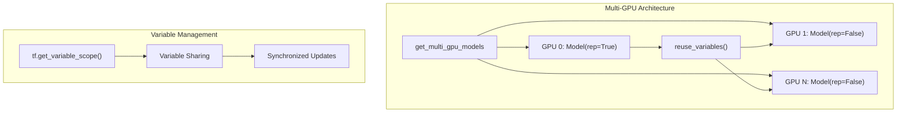

**Multi-GPU Model Distribution**

The `rep` parameter controls which model builds the exponential moving average variables [basic/model.py:15-22]().

Sources: [basic/model.py:15-22]()

## Configuration and Placeholders

The model accepts various input placeholders defined in the constructor:

| Placeholder | Shape | Purpose |
|-------------|-------|---------|
| `x` | `[N, M, JX]` | Context word indices |
| `cx` | `[N, M, JX, W]` | Context character indices |
| `q` | `[N, JQ]` | Question word indices |
| `cq` | `[N, JQ, W]` | Question character indices |
| `y` | `[N, M, JX]` | Answer start positions |
| `y2` | `[N, M, JX]` | Answer end positions |

Key configuration dimensions are extracted from the config object [basic/model.py:33-35]():
- `N`: Batch size
- `M`: Maximum number of sentences  
- `JX`: Maximum sentence length
- `JQ`: Maximum question length
- `W`: Maximum word length

Sources: [basic/model.py:26-46](), [basic/model.py:71-78]()

## Loss Computation

The model uses cross-entropy loss for both start and end position predictions. The `_build_loss` method computes separate losses for `logits` and `logits2`, then combines them [basic/model.py:196-213]().

Loss masking ensures that only valid question positions contribute to the loss computation through the `loss_mask` derived from `q_mask` [basic/model.py:201-204]().

Sources: [basic/model.py:196-213]()

---

# Page: Model Architecture

# Model Architecture

<details>
<summary>Relevant source files</summary>

The following files were used as context for generating this wiki page:

- [basic/cli.py](basic/cli.py)
- [basic/model.py](basic/model.py)

</details>


This document explains the neural network architecture of the BiDAF (Bidirectional Attention Flow) model implemented in the core system. It covers the structure and flow of the main model components, from input embeddings through attention mechanisms to answer prediction. For information about training and evaluation processes, see [Training Pipeline](#4.1). For details about data preprocessing and input formats, see [SQuAD Preprocessing](#3.2).

## Model Class Structure

The BiDAF model is implemented in the `Model` class within [basic/model.py:25-378](). The architecture supports multi-GPU training through the `get_multi_gpu_models` function which creates multiple model instances across available GPUs.

### Model Architecture Flow

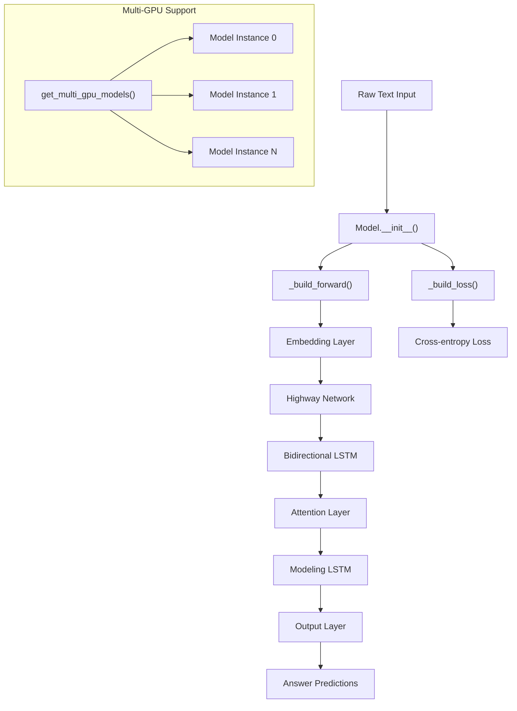

**Sources:** [basic/model.py:15-22](), [basic/model.py:25-67](), [basic/model.py:69-195]()

## Input Processing and Embeddings

The model processes both character-level and word-level embeddings, which are then combined and passed through highway networks for improved information flow.

### Embedding Architecture

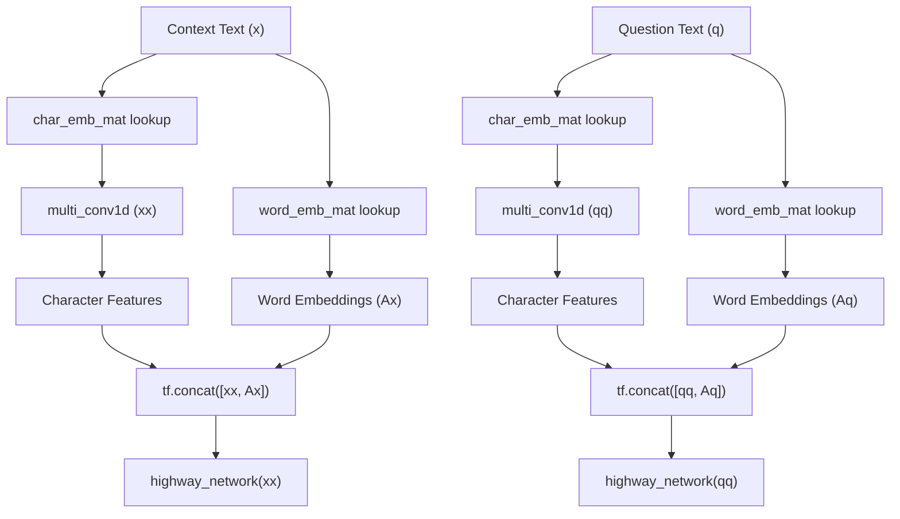

**Sources:** [basic/model.py:80-133]()

The embedding process involves several key components:

| Component | Configuration | Purpose |
|-----------|---------------|---------|
| `char_emb_mat` | Size: `[VC, dc]` | Character-level embeddings |
| `word_emb_mat` | Size: `[VW, dw]` | Word-level embeddings (GloVe) |
| `multi_conv1d` | Configurable filters | Character CNN processing |
| `highway_network` | 2 layers default | Information gating mechanism |

**Sources:** [basic/model.py:82-83](), [basic/model.py:107-108](), [basic/model.py:95-100](), [basic/model.py:127-130]()

## Core BiDAF Architecture

The heart of the model consists of bidirectional LSTM layers followed by the signature bidirectional attention mechanism.

### Contextual Encoding and Attention Flow

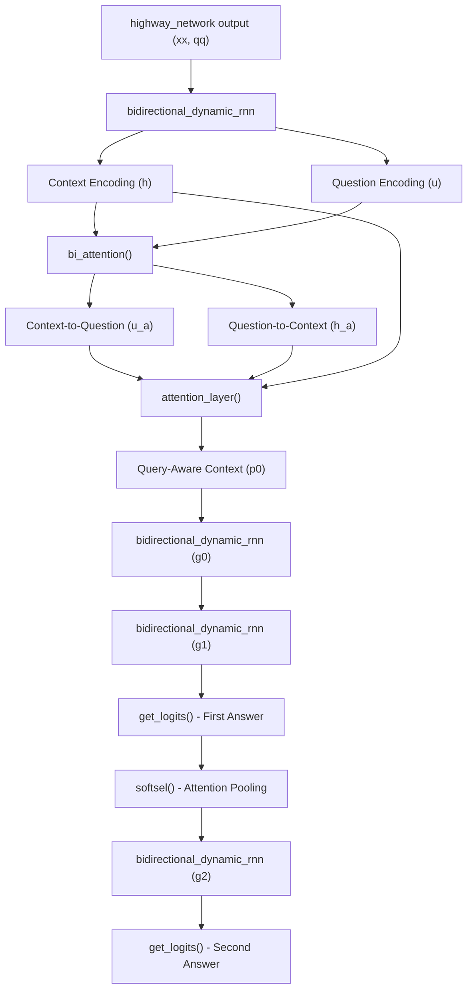

**Sources:** [basic/model.py:140-151](), [basic/model.py:380-409](), [basic/model.py:412-425](), [basic/model.py:164-179]()

### Bidirectional Attention Details

The `bi_attention` function implements the core innovation of BiDAF - computing attention in both directions between context and question:

```mermaid
graph LR
    A["Context h [N,M,JX,2d]"] --> B["h_aug expansion"]
    C["Question u [N,JQ,2d]"] --> D["u_aug expansion"]
    
    B --> E["get_logits([h_aug, u_aug])"]
    D --> E
    
    E --> F["u_logits [N,M,JX,JQ]"]
    
    F --> G["softsel(u_aug, u_logits)"]
    F --> H["tf.reduce_max(u_logits, 3)"]
    
    G --> I["Context-to-Question (u_a)"]
    H --> J["softsel(h, max_logits)"]
    J --> K["Question-to-Context (h_a)"]
```

**Sources:** [basic/model.py:380-409]()

## Output Processing and Answer Prediction

The model produces two sets of logits for answer span prediction - one for the start position and one for the end position.

### Answer Prediction Architecture

The final layers process the attended representations through multiple LSTM layers and produce probability distributions over possible answer positions:

| Component | Input | Output | Purpose |
|-----------|-------|--------|---------|
| `g0` LSTM | `p0` (attended context) | `[N,M,JX,2d]` | First modeling layer |
| `g1` LSTM | `g0` output | `[N,M,JX,2d]` | Second modeling layer |
| `get_logits` | `[g1, p0]` | `[N,M*JX]` | Start position logits |
| `softsel` | `g1` + `logits` | `[N,2d]` | Attention-weighted sum |
| `g2` LSTM | Concatenated features | `[N,M,JX,2d]` | Final modeling layer |
| `get_logits` | `[g2, p0]` | `[N,M*JX]` | End position logits |

**Sources:** [basic/model.py:164-179](), [basic/model.py:181-194]()

## Configuration Options

The model architecture is highly configurable through command-line flags defined in [basic/cli.py](). Key architectural parameters include:

### Essential Architecture Parameters

| Parameter | Default | Description |
|-----------|---------|-------------|
| `hidden_size` | 100 | LSTM hidden dimension |
| `char_emb_size` | 8 | Character embedding size |
| `char_out_size` | 100 | Character CNN output size |
| `highway_num_layers` | 2 | Number of highway layers |
| `share_lstm_weights` | True | Share LSTM weights between context/question |
| `share_cnn_weights` | True | Share CNN weights for character processing |

**Sources:** [basic/cli.py:44-53]()

### Attention Configuration

| Parameter | Default | Description |
|-----------|---------|-------------|
| `c2q_att` | True | Enable context-to-question attention |
| `q2c_att` | True | Enable question-to-context attention |
| `dynamic_att` | False | Use dynamic attention with AttentionCell |
| `logit_func` | "tri_linear" | Attention scoring function |

**Sources:** [basic/cli.py:96-98](), [basic/cli.py:89]()

The model supports alternative attention mechanisms through the `dynamic_att` flag, which uses `AttentionCell` instead of the standard bidirectional attention mechanism.

**Sources:** [basic/model.py:154-162]()

---

# Page: Configuration and CLI

# Configuration and CLI

<details>
<summary>Relevant source files</summary>

The following files were used as context for generating this wiki page:

- [basic/cli.py](basic/cli.py)
- [basic/main.py](basic/main.py)
- [basic/model.py](basic/model.py)

</details>


This document covers the command-line interface and configuration system for the BiDAF model. The configuration system uses TensorFlow's flags mechanism to manage hyperparameters, paths, and execution settings across all components of the system.

For information about how these configurations are used during training and evaluation, see [Training Pipeline](#4.1) and [Evaluation Framework](#4.2). For details on execution modes, see [Execution Modes](#2.3).

## CLI Interface Overview

The BiDAF system uses a comprehensive command-line interface defined in `basic/cli.py` that provides over 70 configuration options. The CLI uses TensorFlow's `tf.app.flags` system to define and parse command-line arguments.

### CLI Architecture Flow

```mermaid
graph TB
    subgraph "CLI Entry Point"
        A["tf.app.run()"] --> B["main(_)"]
        B --> C["config = flags.FLAGS"]
    end
    
    subgraph "Configuration Processing"
        C --> D["config.out_dir = os.path.join(...)"]
        D --> E["basic.main.main(config)"]
    end
    
    subgraph "Configuration Usage"
        E --> F["set_dirs(config)"]
        E --> G["_train(config)"]
        E --> H["_test(config)"]
        E --> I["_forward(config)"]
    end
    
    subgraph "Model Integration"
        G --> J["get_multi_gpu_models(config)"]
        H --> J
        I --> J
        J --> K["Model(config, scope, rep)"]
    end
```

Sources: [basic/cli.py:101-109](), [basic/main.py:19-30]()

## Configuration Categories

The configuration system is organized into logical categories, each serving specific aspects of the model and training pipeline.

### Core Configuration Groups

| Category | Purpose | Key Flags | Used By |
|----------|---------|-----------|---------|
| **Names & Directories** | File paths and identifiers | `model_name`, `data_dir`, `out_base_dir` | [basic/main.py:32-51]() |
| **Device Placement** | GPU/CPU configuration | `device_type`, `num_gpus`, `device` | [basic/model.py:15-22]() |
| **Training Parameters** | Learning and optimization | `batch_size`, `init_lr`, `num_epochs` | [basic/trainer.py]() |
| **Model Architecture** | Neural network structure | `hidden_size`, `highway`, `char_emb_size` | [basic/model.py:26-378]() |
| **Attention Mechanisms** | BiDAF-specific settings | `q2c_att`, `c2q_att`, `dynamic_att` | [basic/model.py:380-425]() |
| **Optimization** | Performance tuning | `len_opt`, `cpu_opt`, `cluster` | [basic/model.py:253-276]() |

Sources: [basic/cli.py:9-99]()

### Configuration to Code Entity Mapping

```mermaid
graph LR
    subgraph "CLI Flags"
        A["--hidden_size"] --> B["config.hidden_size"]
        C["--batch_size"] --> D["config.batch_size"]
        E["--num_gpus"] --> F["config.num_gpus"]
        G["--mode"] --> H["config.mode"]
    end
    
    subgraph "Model Constructor"
        B --> I["BasicLSTMCell(d, ...)"]
        D --> J["N = config.batch_size"]
        F --> K["get_multi_gpu_models(config)"]
        H --> L["if config.mode == 'train'"]
    end
    
    subgraph "TensorFlow Operations"
        I --> M["bidirectional_dynamic_rnn()"]
        J --> N["tf.placeholder('int32', [N, None, None])"]
        K --> O["tf.device('/gpu:{}')"]
        L --> P["Model._build_forward()"]
    end
```

Sources: [basic/cli.py:44](), [basic/model.py:33-35](), [basic/model.py:135-149]()

## Essential Configuration Options

### Training and Execution Control

```mermaid
graph TD
    subgraph "Execution Mode Control"
        A["--mode"] --> B["train"]
        A --> C["test"] 
        A --> D["forward"]
        
        B --> E["_train(config)"]
        C --> F["_test(config)"]
        D --> G["_forward(config)"]
    end
    
    subgraph "Training Parameters"
        H["--batch_size"] --> I["config.batch_size = 60"]
        J["--num_epochs"] --> K["config.num_epochs = 12"]
        L["--init_lr"] --> M["config.init_lr = 0.5"]
        
        I --> N["train_data.get_multi_batches()"]
        K --> O["num_steps calculation"]
        M --> P["optimizer configuration"]
    end
    
    subgraph "Model Architecture"
        Q["--hidden_size"] --> R["config.hidden_size = 100"]
        S["--highway"] --> T["config.highway = True"]
        U["--char_emb_size"] --> V["config.char_emb_size = 8"]
        
        R --> W["BasicLSTMCell(d, ...)"]
        T --> X["highway_network()"]
        V --> Y["char_emb_mat shape"]
    end
```

Sources: [basic/cli.py:26](), [basic/cli.py:34](), [basic/cli.py:44](), [basic/main.py:22-29]()

### Device and Performance Configuration

The system supports multi-GPU training and various performance optimizations:

```python
# Device placement configuration
flags.DEFINE_string("device_type", "gpu", "device for computing gradients")
flags.DEFINE_integer("num_gpus", 1, "num of gpus or cpus for computing gradients")
flags.DEFINE_string("device", "/cpu:0", "default device for summing gradients")

# Performance optimizations
flags.DEFINE_bool("len_opt", False, "Length optimization?")
flags.DEFINE_bool("cpu_opt", False, "CPU optimization?")
flags.DEFINE_bool("cluster", False, "Cluster data for faster training")
```

Sources: [basic/cli.py:21-59]()

## Configuration Processing Pipeline

### Configuration Flow Through System

```mermaid
graph TB
    subgraph "CLI Processing"
        A["tf.app.flags.DEFINE_*"] --> B["flags.FLAGS"]
        B --> C["config = flags.FLAGS"]
        C --> D["config.out_dir = os.path.join(...)"]
    end
    
    subgraph "Directory Setup"
        D --> E["set_dirs(config)"]
        E --> F["config.save_dir"]
        E --> G["config.log_dir"]
        E --> H["config.eval_dir"]
        E --> I["config.answer_dir"]
    end
    
    subgraph "Data Configuration"
        C --> J["read_data(config, ...)"]
        J --> K["update_config(config, [data])"]
        K --> L["config.word_vocab_size"]
        K --> M["config.char_vocab_size"]
        K --> N["config.word_emb_size"]
    end
    
    subgraph "Model Configuration"
        C --> O["get_multi_gpu_models(config)"]
        L --> O
        M --> O
        N --> O
        O --> P["Model(config, scope, rep)"]
    end
```

Sources: [basic/cli.py:101-109](), [basic/main.py:32-51](), [basic/read_data.py]()

### Configuration Validation and Updates

The system performs configuration validation and updates based on loaded data:

```python
def update_config(config, data_list):
    # Updates configuration based on actual data dimensions
    config.max_sent_size = max(config.max_sent_size, 
                              max(len(sent) for data in data_list 
                                  for para in data.data['x'] 
                                  for sent in para))
```

Sources: [basic/read_data.py]()

## Advanced Configuration Features

### Attention Mechanism Configuration

```mermaid
graph LR
    subgraph "Attention Flags"
        A["--q2c_att"] --> B["config.q2c_att = True"]
        C["--c2q_att"] --> D["config.c2q_att = True"] 
        E["--dynamic_att"] --> F["config.dynamic_att = False"]
    end
    
    subgraph "Model Implementation"
        B --> G["bi_attention(config, ...)"]
        D --> G
        F --> H["if config.dynamic_att: AttentionCell"]
        F --> I["else: attention_layer()"]
    end
    
    subgraph "Attention Functions"
        G --> J["u_a, h_a = bi_attention()"]
        H --> K["first_cell = AttentionCell()"]
        I --> L["p0 = attention_layer()"]
    end
```

Sources: [basic/cli.py:96-98](), [basic/model.py:154-162](), [basic/model.py:412-425]()

### Embedding Configuration

The system supports both character-level and word-level embeddings with extensive configuration options:

| Flag | Default | Purpose | Implementation |
|------|---------|---------|---------------|
| `use_char_emb` | True | Enable character embeddings | [basic/model.py:81-103]() |
| `use_word_emb` | True | Enable word embeddings | [basic/model.py:104-124]() |
| `char_emb_size` | 8 | Character embedding dimension | [basic/model.py:83]() |
| `char_out_size` | 100 | Character CNN output size | [basic/model.py:78]() |
| `filter_heights` | "5" | CNN filter heights | [basic/model.py:92]() |
| `use_glove_for_unk` | True | Use GloVe for unknown words | [basic/model.py:110-111]() |

Sources: [basic/cli.py:94-95](), [basic/cli.py:46-48](), [basic/cli.py:87]()

## Configuration Usage Patterns

### Debug Mode Configuration

The system provides a debug mode that overrides multiple settings for rapid testing:

```python
def _config_debug(config):
    if config.debug:
        config.num_steps = 2
        config.eval_period = 1
        config.log_period = 1
        config.save_period = 1
        config.val_num_batches = 2
        config.test_num_batches = 2
```

Sources: [basic/main.py:54-62]()

### Multi-GPU Configuration Usage

```mermaid
graph TD
    subgraph "Multi-GPU Setup"
        A["config.num_gpus"] --> B["get_multi_gpu_models(config)"]
        B --> C["for gpu_idx in range(config.num_gpus)"]
        C --> D["tf.device('/gpu:{}')".format(gpu_idx)]
        D --> E["Model(config, scope, rep)"]
    end
    
    subgraph "Device Placement"
        F["config.device_type"] --> G["'/{}:{}'.format(config.device_type, gpu_idx)"]
        G --> D
        H["config.device"] --> I["tf.device(config.device)"]
        I --> J["gradient aggregation"]
    end
```

Sources: [basic/model.py:15-22](), [basic/main.py:21]()

The configuration system provides comprehensive control over all aspects of the BiDAF model, from basic training parameters to advanced multi-GPU deployment settings. The `tf.app.flags` system ensures type safety and provides built-in help documentation for all options.

---

# Page: Execution Modes

# Execution Modes

<details>
<summary>Relevant source files</summary>

The following files were used as context for generating this wiki page:

- [basic/main.py](basic/main.py)

</details>


## Purpose and Scope

This document covers the three primary execution modes of the BiDAF system and how they are orchestrated through the main entry point. The execution modes determine how the system processes data and models: training new models, testing existing models, or performing forward inference. 

For information about model architecture details, see [Model Architecture](#2.1). For configuration options, see [Configuration and CLI](#2.2). For details about the training pipeline components, see [Training Pipeline](#4.1).

## Main Execution Flow

The BiDAF system operates through a centralized orchestration mechanism in `basic/main.py` that dispatches to one of three execution modes based on configuration.

### Execution Dispatcher

```mermaid
graph TD
    A["_run()"] --> B["Config(**json.load(fh))"]
    B --> C["main(config)"]
    C --> D["set_dirs(config)"]
    D --> E{config.mode}
    E -->|"train"| F["_train(config)"]
    E -->|"test"| G["_test(config)"]
    E -->|"forward"| H["_forward(config)"]
    F --> I["MultiGPUTrainer"]
    G --> J["MultiGPUF1Evaluator"]
    H --> K["ForwardEvaluator"]
```

Sources: [basic/main.py:19-30](), [basic/main.py:222-230]()

The `main()` function serves as the central dispatcher, using `tf.device(config.device)` to set the TensorFlow device context and routing execution based on the `config.mode` parameter.

### Directory Structure Setup

Before executing any mode, the system establishes a standardized directory structure through `set_dirs()`:

| Directory | Purpose | Config Attribute |
|-----------|---------|------------------|
| `out_dir` | Root output directory | `config.out_dir` |
| `save_dir` | Model checkpoints | `config.save_dir` |
| `log_dir` | TensorBoard logs | `config.log_dir` |
| `eval_dir` | Evaluation outputs | `config.eval_dir` |
| `answer_dir` | Answer predictions | `config.answer_dir` |

Sources: [basic/main.py:32-52]()

## Training Mode

The training mode (`_train()`) implements the complete training pipeline with multi-GPU support, periodic evaluation, and checkpoint management.

### Training Flow

```mermaid
graph TD
    A["_train(config)"] --> B["read_data() train & dev"]
    B --> C["update_config()"]
    C --> D["Build embedding matrix"]
    D --> E["get_multi_gpu_models(config)"]
    E --> F["MultiGPUTrainer(config, models)"]
    F --> G["MultiGPUF1Evaluator(config, models)"]
    G --> H["GraphHandler(config, model)"]
    H --> I["tf.Session()"]
    I --> J["Training Loop"]
    J --> K["trainer.step()"]
    K --> L{global_step % save_period}
    L -->|Yes| M["graph_handler.save()"]
    L -->|No| N{global_step % eval_period}
    N -->|Yes| O["evaluator.get_evaluation_from_batches()"]
    N -->|No| J
    O --> J
    M --> N
```

Sources: [basic/main.py:64-128]()

### Training Components

The training mode initializes several key components:

- **Data Loading**: Uses `get_squad_data_filter()` and `read_data()` for train/dev data
- **Embedding Matrix**: Constructs `emb_mat` from GloVe vectors with random initialization for OOV words
- **Multi-GPU Models**: Creates model replicas via `get_multi_gpu_models()`
- **Trainer**: `MultiGPUTrainer` handles distributed training across GPUs
- **Evaluator**: `MultiGPUF1Evaluator` computes F1 and exact match scores
- **Graph Handler**: `GraphHandler` manages model persistence and TensorBoard logging

### Training Loop Control

The training loop processes batches using configurable periods:

- `config.log_period`: Frequency of summary logging
- `config.save_period`: Frequency of model checkpointing  
- `config.eval_period`: Frequency of evaluation on dev set

Sources: [basic/main.py:93-127]()

## Testing Mode

The testing mode (`_test()`) evaluates trained models on test data with support for visualization and answer dumping.

### Testing Flow

```mermaid
graph TD
    A["_test(config)"] --> B["read_data() test"]
    B --> C["update_config()"]
    C --> D{config.use_glove_for_unk}
    D -->|Yes| E["Build new_emb_mat"]
    D -->|No| F["get_multi_gpu_models()"]
    E --> F
    F --> G["MultiGPUF1Evaluator"]
    G --> H["GraphHandler"]
    H --> I["tf.Session()"]
    I --> J["graph_handler.initialize()"]
    J --> K["Evaluation Loop"]
    K --> L["evaluator.get_evaluation()"]
    L --> M{config.vis}
    M -->|Yes| N["dump_eval() per batch"]
    M -->|No| O["Accumulate results"]
    N --> O
    O --> K
    K --> P["Final dump_answer/dump_eval"]
```

Sources: [basic/main.py:130-173]()

### Testing Features

- **OOV Handling**: When `config.use_glove_for_unk` is enabled, builds `new_emb_mat` for unknown words
- **Visualization**: With `config.vis`, saves detailed evaluation outputs per batch
- **Answer Dumping**: Generates prediction files in SQuAD format when `config.dump_answer` is set
- **Evaluation Dumping**: Saves detailed evaluation metrics when `config.dump_eval` is set

Sources: [basic/main.py:136-141](), [basic/main.py:159-172]()

## Forward Mode

The forward mode (`_forward()`) performs inference on new data without computing evaluation metrics.

### Forward Flow

```mermaid
graph TD
    A["_forward(config)"] --> B["assert config.load"]
    B --> C["read_data(config.forward_name)"]
    C --> D["update_config()"]
    D --> E{config.use_glove_for_unk}
    E -->|Yes| F["Build new_emb_mat"]
    E -->|No| G["get_multi_gpu_models()"]
    F --> G
    G --> H["ForwardEvaluator(config, model)"]
    H --> I["GraphHandler"]
    I --> J["tf.Session()"]
    J --> K["graph_handler.initialize()"]
    K --> L["Single-GPU Batch Processing"]
    L --> M["evaluator.get_evaluation_from_batches()"]
    M --> N["dump_answer/dump_eval"]
```

Sources: [basic/main.py:175-209]()

### Forward Mode Characteristics

- **Load Required**: Requires `config.load` to be True (no training from scratch)
- **Custom Dataset**: Uses `config.forward_name` to specify the dataset name
- **Single GPU**: Uses `ForwardEvaluator` instead of multi-GPU evaluator
- **Inference Only**: Generates predictions without ground truth comparison

The forward mode uses `test_data.get_batches()` (single GPU) rather than `get_multi_batches()` used in training and testing modes.

Sources: [basic/main.py:176](), [basic/main.py:192](), [basic/main.py:201]()

## Debug Configuration

All execution modes support debug configuration through `_config_debug()`, which overrides several parameters when `config.debug` is True:

- `num_steps = 2`
- `eval_period = 1` 
- `log_period = 1`
- `save_period = 1`
- `val_num_batches = 2`
- `test_num_batches = 2`

This enables rapid testing with minimal data processing.

Sources: [basic/main.py:54-62]()

## Component Integration

### Cross-Mode Dependencies

```mermaid
graph TB
    subgraph "Data Layer"
        A["read_data()"]
        B["get_squad_data_filter()"]
        C["update_config()"]
    end
    
    subgraph "Model Layer"  
        D["get_multi_gpu_models()"]
        E["GraphHandler"]
    end
    
    subgraph "Execution Layer"
        F["MultiGPUTrainer"]
        G["MultiGPUF1Evaluator"] 
        H["ForwardEvaluator"]
    end
    
    subgraph "Modes"
        I["_train()"]
        J["_test()"]
        K["_forward()"]
    end
    
    A --> I
    A --> J
    A --> K
    B --> I
    C --> I
    C --> J
    C --> K
    D --> I
    D --> J
    D --> K
    E --> I
    E --> J
    E --> K
    F --> I
    G --> I
    G --> J
    H --> K
```

Sources: [basic/main.py:12-16](), [basic/main.py:64-128](), [basic/main.py:130-173](), [basic/main.py:175-209]()

Each execution mode follows a consistent pattern: data loading, configuration updates, model initialization, component setup, and execution loop. The modes differ primarily in their execution components (`MultiGPUTrainer` vs evaluators) and output handling (checkpointing vs prediction dumping).

---

# Page: Data Pipeline

# Data Pipeline

<details>
<summary>Relevant source files</summary>

The following files were used as context for generating this wiki page:

- [basic/read_data.py](basic/read_data.py)
- [squad/prepro.py](squad/prepro.py)

</details>


The data pipeline system manages the complete flow of data from raw SQuAD JSON files through preprocessing, storage, and loading into the BiDAF model. This system handles tokenization, embedding integration, data filtering, batching, and multi-GPU data distribution. For model-specific data transformations, see [Model Architecture](#2.1). For training-specific data handling, see [Training Pipeline](#4.1).

## Data Flow Overview

The data pipeline transforms raw question-answer datasets through several stages before feeding them to the BiDAF model:

**Data Flow Architecture**
```mermaid
graph TD
    subgraph "Raw Data Sources"
        A["SQuAD JSON Files<br/>train-v1.1.json<br/>dev-v1.1.json"] --> B["squad/prepro.py<br/>prepro()"]
        C["GloVe Embeddings<br/>glove.*.txt"] --> B
        D["NLTK/CoreNLP<br/>Tokenizers"] --> B
    end
    
    subgraph "Preprocessing Stage"
        B --> E["Tokenization<br/>word_tokenize()<br/>sent_tokenize()"]
        E --> F["Word/Char Counters<br/>word_counter<br/>char_counter"]
        F --> G["Embedding Extraction<br/>get_word2vec()"]
        G --> H["Data Structure Creation<br/>save()"]
    end
    
    subgraph "Processed Data Storage"
        H --> I["data_*.json<br/>Structured Examples"]
        H --> J["shared_*.json<br/>Vocabularies & Embeddings"]
        H --> K["metadata_*.json<br/>Configuration Stats"]
    end
    
    subgraph "Data Loading & Management"
        I --> L["basic/read_data.py<br/>read_data()"]
        J --> L
        K --> M["load_metadata()"]
        L --> N["DataSet Objects<br/>Batching & Filtering"]
        M --> N
    end
    
    subgraph "Model Integration"
        N --> O["get_batches()<br/>Mini-batch Generation"]
        O --> P["Multi-GPU Distribution<br/>get_multi_batches()"]
        P --> Q["BiDAF Model Input<br/>Tensors & Embeddings"]
    end
```

Sources: [basic/read_data.py:158-224](), [squad/prepro.py:55-82](), [squad/prepro.py:107-227]()

## Core Components

The data pipeline consists of two main subsystems with distinct responsibilities:

**Component Architecture**
```mermaid
graph TB
    subgraph "Preprocessing Components"
        A["prepro()<br/>Main Orchestrator"] --> B["prepro_each()<br/>Process Data Split"]
        B --> C["word_tokenize()<br/>NLTK/Stanford"]
        B --> D["get_word_span()<br/>Answer Alignment"]
        B --> E["get_word2vec()<br/>Embedding Loading"]
        B --> F["save()<br/>JSON Serialization"]
    end
    
    subgraph "Data Management Components"
        G["read_data()<br/>Main Data Loader"] --> H["DataSet Class<br/>Container & Batching"]
        I["load_metadata()<br/>Config Loading"] --> H
        J["get_squad_data_filter()<br/>Example Filtering"] --> H
        H --> K["get_batches()<br/>Mini-batch Iterator"]
        H --> L["get_multi_batches()<br/>Multi-GPU Batching"]
    end
    
    subgraph "Abstract Base Classes"
        M["Data Class<br/>get_size()<br/>get_by_idxs()<br/>get_one()"] --> H
        N["DataSet Methods<br/>divide()<br/>__add__()<br/>get_empty()"] --> H
    end
    
    subgraph "Configuration Integration"
        O["update_config()<br/>Size Calculations"] --> P["Config Object<br/>max_*_size values"]
        H --> O
    end
```

Sources: [basic/read_data.py:14-39](), [basic/read_data.py:41-147](), [squad/prepro.py:107-227](), [basic/read_data.py:280-317]()

## Data Structures and Formats

The pipeline uses specific JSON structures to store processed data efficiently:

| File Type | Content | Key Fields |
|-----------|---------|------------|
| `data_*.json` | Example-specific data | `q` (questions), `cq` (char questions), `y` (answers), `*x` (context refs), `ids` |
| `shared_*.json` | Shared vocabularies & embeddings | `x` (contexts), `cx` (char contexts), `word2vec`, `word2idx`, `char2idx` |
| `metadata_*.json` | Dataset statistics | `max_*_size` values, vocabulary sizes |

**Data Structure Organization**
```mermaid
graph LR
    subgraph "Example Data Structure"
        A["data_train.json"] --> B["q: List[List[str]]<br/>Questions as token lists"]
        A --> C["cq: List[List[List[str]]]<br/>Character-level questions"]
        A --> D["y: List[List[List[int]]]<br/>Answer span positions"]
        A --> E["*x: List[List[int]]<br/>Context references"]
        A --> F["ids: List[str]<br/>SQuAD question IDs"]
    end
    
    subgraph "Shared Data Structure"
        G["shared_train.json"] --> H["x: List[List[List[str]]]<br/>Tokenized contexts"]
        G --> I["cx: List[List[List[List[str]]]]<br/>Character contexts"]
        G --> J["word2vec: Dict[str, List[float]]<br/>GloVe embeddings"]
        G --> K["word2idx: Dict[str, int]<br/>Word vocabulary"]
        G --> L["char2idx: Dict[str, int]<br/>Character vocabulary"]
    end
```

Sources: [squad/prepro.py:220-227](), [basic/read_data.py:161-164](), [basic/read_data.py:182-221]()

## Batching and Multi-GPU Support

The `DataSet` class provides sophisticated batching capabilities for efficient training:

**Batching Strategy Flow**
```mermaid
graph TD
    A["DataSet.get_batches()"] --> B{"shuffle=True?"}
    B -->|Yes| C["random.sample()<br/>Shuffle valid_idxs"]
    B -->|No| D["Use valid_idxs order"]
    C --> E{"cluster=True?"}
    E -->|Yes| F["_sort_key()<br/>Sort by max sentence length"]
    E -->|No| G["Random grouping"]
    F --> H["grouper()<br/>Create batch groups"]
    G --> H
    D --> H
    H --> I["get_by_idxs()<br/>Extract batch data"]
    I --> J["Resolve shared references<br/>*x -> shared['x']"]
    J --> K["Return batch DataSet"]
    
    subgraph "Multi-GPU Extension"
        L["get_multi_batches()"] --> M["Larger batch_size_per_step"]
        M --> N["divide()<br/>Split into GPU batches"]
        N --> O["Tuple of batch DataSets"]
    end
```

Sources: [basic/read_data.py:72-112](), [basic/read_data.py:114-119](), [basic/read_data.py:141-146]()

## Data Filtering and Validation

The system includes comprehensive filtering to ensure data quality and compatibility with model constraints:

| Filter Type | Purpose | Configuration |
|-------------|---------|---------------|
| `max` | Strict size limits | `num_sents_th`, `sent_size_th` |
| `valid` | Overall paragraph validation | Check all sentences |
| `semi` | Answer sentence validation | Only validate answer spans |
| `squash` | Paragraph-level processing | Flatten sentence structure |
| `single` | Single sentence answers | Answer spans within one sentence |

**Filtering Process**
```mermaid
graph TD
    A["get_squad_data_filter()"] --> B["data_filter() function"]
    B --> C["Extract data_point fields<br/>rx, rcx, q, cq, y"]
    C --> D["Question size check<br/>len(q) > ques_size_th"]
    D --> E{"config.data_filter"}
    E -->|max| F["Strict validation<br/>Single sentence spans"]
    E -->|valid| G["Full paragraph validation<br/>All sentences checked"]
    E -->|semi| H["Answer sentence validation<br/>Relaxed context limits"]
    F --> I["Return True/False"]
    G --> I
    H --> I
```

Sources: [basic/read_data.py:227-277](), [basic/read_data.py:167-176]()

## Integration Points

The data pipeline integrates with several other system components:

- **Configuration System**: Updates `config` object with data-derived parameters via `update_config()` [basic/read_data.py:280-317]()
- **Model Architecture**: Provides vocabulary sizes and embedding dimensions [basic/read_data.py:308-310]()
- **Training Loop**: Supplies batched data through `get_batches()` and `get_multi_batches()` methods
- **Evaluation Framework**: Supports filtered datasets and custom data splits for testing

The pipeline ensures efficient memory usage through lazy loading, reference-based shared data storage, and configurable batch sizes to accommodate different GPU memory constraints.

Sources: [basic/read_data.py:104-109](), [basic/read_data.py:280-317](), [squad/prepro.py:14-17]()

---

# Page: Data Loading and Management

# Data Loading and Management

<details>
<summary>Relevant source files</summary>

The following files were used as context for generating this wiki page:

- [basic/read_data.py](basic/read_data.py)

</details>


This document covers the core data loading and management system in the BiDAF repository. The system handles loading preprocessed data from JSON files, organizing it into batches for training and evaluation, and managing shared resources like word embeddings. For information about the preprocessing pipeline that creates this data, see [SQuAD Preprocessing](#3.2).

## Core Data Abstractions

The data management system is built around two main abstractions: the `Data` base class and the `DataSet` container class.

### Data Interface

The `Data` class [basic/read_data.py:14-38]() provides an abstract interface for data sources:

```mermaid
classDiagram
    class Data {
        +get_size() int
        +get_by_idxs(idxs) dict
        +get_one(idx) dict
        +get_empty() Data
        +__add__(other) Data
    }
    
    class DataSet {
        -data: dict|Data
        -data_type: str
        -shared: dict
        -valid_idxs: list
        -num_examples: int
        +get_batches(batch_size, num_batches, shuffle, cluster)
        +get_multi_batches(batch_size, num_batches_per_step)
        +get_by_idxs(idxs) dict
        +divide(integer) tuple
        +__add__(other) DataSet
    }
    
    Data <|-- DataSet : contains
```

**Core Data Interface Methods**

| Method | Purpose | Return Type |
|--------|---------|------------|
| `get_size()` | Returns total number of examples | `int` |
| `get_by_idxs(idxs)` | Retrieves batch of examples by indices | `dict` |
| `get_one(idx)` | Retrieves single example by index | `dict` |
| `get_empty()` | Creates empty data container | `Data` |

Sources: [basic/read_data.py:14-38]()

### DataSet Container

The `DataSet` class [basic/read_data.py:41-147]() is the primary data container that wraps either dictionary data or `Data` objects:

**Key Attributes:**
- `data`: Raw data as dictionary or `Data` object
- `data_type`: String identifier for the dataset type
- `shared`: Shared resources like embeddings and vocabularies
- `valid_idxs`: List of valid example indices for filtering
- `num_examples`: Number of valid examples

Sources: [basic/read_data.py:41-48]()

## Data Loading Process

The data loading process transforms preprocessed JSON files into `DataSet` objects ready for model consumption.

```mermaid
flowchart TD
    A["data_{data_type}.json"] --> B["read_data()"]
    C["shared_{data_type}.json"] --> B
    D["metadata_{data_type}.json"] --> E["load_metadata()"]
    
    B --> F["Raw Data Dict"]
    B --> G["Shared Resources"]
    E --> H["Config Updates"]
    
    F --> I["apply data_filter()"]
    G --> I
    I --> J["valid_idxs list"]
    
    F --> K["DataSet Object"]
    G --> K
    J --> K
    
    K --> L["get_batches()"]
    L --> M["Batch DataSet Objects"]
    
    style B fill:#e3f2fd
    style K fill:#f3e5f5
    style L fill:#fff3e0
```

**Data Loading Functions**

| Function | Purpose |
|----------|---------|
| `read_data(config, data_type, ref, data_filter)` | Main data loading function |
| `load_metadata(config, data_type)` | Loads dataset metadata into config |
| `get_squad_data_filter(config)` | Creates SQuAD-specific data filter |

Sources: [basic/read_data.py:149-224]()

### Shared Data Management

The system manages shared resources including word embeddings and vocabularies. During loading, it creates vocabulary mappings and handles GloVe embeddings:

**Vocabulary Creation Process:**
1. Word vocabulary (`word2idx`) based on frequency thresholds [basic/read_data.py:186-194]()
2. Character vocabulary (`char2idx`) based on frequency thresholds [basic/read_data.py:195-197]()
3. Special tokens: `NULL` (index 0) and `UNK` (index 1) [basic/read_data.py:198-203]()
4. GloVe integration for unknown words when `use_glove_for_unk` is enabled [basic/read_data.py:210-221]()

Sources: [basic/read_data.py:180-222]()

## Batching Strategies

The batching system provides flexible strategies for organizing data during training and evaluation.

### Basic Batching

The `get_batches()` method [basic/read_data.py:72-112]() supports multiple batching strategies:

```mermaid
flowchart TD
    A["DataSet.get_batches()"] --> B{"shuffle?"}
    B -->|Yes| C{"cluster?"}
    B -->|No| D["Sequential Batching"]
    
    C -->|Yes| E["Sort by Length"]
    C -->|No| F["Random Batching"]
    
    E --> G["Group by batch_size"]
    F --> G
    D --> G
    
    G --> H["Generate Batch Indices"]
    H --> I["get_by_idxs()"]
    I --> J["Process Shared Data"]
    J --> K["Yield Batch DataSet"]
    
    style A fill:#e3f2fd
    style J fill:#f3e5f5
    style K fill:#fff3e0
```

**Batching Parameters:**

| Parameter | Purpose | Default |
|-----------|---------|---------|
| `batch_size` | Number of examples per batch | Required |
| `num_batches` | Total batches to generate | All available |
| `shuffle` | Randomize example order | `False` |
| `cluster` | Group by sequence length | `False` |

**Clustering Strategy:**
When `cluster=True`, examples are sorted by maximum sequence length using `_sort_key()` [basic/read_data.py:50-53]() to minimize padding and improve training efficiency.

Sources: [basic/read_data.py:72-112]()

### Multi-GPU Batching

The `get_multi_batches()` method [basic/read_data.py:114-119]() supports multi-GPU training by dividing large batches into smaller sub-batches:

```mermaid
flowchart LR
    A["Large Batch<br/>(batch_size × num_batches_per_step)"] --> B["get_multi_batches()"]
    B --> C["Sub-batch 1<br/>(batch_size)"]
    B --> D["Sub-batch 2<br/>(batch_size)"]
    B --> E["Sub-batch N<br/>(batch_size)"]
    
    C --> F["GPU 1"]
    D --> G["GPU 2"]
    E --> H["GPU N"]
    
    style A fill:#e3f2fd
    style B fill:#f3e5f5
```

Sources: [basic/read_data.py:114-119]()

### Shared Data Resolution

During batching, keys prefixed with `*` are resolved using the shared data dictionary [basic/read_data.py:104-109]():

```python
# Example: '*x' key references shared['x']
if key.startswith('*'):
    shared_key = key[1:]  # Remove '*' prefix
    shared_batch_data[shared_key] = [index(self.shared[shared_key], each) for each in val]
```

Sources: [basic/read_data.py:104-109]()

## Data Filtering and Validation

The system provides sophisticated filtering capabilities to ensure data quality and handle memory constraints.

### SQuAD Data Filter

The `get_squad_data_filter()` function [basic/read_data.py:227-277]() creates filters specific to SQuAD dataset requirements:

```mermaid
flowchart TD
    A["Data Point"] --> B["Question Length Check"]
    B --> C{"len(q) > ques_size_th?"}
    C -->|Yes| D["Reject"]
    C -->|No| E["Context Length Check"]
    
    E --> F{"data_filter mode"}
    F -->|"max"| G["Max Constraints"]
    F -->|"valid"| H["Valid Constraints"]
    F -->|"semi"| I["Semi Constraints"]
    
    G --> J["Check Answer Span"]
    H --> K["Check All Sentences"]
    I --> L["Check Answer Sentence"]
    
    J --> M{"Within Limits?"}
    K --> M
    L --> M
    M -->|Yes| N["Accept"]
    M -->|No| D
    
    style A fill:#e3f2fd
    style N fill:#c8e6c9
    style D fill:#ffcdd2
```

**Filter Modes:**

| Mode | Description | Constraints |
|------|-------------|-------------|
| `max` | Maximum constraints | Answer must be within single sentence and size limits |
| `valid` | Validation constraints | All sentences must be within size limits |
| `semi` | Semi-strict constraints | Only answer sentence must be within limits |

Sources: [basic/read_data.py:227-277]()

### Filter Criteria

The filtering system checks multiple criteria:

1. **Question Length:** `len(q) > config.ques_size_th` [basic/read_data.py:232-233]()
2. **Sentence Count:** `len(xi) > config.num_sents_th` [basic/read_data.py:258-259]()
3. **Sentence Length:** `len(xij) > config.sent_size_th` [basic/read_data.py:260-261]()
4. **Answer Span Constraints:** Single sentence answers when `config.single=True` [basic/read_data.py:244-247]()
5. **Paragraph Size:** Total paragraph length when `config.squash=True` [basic/read_data.py:237-242]()

Sources: [basic/read_data.py:227-277]()

## Configuration Management

The data loading system automatically updates model configuration based on loaded data characteristics.

### Dynamic Configuration Updates

The `update_config()` function [basic/read_data.py:280-317]() computes dataset statistics and updates configuration:

```mermaid
flowchart TD
    A["Data Sets"] --> B["Compute Statistics"]
    B --> C["max_num_sents"]
    B --> D["max_sent_size"]
    B --> E["max_ques_size"]
    B --> F["max_word_size"]
    B --> G["max_para_size"]
    
    C --> H["Apply Training Limits"]
    D --> H
    E --> H
    F --> H
    G --> H
    
    H --> I["Update Config Object"]
    I --> J["char_vocab_size"]
    I --> K["word_emb_size"]
    I --> L["word_vocab_size"]
    
    style A fill:#e3f2fd
    style I fill:#f3e5f5
```

**Configuration Parameters Updated:**

| Parameter | Description | Source |
|-----------|-------------|---------|
| `max_num_sents` | Maximum sentences per paragraph | Computed from data |
| `max_sent_size` | Maximum words per sentence | Computed from data |
| `max_ques_size` | Maximum words per question | Computed from data |
| `max_word_size` | Maximum characters per word | Computed from data |
| `char_vocab_size` | Character vocabulary size | `len(shared['char2idx'])` |
| `word_vocab_size` | Word vocabulary size | `len(shared['word2idx'])` |
| `word_emb_size` | Word embedding dimension | GloVe vector size |

**Training Mode Limits:**
During training, maximum sizes are capped by threshold values [basic/read_data.py:301-306]():
- `max_num_sents = min(max_num_sents, num_sents_th)`
- `max_sent_size = min(max_sent_size, sent_size_th)`
- `max_para_size = min(max_para_size, para_size_th)`

Sources: [basic/read_data.py:280-317]()

---

# Page: SQuAD Preprocessing

# SQuAD Preprocessing

<details>
<summary>Relevant source files</summary>

The following files were used as context for generating this wiki page:

- [download.sh](download.sh)
- [my/zip_save.py](my/zip_save.py)
- [squad/prepro.py](squad/prepro.py)
- [tree/test.ipynb](tree/test.ipynb)

</details>


This document covers the preprocessing pipeline that transforms raw SQuAD (Stanford Question Answering Dataset) data into the format required by the BiDAF model. The preprocessing system handles tokenization, embedding integration, answer span detection, and data structure conversion.

For information about loading the preprocessed data during training, see [Data Loading and Management](#3.1). For details about the overall data pipeline architecture, see [Data Pipeline](#3).

## Overview

The SQuAD preprocessing system is implemented primarily in `squad/prepro.py` and converts raw SQuAD JSON files into structured data suitable for neural network training. The system performs tokenization, integrates GloVe word embeddings, detects answer spans, and generates both word-level and character-level representations.

Sources: [squad/prepro.py:1-232]()

## Data Acquisition and Setup

### Data Download Pipeline

The preprocessing system requires several external resources that are automatically downloaded via the `download.sh` script:

```mermaid
graph TB
    A[download.sh] --> B["SQuAD Dataset"]
    A --> C["GloVe Embeddings"]
    A --> D["NLTK Data"]
    
    B --> E["train-v1.1.json"]
    B --> F["dev-v1.1.json"]
    
    C --> G["glove.6B.zip"]
    G --> H["glove.6B.100d.txt"]
    G --> I["glove.6B.200d.txt"]
    G --> J["glove.6B.300d.txt"]
    
    D --> K["punkt tokenizer"]
    
    subgraph "Target Directories"
        L["/home/data/squad/"]
        M["/home/data/glove/"]
        N["/home/nltk_data/"]
    end
    
    E --> L
    F --> L
    H --> M
    I --> M
    J --> M
    K --> N
```

The download script creates the following directory structure:
- `$HOME/data/squad/` - SQuAD JSON files
- `$HOME/data/glove/` - GloVe word embedding files
- `$HOME/nltk_data/` - NLTK tokenization data

Sources: [download.sh:1-26]()

### Configuration Arguments

The preprocessing system accepts multiple configuration options through command-line arguments:

| Argument | Default | Description |
|----------|---------|-------------|
| `--source_dir` | `~/data/squad` | Directory containing raw SQuAD files |
| `--target_dir` | `data/squad` | Output directory for processed files |
| `--glove_dir` | `~/data/glove` | Directory containing GloVe embeddings |
| `--glove_corpus` | `6B` | GloVe corpus version (6B, 42B, 840B, 2B) |
| `--glove_vec_size` | `100` | GloVe vector dimensionality |
| `--mode` | `full` | Processing mode (full, all, single) |
| `--tokenizer` | `PTB` | Tokenization method (PTB, Stanford) |
| `--train_ratio` | `0.9` | Training data ratio for splitting |

Sources: [squad/prepro.py:19-39]()

## Preprocessing Pipeline Architecture

### Main Processing Flow

```mermaid
graph TD
    A["get_args()"] --> B["prepro()"]
    B --> C{"Processing Mode"}
    
    C -->|full| D["prepro_each('train')"]
    C -->|full| E["prepro_each('dev')"]
    C -->|full| F["prepro_each('dev') as test"]
    
    C -->|all| G["create_all()"]
    G --> H["prepro_each('all')"]
    
    C -->|single| I["prepro_each(single_path)"]
    
    D --> J["save(data, shared, 'train')"]
    E --> K["save(data, shared, 'dev')"]
    F --> L["save(data, shared, 'test')"]
    H --> J
    I --> M["save(data, shared, 'single')"]
    
    subgraph "Output Files"
        N["data_train.json"]
        O["shared_train.json"]
        P["data_dev.json"]
        Q["shared_dev.json"]
    end
    
    J --> N
    J --> O
    K --> P
    K --> Q
```

The `prepro()` function orchestrates the entire preprocessing pipeline, supporting three main modes:
- **full**: Processes train and dev sets separately
- **all**: Combines train and dev sets for training
- **single**: Processes a single custom file

Sources: [squad/prepro.py:55-75]()

### Core Processing Function

The `prepro_each()` function performs the detailed preprocessing for each dataset split:

```mermaid
graph TB
    A["prepro_each()"] --> B["Initialize Tokenizer"]
    B --> C["Load Source JSON"]
    C --> D["Initialize Counters"]
    
    D --> E["Process Articles"]
    E --> F["Extract Paragraphs"]
    F --> G["Tokenize Context"]
    G --> H["Process Characters"]
    
    H --> I["Process Questions"]
    I --> J["Extract Answers"]
    J --> K["Detect Answer Spans"]
    K --> L["Validate Spans"]
    
    L --> M["get_word2vec()"]
    M --> N["Build Data Structure"]
    N --> O["save()"]
    
    subgraph "Tokenization Options"
        B1["NLTK PTB Tokenizer"]
        B2["Stanford CoreNLP"]
    end
    
    B --> B1
    B --> B2
    
    subgraph "Data Structures"
        N1["data: q, cq, y, *x, *cx, cy"]
        N2["shared: x, cx, p, word2vec"]
    end
    
    N --> N1
    N --> N2
```

Sources: [squad/prepro.py:107-228]()

## Tokenization and Text Processing

### Tokenizer Configuration

The system supports two tokenization approaches:

**PTB Tokenizer (Default)**:
```python
import nltk
sent_tokenize = nltk.sent_tokenize
word_tokenize = nltk.word_tokenize
```

**Stanford CoreNLP Tokenizer**:
```python
from my.corenlp_interface import CoreNLPInterface
interface = CoreNLPInterface(args.url, args.port)
sent_tokenize = interface.split_doc
word_tokenize = interface.split_sent
```

Sources: [squad/prepro.py:108-119]()

### Text Processing Pipeline

```mermaid
graph LR
    A["Raw Context Text"] --> B["Quote Normalization"]
    B --> C["Sentence Tokenization"]
    C --> D["Word Tokenization"]
    D --> E["process_tokens()"]
    E --> F["Character-level Processing"]
    
    subgraph "Parallel Processing"
        G["Raw Question Text"] --> H["Word Tokenization"]
        H --> I["Character-level Processing"]
    end
    
    F --> J["Word/Char Counters"]
    I --> J
    
    J --> K["Token Validation"]
    K --> L["Final Data Structures"]
```

The system processes both context and question text through:
1. **Quote normalization**: Converts `''` and ``` `` ``` to standard quotes
2. **Sentence tokenization**: Splits paragraphs into sentences
3. **Word tokenization**: Splits sentences into words
4. **Character processing**: Creates character-level representations
5. **Token counting**: Maintains frequency counters for vocabulary

Sources: [squad/prepro.py:143-160](), [squad/prepro.py:165-201]()

## Answer Span Detection

### Span Detection Process

The system performs precise answer span detection to map character-level answer positions to word-level indices:

```mermaid
graph TD
    A["Answer Text & Position"] --> B["get_word_span()"]
    B --> C["Word-level Span [yi0, yi1]"]
    
    C --> D["get_word_idx()"]
    D --> E["Character-level Offsets"]
    E --> F["Validate Span Boundaries"]
    
    F --> G{"Validation Checks"}
    G -->|Pass| H["Store Span Data"]
    G -->|Fail| I["Assert Error"]
    
    subgraph "Span Validation"
        J["answer_text[0] == w0[cyi0]"]
        K["answer_text[-1] == w1[cyi1]"]
        L["cyi0 < 32 characters"]
        M["cyi1 < 32 characters"]
    end
    
    F --> J
    F --> K
    F --> L
    F --> M
```

The span detection process:
1. Uses `get_word_span()` to find word-level boundaries
2. Calculates character offsets within start/end words
3. Validates that extracted text matches original answer
4. Ensures character offsets are within reasonable bounds

Sources: [squad/prepro.py:177-195]()

## Embedding Integration

### GloVe Embedding Loading

The `get_word2vec()` function loads pre-trained GloVe embeddings and matches them to the vocabulary:

```mermaid
graph TB
    A["word_counter"] --> B["get_word2vec()"]
    B --> C["Load GloVe File"]
    C --> D["Parse Vector Lines"]
    
    D --> E{"Word Matching"}
    E -->|Exact| F["word2vec_dict[word]"]
    E -->|Capitalized| G["word2vec_dict[word.capitalize()]"]
    E -->|Lowercase| H["word2vec_dict[word.lower()]"]
    E -->|Uppercase| I["word2vec_dict[word.upper()]"]
    
    F --> J["Coverage Statistics"]
    G --> J
    H --> J
    I --> J
    
    subgraph "GloVe Corpus Sizes"
        K["6B: 400K words"]
        L["42B: 1.9M words"]
        M["840B: 2.2M words"]
        N["2B: 1.2M words"]
    end
```

The system attempts multiple case variations to maximize vocabulary coverage and reports the percentage of words found in the GloVe embeddings.

Sources: [squad/prepro.py:84-104]()

## Data Structure Generation

### Output Data Format

The preprocessing generates two main output files per dataset split:

**Data File (`data_*.json`)**:
```json
{
  "q": "questions (word-tokenized)",
  "cq": "questions (character-level)",
  "y": "answer spans (word-level)",
  "cy": "answer spans (character-level)",
  "*x": "context references",
  "*cx": "context references (char)",
  "ids": "question IDs",
  "idxs": "question indices",
  "answerss": "answer texts"
}
```

**Shared File (`shared_*.json`)**:
```json
{
  "x": "contexts (word-tokenized)",
  "cx": "contexts (character-level)",
  "p": "raw context paragraphs",
  "word_counter": "word frequency counts",
  "char_counter": "character frequency counts",
  "word2vec": "GloVe embeddings",
  "lower_word2vec": "lowercase GloVe embeddings"
}
```

Sources: [squad/prepro.py:220-224]()

### Data Structure Relationships

```mermaid
graph TB
    subgraph "Instance-Level Data"
        A["q: questions"]
        B["cq: char questions"]
        C["y: answer spans"]
        D["cy: char spans"]
        E["*x: context refs"]
        F["ids: question IDs"]
    end
    
    subgraph "Shared Data"
        G["x: contexts"]
        H["cx: char contexts"]
        I["p: raw paragraphs"]
        J["word2vec: embeddings"]
        K["counters: frequencies"]
    end
    
    E --> G
    A --> J
    G --> J
    
    subgraph "File Output"
        L["data_*.json"]
        M["shared_*.json"]
    end
    
    A --> L
    B --> L
    C --> L
    D --> L
    E --> L
    F --> L
    
    G --> M
    H --> M
    I --> M
    J --> M
    K --> M
```

The data structure separates instance-specific information (questions, answers) from shared resources (contexts, embeddings) to optimize storage and loading efficiency.

Sources: [squad/prepro.py:77-81](), [squad/prepro.py:220-227]()

## Processing Modes and Flexibility

### Mode Comparison

| Mode | Train Data | Dev Data | Test Data | Use Case |
|------|------------|----------|-----------|----------|
| `full` | train-v1.1.json | dev-v1.1.json | dev-v1.1.json | Standard training |
| `all` | train+dev combined | dev-v1.1.json | dev-v1.1.json | Maximum training data |
| `single` | custom file | - | - | Custom dataset processing |

### Advanced Options

The system supports additional processing options:
- **Debug mode**: Processes only the first paragraph for testing
- **Split control**: Adjustable train/dev ratios
- **Sentence splitting**: Optional sentence boundary detection
- **Custom tokenization**: Pluggable tokenizer interfaces

Sources: [squad/prepro.py:59-74](), [squad/prepro.py:213-214]()

---

# Page: Alternative Dataset Support

# Alternative Dataset Support

<details>
<summary>Relevant source files</summary>

The following files were used as context for generating this wiki page:

- [basic/ensemble_fast.py](basic/ensemble_fast.py)
- [basic_cnn/cli.py](basic_cnn/cli.py)
- [basic_cnn/read_data.py](basic_cnn/read_data.py)
- [cnn_dm/eda.ipynb](cnn_dm/eda.ipynb)
- [cnn_dm/prepro.py](cnn_dm/prepro.py)
- [squad/utils.py](squad/utils.py)

</details>


This document covers the system's support for datasets beyond SQuAD, including CNN/Daily Mail and custom data formats. For information about the core SQuAD data pipeline, see [SQuAD Preprocessing](#3.2).

## Overview

The BiDAF system extends beyond SQuAD to support alternative datasets through modular data loading and preprocessing components. The primary alternative implementation targets the CNN/Daily Mail dataset with entity-centric question answering.

**Alternative Dataset Architecture**

```mermaid
graph TB
    subgraph "Core Data Interface"
        A[Data] --> B["MyData"]
        C[DataSet] --> D["MyDataSet"]
    end
    
    subgraph "CNN/Daily Mail Pipeline"
        E["cnn_dm/prepro.py"] --> F["prepro_each()"]
        F --> G["para2sents()"]
        G --> H["get_word2vec()"]
        H --> I["shared_*.json"]
    end
    
    subgraph "Alternative Model"
        J["basic_cnn/cli.py"] --> K["CNN Config"]
        K --> L["basic_cnn/read_data.py"]
        L --> M["read_data()"]
        M --> N["MyDataSet"]
    end
    
    E --> L
    I --> M
    B --> N
    D --> N
```

Sources: [basic_cnn/read_data.py:15-271](), [cnn_dm/prepro.py:1-185](), [basic_cnn/cli.py:1-103]()

## CNN/Daily Mail Dataset Support

The system provides specialized support for the CNN/Daily Mail dataset through the `basic_cnn` module. This dataset focuses on entity-centric reading comprehension where questions involve anonymized entities marked with `@entity` tokens.

**Data Format Structure**

| Component | Description | Example |
|-----------|-------------|---------|
| Context | Paragraph with entity markers | `"The @entity1 won the game against @entity2"` |
| Question | Query with entity placeholders | `"Who won the game?"` |
| Answer | Target entity | `@entity1` |
| Candidates | List of possible entities | `["@entity1:TeamA", "@entity2:TeamB"]` |

### Data Loading Architecture

The CNN/Daily Mail data loader implements a custom hierarchy extending the base data interface:

```mermaid
graph LR
    subgraph "Data Classes"
        A[Data] --> B["MyData"]
        C[DataSet] --> D["MyDataSet"]
    end
    
    subgraph "File Processing"
        E["*.question files"] --> F["get_one()"]
        F --> G["para2sents()"]
        G --> H["Data Structure"]
    end
    
    subgraph "Batch Management"
        I["get_batches()"] --> J["get_by_idxs()"]
        J --> K["DataSet objects"]
    end
    
    B --> F
    D --> I
    H --> K
```

The `MyData` class handles individual file processing while `MyDataSet` manages batch operations and metadata:

- `MyData.get_one()` [basic_cnn/read_data.py:47-71]() extracts structured data from question files
- `para2sents()` [cnn_dm/prepro.py:53-68]() converts paragraphs to entity-focused sentences
- `MyDataSet` [basic_cnn/read_data.py:199-206]() extends `DataSet` with CNN-specific metadata

Sources: [basic_cnn/read_data.py:15-81](), [cnn_dm/prepro.py:53-68]()

## Preprocessing Pipeline

The CNN/Daily Mail preprocessing follows a multi-stage pipeline that differs significantly from SQuAD preprocessing:

**CNN/Daily Mail Preprocessing Flow**

```mermaid
graph TD
    subgraph "Input Processing"
        A["Raw .question files"] --> B["prepro_each()"]
        B --> C["File filtering"]
        C --> D["Token extraction"]
    end
    
    subgraph "Entity Processing"
        D --> E["para2sents()"]
        E --> F["Entity window extraction"]
        F --> G["@entity markers"]
    end
    
    subgraph "Output Generation"
        G --> H["Word/char counters"]
        H --> I["get_word2vec()"]
        I --> J["shared_*.json"]
    end
    
    subgraph "Configuration"
        K["width parameter"] --> E
        L["num_sents_th"] --> C
        M["ques_size_th"] --> C
    end
```

### Entity-Centric Sentence Generation

The key difference from SQuAD is the `para2sents()` function [cnn_dm/prepro.py:53-68](), which creates sentences by extracting word windows around entities:

```python
# Simplified logic from para2sents
words = para.split(" ")
for i, word in enumerate(words):
    if word.startswith("@"):
        start = max(i - width, 0)
        stop = min(i + width + 1, len(words))
        sent = words[start:stop]
```

The `width` parameter [basic_cnn/cli.py:92]() controls the context window size around each entity, typically set to 5 words.

Sources: [cnn_dm/prepro.py:53-68](), [basic_cnn/cli.py:92]()

## Configuration and Usage

Alternative dataset support requires specific configuration through the CNN module's command-line interface:

### Key Configuration Parameters

| Parameter | Purpose | Default | File Reference |
|-----------|---------|---------|----------------|
| `data_dir` | CNN data directory | `"data/cnn"` | [basic_cnn/cli.py:10]() |
| `root_dir` | Source question files | User-specific path | [basic_cnn/cli.py:11]() |
| `width` | Entity context window | `5` | [basic_cnn/cli.py:92]() |
| `num_sents_th` | Max sentences per document | `200` | [basic_cnn/cli.py:49]() |
| `ques_size_th` | Max question length | `30` | [basic_cnn/cli.py:50]() |

### Data Processing Workflow

The alternative dataset processing follows this sequence:

1. **Preprocessing**: Run `cnn_dm/prepro.py` to generate processed data files
2. **Data Loading**: Use `basic_cnn/read_data.py` to load and batch data
3. **Model Training**: Execute with CNN-specific configuration via `basic_cnn/cli.py`

The `read_data()` function [basic_cnn/read_data.py:208-270]() serves as the main entry point, handling vocabulary construction and data filtering based on the configuration parameters.

**Integration with Core System**

```mermaid
graph LR
    subgraph "Shared Components"
        A["my/tensorflow/"] --> B["Custom layers"]
        C["squad/utils.py"] --> D["Text processing"]
    end
    
    subgraph "CNN Module"
        E["basic_cnn/model.py"] --> F["CNN Architecture"]
        G["basic_cnn/read_data.py"] --> H["CNN DataSet"]
    end
    
    subgraph "Core BiDAF"
        I["basic/main.py"] --> J["Orchestration"]
        K["basic/model.py"] --> L["BiDAF Architecture"]
    end
    
    B --> F
    B --> L
    D --> G
    J --> E
```

The alternative dataset support integrates with the core system by sharing utility functions and TensorFlow components while maintaining separate model architectures and data processing pipelines.

Sources: [basic_cnn/read_data.py:208-270](), [basic_cnn/cli.py:9-103](), [squad/utils.py:70-79]()

---

# Page: Training and Evaluation

# Training and Evaluation

<details>
<summary>Relevant source files</summary>

The following files were used as context for generating this wiki page:

- [basic/evaluator.py](basic/evaluator.py)
- [basic/trainer.py](basic/trainer.py)

</details>


This document covers the training and evaluation systems in the BiDAF codebase, including the core training loops, evaluation metrics, and multi-GPU support. It provides an overview of how models are trained and assessed for performance on question answering tasks.

For detailed information about the training pipeline implementation, see [Training Pipeline](#4.1). For comprehensive coverage of evaluation metrics and assessment frameworks, see [Evaluation Framework](#4.2). For tools to analyze and visualize training results, see [Visualization and Analysis](#4.3).

## Training and Evaluation Pipeline Overview

The BiDAF system implements a comprehensive training and evaluation pipeline that supports both single-GPU and multi-GPU configurations. The system is designed around separate but coordinated training and evaluation phases that work together to optimize and assess model performance.

### Training and Evaluation Architecture

```mermaid
graph TB
    subgraph "Training System"
        A["Trainer"] --> B["MultiGPUTrainer"]
        B --> C["AdadeltaOptimizer"]
        C --> D["gradient computation"]
        D --> E["parameter updates"]
    end
    
    subgraph "Evaluation System"
        F["Evaluator"] --> G["LabeledEvaluator"]
        G --> H["AccuracyEvaluator"]
        G --> I["F1Evaluator"]
        I --> J["MultiGPUF1Evaluator"]
        G --> K["ForwardEvaluator"]
    end
    
    subgraph "Evaluation Results"
        L["Evaluation"] --> M["AccuracyEvaluation"]
        L --> N["F1Evaluation"]  
        L --> O["ForwardEvaluation"]
        M --> P["accuracy, loss metrics"]
        N --> Q["F1, EM scores"]
        O --> R["answer predictions"]
    end
    
    subgraph "Training Loop Integration"
        S["basic/main.py _train"] --> A
        S --> F
        T["basic/main.py _test"] --> I
        U["basic/main.py _forward"] --> K
    end
    
    A --> V["model.get_loss()"]
    F --> W["model.yp, model.yp2"]
    
    style B fill:#f9f9f9
    style J fill:#f9f9f9
    style S fill:#e1f5fe
```

Sources: [basic/trainer.py:1-74](), [basic/evaluator.py:1-423]()

## Training System Components

The training system is built around two main trainer classes that handle optimization and gradient computation for both single and multi-GPU scenarios.

### Core Training Classes

| Class | Purpose | Key Features |
|-------|---------|-------------|
| `Trainer` | Single-GPU training | Basic gradient computation and optimization |
| `MultiGPUTrainer` | Distributed training | Gradient averaging across multiple GPUs |

### Training Class Hierarchy

```mermaid
graph TD
    A["Trainer"] --> B["config: training parameters"]
    A --> C["model: Model instance"]  
    A --> D["opt: AdadeltaOptimizer"]
    A --> E["loss: model.get_loss()"]
    A --> F["train_op: apply_gradients"]
    
    G["MultiGPUTrainer"] --> H["models: list of Model instances"]
    G --> I["losses: per-GPU loss computation"]
    G --> J["grads_list: per-GPU gradients"]
    G --> K["average_gradients()"]
    
    L["Training Step Process"] --> M["get_feed_dict()"]
    M --> N["sess.run([loss, train_op])"]
    N --> O["return loss, summary"]
    
    style A fill:#f9f9f9
    style G fill:#f9f9f9
```

Sources: [basic/trainer.py:7-35](), [basic/trainer.py:36-74]()

The `Trainer` class handles single-GPU training with Adadelta optimization [basic/trainer.py:12](), while `MultiGPUTrainer` coordinates training across multiple GPUs using gradient averaging [basic/trainer.py:57]().

## Evaluation System Components

The evaluation system provides multiple evaluation strategies and metrics for assessing model performance on question answering tasks.

### Evaluation Class Architecture

```mermaid
graph TB
    subgraph "Evaluation Result Classes"
        A["Evaluation"] --> B["LabeledEvaluation"] 
        B --> C["AccuracyEvaluation"]
        C --> D["F1Evaluation"]
        A --> E["ForwardEvaluation"]
    end
    
    subgraph "Evaluator Classes"
        F["Evaluator"] --> G["LabeledEvaluator"]
        G --> H["AccuracyEvaluator"] 
        G --> I["F1Evaluator"]
        I --> J["MultiGPUF1Evaluator"]
        F --> K["ForwardEvaluator"]
    end
    
    subgraph "Key Methods"
        L["get_evaluation()"] --> M["sess.run() execution"]
        M --> N["metric computation"]
        N --> O["result aggregation"]
    end
    
    subgraph "Metrics Computed"
        P["accuracy: correct predictions"]
        Q["F1 score: span overlap"]
        R["exact match: perfect matches"]
        S["loss: cross-entropy"]
    end
    
    H --> P
    I --> Q
    I --> R
    C --> S
    
    style J fill:#f9f9f9
    style I fill:#f9f9f9
```

Sources: [basic/evaluator.py:11-48](), [basic/evaluator.py:99-119](), [basic/evaluator.py:236-333]()

### Evaluation Metrics and Processing

The evaluation system computes several key metrics:

- **Accuracy**: Exact match between predicted and ground truth answer spans [basic/evaluator.py:149-159]()
- **F1 Score**: Token-level overlap between predicted and ground truth spans [basic/evaluator.py:322-331]()
- **Loss**: Cross-entropy loss for training optimization [basic/evaluator.py:146]()

The `F1Evaluator` performs span extraction using `get_best_span()` [basic/evaluator.py:272]() and computes F1 scores using span overlap analysis [basic/evaluator.py:293]().

## Multi-GPU Training and Evaluation

The system provides comprehensive multi-GPU support for both training and evaluation phases.

### Multi-GPU Processing Flow

```mermaid
graph LR
    subgraph "Multi-GPU Training"
        A["MultiGPUTrainer"] --> B["GPU 0: model_0"]
        A --> C["GPU 1: model_1"] 
        A --> D["GPU N: model_N"]
        B --> E["gradients_0"]
        C --> F["gradients_1"]
        D --> G["gradients_N"]
        E --> H["average_gradients()"]
        F --> H
        G --> H
        H --> I["global parameter update"]
    end
    
    subgraph "Multi-GPU Evaluation"
        J["MultiGPUF1Evaluator"] --> K["GPU 0: yp_0, yp2_0"]
        J --> L["GPU 1: yp_1, yp2_1"]
        J --> M["GPU N: yp_N, yp2_N"]
        K --> N["tf.concat() predictions"]
        L --> N
        M --> N
        N --> O["combined F1 computation"]
    end
    
    style A fill:#f9f9f9
    style J fill:#f9f9f9
```

Sources: [basic/trainer.py:49-58](), [basic/evaluator.py:334-355]()

The `MultiGPUTrainer` distributes batches across GPUs and averages gradients [basic/trainer.py:57](), while `MultiGPUF1Evaluator` concatenates predictions from multiple GPUs [basic/evaluator.py:340-342]().

## Training and Evaluation Integration

The training and evaluation systems are integrated through the main orchestration system, which coordinates different execution modes.

### Execution Mode Integration

```mermaid
graph TD
    A["basic/main.py"] --> B["_train mode"]
    A --> C["_test mode"] 
    A --> D["_forward mode"]
    
    B --> E["MultiGPUTrainer.step()"]
    E --> F["gradient computation"]
    F --> G["parameter updates"]
    G --> H["periodic evaluation"]
    
    C --> I["MultiGPUF1Evaluator"]
    I --> J["F1 and accuracy metrics"]
    J --> K["performance assessment"]
    
    D --> L["ForwardEvaluator"]
    L --> M["answer prediction"]
    M --> N["id2answer_dict output"]
    
    H --> O["model checkpointing"]
    K --> P["evaluation summaries"]
    N --> Q["prediction files"]
    
    style B fill:#e3f2fd
    style C fill:#f3e5f5
    style D fill:#fff3e0
```

Sources: [basic/trainer.py:23-33](), [basic/evaluator.py:242-297](), [basic/evaluator.py:363-392]()

The system supports three primary execution modes:
- **Training mode**: Uses `MultiGPUTrainer` for model optimization
- **Test mode**: Uses `MultiGPUF1Evaluator` for performance assessment  
- **Forward mode**: Uses `ForwardEvaluator` for answer prediction generation

Each mode leverages the appropriate trainer or evaluator class to accomplish its specific objectives while maintaining consistent interfaces for model interaction and result processing.

---

# Page: Training Pipeline

# Training Pipeline

<details>
<summary>Relevant source files</summary>

The following files were used as context for generating this wiki page:

- [README.md](README.md)
- [basic/graph_handler.py](basic/graph_handler.py)
- [basic/trainer.py](basic/trainer.py)

</details>


This document covers the training pipeline for the BiDAF model, including single and multi-GPU training, optimization strategies, and model checkpointing. The training pipeline orchestrates the training loop, gradient computation, parameter updates, and model persistence.

For information about data loading and preprocessing that feeds into training, see [Data Pipeline](#3). For details about the model architecture being trained, see [Model Architecture](#2.1). For evaluation during and after training, see [Evaluation Framework](#4.2).

## Training Flow Overview

The training pipeline consists of several coordinated components that work together to train the BiDAF model on question-answering data.

**Training Flow Architecture**
```mermaid
graph TD
    A["`basic/cli.py`<br/>Command Line Interface"] --> B["`basic/main.py`<br/>_train() function"]
    B --> C["`basic/read_data.py`<br/>DataSet.get_batches()"]
    B --> D["`basic/model.py`<br/>get_multi_gpu_models()"]
    
    C --> E["`basic/trainer.py`<br/>Trainer or MultiGPUTrainer"]
    D --> E
    
    E --> F["`tf.train.AdadeltaOptimizer`<br/>Gradient Computation"]
    F --> G["`trainer.step()`<br/>Parameter Updates"]
    
    G --> H["`basic/graph_handler.py`<br/>GraphHandler.save()"]
    H --> I["`Model Checkpoints`<br/>Saved to disk"]
    
    J["`basic/evaluator.py`<br/>Periodic Evaluation"] --> B
    
    style B fill:#f9f9f9
    style E fill:#f9f9f9
    style H fill:#f9f9f9
```

The training process is initiated through the command line interface and orchestrated by the `_train` function in [basic/main.py](). The system supports both single-GPU and multi-GPU training configurations.

Sources: [basic/main.py](), [basic/trainer.py](), [basic/cli.py](), [basic/graph_handler.py]()

## Single GPU Training

Single GPU training is handled by the `Trainer` class, which provides a straightforward training loop with gradient computation and parameter updates.

**Single GPU Training Components**
```mermaid
graph TD
    A["`Trainer.__init__()`<br/>Setup optimizer and loss"] --> B["`tf.train.AdadeltaOptimizer`<br/>config.init_lr learning rate"]
    A --> C["`model.get_loss()`<br/>Loss computation"]
    A --> D["`model.get_var_list()`<br/>Trainable parameters"]
    
    B --> E["`opt.compute_gradients()`<br/>Gradient computation"]
    C --> E
    D --> E
    
    E --> F["`opt.apply_gradients()`<br/>Parameter updates"]
    F --> G["`global_step`<br/>Step counter increment"]
    
    H["`trainer.step()`<br/>Training step execution"] --> I["`model.get_feed_dict()`<br/>Batch data preparation"]
    I --> J["`sess.run()`<br/>TensorFlow execution"]
    J --> K["`loss, summary, train_op`<br/>Training outputs"]
    
    style A fill:#f9f9f9
    style H fill:#f9f9f9
```

The `Trainer` class in [basic/trainer.py:7-34]() encapsulates the training logic for single GPU scenarios. Key components include:

| Component | Purpose | Configuration |
|-----------|---------|---------------|
| `tf.train.AdadeltaOptimizer` | Gradient-based optimization | Learning rate from `config.init_lr` |
| `model.get_loss()` | Loss function computation | Cross-entropy loss for answer spans |
| `model.get_var_list()` | Trainable parameters | All model parameters |
| `global_step` | Training progress tracking | Auto-incremented per batch |

The training step is executed through `trainer.step()` which:
1. Constructs feed dictionary from batch data via `model.get_feed_dict()`
2. Runs TensorFlow operations: loss computation, summary generation, parameter updates
3. Returns loss value, summary (optional), and training operation result

Sources: [basic/trainer.py:7-34]()

## Multi-GPU Training

Multi-GPU training is implemented through the `MultiGPUTrainer` class, which distributes training across multiple GPUs using data parallelism.

**Multi-GPU Training Architecture**
```mermaid
graph TD
    A["`MultiGPUTrainer.__init__()`<br/>Setup multi-GPU training"] --> B["`models`<br/>List of model replicas"]
    
    B --> C["`GPU 0`<br/>model.get_loss()"]
    B --> D["`GPU 1`<br/>model.get_loss()"]
    B --> E["`GPU N`<br/>model.get_loss()"]
    
    C --> F["`opt.compute_gradients()`<br/>GPU 0 gradients"]
    D --> G["`opt.compute_gradients()`<br/>GPU 1 gradients"]
    E --> H["`opt.compute_gradients()`<br/>GPU N gradients"]
    
    F --> I["`average_gradients()`<br/>Gradient averaging"]
    G --> I
    H --> I
    
    I --> J["`opt.apply_gradients()`<br/>Parameter updates"]
    J --> K["`global_step`<br/>Synchronized step counter"]
    
    L["`tf.add_n(losses)/len(losses)`<br/>Average loss computation"] --> M["`Combined loss`<br/>Across all GPUs"]
    
    style A fill:#f9f9f9
    style I fill:#f9f9f9
    style J fill:#f9f9f9
```

The `MultiGPUTrainer` class in [basic/trainer.py:36-73]() implements data parallelism by:

1. **Model Replication**: Creates model instances on each GPU device
2. **Gradient Computation**: Computes gradients on each GPU independently using `tf.device("/{}:{}".format(config.device_type, gpu_idx))`
3. **Gradient Averaging**: Uses `average_gradients()` from [my.tensorflow]() to combine gradients across GPUs
4. **Synchronized Updates**: Applies averaged gradients to shared parameters

Key configuration parameters:

| Parameter | Purpose | Example Usage |
|-----------|---------|---------------|
| `num_gpus` | Number of GPUs to use | `--num_gpus 3` |
| `batch_size` | Per-GPU batch size | `--batch_size 20` (for 60 total with 3 GPUs) |
| `device_type` | Device type (gpu/cpu) | `gpu` (default) |

The multi-GPU step method coordinates training across devices by:
- Constructing combined feed dictionary from all GPU batches
- Running synchronized loss computation, summary generation, and parameter updates
- Returning averaged loss across all GPUs

Sources: [basic/trainer.py:36-73](), [my/tensorflow](), [README.md:138-151]()

## Model Checkpointing and Persistence

Model checkpointing is handled by the `GraphHandler` class, which manages saving, loading, and TensorBoard logging during training.

**Model Persistence Workflow**
```mermaid
graph TD
    A["`GraphHandler.__init__()`<br/>Setup saver and paths"] --> B["`tf.train.Saver`<br/>max_to_keep configuration"]
    A --> C["`config.save_dir`<br/>Checkpoint directory"]
    A --> D["`config.model_name`<br/>Model identifier"]
    
    E["`GraphHandler.initialize()`<br/>Session initialization"] --> F["`tf.initialize_all_variables()`<br/>Variable initialization"]
    E --> G["`_load()`<br/>Load existing checkpoint"]
    E --> H["`tf.train.SummaryWriter`<br/>TensorBoard logging"]
    
    I["`GraphHandler.save()`<br/>Save checkpoint"] --> J["`saver.save()`<br/>Write to disk"]
    J --> K["`save_path + global_step`<br/>Checkpoint files"]
    
    L["`GraphHandler.add_summary()`<br/>Log training metrics"] --> M["`writer.add_summary()`<br/>TensorBoard logs"]
    
    N["`GraphHandler._load()`<br/>Load from checkpoint"] --> O["`tf.train.get_checkpoint_state()`<br/>Find latest checkpoint"]
    O --> P["`saver.restore()`<br/>Restore parameters"]
    
    style E fill:#f9f9f9
    style I fill:#f9f9f9
    style N fill:#f9f9f9
```

The `GraphHandler` class in [basic/graph_handler.py:14-80]() provides comprehensive model persistence:

### Checkpoint Management

| Method | Purpose | Configuration |
|--------|---------|---------------|
| `save()` | Save model checkpoint | `max_to_keep` limits stored checkpoints |
| `_load()` | Load existing checkpoint | `load_path`, `load_step`, or latest |
| `initialize()` | Setup session and logging | Creates `SummaryWriter` for training mode |

### Loading Strategies

The system supports multiple loading strategies:

1. **Specific Path**: Load from `config.load_path`
2. **Specific Step**: Load from `config.load_step` 
3. **Latest Checkpoint**: Automatically find latest in `config.save_dir`
4. **EMA Weights**: Load exponential moving average weights when `config.load_ema` is true

### TensorBoard Integration

Training metrics are logged to TensorBoard through:
- `add_summary()` for individual summaries
- `add_summaries()` for batch summary logging
- Automatic graph visualization in training mode

The checkpoint files are saved with naming pattern: `{model_name}-{global_step}` in the configured save directory.

Sources: [basic/graph_handler.py:14-80]()

## Training Configuration and Optimization

The training pipeline supports various optimization strategies and configuration options to improve performance and convergence.

**Training Optimization Options**

| Flag | Purpose | Performance Impact |
|------|---------|-------------------|
| `--len_opt` | Length-based optimization | Faster training through batching |
| `--cluster` | Clustering optimization | Reduced memory usage |
| `--debug` | Debug mode | Memory verification, slower execution |
| `--noload` | Skip loading checkpoint | Fresh training start |

### Memory and Performance Considerations

The model requires significant GPU memory:
- **Base Requirements**: ~12GB GPU RAM for default batch size
- **Multi-GPU Strategy**: Distribute batch across GPUs (e.g., batch_size=20 per GPU with 3 GPUs)
- **Memory Optimization**: Use `--len_opt` and `--cluster` flags

### Training Progress and Monitoring

| Metric | Source | Purpose |
|--------|--------|---------|
| Loss | Training step output | Convergence monitoring |
| F1/EM Scores | Periodic evaluation | Performance tracking |
| Global Step | Checkpoint metadata | Progress tracking |
| TensorBoard Logs | GraphHandler summaries | Visualization |

### Typical Training Configuration

```bash
# Debug verification
python -m basic.cli --mode train --noload --debug

# Full training with optimization
python -m basic.cli --mode train --noload --len_opt --cluster

# Multi-GPU training
python -m basic.cli --mode train --noload --num_gpus 3 --batch_size 20
```

The training typically converges around 18,000 steps, taking approximately 4 seconds per step on NVIDIA Titan X (Pascal), totaling about 20 hours for full training.

Sources: [README.md:31-58](), [basic/cli.py](), [basic/main.py]()

---

# Page: Evaluation Framework

# Evaluation Framework

<details>
<summary>Relevant source files</summary>

The following files were used as context for generating this wiki page:

- [basic/evaluator.py](basic/evaluator.py)
- [my/utils.py](my/utils.py)
- [squad/evaluate-v1.1.py](squad/evaluate-v1.1.py)

</details>


The evaluation framework provides comprehensive performance assessment capabilities for the BiDAF question answering model. It supports multiple evaluation modes including accuracy measurement, F1 scoring, and forward inference, with built-in support for multi-GPU evaluation and integration with the official SQuAD evaluation metrics.

For information about training metrics and optimization, see [Training Pipeline](#4.1). For visualization of evaluation results, see [Visualization and Analysis](#4.3).

## Evaluation Data Structures

The framework uses a hierarchical set of classes to store and aggregate evaluation results across batches and different evaluation modes.

### Core Evaluation Classes

```mermaid
classDiagram
    class Evaluation {
        +data_type: str
        +global_step: int
        +idxs: list
        +yp: list
        +num_examples: int
        +tensor_dict: dict
        +__add__(other)
        +__repr__()
    }
    
    class LabeledEvaluation {
        +y: list
        +__add__(other)
    }
    
    class AccuracyEvaluator {
        +correct: list
        +acc: float
        +loss: float
        +summaries: list
        +__add__(other)
    }
    
    class F1Evaluation {
        +yp2: list
        +f1s: list
        +f1: float
        +id2answer_dict: dict
        +__add__(other)
    }
    
    class ForwardEvaluation {
        +yp2: list
        +loss: float
        +id2answer_dict: dict
        +__add__(other)
    }
    
    Evaluation <|-- LabeledEvaluation
    LabeledEvaluation <|-- AccuracyEvaluator
    AccuracyEvaluator <|-- F1Evaluation
    Evaluation <|-- ForwardEvaluation
```

The `Evaluation` class serves as the base container for evaluation results, storing predictions (`yp`), example indices (`idxs`), and optional tensor outputs. Each evaluation type extends this base with specific metrics and comparison methods.

Sources: [basic/evaluator.py:11-47]()

### Evaluation Result Aggregation

The evaluation classes implement `__add__` methods to enable aggregation of results across batches:

| Class | Aggregation Strategy |
|-------|---------------------|
| `Evaluation` | Concatenates predictions and indices |
| `AccuracyEvaluation` | Computes weighted average loss, combines accuracy lists |
| `F1Evaluation` | Merges F1 scores, combines answer dictionaries |
| `ForwardEvaluation` | Aggregates predictions and answer mappings |

Sources: [basic/evaluator.py:33-46](), [basic/evaluator.py:84-96](), [basic/evaluator.py:215-230]()

## Core Evaluator Classes

The evaluator hierarchy provides different evaluation strategies for various model usage patterns.

### Evaluator Class Architecture

```mermaid
graph TD
    subgraph "Base Evaluators"
        A["Evaluator"] --> B["LabeledEvaluator"]
        B --> C["AccuracyEvaluator"]
        B --> D["F1Evaluator"]
        A --> E["ForwardEvaluator"]
        C --> F["AccuracyEvaluator2"]
    end
    
    subgraph "Multi-GPU Support"
        D --> G["MultiGPUF1Evaluator"]
    end
    
    subgraph "Core Methods"
        H["get_evaluation(sess, batch)"]
        I["get_evaluation_from_batches(sess, batches)"]
        J["_get_feed_dict(batch)"]
        K["_split_batch(batch)"]
    end
    
    A --> H
    A --> I
    D --> J
    D --> K
    G --> J
    G --> K
```

Sources: [basic/evaluator.py:99-119](), [basic/evaluator.py:121-135](), [basic/evaluator.py:334-355]()

### F1Evaluator Implementation

The `F1Evaluator` class is the primary evaluator for question answering tasks, implementing span-based F1 scoring:

```mermaid
flowchart TD
    subgraph "F1Evaluator Process"
        A["get_evaluation(sess, batch)"] --> B["Run TensorFlow session"]
        B --> C["Extract yp, yp2 predictions"]
        C --> D["get_best_span(ypi, yp2i)"]
        D --> E["Extract answer spans"]
        E --> F["Generate id2answer_dict"]
        F --> G["Calculate F1 scores"]
        G --> H["Create F1Evaluation object"]
    end
    
    subgraph "Span Processing"
        I["get_phrase(context, xi, span)"] --> F
        J["span_f1(true_span, pred_span)"] --> G
        K["compare2(yi, span)"] --> G
    end
```

The evaluator processes model predictions through several key steps:

1. **Prediction Extraction**: Retrieves `yp` (start logits) and `yp2` (end logits) from the model
2. **Span Calculation**: Uses `get_best_span` to find optimal answer spans from logit matrices
3. **Answer Generation**: Converts spans to text using `get_phrase` with original context
4. **Metric Calculation**: Computes F1 scores using `span_f1` and exact match using `compare2`

Sources: [basic/evaluator.py:242-297](), [basic/evaluator.py:322-331]()

## Metrics and Scoring

The framework implements multiple evaluation metrics tailored for question answering tasks.

### Span-Based F1 Scoring

The core F1 calculation uses token-level overlap between predicted and ground truth spans:

| Metric Function | Purpose | Implementation |
|----------------|---------|----------------|
| `span_f1(yi, span)` | Token-level F1 for spans | [basic/evaluator.py:322-331]() |
| `compare2(yi, span)` | Exact span match | [basic/evaluator.py:315-320]() |
| `get_best_span(ypi, yp2i)` | Optimal span extraction | [squad/utils.py]() |

The `span_f1` method computes F1 scores by finding the maximum overlap between any ground truth span and the predicted span within the same paragraph:

```mermaid
graph TD
    A["Input: yi (ground truth spans), span (predicted)"] --> B["Check if same paragraph"]
    B --> C["Extract token positions"]
    C --> D["Calculate token overlap"]
    D --> E["Compute precision and recall"]
    E --> F["Return F1 = 2*P*R/(P+R)"]
    
    subgraph "Token Processing"
        G["true_span = start[1], stop[1]"]
        H["pred_span = span[0][1], span[1][1]"]
        I["span_f1(true_span, pred_span)"]
    end
    
    C --> G
    C --> H
    G --> I
    H --> I
    I --> D
```

Sources: [basic/evaluator.py:322-331](), [my/nltk_utils.py]()

### Official SQuAD Evaluation Integration

The framework integrates with the official SQuAD v1.1 evaluation script for standardized metrics:

| Metric | Description | Normalization |
|--------|-------------|---------------|
| Exact Match (EM) | Binary match after normalization | Remove articles, punctuation, extra whitespace |
| F1 Score | Token-level F1 after normalization | Same normalization as EM |

The official evaluator applies text normalization before comparison:
- Converts to lowercase
- Removes articles (a, an, the)
- Removes punctuation
- Normalizes whitespace

Sources: [squad/evaluate-v1.1.py:11-26](), [squad/evaluate-v1.1.py:29-39](), [squad/evaluate-v1.1.py:42-43]()

## Multi-GPU Evaluation

The `MultiGPUF1Evaluator` extends single-GPU evaluation to support distributed model inference across multiple GPUs.

### Multi-GPU Architecture

```mermaid
graph TD
    subgraph "Multi-GPU Setup"
        A["MultiGPUF1Evaluator"] --> B["models: list[Model]"]
        B --> C["Model 0"]
        B --> D["Model 1"] 
        B --> E["Model N"]
    end
    
    subgraph "Tensor Concatenation"
        F["tf.concat(0, [model.yp for model in models])"] --> G["Combined yp"]
        H["tf.concat(0, [model.yp2 for model in models])"] --> I["Combined yp2"]
        J["tf.add_n([model.loss for model in models])/len(models)"] --> K["Average loss"]
    end
    
    subgraph "Batch Processing"
        L["_split_batch(batches)"] --> M["Merge batch data"]
        N["_get_feed_dict(batches)"] --> O["Combined feed_dict"]
    end
    
    C --> F
    D --> F
    E --> F
    C --> H
    D --> H
    E --> H
```

The multi-GPU evaluator manages evaluation across multiple model replicas:

1. **Tensor Concatenation**: Combines predictions from all GPU models using `tf.concat`
2. **Batch Splitting**: Merges batches from different GPUs using `_split_batch`
3. **Feed Dictionary**: Combines feed dictionaries for all models using `_get_feed_dict`
4. **Loss Averaging**: Computes average loss across all model replicas

Sources: [basic/evaluator.py:334-355](), [basic/evaluator.py:338-342]()

## Evaluation Pipeline Integration

The evaluation framework integrates with the main training and inference pipeline through standardized interfaces.

### Evaluation Mode Flow

```mermaid
sequenceDiagram
    participant Main as "basic/main.py"
    participant Evaluator as "F1Evaluator/MultiGPUF1Evaluator"
    participant Model as "BiDAF Model"
    participant DataSet as "DataSet"
    
    Main->>Evaluator: Initialize with config, model
    Main->>DataSet: Load evaluation data
    Main->>Evaluator: get_evaluation_from_batches(sess, batches)
    
    loop For each batch
        Evaluator->>Model: get_feed_dict(data_set, False)
        Evaluator->>Model: sess.run([yp, yp2, loss])
        Evaluator->>Evaluator: get_best_span(yp, yp2)
        Evaluator->>Evaluator: calculate F1 scores
        Evaluator->>Evaluator: create F1Evaluation object
    end
    
    Evaluator->>Main: Return aggregated F1Evaluation
    Main->>Main: Log metrics, save results
```

The evaluation process follows a consistent pattern:

1. **Initialization**: Create evaluator with model configuration
2. **Batch Processing**: Process evaluation data in batches
3. **Prediction Generation**: Run model inference to get answer spans
4. **Metric Calculation**: Compute F1 and exact match scores
5. **Result Aggregation**: Combine results across all batches
6. **Output Generation**: Create answer dictionaries for external evaluation

Sources: [basic/evaluator.py:116-118](), [basic/evaluator.py:242-297]()

### TensorBoard Integration

Evaluation results are automatically integrated with TensorBoard for monitoring:

```mermaid
graph LR
    subgraph "Metrics Collection"
        A["F1Evaluation"] --> B["self.summaries"]
        C["AccuracyEvaluation"] --> B
    end
    
    subgraph "TensorBoard Summaries"
        B --> D["tf.Summary.Value(tag='{}/f1')"]
        B --> E["tf.Summary.Value(tag='{}/acc')"] 
        B --> F["tf.Summary.Value(tag='{}/loss')"]
    end
    
    subgraph "Summary Tags"
        D --> G["dev/f1, test/f1"]
        E --> H["dev/acc, test/acc"]
        F --> I["dev/loss, test/loss"]
    end
```

Sources: [basic/evaluator.py:77-79](), [basic/evaluator.py:212-213]()

---

# Page: Visualization and Analysis

# Visualization and Analysis

<details>
<summary>Relevant source files</summary>

The following files were used as context for generating this wiki page:

- [basic/templates/visualizer.html](basic/templates/visualizer.html)
- [basic/visualizer.py](basic/visualizer.py)
- [basic_cnn/superhighway.py](basic_cnn/superhighway.py)
- [basic_cnn/templates/visualizer.html](basic_cnn/templates/visualizer.html)
- [basic_cnn/trainer.py](basic_cnn/trainer.py)
- [basic_cnn/visualizer.py](basic_cnn/visualizer.py)

</details>


The visualization and analysis system provides interactive HTML-based tools for examining model predictions, attention weights, and performance on question-answering tasks. This system transforms evaluation results into color-coded visual representations that help understand model behavior and debug performance issues. For information about generating evaluation results, see [Evaluation Framework](#4.2).

## Visualization System Architecture

The visualization system consists of a standalone tool that processes evaluation JSON files and generates interactive HTML pages served via a local web server.

```mermaid
graph TD
    subgraph "Input Data"
        A["eval/{data_type}-{step}.json"] --> B["accuracy2_visualizer"]
        C["data_{data_type}.json"] --> B
        D["shared_{data_type}.json"] --> B
    end
    
    subgraph "Processing Pipeline"
        B --> E["get_segment"]
        B --> F["get_best_span"]
        E --> G["Row Generation"]
        F --> G
        G --> H["Jinja2 Template"]
    end
    
    subgraph "Output System"
        H --> I["visualizer.html Template"]
        I --> J["Generated HTML Pages"]
        J --> K["HTTPServer"]
        K --> L["Interactive Visualization"]
    end
    
    subgraph "Client Components"
        L --> M["jQuery + Chroma.js"]
        M --> N["Color-coded Attention"]
    end
```

**Visualization Data Flow**

Sources: [basic/visualizer.py:45-129]()

## Using the Visualizer

The visualizer is executed as a standalone script with configurable parameters for model selection, data type, and server settings.

### Command Line Interface

| Parameter | Default | Description |
|-----------|---------|-------------|
| `--model_name` | `'basic'` | Model type to visualize |
| `--data_type` | `'dev'` | Dataset split (dev/test) |
| `--step` | `5000` | Training step checkpoint |
| `--template_name` | `'visualizer.html'` | HTML template file |
| `--num_per_page` | `100` | Results per HTML page |
| `--port` | `8000` | Server port |
| `--host` | `'0.0.0.0'` | Server host address |

### Execution Process

The visualizer follows this execution sequence:

```mermaid
graph LR
    A["get_args"] --> B["Load Evaluation JSON"]
    B --> C["Load Data & Shared Files"] 
    C --> D["Process Results Loop"]
    D --> E["Generate HTML Pages"]
    E --> F["Start HTTP Server"]
    F --> G["Serve Visualization"]
```

**Command Line and Server Setup**

Sources: [basic/visualizer.py:25-39](), [basic/visualizer.py:117-129]()

## Visualization Components

The visualization system renders structured data about model predictions and attention weights in an interactive HTML table format.

### Row Data Structure

Each visualization row contains the following components processed by the `accuracy2_visualizer` function:

| Component | Source | Description |
|-----------|--------|-------------|
| `id` | `data['ids'][idx]` | Question ID |
| `ques` | `data['q'][idx]` | Question text |
| `para` | `shared['x'][rx[0]][rx[1]]` | Context paragraph |
| `a` | `data['answerss'][idx]` | Ground truth answers |
| `ap` | `get_segment(para, span)` | Predicted answer |
| `yp` | `eval_['yp']` | Start position probabilities |
| `yp2` | `eval_['yp2']` | End position probabilities |
| `score` | `ypi[span] * yp2i[span]` | Prediction confidence |

### Answer Span Extraction

The `get_segment` function extracts the predicted answer text from the paragraph using span indices:

```mermaid
graph LR
    A["get_best_span"] --> B["span[0][0], span[0][1]"]
    B --> C["span[1][0], span[1][1]"]
    C --> D["para[start_sent][start_word:end_word]"]
    D --> E["Joined Answer Text"]
```

**Row Processing and Answer Extraction**

Sources: [basic/visualizer.py:81-104](), [basic/visualizer.py:132-133]()

## Attention Weight Visualization

The HTML template uses JavaScript and CSS to create color-coded visualizations of attention weights, providing visual insight into model attention patterns.

### Color Mapping System

```mermaid
graph TD
    A["Attention Score"] --> B["parseFloat(attr('color'))"]
    B --> C["chroma.scale(['white', 'red'])"]
    C --> D["scale(val).hex()"]
    D --> E["Cell Background Color"]
    
    subgraph "Template Processing"
        F["yp/yp2 Values"] --> G["color Attribute"]
        G --> H["JavaScript Processing"]
        H --> I["Dynamic Coloring"]
    end
```

**JavaScript Color Processing**

The client-side JavaScript processes attention weights using the Chroma.js library:

- Reads attention values from `color` attributes on table cells with class `att`
- Maps values to a white-to-red color scale
- Applies background colors dynamically to visualize attention intensity

### HTML Structure

The template generates a nested table structure where:
- Outer table contains questions, answers, and predictions
- Inner table represents the paragraph with attention-colored cells
- Two rows per sentence: one for start probabilities (`yp`), one for end probabilities (`yp2`)

Sources: [basic/templates/visualizer.html:8-18](), [basic/templates/visualizer.html:50-70]()

## HTML Template System

The visualization uses Jinja2 templating to generate dynamic HTML content with embedded attention data and interactive features.

### Template Architecture

```mermaid
graph TB
    subgraph "Template Components"
        A["visualizer.html"] --> B["jQuery 1.12.0"]
        A --> C["Chroma.js 1.1.1"]
        A --> D["Custom CSS Styles"]
    end
    
    subgraph "Data Binding"
        E["rows Variable"] --> F["Jinja2 Loops"]
        F --> G["Question Display"]
        F --> H["Answer Lists"]
        F --> I["Attention Tables"]
    end
    
    subgraph "Interactive Features"
        I --> J["Color-coded Cells"]
        J --> K["Bold Highlighting"]
        K --> L["Ground Truth Spans"]
    end
```

**Template Structure and Features**

### Key Template Features

| Feature | Implementation | Purpose |
|---------|----------------|---------|
| Attention Coloring | `class="att" color="{{ value }}"` | Visual attention weights |
| Ground Truth Highlighting | `<b>{{ word }}</b>` conditions | Show correct answers |
| Nested Tables | Inner paragraph tables | Structured text display |
| Dynamic Lists | `` | Multiple answer display |

The template processes attention data through nested loops, creating a two-dimensional representation where each word's attention weight is visually encoded through background color intensity.

Sources: [basic/templates/visualizer.html:34-73](), [basic/templates/visualizer.html:1-33]()

## Integration with Evaluation Results

The visualizer integrates with the evaluation framework by consuming JSON output files generated during model evaluation phases.

### File Dependencies

```mermaid
graph LR
    subgraph "Evaluation Output"
        A["out/{model}/{run_id}/eval/"] --> B["{data_type}-{step}.json"]
    end
    
    subgraph "Data Sources"
        C["data/squad/data_{data_type}.json"] --> D["Question Data"]
        E["data/squad/shared_{data_type}.json"] --> F["Shared Context"]
    end
    
    subgraph "Visualization Input"
        B --> G["idxs, y, yp, yp2 Arrays"]
        D --> H["ids, q, *x, answerss"]
        F --> I["x (contexts)"]
    end
```

**Data Integration and File Structure**

### Evaluation Data Format

The visualizer expects specific keys in the evaluation JSON:
- `idxs`: Example indices
- `y`: Ground truth answer spans
- `yp`: Start position probability distributions
- `yp2`: End position probability distributions

These arrays are synchronized by index, allowing the visualizer to match predictions with ground truth data and original text content.

### Multi-Model Support

The system supports visualization for different model architectures through separate visualizer implementations:
- `basic/visualizer.py` for the main BiDAF model
- `basic_cnn/visualizer.py` for CNN-based variants

Both implementations share the same template structure and visualization logic, ensuring consistent analysis capabilities across model types.

Sources: [basic/visualizer.py:53-56](), [basic/visualizer.py:73-84](), [basic_cnn/visualizer.py:53-56]()

---

# Page: TensorFlow Extensions

# TensorFlow Extensions

<details>
<summary>Relevant source files</summary>

The following files were used as context for generating this wiki page:

- [my/tensorflow/general.py](my/tensorflow/general.py)
- [my/tensorflow/nn.py](my/tensorflow/nn.py)
- [my/tensorflow/rnn.py](my/tensorflow/rnn.py)
- [my/tensorflow/rnn_cell.py](my/tensorflow/rnn_cell.py)
- [my/utils.py](my/utils.py)
- [squad/evaluate-v1.1.py](squad/evaluate-v1.1.py)

</details>


The TensorFlow Extensions module provides custom neural network components that extend TensorFlow's functionality specifically for the BiDAF question answering system. This module implements specialized layers, RNN cells, and utility functions that are not available in standard TensorFlow but are essential for the bidirectional attention flow architecture.

The extensions are organized into several key areas: custom neural network layers for attention mechanisms and specialized operations, custom RNN cells for advanced sequence modeling, tensor manipulation utilities, and general-purpose helper functions. For information about how these extensions are used within the core BiDAF model architecture, see [Model Architecture](#2.1). For details on alternative model implementations that also use these extensions, see [Alternative Models](#6).

## Extension Module Architecture

The TensorFlow extensions are organized into a modular structure where each component serves a specific purpose in the neural network pipeline.

**TensorFlow Extensions Module Structure**
```mermaid
graph TB
    subgraph "my/tensorflow/"
        A[nn.py] --> B["Custom Neural Network Layers"]
        C[rnn_cell.py] --> D["Custom RNN Cells"]
        E[rnn.py] --> F["RNN Wrapper Functions"]
        G[general.py] --> H["Core Utilities & Operations"]
    end
    
    subgraph "my/"
        I[utils.py] --> J["General Purpose Utilities"]
    end
    
    subgraph "Core Functions"
        B --> K["linear()"]
        B --> L["softmax()"]
        B --> M["softsel()"]
        B --> N["highway_network()"]
        B --> O["multi_conv1d()"]
        
        D --> P["AttentionCell"]
        D --> Q["TreeRNNCell"]
        D --> R["SwitchableDropoutWrapper"]
        
        F --> S["dynamic_rnn()"]
        F --> T["bidirectional_dynamic_rnn()"]
        
        H --> U["flatten()"]
        H --> V["reconstruct()"]
        H --> W["exp_mask()"]
        
        J --> X["mytqdm()"]
        J --> Y["fill()"]
    end
    
    style A fill:#e3f2fd
    style C fill:#f3e5f5
    style E fill:#fff3e0
    style G fill:#e8f5e8
    style I fill:#fce4ec
```

Sources: [my/tensorflow/nn.py:1-180](), [my/tensorflow/rnn_cell.py:1-224](), [my/tensorflow/rnn.py:1-83](), [my/tensorflow/general.py:1-168](), [my/utils.py:1-59]()

## Custom Neural Network Layers

The `nn.py` module provides specialized neural network layers that implement attention mechanisms, highway networks, and other operations crucial for the BiDAF architecture.

### Core Layer Functions

| Function | Purpose | Key Parameters |
|----------|---------|----------------|
| `linear()` | Enhanced linear transformation with dropout and weight decay | `args`, `output_size`, `wd`, `input_keep_prob` |
| `highway_layer()` | Single highway network layer with gating mechanism | `arg`, `bias`, `scope` |
| `highway_network()` | Multi-layer highway network | `arg`, `num_layers`, `bias` |
| `softmax()` | Masked softmax operation | `logits`, `mask` |
| `softsel()` | Soft selection using attention weights | `target`, `logits`, `mask` |
| `multi_conv1d()` | Multi-scale 1D convolution | `in_`, `filter_sizes`, `heights` |

### Attention and Logit Functions

The module implements several methods for computing attention logits, which are essential for the bidirectional attention mechanism:

**Attention Logit Computation Methods**
```mermaid
graph LR
    A["get_logits()"] --> B["func parameter"]
    
    B --> C["'sum'"]
    B --> D["'linear'"]
    B --> E["'double'"]
    B --> F["'dot'"]
    B --> G["'mul_linear'"]
    B --> H["'proj'"]
    B --> I["'tri_linear'"]
    
    C --> J["sum_logits()"]
    D --> K["linear_logits()"]
    E --> L["double_linear_logits()"]
    F --> M["Element-wise multiplication"]
    G --> N["Multiplication + linear"]
    H --> O["Projection + multiplication"]
    I --> P["Trilinear attention"]
    
    style A fill:#e3f2fd
    style J fill:#f3e5f5
    style K fill:#f3e5f5
    style L fill:#f3e5f5
```

Sources: [my/tensorflow/nn.py:8-27](), [my/tensorflow/nn.py:39-47](), [my/tensorflow/nn.py:50-63](), [my/tensorflow/nn.py:99-131](), [my/tensorflow/nn.py:134-153](), [my/tensorflow/nn.py:156-179]()

### Highway Networks

Highway networks allow information to flow across layers with learned gating mechanisms. The implementation includes both single layers and multi-layer networks:

- `highway_layer()` [my/tensorflow/nn.py:134-142]() implements a single highway layer with transform and gate components
- `highway_network()` [my/tensorflow/nn.py:145-153]() stacks multiple highway layers for deep information processing

### Convolutional Operations

The `multi_conv1d()` function [my/tensorflow/nn.py:169-179]() implements character-level convolutions with multiple filter sizes, commonly used for character embedding in NLP models.

Sources: [my/tensorflow/nn.py:134-179]()

## RNN Components  

The RNN components provide specialized recurrent neural network cells and wrapper functions that enable advanced sequence modeling capabilities.

### Custom RNN Cells

**RNN Cell Hierarchy**
```mermaid
graph TB
    A["RNNCell (TensorFlow base)"] --> B["SwitchableDropoutWrapper"]
    A --> C["TreeRNNCell"]
    A --> D["AttentionCell"]
    A --> E["MatchCell"]
    A --> F["NoOpCell"]
    
    B --> G["Training-aware dropout"]
    C --> H["Tree-structured processing"]
    D --> I["Memory attention mechanism"]
    E --> J["Question-context matching"]
    F --> K["Identity operation"]
    
    subgraph "Key Features"
        L["is_train conditional logic"]
        M["reduce_func for tree operations"]
        N["controller for attention"]
        O["mapper for input transformation"]
    end
    
    B -.-> L
    C -.-> M
    D -.-> N
    D -.-> O
    
    style A fill:#e3f2fd
    style B fill:#f3e5f5
    style C fill:#f3e5f5
    style D fill:#f3e5f5
    style E fill:#f3e5f5
    style F fill:#f3e5f5
```

Sources: [my/tensorflow/rnn_cell.py:8-26](), [my/tensorflow/rnn_cell.py:28-60](), [my/tensorflow/rnn_cell.py:116-224](), [my/tensorflow/rnn_cell.py:78-114](), [my/tensorflow/rnn_cell.py:62-76]()

### SwitchableDropoutWrapper

The `SwitchableDropoutWrapper` [my/tensorflow/rnn_cell.py:8-26]() extends TensorFlow's `DropoutWrapper` to conditionally apply dropout based on training state. This allows the same model to behave differently during training and inference without rebuilding the graph.

### AttentionCell

The `AttentionCell` [my/tensorflow/rnn_cell.py:116-224]() implements early fusion attention where the cell uses inputs and previous state to attend over memory:

- **Controller**: Computes attention logits from inputs, state, and memory
- **Mapper**: Transforms inputs and state based on selected memory
- **Memory**: External memory tensor that the cell attends over

The cell provides several pre-built controllers and mappers:
- `get_linear_controller()` and `get_double_linear_controller()` for computing attention
- `get_concat_mapper()` and `get_sim_mapper()` for input transformation

### RNN Wrapper Functions

The `rnn.py` module provides wrapper functions that handle tensor reshaping for batch processing:

| Function | Purpose | Key Feature |
|----------|---------|-------------|
| `dynamic_rnn()` | Enhanced dynamic RNN with reshaping | Flattens inputs, reconstructs outputs |
| `bidirectional_dynamic_rnn()` | Bidirectional RNN wrapper | Handles forward/backward cell coordination |
| `bw_dynamic_rnn()` | Backward-only RNN | Sequence reversal for backward processing |

These wrappers use `flatten()` and `reconstruct()` utilities to handle arbitrary tensor dimensions while maintaining compatibility with TensorFlow's RNN functions.

Sources: [my/tensorflow/rnn.py:9-22](), [my/tensorflow/rnn.py:46-64](), [my/tensorflow/rnn.py:25-43]()

## Utility Functions

The utility functions provide fundamental operations for tensor manipulation, masking, and general-purpose helpers.

### Tensor Operations

**Core Tensor Manipulation Flow**
```mermaid
graph LR
    A["Input Tensor"] --> B["flatten()"]
    B --> C["TensorFlow Operation"]
    C --> D["reconstruct()"]
    D --> E["Output Tensor"]
    
    F["Mask Tensor"] --> G["exp_mask()"]
    G --> H["Masked Operation"]
    
    I["Variables"] --> J["add_wd()"]
    J --> K["Weight Decay Loss"]
    
    style B fill:#e3f2fd
    style D fill:#e3f2fd
    style G fill:#f3e5f5
    style J fill:#fff3e0
```

Sources: [my/tensorflow/general.py:121-141](), [my/tensorflow/general.py:104-118](), [my/tensorflow/general.py:144-151]()

### Key Utility Functions

| Function | Purpose | Location |
|----------|---------|----------|
| `flatten()` | Reshapes tensor while preserving last N dimensions | [my/tensorflow/general.py:121-127]() |
| `reconstruct()` | Restores original tensor shape after flattening | [my/tensorflow/general.py:130-141]() |
| `exp_mask()` | Applies exponential masking for softmax operations | [my/tensorflow/general.py:104-118]() |
| `add_wd()` | Adds weight decay to trainable variables | [my/tensorflow/general.py:144-151]() |
| `average_gradients()` | Averages gradients across multiple GPUs | [my/tensorflow/general.py:59-95]() |

### General Purpose Utilities

The `my/utils.py` module provides non-TensorFlow specific utilities:

- `mytqdm()` [my/utils.py:8-13](): Progress bar wrapper with optional display
- `fill()` [my/utils.py:24-35](): Fills numpy arrays from nested lists
- `json_pretty_dump()` [my/utils.py:16-17](): Pretty-prints JSON with consistent formatting
- `argmax()` [my/utils.py:55-56](): Multi-dimensional argmax operation

### Constants and Initialization

The `general.py` module defines important constants used throughout the system:

```python
VERY_BIG_NUMBER = 1e30
VERY_SMALL_NUMBER = 1e-30
VERY_POSITIVE_NUMBER = VERY_BIG_NUMBER
VERY_NEGATIVE_NUMBER = -VERY_BIG_NUMBER
```

These constants are used in masking operations and numerical stability measures.

Sources: [my/tensorflow/general.py:8-11](), [my/utils.py:8-56]()

## Integration with BiDAF Architecture

The TensorFlow extensions integrate seamlessly with the core BiDAF model to provide essential functionality:

**Extension Usage in BiDAF Pipeline**
```mermaid
graph TD
    subgraph "Input Processing"
        A["Character/Word Embeddings"] --> B["multi_conv1d()"]
        B --> C["highway_network()"]
    end
    
    subgraph "Attention Mechanism"
        D["Context Encoding"] --> E["get_logits()"]
        F["Question Encoding"] --> E
        E --> G["softmax()"]
        G --> H["softsel()"]
    end
    
    subgraph "RNN Processing"
        I["Sequence Data"] --> J["bidirectional_dynamic_rnn()"]
        J --> K["AttentionCell"]
        K --> L["Model Output"]
    end
    
    subgraph "Utilities"
        M["flatten()"] --> N["TensorFlow Ops"]
        N --> O["reconstruct()"]
        P["exp_mask()"] --> E
    end
    
    C --> D
    H --> K
    
    style E fill:#e3f2fd
    style G fill:#e3f2fd
    style H fill:#e3f2fd
    style J fill:#f3e5f5
    style K fill:#f3e5f5
```

The extensions provide the building blocks that make the BiDAF attention mechanism possible, from basic tensor operations to complex attention cells. These components work together to enable the bidirectional attention flow that gives the model its name.

Sources: [my/tensorflow/nn.py:1-180](), [my/tensorflow/rnn_cell.py:1-224](), [my/tensorflow/rnn.py:1-83](), [my/tensorflow/general.py:1-168]()

---

# Page: Custom Neural Network Layers

# Custom Neural Network Layers

<details>
<summary>Relevant source files</summary>

The following files were used as context for generating this wiki page:

- [my/tensorflow/general.py](my/tensorflow/general.py)
- [my/tensorflow/nn.py](my/tensorflow/nn.py)
- [my/tensorflow/rnn.py](my/tensorflow/rnn.py)
- [my/tensorflow/rnn_cell.py](my/tensorflow/rnn_cell.py)

</details>


This document covers the custom neural network layers and operations implemented in the BiDAF repository. These layers extend TensorFlow's functionality with domain-specific operations for question answering, particularly attention mechanisms, highway networks, and specialized RNN cells. For RNN wrapper functions and sequence processing, see [RNN Components](#5.2). For general utility functions, see [Utility Functions](#5.3).

## Core Layer Architecture

The custom layers in BiDAF are organized into several categories that work together to implement the bidirectional attention flow mechanism. The primary implementations are located in the `my/tensorflow/` package.

### Layer Type Hierarchy

```mermaid
graph TD
    A["my/tensorflow/nn.py"] --> B["Linear Transformations"]
    A --> C["Attention Operations"] 
    A --> D["Highway Networks"]
    A --> E["Convolutional Layers"]
    
    F["my/tensorflow/rnn_cell.py"] --> G["Custom RNN Cells"]
    G --> H["AttentionCell"]
    G --> I["TreeRNNCell"]
    G --> J["MatchCell"]
    G --> K["SwitchableDropoutWrapper"]
    
    L["my/tensorflow/general.py"] --> M["Tensor Utilities"]
    M --> N["flatten/reconstruct"]
    M --> O["exp_mask"]
    M --> P["add_wd"]
    
    B --> Q["BiDAF Model Integration"]
    C --> Q
    D --> Q
    E --> Q
    H --> Q
    I --> Q
    J --> Q
```

Sources: [my/tensorflow/nn.py:1-180](), [my/tensorflow/rnn_cell.py:1-224](), [my/tensorflow/general.py:1-168]()

## Linear Transformation Layers

The foundation of the custom layer system is the enhanced `linear` function, which extends TensorFlow's basic linear operations with additional features like weight decay, dropout, and tensor shape handling.

### Enhanced Linear Layer

| Function | Purpose | Key Features |
|----------|---------|--------------|
| `linear` | Linear transformation with extensions | Dropout, weight decay, shape preservation |
| `double_linear_logits` | Two-layer linear transformation | Tanh activation, masking support |
| `linear_logits` | Single linear layer for logits | Masking, squeeze option |
| `get_logits` | Unified logit computation | Multiple computation methods |

The `linear` function at [my/tensorflow/nn.py:8-27]() serves as the core building block, handling tensor flattening and reconstruction while supporting conditional dropout and weight decay.

```mermaid
graph LR
    A["Input Tensors"] --> B["flatten"]
    B --> C["Conditional Dropout"] 
    C --> D["_linear (TensorFlow)"]
    D --> E["reconstruct"]
    E --> F["Optional Squeeze"]
    F --> G["Weight Decay"]
    G --> H["Output"]
    
    I["is_train"] --> C
    J["input_keep_prob"] --> C
    K["wd"] --> G
```

Sources: [my/tensorflow/nn.py:8-27](), [my/tensorflow/general.py:121-141]()

### Logit Computation Methods

The `get_logits` function at [my/tensorflow/nn.py:99-131]() provides a unified interface for different logit computation strategies:

| Method | Implementation | Use Case |
|--------|---------------|----------|
| `sum` | `sum_logits` | Simple summation |
| `linear` | `linear_logits` | Single linear transformation |
| `double` | `double_linear_logits` | Two-layer with tanh |
| `dot` | Element-wise multiplication | Direct similarity |
| `mul_linear` | Multiplication + linear | Enhanced similarity |
| `proj` | Projection-based | Dimensional alignment |
| `tri_linear` | Trilinear attention | BiDAF attention mechanism |

Sources: [my/tensorflow/nn.py:99-131](), [my/tensorflow/nn.py:66-84](), [my/tensorflow/nn.py:77-83]()

## Attention Mechanisms

The attention operations form the core of the BiDAF model's bidirectional attention flow. These operations handle the computation of attention weights and the selection of relevant information.

### Attention Operation Flow

```mermaid
graph TD
    A["Query/Context Tensors"] --> B["softmax"]
    B --> C["Attention Weights"]
    C --> D["softsel"]
    D --> E["Weighted Selection"]
    
    F["Mask Tensor"] --> G["exp_mask"]
    G --> B
    
    H["Target Tensor"] --> D
    I["Logits"] --> B
```

The `softsel` function at [my/tensorflow/nn.py:50-63]() implements soft selection using attention weights:
- Takes target tensor `[..., J, d]` and logits `[..., J]`
- Applies softmax to logits with optional masking
- Returns weighted sum `[..., d]`

The `exp_mask` function at [my/tensorflow/general.py:104-118]() enables attention masking by assigning very negative values to masked positions, effectively zeroing them in softmax computation.

Sources: [my/tensorflow/nn.py:39-63](), [my/tensorflow/general.py:104-118]()

## Highway Networks

Highway networks allow for the flow of information through deep architectures by providing learned gating mechanisms. The implementation includes both single layers and multi-layer networks.

### Highway Layer Structure

```mermaid
graph LR
    A["Input x"] --> B["Transform Gate"]
    A --> C["Carry Gate"] 
    A --> D["Transformation"]
    
    B --> E["linear + relu"]
    C --> F["linear + sigmoid"]
    D --> G["linear + relu"]
    
    E --> H["gate * transform"]
    F --> I["(1-gate) * input"]
    G --> H
    
    H --> J["Output"]
    I --> J
```

The `highway_layer` at [my/tensorflow/nn.py:134-142]() implements:
- Transform gate: `sigmoid(linear(x))`
- Transformation: `relu(linear(x))`
- Output: `gate * transform + (1 - gate) * x`

The `highway_network` at [my/tensorflow/nn.py:145-153]() stacks multiple highway layers for deeper processing.

Sources: [my/tensorflow/nn.py:134-153]()

## Convolutional Layers

The convolutional operations provide character-level feature extraction, particularly useful for handling out-of-vocabulary words and morphological variations.

### Multi-Scale Convolution

| Layer | Input/Output | Operation |
|-------|--------------|-----------|
| `conv1d` | `[N, J, d]` → `[N, J, filter_size]` | Single filter convolution |
| `multi_conv1d` | `[N, J, d]` → `[N, J, sum(filter_sizes)]` | Multiple filter sizes |

The `multi_conv1d` function at [my/tensorflow/nn.py:169-179]() applies convolutions with different filter heights simultaneously and concatenates the results, enabling the capture of features at multiple scales.

```mermaid
graph TD
    A["Character Embeddings"] --> B["conv1d (height=3)"]
    A --> C["conv1d (height=4)"]
    A --> D["conv1d (height=5)"]
    
    B --> E["Max Pool"]
    C --> F["Max Pool"]
    D --> G["Max Pool"]
    
    E --> H["Concatenate"]
    F --> H
    G --> H
    
    H --> I["Multi-scale Features"]
```

Sources: [my/tensorflow/nn.py:156-179]()

## Custom RNN Cells

The repository implements several specialized RNN cells that extend TensorFlow's basic RNN functionality with attention mechanisms and tree structures.

### RNN Cell Hierarchy

```mermaid
graph TD
    A["RNNCell (Base)"] --> B["SwitchableDropoutWrapper"]
    A --> C["AttentionCell"]
    A --> D["TreeRNNCell"]
    A --> E["MatchCell"]
    A --> F["NoOpCell"]
    
    G["Memory/Context"] --> C
    H["Tree Structure"] --> D
    I["Question Context"] --> E
    
    C --> J["Attention Controller"]
    C --> K["Memory Mapper"]
    
    L["Linear Controller"] --> J
    M["Double Linear Controller"] --> J
    N["Concat Mapper"] --> K
    O["Sim Mapper"] --> K
```

Sources: [my/tensorflow/rnn_cell.py:8-224]()

### AttentionCell Implementation

The `AttentionCell` at [my/tensorflow/rnn_cell.py:116-224]() implements early fusion attention:

**Components:**
- **Controller**: Computes attention logits from inputs, state, and memory
- **Mapper**: Combines inputs with selected memory
- **Base Cell**: Processes the combined information

**Controller Types:**
- `get_linear_controller`: Single linear transformation
- `get_double_linear_controller`: Two-layer transformation with configurable size

**Mapper Types:**
- `get_concat_mapper`: Simple concatenation of inputs and selected memory
- `get_sim_mapper`: Similarity-based mapping with element-wise operations

Sources: [my/tensorflow/rnn_cell.py:116-224]()

### Specialized Cell Types

| Cell Type | Purpose | Key Features |
|-----------|---------|--------------|
| `TreeRNNCell` | Tree-structured processing | Hierarchical state reduction |
| `MatchCell` | Question-context matching | Question-aware processing |
| `SwitchableDropoutWrapper` | Training-aware dropout | Conditional dropout application |
| `NoOpCell` | Identity operation | State passthrough |

The `TreeRNNCell` at [my/tensorflow/rnn_cell.py:28-60]() processes tree structures by:
1. Extracting input features and binary mask
2. Reshaping state for tree computation
3. Applying reduction function with masking
4. Processing through base cell

Sources: [my/tensorflow/rnn_cell.py:28-76](), [my/tensorflow/rnn_cell.py:78-114]()

## Integration with BiDAF Architecture

These custom layers integrate into the BiDAF model architecture to implement the bidirectional attention flow mechanism.

### Layer Usage in BiDAF

```mermaid
graph TD
    A["Character Embeddings"] --> B["multi_conv1d"]
    C["Word Embeddings"] --> D["highway_network"]
    B --> D
    
    D --> E["Bidirectional LSTM"]
    E --> F["Context Representation h"]
    E --> G["Question Representation u"]
    
    F --> H["get_logits (tri_linear)"]
    G --> H
    H --> I["Attention Weights"]
    
    I --> J["softsel"]
    F --> J
    J --> K["Query-aware Context"]
    
    K --> L["AttentionCell (Optional)"]
    L --> M["Final Representations"]
```

**Key Integration Points:**
- Character-level features via `multi_conv1d`
- Information flow control via `highway_network`
- Attention computation via `get_logits` with `tri_linear` method
- Soft selection via `softsel`
- Enhanced RNN processing via `AttentionCell`

The trilinear attention mechanism uses the formula implemented in `get_logits` at [my/tensorflow/nn.py:125-129]():
```
logits = linear([h, u, h*u], bias=True)
```

Sources: [my/tensorflow/nn.py:125-129](), [my/tensorflow/nn.py:169-179](), [my/tensorflow/nn.py:145-153](), [my/tensorflow/rnn_cell.py:116-153]()

---

# Page: RNN Components

# RNN Components

<details>
<summary>Relevant source files</summary>

The following files were used as context for generating this wiki page:

- [my/nltk_utils.py](my/nltk_utils.py)
- [my/tensorflow/general.py](my/tensorflow/general.py)
- [my/tensorflow/nn.py](my/tensorflow/nn.py)
- [my/tensorflow/rnn.py](my/tensorflow/rnn.py)
- [my/tensorflow/rnn_cell.py](my/tensorflow/rnn_cell.py)
- [tree/cli.py](tree/cli.py)
- [tree/main.py](tree/main.py)
- [tree/model.py](tree/model.py)
- [tree/read_data.py](tree/read_data.py)

</details>


This document covers the custom RNN (Recurrent Neural Network) components and cells implemented in the BiDAF system's TensorFlow extensions. These components extend TensorFlow's standard RNN functionality with specialized cells for attention mechanisms, tree processing, and training-aware dropout.

For information about general neural network layers and operations, see [Custom Neural Network Layers](#5.1). For utility functions used across the system, see [Utility Functions](#5.3).

## Overview

The BiDAF system implements several custom RNN components that extend TensorFlow's base `RNNCell` class to provide specialized functionality for question answering tasks. These components are primarily located in `my/tensorflow/rnn_cell.py` and include cells for attention mechanisms, tree-structured data processing, and enhanced dropout control.

```mermaid
graph TD
    subgraph "TensorFlow Base"
        A["RNNCell"] --> B["DropoutWrapper"]
    end
    
    subgraph "Custom RNN Cells"
        B --> C["SwitchableDropoutWrapper"]
        A --> D["TreeRNNCell"]
        A --> E["NoOpCell"]
        A --> F["MatchCell"]
        A --> G["AttentionCell"]
    end
    
    subgraph "RNN Wrappers"
        H["dynamic_rnn"]
        I["bidirectional_dynamic_rnn"]
        J["bw_dynamic_rnn"]
    end
    
    subgraph "Model Integration"
        K["basic/model.py"]
        L["tree/model.py"]
    end
    
    C --> K
    D --> L
    F --> K
    G --> K
    H --> K
    I --> K
```

Sources: [my/tensorflow/rnn_cell.py:1-224](), [my/tensorflow/rnn.py:1-83]()

## Core RNN Cell Extensions

### SwitchableDropoutWrapper

The `SwitchableDropoutWrapper` extends TensorFlow's `DropoutWrapper` to provide training-aware dropout that can be conditionally enabled or disabled based on a boolean tensor.

```mermaid
graph LR
    A["inputs"] --> B["SwitchableDropoutWrapper"]
    C["state"] --> B
    D["is_train"] --> B
    B --> E["outputs (conditional dropout)"]
    B --> F["new_state (conditional dropout)"]
    
    subgraph "Conditional Logic"
        G["is_train=True"] --> H["Apply Dropout"]
        I["is_train=False"] --> J["No Dropout"]
    end
```

Key features:
- Conditionally applies dropout based on `is_train` boolean tensor
- Supports both input and output dropout
- Maintains proper state handling for tuple states (like LSTM)

**Implementation Details:**
- Inherits from `DropoutWrapper` [my/tensorflow/rnn_cell.py:8-26]()
- Uses `tf.cond` to switch between dropout and no-dropout execution paths
- Handles complex state structures (tuples) appropriately

Sources: [my/tensorflow/rnn_cell.py:8-26]()

### TreeRNNCell

The `TreeRNNCell` processes tree-structured data by applying reduction operations over child nodes. It's specifically designed for parsing tree inputs in the tree-based question answering model.

```mermaid
graph TD
    A["inputs [N*B, I + B]"] --> B["TreeRNNCell"]
    C["state [N*B, d]"] --> B
    
    subgraph "Input Processing"
        D["Slice input x [N*B, I]"]
        E["Slice mask [N*B, B]"]
        F["Reshape state [N, B, d]"]
    end
    
    subgraph "Tree Processing"
        G["Apply mask to previous states"]
        H["Reduce function (e.g., max)"]
        I["Generate new state [N*B, d]"]
    end
    
    B --> J["Cell output"]
    B --> K["Updated state"]
```

Key features:
- Processes inputs containing both feature vectors and adjacency masks
- Applies configurable reduction functions (e.g., `tf.reduce_max`)
- Handles variable tree structures through masking

**Implementation Details:**
- Takes `cell`, `input_size`, and `reduce_func` parameters [my/tensorflow/rnn_cell.py:28-60]()
- Splits input into feature vector and binary mask components
- Uses `exp_mask` to handle variable tree structures

Sources: [my/tensorflow/rnn_cell.py:28-60](), [tree/model.py:108-115]()

### NoOpCell

The `NoOpCell` is a pass-through RNN cell that returns its input state unchanged. It's used in scenarios where RNN structure is needed but no computation should be performed.

| Property | Value |
|----------|-------|
| Input | `inputs, state` |
| Output | `state, state` |
| Use Case | Placeholder in RNN sequences |

**Implementation:**
- Simply returns the input state as both output and next state [my/tensorflow/rnn_cell.py:62-76]()
- Maintains proper RNN cell interface

Sources: [my/tensorflow/rnn_cell.py:62-76](), [tree/model.py:107]()

### MatchCell

The `MatchCell` implements attention-based matching between context and question representations, specifically designed for reading comprehension tasks.

```mermaid
graph TD
    A["inputs [N, d + JQ + JQ * d]"] --> B["MatchCell"]
    C["state [N, d]"] --> B
    
    subgraph "Input Decomposition"
        D["Context vector x [N, d]"]
        E["Question mask [N, JQ]"]
        F["Question vectors [N, JQ, d]"]
    end
    
    subgraph "Attention Computation"
        G["Tile context and state"]
        H["Compute attention weights f"]
        I["Apply softmax with mask"]
        J["Weighted question vector q"]
    end
    
    B --> K["Concatenated [x, q]"]
    K --> L["Base cell computation"]
```

Key features:
- Decomposes complex input into context, question mask, and question vectors
- Computes attention weights using linear transformations
- Applies masked softmax for proper attention computation

**Implementation Details:**
- Processes inputs with structure `[context, question_mask, question_vectors]` [my/tensorflow/rnn_cell.py:78-114]()
- Uses `linear` function for attention weight computation
- Applies `exp_mask` and `softmax` for attention distribution

Sources: [my/tensorflow/rnn_cell.py:78-114]()

### AttentionCell

The `AttentionCell` implements a general-purpose attention mechanism that can be configured with different controllers and mappers for various attention strategies.

```mermaid
graph TD
    A["inputs"] --> B["AttentionCell"]
    C["state"] --> B
    D["memory [N, M, m]"] --> B
    E["mask"] --> B
    
    subgraph "Attention Components"
        F["Controller"] --> G["memory_logits"]
        H["Softsel"] --> I["selected_memory"]
        J["Mapper"] --> K["transformed_inputs"]
    end
    
    subgraph "Controller Types"
        L["Linear Controller"]
        M["Double Linear Controller"]
    end
    
    subgraph "Mapper Types"
        N["Concat Mapper"]
        O["Similarity Mapper"]
    end
    
    B --> P["Base cell output"]
```

Key features:
- Configurable controller functions for computing attention weights
- Configurable mapper functions for integrating attended memory
- Supports multiple attention strategies (linear, double linear)
- Provides different input transformation strategies (concat, similarity)

**Implementation Details:**
- Uses `softsel` function for memory selection [my/tensorflow/rnn_cell.py:151]()
- Provides static methods for different controller types [my/tensorflow/rnn_cell.py:156-198]()
- Supports concat and similarity-based input mapping [my/tensorflow/rnn_cell.py:200-224]()

Sources: [my/tensorflow/rnn_cell.py:116-224]()

## RNN Wrapper Functions

The system provides custom RNN wrapper functions that handle tensor reshaping for multi-dimensional inputs while maintaining compatibility with TensorFlow's RNN functions.

### Dynamic RNN Wrappers

```mermaid
graph LR
    A["Multi-dimensional inputs"] --> B["flatten(inputs, 2)"]
    B --> C["TensorFlow RNN"]
    C --> D["reconstruct(outputs, inputs, 2)"]
    D --> E["Multi-dimensional outputs"]
    
    subgraph "Wrapper Functions"
        F["dynamic_rnn"]
        G["bidirectional_dynamic_rnn"]
        H["bw_dynamic_rnn"]
    end
```

Key wrapper functions:

| Function | Purpose | Key Features |
|----------|---------|--------------|
| `dynamic_rnn` | Standard RNN processing | Handles multi-dimensional inputs via flatten/reconstruct |
| `bidirectional_dynamic_rnn` | Bidirectional RNN processing | Processes forward and backward simultaneously |
| `bw_dynamic_rnn` | Backward-only RNN | Reverses sequence for backward processing |

**Implementation Pattern:**
1. Flatten multi-dimensional inputs to 2D [my/tensorflow/rnn.py:13]()
2. Call corresponding TensorFlow RNN function
3. Reconstruct outputs to original dimensionality [my/tensorflow/rnn.py:21]()

Sources: [my/tensorflow/rnn.py:9-83]()

## Integration with Models

### Basic BiDAF Model Integration

The basic BiDAF model uses `SwitchableDropoutWrapper` and `AttentionCell` for its core processing:

```mermaid
graph TD
    A["Word/Char Embeddings"] --> B["LSTM with SwitchableDropoutWrapper"]
    B --> C["Bidirectional Encoding"]
    C --> D["Attention Mechanism"]
    D --> E["Modeling Layer"]
    
    subgraph "RNN Components Used"
        F["SwitchableDropoutWrapper"]
        G["bidirectional_dynamic_rnn"]
    end
```

### Tree Model Integration

The tree-based model demonstrates advanced usage of `TreeRNNCell` and `NoOpCell`:

```mermaid
graph TD
    A["Parse Tree Input"] --> B["NoOpCell"]
    B --> C["TreeRNNCell"]
    C --> D["Tree Structure Processing"]
    D --> E["Position Embeddings"]
    E --> F["Final Predictions"]
    
    subgraph "Tree Processing Pipeline"
        G["tree2matrix conversion"]
        H["Edge mask generation"]
        I["Hierarchical state updates"]
    end
```

**Tree Model Usage Example:**
- Creates `NoOpCell` as base cell [tree/model.py:107]()
- Wraps with `TreeRNNCell` using `tf.reduce_max` reduction [tree/model.py:108]()
- Processes tree structure through `dynamic_rnn` [tree/model.py:114]()

Sources: [basic/model.py](), [tree/model.py:107-115]()

---

# Page: Utility Functions

# Utility Functions

<details>
<summary>Relevant source files</summary>

The following files were used as context for generating this wiki page:

- [my/utils.py](my/utils.py)
- [squad/evaluate-v1.1.py](squad/evaluate-v1.1.py)

</details>


This page documents the general-purpose utility functions that support various operations throughout the BiDAF codebase. These utilities handle array operations, progress tracking, text processing, and evaluation metrics. For custom TensorFlow neural network layers, see [Custom Neural Network Layers](#5.1). For RNN-specific components, see [RNN Components](#5.2).

The utility functions are organized into two main categories: general-purpose utilities in `my/utils.py` and specialized text processing and evaluation utilities in `squad/evaluate-v1.1.py`.

## Core Utility Functions

The primary utility functions are located in [my/utils.py:1-59]() and provide essential operations for data manipulation, progress tracking, and formatting throughout the BiDAF system.

### Progress Tracking and Display

The `mytqdm` function provides a conditional progress bar wrapper around the popular `tqdm` library:

| Function | Purpose | Usage Context |
|----------|---------|---------------|
| `mytqdm` | Conditional progress bar display | Data loading, batch processing, training loops |
| `json_pretty_dump` | Formatted JSON output | Configuration saving, result serialization |

The `mytqdm` function at [my/utils.py:8-13]() enables or disables progress bars based on a boolean flag, allowing for clean output in both interactive and batch processing scenarios.

### Array Operations and Data Manipulation

Several functions handle multi-dimensional array operations that are common in deep learning workflows:

```mermaid
graph TB
    subgraph "Array_Operations"
        A["fill()"] --> B["Multi-dimensional array filling"]
        C["index()"] --> D["Recursive multi-dimensional indexing"]
        E["argmax()"] --> F["N-dimensional argmax with unraveled indices"]
    end
    
    subgraph "Data_Processing"
        G["short_floats()"] --> H["Precision-controlled float formatting"]
        I["json_pretty_dump()"] --> J["Structured JSON output"]
    end
    
    B --> K["DataSet batching"]
    D --> L["Nested data access"]
    F --> M["Model prediction analysis"]
    H --> N["Result serialization"]
    J --> O["Configuration management"]
```

The `fill` function at [my/utils.py:24-35]() uses a deque-based approach to populate multi-dimensional numpy arrays from nested Python lists, handling variable-length sequences efficiently.

The `index` function at [my/utils.py:20-21]() provides recursive indexing for nested data structures, commonly used when accessing hierarchical model outputs or configuration parameters.

Sources: [my/utils.py:1-59]()

## Text Processing and Evaluation Utilities

The SQuAD evaluation utilities in [squad/evaluate-v1.1.py:1-95]() implement the official scoring metrics for question answering systems, providing standardized text processing and evaluation functions.

### Text Normalization Pipeline

The text normalization process follows a structured pipeline to ensure consistent evaluation:

```mermaid
graph LR
    subgraph "normalize_answer_Pipeline"
        A["Raw text input"] --> B["lower()"]
        B --> C["remove_punc()"]
        C --> D["remove_articles()"]
        D --> E["white_space_fix()"]
        E --> F["Normalized text"]
    end
    
    subgraph "Text_Processing_Functions"
        G["remove_articles"] --> H["Remove 'a', 'an', 'the'"]
        I["white_space_fix"] --> J["Normalize whitespace"]
        K["remove_punc"] --> L["Strip punctuation"]
        M["lower"] --> N["Convert to lowercase"]
    end
```

The `normalize_answer` function at [squad/evaluate-v1.1.py:11-26]() applies four sequential transformations to ensure consistent text comparison between predictions and ground truth answers.

### Evaluation Metrics Implementation

The evaluation system implements two primary metrics used in question answering:

| Metric | Function | Calculation Method |
|--------|----------|-------------------|
| Exact Match | `exact_match_score` | Binary match after normalization |
| F1 Score | `f1_score` | Token-level precision and recall |

The F1 score calculation at [squad/evaluate-v1.1.py:29-39]() uses token-level overlap between prediction and ground truth, computing precision and recall based on common tokens identified through `Counter` intersection.

Sources: [squad/evaluate-v1.1.py:11-95]()

## Integration with BiDAF System

These utility functions integrate throughout the BiDAF architecture to support various system operations:

```mermaid
graph TB
    subgraph "Data_Pipeline_Integration"
        A["basic/read_data.py"] --> B["mytqdm for batch loading"]
        A --> C["fill for array padding"]
        D["squad/prepro.py"] --> E["normalize_answer for preprocessing"]
    end
    
    subgraph "Training_Integration"
        F["basic/trainer.py"] --> G["mytqdm for epoch progress"]
        H["basic/evaluator.py"] --> I["f1_score for validation"]
        H --> J["exact_match_score for metrics"]
    end
    
    subgraph "Model_Integration"
        K["basic/model.py"] --> L["argmax for prediction extraction"]
        M["basic/visualizer.py"] --> N["short_floats for display"]
        O["basic/ensemble.py"] --> P["evaluate for final scoring"]
    end
    
    subgraph "Configuration_Integration"
        Q["basic/cli.py"] --> R["json_pretty_dump for config saving"]
        S["basic/graph_handler.py"] --> T["index for nested parameter access"]
    end
```

### Usage Patterns

The utility functions follow specific usage patterns throughout the codebase:

1. **Progress Tracking**: `mytqdm` wraps iterators in data loading and training loops
2. **Array Processing**: `fill` and `index` handle variable-length sequence data
3. **Evaluation**: `f1_score` and `exact_match_score` compute standard QA metrics
4. **Serialization**: `json_pretty_dump` and `short_floats` format output data

The `metric_max_over_ground_truths` function at [squad/evaluate-v1.1.py:46-51]() implements the SQuAD evaluation protocol where multiple acceptable answers exist for a single question, taking the maximum score across all ground truth answers.

Sources: [my/utils.py:1-59](), [squad/evaluate-v1.1.py:1-95]()

## Function Reference

### Core Utilities (`my/utils.py`)

| Function | Parameters | Return Type | Description |
|----------|------------|-------------|-------------|
| `mytqdm` | `list_`, `desc`, `show` | Iterator | Conditional progress bar wrapper |
| `json_pretty_dump` | `obj`, `fh` | None | Pretty-print JSON to file handle |
| `index` | `l`, `i` | Any | Recursive multi-dimensional indexing |
| `fill` | `l`, `shape`, `dtype` | numpy.ndarray | Fill array from nested lists |
| `short_floats` | `o`, `precision` | Object | Format floats with limited precision |
| `argmax` | `x` | Tuple | N-dimensional argmax indices |

### Evaluation Utilities (`squad/evaluate-v1.1.py`)

| Function | Parameters | Return Type | Description |
|----------|------------|-------------|-------------|
| `normalize_answer` | `s` | String | Standardize text for comparison |
| `f1_score` | `prediction`, `ground_truth` | Float | Token-level F1 score |
| `exact_match_score` | `prediction`, `ground_truth` | Boolean | Exact string match after normalization |
| `evaluate` | `dataset`, `predictions` | Dict | Complete SQuAD evaluation metrics |

These utilities provide the foundational operations that enable the BiDAF system to process data efficiently, track progress during long-running operations, and evaluate model performance using standard metrics.

Sources: [my/utils.py:1-59](), [squad/evaluate-v1.1.py:1-95]()

---

# Page: Alternative Models

# Alternative Models

<details>
<summary>Relevant source files</summary>

The following files were used as context for generating this wiki page:

- [basic_cnn/main.py](basic_cnn/main.py)
- [basic_cnn/model.py](basic_cnn/model.py)
- [my/nltk_utils.py](my/nltk_utils.py)
- [tree/cli.py](tree/cli.py)
- [tree/main.py](tree/main.py)
- [tree/model.py](tree/model.py)
- [tree/read_data.py](tree/read_data.py)

</details>


This document covers the alternative model architectures provided in the BiDAF repository beyond the core bidirectional attention flow model. The repository includes two main alternative implementations: a CNN-based variant and a tree-based variant that processes syntactic parse trees.

For information about the core BiDAF model architecture, see [Model Architecture](#2.1). For training and evaluation procedures that apply to all models, see [Training Pipeline](#4.1).

## Overview

The alternative models maintain the same question-answering objective as the core BiDAF model but employ different neural architectures to process the input text. Both alternatives are designed to be drop-in replacements for the core model while exploring different representational approaches.

### Alternative Model Architecture

```mermaid
graph TB
    subgraph "Core System Interface"
        A["main.py Entry Points"] --> B["Config Management"]
        B --> C["Data Pipeline"]
        C --> D["Model Factory"]
    end
    
    subgraph "CNN Model Path"
        D --> E["basic_cnn/model.py"]
        E --> F["Model class"]
        F --> G["multi_conv1d layers"]
        F --> H["bi_attention"]
        F --> I["highway_network"]
        E --> J["get_multi_gpu_models"]
    end
    
    subgraph "Tree Model Path"
        D --> K["tree/model.py"]
        K --> L["Model class"]
        L --> M["TreeRNNCell"]
        L --> N["tree2matrix"]
        L --> O["POS embeddings"]
    end
    
    subgraph "Shared Components"
        P["my/tensorflow/nn.py"] --> G
        P --> H
        P --> I
        Q["my/nltk_utils.py"] --> N
        R["my/tensorflow/rnn_cell.py"] --> M
    end
```

Sources: [basic_cnn/model.py:1-376](), [tree/model.py:1-249](), [basic_cnn/main.py:1-239](), [tree/main.py:1-188]()

## CNN-Based Model

The CNN-based model (`basic_cnn/`) replaces the standard BiDAF architecture with convolutional layers for character-level processing and maintains the bidirectional attention mechanism.

### CNN Model Architecture

```mermaid
graph TD
    subgraph "Input Processing"
        A["Context & Question Text"] --> B["Character Embeddings"]
        A --> C["Word Embeddings"]
        B --> D["multi_conv1d"]
        D --> E["Character Convolutions"]
    end
    
    subgraph "CNN Feature Extraction"
        E --> F["filter_sizes config"]
        E --> G["heights config"]
        F --> H["Convolutional Filters"]
        G --> H
        H --> I["Max Pooling"]
        I --> J["Character Features"]
    end
    
    subgraph "Attention & Highway"
        C --> K["Word Features"]
        J --> L["Combined Features"]
        K --> L
        L --> M["highway_network"]
        M --> N["Bidirectional LSTM"]
        N --> O["bi_attention"]
        O --> P["attention_layer"]
    end
    
    subgraph "Output Generation"
        P --> Q["Modeling LSTM"]
        Q --> R["get_logits"]
        R --> S["Answer Prediction"]
    end
```

Sources: [basic_cnn/model.py:123-170](), [basic_cnn/model.py:17-71]()

### Key CNN Components

| Component | Location | Purpose |
|-----------|----------|---------|
| `multi_conv1d` | [basic_cnn/model.py:137-142]() | Character-level convolutions with multiple filter sizes |
| `bi_attention` | [basic_cnn/model.py:17-61]() | Bidirectional attention between context and question |
| `attention_layer` | [basic_cnn/model.py:64-71]() | Combines attention outputs with original representations |
| `highway_network` | [basic_cnn/model.py:164-167]() | Information highway for better gradient flow |

The CNN model uses configurable filter sizes and heights specified in `config.out_channel_dims` and `config.filter_heights`. Character embeddings are processed through multiple convolutional filters before being combined with word embeddings.

### CNN Configuration

The CNN model introduces several configuration parameters:

- `out_channel_dims`: Comma-separated filter sizes for character convolutions
- `filter_heights`: Comma-separated filter heights 
- `share_cnn_weights`: Whether to share weights between context and question CNN processing
- `char_out_size`: Output dimension of character-level features

Sources: [basic_cnn/model.py:133-144]()

## Tree-Based Model

The tree-based model (`tree/`) processes syntactic parse trees using a specialized TreeRNN architecture. It operates on the hierarchical structure of sentences rather than just sequential tokens.

### Tree Model Architecture

```mermaid
graph TD
    subgraph "Input Processing"
        A["Context & Question Text"] --> B["Character Embeddings"]
        A --> C["Word Embeddings"] 
        A --> D["Syntactic Parse Trees"]
        D --> E["tree2matrix conversion"]
    end
    
    subgraph "Tree Structure Processing"
        E --> F["tree_height dimensions"]
        E --> G["edge_mask tensors"]
        F --> H["TreeRNNCell"]
        G --> H
        H --> I["POS Embeddings"]
        I --> J["Tree Traversal"]
    end
    
    subgraph "RNN Processing"
        B --> K["Character Convolutions"]
        C --> L["Word Features"]
        K --> M["Combined Features"]
        L --> M
        M --> N["Bidirectional LSTM"]
        N --> O["Context Encoding"]
    end
    
    subgraph "Tree-Context Integration"
        J --> P["Tree Representations"]
        O --> Q["Sequential Representations"]
        P --> R["Tree-aware Attention"]
        Q --> R
        R --> S["Final Predictions"]
    end
```

Sources: [tree/model.py:49-122](), [my/nltk_utils.py:83-106]()

### Tree Processing Components

| Component | Location | Purpose |
|-----------|----------|---------|
| `TreeRNNCell` | [tree/model.py:108]() | Processes tree structures recursively |
| `tree2matrix` | [my/nltk_utils.py:83-106]() | Converts NLTK trees to tensor representations |
| `set_span` | [my/nltk_utils.py:21-27]() | Sets span information for tree nodes |
| `find_max_f1_subtree` | [my/nltk_utils.py:79-80]() | Finds optimal subtree for answer spans |

### Tree Data Representation

The tree model uses a specialized tensor representation for parse trees:

```mermaid
graph LR
    subgraph "NLTK Tree"
        A["Tree.fromstring"] --> B["Hierarchical Structure"]
        B --> C["Node Labels"]
        B --> D["Span Information"]
    end
    
    subgraph "Tensor Conversion"
        C --> E["POS Embeddings"]
        D --> F["Edge Masks"]
        E --> G["tx tensor"]
        F --> H["tx_edge_mask tensor"]
    end
    
    subgraph "Model Input"
        G --> I["TreeRNNCell input"]
        H --> I
        I --> J["Tree Processing"]
    end
```

Sources: [tree/model.py:169-246](), [my/nltk_utils.py:83-106]()

The tree model represents parse trees as matrices with dimensions `[batch_size, max_num_sents, max_tree_height, max_sent_size]`, where each position contains POS tag embeddings and edge connectivity information.

## Data Pipeline Differences

### CNN Model Data Handling

The CNN model uses the same data format as the core BiDAF model but with additional character-level processing configurations:

```python
# From basic_cnn/model.py
filter_sizes = list(map(int, config.out_channel_dims.split(',')))
heights = list(map(int, config.filter_heights.split(',')))
```

Sources: [basic_cnn/model.py:133-134]()

### Tree Model Data Requirements

The tree model requires additional preprocessing to generate syntactic parse trees:

| Data Field | Purpose |
|------------|---------|
| `stx` | Serialized syntactic parse trees |
| `tx` | Tree tensor representation |
| `tx_edge_mask` | Tree connectivity masks |

The tree model's `get_feed_dict` method converts NLTK tree strings into tensor representations using the `tree2matrix` function.

Sources: [tree/model.py:223-246](), [tree/read_data.py:113-129]()

## Usage and Configuration

### Running CNN Model

```bash
# CNN model execution
python -m basic_cnn.main config.json
```

### Running Tree Model

```bash
# Tree model execution  
python -m tree.main config.json
# or via CLI
python -m tree.cli
```

### Model Selection

Both alternative models integrate with the same training and evaluation infrastructure as the core BiDAF model. The main differences are:

1. **Data preprocessing requirements**: Tree model needs parse trees
2. **Configuration parameters**: Each model has specific hyperparameters
3. **Memory requirements**: Tree model typically uses more memory due to tree representations

Sources: [basic_cnn/main.py:21-32](), [tree/main.py:20-29](), [tree/cli.py:49-54]()

### Configuration Differences

| Parameter | CNN Model | Tree Model | Purpose |
|-----------|-----------|------------|---------|
| `out_channel_dims` | Required | N/A | CNN filter dimensions |
| `filter_heights` | Required | N/A | CNN filter sizes |
| `tree_height_th` | N/A | Required | Maximum tree height threshold |
| `pos_vocab_size` | N/A | Required | POS tag vocabulary size |

Sources: [basic_cnn/model.py:133-135](), [tree/cli.py:32-46]()

---

# Page: CNN-Based Model

# CNN-Based Model

<details>
<summary>Relevant source files</summary>

The following files were used as context for generating this wiki page:

- [basic_cnn/cli.py](basic_cnn/cli.py)
- [basic_cnn/evaluator.py](basic_cnn/evaluator.py)
- [basic_cnn/main.py](basic_cnn/main.py)
- [basic_cnn/model.py](basic_cnn/model.py)
- [basic_cnn/read_data.py](basic_cnn/read_data.py)

</details>


This document covers the CNN-based variant of the question answering model, which is an alternative architecture designed for entity selection tasks on CNN/Daily Mail datasets. This model differs from the core BiDAF system by using convolutional layers for character processing and predicting entity candidates rather than extracting text spans.

For information about the main BiDAF architecture, see [Core BiDAF Model](#2). For general model training and evaluation concepts, see [Training and Evaluation](#4).

## Purpose and Architecture Overview

The CNN-based model adapts the bidirectional attention flow mechanism for entity-centric question answering tasks. Instead of predicting answer spans within context passages, this model selects the most likely entity from a predefined set of candidates.

### High-Level Architecture

```mermaid
graph TD
    A["CNN/Daily Mail Data"] --> B["MyData Class"]
    B --> C["Character CNN Processing"]
    B --> D["Word Embeddings"]
    C --> E["Highway Network"]
    D --> E
    E --> F["Bidirectional LSTM"]
    F --> G["Bi-directional Attention"]
    G --> H["Modeling Layer"]
    H --> I["Entity Selection"]
    I --> J["CNNAccuracyEvaluator"]
```

**CNN Model Architecture Flow**

Sources: [basic_cnn/model.py:74-376](), [basic_cnn/main.py:21-32]()

## Data Pipeline

The CNN model processes data in a fundamentally different format from the main BiDAF system, handling entity candidates and sentence-level context rather than character-level span annotation.

### Data Loading Process

```mermaid
graph LR
    A["CNN Dataset Files"] --> B["MyData.get_one()"]
    B --> C["para2sents()"]
    C --> D["Entity Candidates"]
    D --> E["MyDataSet"]
    E --> F["Model Input"]
    
    subgraph "Data Structure"
        G["URL"]
        H["Paragraph Text"]
        I["Question"]
        J["Answer Entity"]
        K["Candidate Entities"]
    end
    
    B --> G
    B --> H
    B --> I
    B --> J
    B --> K
```

**CNN Data Loading Pipeline**

The `MyData` class handles the specialized data format:

| Component | Purpose | Key Method |
|-----------|---------|------------|
| `MyData` | File-based data loading | `get_one(idx)` |
| `para2sents` | Paragraph segmentation | From `cnn_dm.prepro` |
| Entity extraction | Candidate processing | Line parsing logic |

Sources: [basic_cnn/read_data.py:41-82](), [basic_cnn/read_data.py:208-271]()

### Data Format Structure

The CNN model expects specific data format with entity-marked text:

```mermaid
graph TD
    A["Input File"] --> B["URL Line"]
    B --> C["Paragraph Text"]
    C --> D["Question Text"]
    D --> E["Answer Entity"]
    E --> F["Candidate List"]
    
    subgraph "Processing"
        G["para2sents(para, width)"]
        H["Entity Extraction"]
        I["Character Tokenization"]
    end
    
    C --> G
    F --> H
    G --> I
```

**Data Format Processing**

Sources: [basic_cnn/read_data.py:47-71]()

## Model Components

### Character-Level CNN Processing

The model uses convolutional layers for character-level feature extraction, differing from the main BiDAF approach:

```mermaid
graph TD
    A["Character Embeddings"] --> B["multi_conv1d"]
    B --> C["Filter Sizes"]
    B --> D["Filter Heights"]
    C --> E["Concatenated Features"]
    D --> E
    E --> F["Highway Network"]
    
    subgraph "CNN Configuration"
        G["out_channel_dims"]
        H["filter_heights"]
        I["share_cnn_weights"]
    end
    
    G --> C
    H --> D
    I --> B
```

**Character CNN Architecture**

The CNN processing uses configurable filter parameters defined in the CLI:

| Parameter | Default | Purpose |
|-----------|---------|---------|
| `out_channel_dims` | "100" | Output channel dimensions |
| `filter_heights` | "5" | Convolutional filter heights |
| `share_cnn_weights` | True | Weight sharing between context/question |

Sources: [basic_cnn/model.py:127-145](), [basic_cnn/cli.py:72-76]()

### Attention Mechanism

The bidirectional attention mechanism is adapted for entity selection:

```mermaid
graph TD
    A["Context Representation h"] --> B["bi_attention()"]
    C["Question Representation u"] --> B
    B --> D["Context-to-Question u_a"]
    B --> E["Question-to-Context h_a"]
    D --> F["attention_layer()"]
    E --> F
    F --> G["Combined Representation p0"]
    G --> H["Entity Prediction"]
```

**Bidirectional Attention for Entity Selection**

Sources: [basic_cnn/model.py:17-72](), [basic_cnn/model.py:199-210]()

### Entity Prediction Layer

Unlike span prediction, the CNN model outputs entity selection probabilities:

```mermaid
graph TD
    A["Final Hidden States g1"] --> B["get_logits()"]
    A --> C["Attention Context p0"]
    B --> D["Softmax Across Entities"]
    C --> D
    D --> E["Entity Probabilities yp"]
    E --> F["Entity Selection"]
    
    subgraph "Evaluation"
        G["CNNAccuracyEvaluator"]
        H["Entity Matching"]
        I["Probability Aggregation"]
    end
    
    F --> G
    G --> H
    G --> I
```

**Entity Prediction Process**

Sources: [basic_cnn/model.py:207-227](), [basic_cnn/evaluator.py:187-202]()

## Training and Evaluation

### Training Configuration

The CNN model uses specific hyperparameters optimized for entity selection:

| Parameter | Default | Description |
|-----------|---------|-------------|
| `batch_size` | 60 | Training batch size |
| `hidden_size` | 100 | LSTM hidden dimension |
| `width` | 5 | Context window around entities |
| `highway_num_layers` | 2 | Highway network depth |

Sources: [basic_cnn/cli.py:15-93]()

### Evaluation Process

```mermaid
graph TD
    A["Model Predictions yp"] --> B["CNNAccuracyEvaluator.compare()"]
    C["Ground Truth Entities"] --> B
    B --> D["Entity Distribution"]
    D --> E["Max Probability Entity"]
    E --> F["Accuracy Calculation"]
    
    subgraph "Multi-GPU Support"
        G["MultiGPUCNNAccuracyEvaluator"]
        H["Batch Concatenation"]
        I["Distributed Evaluation"]
    end
    
    B --> G
    G --> H
    G --> I
```

**CNN Model Evaluation Pipeline**

The evaluation process aggregates predictions across sentences for entity-marked tokens:

1. **Entity Aggregation**: Sums probabilities for tokens starting with "@"
2. **Prediction Selection**: Chooses entity with highest aggregated probability  
3. **Accuracy Calculation**: Compares predicted entity with ground truth

Sources: [basic_cnn/evaluator.py:187-202](), [basic_cnn/evaluator.py:386-406]()

## Execution Modes

### Training Mode

```mermaid
graph TD
    A["_train() Function"] --> B["read_data() for train/dev"]
    B --> C["get_multi_gpu_models()"]
    C --> D["MultiGPUTrainer"]
    D --> E["MultiGPUCNNAccuracyEvaluator"]
    E --> F["Training Loop"]
    F --> G["Periodic Evaluation"]
    G --> H["Model Checkpointing"]
```

**Training Pipeline**

Sources: [basic_cnn/main.py:43-113]()

### Testing Mode  

```mermaid
graph TD
    A["_test() Function"] --> B["Load Test Data"]
    B --> C["Initialize Models"]
    C --> D["MultiGPUCNNAccuracyEvaluator"]
    D --> E["Batch Processing"]
    E --> F["Accuracy Reporting"]
    F --> G["Answer Dumping"]
```

**Testing Pipeline**

Sources: [basic_cnn/main.py:115-159]()

## Key Differences from Main BiDAF

| Aspect | CNN Model | Main BiDAF |
|--------|-----------|------------|
| **Task Type** | Entity selection | Span extraction |
| **Dataset** | CNN/Daily Mail | SQuAD |
| **Output** | Entity probabilities | Start/end positions |
| **Evaluation** | Entity accuracy | F1/EM scores |
| **Character Processing** | CNN layers | Character embeddings |
| **Data Loading** | `MyData` class | Standard BiDAF format |

### Architecture Comparison

```mermaid
graph TD
    subgraph "CNN Model"
        A1["Character CNN"] --> B1["Highway Network"]
        B1 --> C1["BiLSTM Encoding"]
        C1 --> D1["Bi-Attention"]
        D1 --> E1["Entity Selection"]
    end
    
    subgraph "Main BiDAF"
        A2["Character Embeddings"] --> B2["Highway Network"]
        B2 --> C2["BiLSTM Encoding"]
        C2 --> D2["Bi-Attention"]
        D2 --> E2["Span Prediction"]
    end
```

**Architectural Differences**

Sources: [basic_cnn/model.py:114-227](), comparison with core BiDAF architecture

The CNN-based model provides an alternative approach to question answering that focuses on entity selection tasks, utilizing convolutional character processing and specialized evaluation metrics for entity-centric datasets.

---

# Page: Tree-Based Model

# Tree-Based Model

<details>
<summary>Relevant source files</summary>

The following files were used as context for generating this wiki page:

- [my/nltk_utils.py](my/nltk_utils.py)
- [tree/cli.py](tree/cli.py)
- [tree/main.py](tree/main.py)
- [tree/model.py](tree/model.py)
- [tree/read_data.py](tree/read_data.py)

</details>


This document covers the tree-based question answering model variant in the BiDAF repository. The tree-based model processes syntactic parse trees to leverage linguistic structure for question answering, representing an alternative to the standard sequential BiDAF architecture. For information about the core BiDAF model, see [Core BiDAF Model](#2). For CNN-based alternatives, see [CNN-Based Model](#6.1).

## Architecture Overview

The tree-based model extends the BiDAF approach by incorporating syntactic parse trees into the neural architecture. Instead of processing sentences as flat sequences, it leverages tree structures to capture hierarchical linguistic relationships.

### Core Model Architecture

```mermaid
graph TD
    subgraph "Input Processing"
        A["Context & Question<br/>Text Input"] --> B["Character Embeddings<br/>conv2d + max_pool"]
        A --> C["Word Embeddings<br/>GloVe Integration"]
        A --> D["Parse Trees<br/>NLTK Tree Structures"]
        D --> E["POS Embeddings<br/>pos_emb_mat"]
    end
    
    subgraph "Sequential Encoding"
        B --> F["Bidirectional LSTM<br/>bidirectional_dynamic_rnn"]
        C --> F
        F --> G["Context Representation h<br/>[N, M, JX, D]"]
        F --> H["Question Representation u<br/>[N, D]"]
    end
    
    subgraph "Tree Processing"
        G --> I["Initial Tree States<br/>reshape to [N*M*JX, D]"]
        E --> J["Tree Structure Matrix<br/>tree2matrix conversion"]
        J --> K["Edge Masks<br/>tx_edge_mask [N,M,H,JX,JX]"]
        I --> L["TreeRNNCell<br/>dynamic_rnn processing"]
        K --> L
        L --> M["Tree-Aware Representations<br/>[N, M, H, JX, D]"]
    end
    
    subgraph "Answer Prediction"
        H --> N["Question Vector<br/>expand to [N,1,1,1,D]"]
        M --> O["Tree-Question Interaction<br/>element-wise multiplication"]
        N --> O
        O --> P["Answer Logits<br/>linear projection"]
        P --> Q["Answer Probabilities<br/>softmax over tree positions"]
    end
    
    style L fill:#e3f2fd
    style M fill:#e3f2fd
    style J fill:#fff3e0
```

Sources: [tree/model.py:49-122]()

### Tree Data Structure Processing

```mermaid
graph LR
    subgraph "NLTK Tree Processing"
        A["Raw Parse Tree<br/>String Format"] --> B["nltk.tree.Tree.fromstring<br/>Parse Tree Object"]
        B --> C["set_span<br/>Assign Token Spans"]
        C --> D["tree2matrix<br/>Convert to Tensor Format"]
    end
    
    subgraph "Matrix Representation"
        D --> E["Tree Matrix<br/>[H, JX] positions"]
        D --> F["Edge Mask<br/>[H, JX, JX] connectivity"]
        E --> G["POS Tag Indices<br/>pos2idx mapping"]
        F --> H["Tree Structure<br/>Parent-Child Relations"]
    end
    
    subgraph "Neural Processing"
        G --> I["POS Embeddings<br/>pos_emb_mat lookup"]
        H --> J["TreeRNNCell Input<br/>Structure + Embeddings"]
        I --> J
        J --> K["Tree-Aware Features<br/>Hierarchical Encoding"]
    end
    
    style D fill:#e8f5e8
    style J fill:#f3e5f5
```

Sources: [my/nltk_utils.py:83-106](), [tree/model.py:223-227]()

## Data Pipeline

The tree-based model requires specialized data loading to handle parse trees alongside traditional text data.

### DataSet Management

The `SquadDataSet` class in [tree/read_data.py:46-49]() extends the base `DataSet` class to handle tree-structured data. Key data structures include:

| Field | Description | Shape |
|-------|-------------|-------|
| `x` | Word indices | `[N, M, JX]` |
| `cx` | Character indices | `[N, M, JX, W]` |
| `q` | Question word indices | `[N, JQ]` |
| `stx` | Syntactic tree strings | `[N, M]` |
| `tx` | Tree position matrices | `[N, M, H, JX]` |
| `tx_edge_mask` | Tree connectivity masks | `[N, M, H, JX, JX]` |

Sources: [tree/read_data.py:13-44](), [tree/model.py:21-31]()

### Tree Filtering and Validation

The data pipeline includes specialized filtering for tree structures:

```python
def get_squad_data_filter(config):
    def data_filter(data_point, shared):
        # Filter by tree height threshold
        stxi = stx[rx[0]][rx[1]]
        if any(nltk.tree.Tree.fromstring(s).height() > config.tree_height_th for s in stxi):
            return False
        return True
```

This filtering ensures trees don't exceed the maximum height threshold (`tree_height_th`) defined in [tree/cli.py:46]().

Sources: [tree/read_data.py:113-129]()

## Model Components

### TreeRNNCell Integration

The core innovation is the use of `TreeRNNCell` from [my/tensorflow/rnn_cell.py]() to process tree structures:

```mermaid
graph TD
    subgraph "Tree RNN Processing"
        A["Initial State<br/>h [N*M*JX, D]"] --> B["TreeRNNCell<br/>tree_rnn_cell"]
        C["POS Embeddings<br/>Atx [N,M,H,JX,d]"] --> D["Tree Inputs<br/>concat with edge_mask"]
        E["Edge Masks<br/>tx_edge_mask"] --> D
        D --> F["Input Tensor<br/>[N*M*JX, H, d+JX]"]
        B --> G["dynamic_rnn<br/>Tree Processing"]
        F --> G
        G --> H["Tree Features<br/>[N, M, H, JX, D]"]
    end
    
    subgraph "Answer Prediction"
        I["Question Vector<br/>u [N, 1, 1, 1, D]"] --> J["Tree-Question Dot<br/>element-wise multiply"]
        H --> J
        J --> K["Linear Projection<br/>linear(h*u, 1)"]
        K --> L["Softmax<br/>Answer Distribution"]
    end
    
    style B fill:#e3f2fd
    style G fill:#e3f2fd
```

Sources: [tree/model.py:107-121]()

### Loss Computation and Training

The model uses cross-entropy loss over tree positions:

- **Loss Function**: Softmax cross-entropy over flattened tree positions `[N, M * H * JX]`
- **Target Generation**: Uses `find_max_f1_subtree` to find optimal subtree matching answer spans
- **Supervision**: Binary labels indicating correct tree nodes for answer spans

Sources: [tree/model.py:123-135](), [tree/model.py:238-246]()

## Execution Pipeline

### Training Process

```mermaid
graph TD
    subgraph "Setup Phase"
        A["CLI Arguments<br/>tree/cli.py"] --> B["Config Object<br/>flags.FLAGS"]
        B --> C["Data Loading<br/>read_data with tree filter"]
        C --> D["Model Initialization<br/>Model(config)"]
    end
    
    subgraph "Training Loop"
        D --> E["Trainer<br/>tree/trainer.py"]
        E --> F["Batch Processing<br/>get_batches with tree data"]
        F --> G["Feed Dict Creation<br/>tree2matrix conversion"]
        G --> H["Forward Pass<br/>TreeRNNCell processing"]
        H --> I["Loss Computation<br/>cross-entropy"]
        I --> J["Backpropagation<br/>gradient updates"]
    end
    
    subgraph "Evaluation"
        J --> K["AccuracyEvaluator2<br/>tree/evaluator.py"]
        K --> L["Tree Prediction<br/>softmax over positions"]
        L --> M["Accuracy Metrics<br/>tree-level accuracy"]
    end
    
    style G fill:#fff3e0
    style H fill:#e3f2fd
```

Sources: [tree/main.py:41-104](), [tree/cli.py:8-47]()

### Configuration Parameters

Key tree-specific configuration parameters:

| Parameter | Default | Description |
|-----------|---------|-------------|
| `tree_height_th` | 16 | Maximum tree height threshold |
| `hidden_size` | 32 | RNN hidden state size |
| `char_emb_size` | 8 | Character embedding dimension |
| `input_keep_prob` | 0.5 | Dropout keep probability |

Sources: [tree/cli.py:32-46]()

## Tree Processing Utilities

### NLTK Integration

The system relies heavily on NLTK tree processing utilities:

```mermaid
graph LR
    subgraph "Tree Utilities"
        A["set_span<br/>Assign token spans"] --> B["tree_contains_span<br/>Check span coverage"]
        A --> C["find_max_f1_subtree<br/>Best matching subtree"]
        C --> D["span_f1<br/>F1 score calculation"]
        B --> E["tree2matrix<br/>Tensor conversion"]
        E --> F["TreeRNNCell<br/>Neural processing"]
    end
    
    subgraph "Span Operations"
        G["span_overlap<br/>Compute intersection"] --> H["span_prec<br/>Precision metric"]
        G --> I["span_recall<br/>Recall metric"]
        H --> J["span_f1<br/>F1 calculation"]
        I --> J
    end
    
    style C fill:#e8f5e8
    style E fill:#f3e5f5
```

### Key Functions

- **`set_span`**: Associates token spans with tree nodes [my/nltk_utils.py:21-28]()
- **`tree2matrix`**: Converts trees to tensor format for neural processing [my/nltk_utils.py:83-106]()
- **`find_max_f1_subtree`**: Finds subtree with maximum F1 overlap with answer span [my/nltk_utils.py:79-81]()
- **`load_compressed_tree`**: Loads and compresses tree structures [my/nltk_utils.py:109-127]()

Sources: [my/nltk_utils.py:1-130]()

## Implementation Notes

The tree-based model represents a research-oriented extension that leverages linguistic structure through parse trees. The architecture maintains compatibility with the broader BiDAF framework while introducing tree-specific processing through `TreeRNNCell` and specialized data handling.

Key implementation considerations:
- Tree height limitations require filtering during data loading
- Matrix representation enables batch processing of variable tree structures  
- POS tag embeddings provide semantic information for internal tree nodes
- F1-based subtree matching enables supervision at the tree structure level

Sources: [tree/model.py:1-249](), [tree/read_data.py:1-160](), [my/nltk_utils.py:1-130]()

---

# Page: Ensemble and Deployment

# Ensemble and Deployment

<details>
<summary>Relevant source files</summary>

The following files were used as context for generating this wiki page:

- [basic/ensemble.py](basic/ensemble.py)
- [basic/run_ensemble.sh](basic/run_ensemble.sh)
- [basic/run_single.sh](basic/run_single.sh)
- [squad/evaluate.py](squad/evaluate.py)

</details>


This section covers the ensemble methods and deployment infrastructure for the BiDAF question answering system. It explains how to combine predictions from multiple trained models to achieve better performance and how to deploy models for production inference.

For details about individual model training, see [Training Pipeline](#4.1). For information about model architecture specifics, see [Model Architecture](#2.1).

## Overview

The ensemble and deployment system provides two main capabilities:

1. **Model Ensembling**: Combining predictions from multiple trained BiDAF models to improve accuracy through the `ensemble.py` module
2. **Production Deployment**: Ready-to-use shell scripts (`run_single.sh`, `run_ensemble.sh`) that handle the complete pipeline from raw input to final predictions

The system supports both single-model and multi-model inference workflows, with built-in preprocessing, model loading, and prediction aggregation.

## Ensemble Strategies

The ensemble system implements three different strategies for combining predictions from multiple models, each with distinct advantages for different scenarios.

### Ensemble Architecture

```mermaid
graph TD
    A["Raw Input Text"] --> B["squad.prepro --mode single"]
    B --> C["Preprocessed Data"]
    C --> D["Model 31 (basic.cli --mode forward)"]
    C --> E["Model 33 (basic.cli --mode forward)"]
    C --> F["Model 37 (basic.cli --mode forward)"]
    C --> G["Model 46 (basic.cli --mode forward)"]
    D --> H["yp1, yp2 probabilities"]
    E --> I["yp1, yp2 probabilities"]
    F --> J["yp1, yp2 probabilities"]
    G --> K["yp1, yp2 probabilities"]
    H --> L["basic.ensemble"]
    I --> L
    J --> L
    K --> L
    L --> M["ensemble1: Sum probabilities"]
    L --> N["ensemble2: Vote on best spans"]
    L --> O["ensemble3: Vote on phrases"]
    M --> P["Final Answer"]
    N --> P
    O --> P
```

Sources: [basic/ensemble.py:23-50](), [basic/run_ensemble.sh:19-25]()

### Probability-Based Ensemble (ensemble1)

The `ensemble1` function combines probability distributions directly by summing the start and end position probabilities across all models before extracting the best span.

| Step | Function | Purpose |
|------|----------|---------|
| 1 | `combine_y_list(y1_list)` | Sum start position probabilities |
| 2 | `combine_y_list(y2_list)` | Sum end position probabilities |
| 3 | `get_best_span(sum_y1, sum_y2)` | Extract optimal span from combined probabilities |
| 4 | `get_phrase(context, wordss, span)` | Convert span to text answer |

Sources: [basic/ensemble.py:52-64]()

### Span-Based Ensemble (ensemble2)

The `ensemble2` function first extracts the best span from each individual model, then votes on the most confident start and end positions separately.

```mermaid
graph LR
    A["Model 1: y1, y2"] --> B["get_best_span()"]
    C["Model 2: y1, y2"] --> D["get_best_span()"]
    E["Model N: y1, y2"] --> F["get_best_span()"]
    B --> G["start_dict accumulation"]
    D --> G
    F --> G
    B --> H["stop_dict accumulation"]
    D --> H
    F --> H
    G --> I["max(start_dict)"]
    H --> J["max(stop_dict)"]
    I --> K["Final Span"]
    J --> K
    K --> L["get_phrase()"]
```

Sources: [basic/ensemble.py:67-77]()

### Phrase-Based Ensemble (ensemble3)

The `ensemble3` function generates the final phrase from each model independently, then votes on the most frequently occurring phrase weighted by confidence scores.

This approach is particularly robust to minor tokenization differences between models and tends to produce the most reliable results in practice.

Sources: [basic/ensemble.py:80-86]()

### Probability Combination Methods

The `combine_y_list` function supports different mathematical operations for combining probability lists:

- **Multiplication (`'*'`)**: Default method using `functools.reduce(mul, l)` for geometric mean-like behavior
- **Addition (`'+'`)**: Simple summation using `sum()` function
- **Custom operators**: Support for user-defined combination functions

Sources: [basic/ensemble.py:89-96]()

## Deployment Scripts

The deployment system provides two shell scripts that handle the complete inference pipeline from raw text input to final predictions.

### Single Model Deployment

The `run_single.sh` script provides a streamlined workflow for deploying a single trained model:

```mermaid
graph TD
    A["./basic/run_single.sh source_path target_path [debug]"] --> B["squad.prepro --mode single"]
    B --> C["Preprocessed data in inter_single/"]
    C --> D["Load model 37 from save/37/save"]
    D --> E["basic.cli --mode forward"]
    E --> F["Generate eval.json predictions"]
    F --> G["basic.ensemble (single input)"]
    G --> H["Final predictions in target_path"]
    
    I["Optional debug flag"] --> J["Enable debug mode"]
    J --> B
```

The script performs these operations:
1. **Preprocessing**: Uses `squad.prepro --mode single` to tokenize input text
2. **Model Loading**: Loads model 37 configuration from `save/37/shared.json` and weights from `save/37/save`
3. **Inference**: Runs forward pass with optimizations (`--len_opt --cluster --cpu_opt --load_ema`)
4. **Output**: Applies ensemble logic even for single model to maintain consistent output format

Sources: [basic/run_single.sh:1-26]()

### Multi-Model Ensemble Deployment

The `run_ensemble.sh` script orchestrates prediction generation from multiple models and combines their outputs:

| Model ID | Purpose | Load Path |
|----------|---------|-----------|
| 31, 33, 34, 35 | Base models | `save/{id}/save` |
| 36, 37, 40, 41 | Optimized variants | `save/{id}/save` |
| 43, 44, 45, 46 | Additional ensemble members | `save/{id}/save` |

The ensemble process runs all models in parallel using background processes (`&`) and waits for completion before combining results.

```mermaid
graph TD
    A["./basic/run_ensemble.sh source_path target_path [debug]"] --> B["squad.prepro --mode single"]
    B --> C["Preprocessed data in inter_ensemble/"]
    C --> D["Parallel model execution"]
    D --> E["Model 31 → eval-31.json"]
    D --> F["Model 33 → eval-33.json"]
    D --> G["Model 37 → eval-37.json"]
    D --> H["Model 46 → eval-46.json"]
    E --> I["wait for all processes"]
    F --> I
    G --> I
    H --> I
    I --> J["basic.ensemble with all eval files"]
    J --> K["Combined predictions in target_path"]
```

Sources: [basic/run_ensemble.sh:19-29]()

### Command-Line Interface Integration

Both deployment scripts integrate with the main CLI system through `basic.cli` with these key parameters:

- `--mode forward`: Enables inference-only mode without training
- `--nodump_answer`: Suppresses intermediate answer dumping for efficiency
- `--batch_size 1`: Processes single examples for deployment
- `--load_ema`: Uses exponential moving average weights for better stability
- `--cpu_opt`: Enables CPU optimizations for deployment environments

Sources: [basic/run_single.sh:22](), [basic/run_ensemble.sh:24]()

## Model Management

### Model Loading and Configuration

The deployment system manages trained models through a standardized directory structure:

```
save/
├── {model_id}/
│   ├── save/           # Model weights and checkpoint
│   └── shared.json     # Model configuration and metadata
└── inter_{single|ensemble}/
    ├── data_single.json    # Preprocessed input data
    ├── shared_single.json  # Shared preprocessing metadata
    └── eval-{id}.json      # Individual model predictions
```

Each model requires both weight files (`load_path`) and configuration (`shared_path`) to ensure proper initialization during deployment.

Sources: [basic/run_single.sh:19-20](), [basic/run_ensemble.sh:20-21]()

### Evaluation and Metrics

The system integrates with the official SQuAD evaluation metrics through the `squad.evaluate` module:

#### Evaluation Functions

| Function | Purpose | Implementation |
|----------|---------|----------------|
| `normalize_answer()` | Text preprocessing | Removes articles, punctuation, extra whitespace |
| `f1_score()` | Token-level F1 score | Precision and recall over word tokens |
| `exact_match_score()` | Exact string match | Binary match after normalization |
| `evaluate()` | Dataset-level metrics | Aggregates scores across all questions |

The evaluation system handles multiple ground truth answers per question by taking the maximum score across all valid answers.

Sources: [squad/evaluate.py:11-26](), [squad/evaluate.py:29-51](), [squad/evaluate.py:54-75]()

#### Metric Calculation Process

```mermaid
graph LR
    A["Raw Prediction"] --> B["normalize_answer()"]
    C["Ground Truth Answers"] --> D["normalize_answer()"]
    B --> E["Token-level comparison"]
    D --> E
    E --> F["f1_score()"]
    E --> G["exact_match_score()"]
    F --> H["metric_max_over_ground_truths()"]
    G --> H
    H --> I["Final Score per Question"]
    I --> J["evaluate() aggregation"]
    J --> K["Dataset F1 and EM scores"]
```

Sources: [squad/evaluate.py:46-51]()

## Production Workflow

### End-to-End Deployment Process

The complete production workflow follows this sequence:

1. **Input Processing**: Raw text files are preprocessed using `squad.prepro --mode single`
2. **Model Execution**: Trained models generate predictions in parallel for ensemble or sequentially for single-model deployment
3. **Prediction Combination**: The `basic.ensemble` module combines multiple predictions using configurable strategies
4. **Output Generation**: Final answers are written to the specified target path in JSON format

### Debug Mode Support

Both deployment scripts support an optional debug flag that:
- Adds `-d` flag to preprocessing for reduced dataset size
- Adds `--debug` flag to model execution for verbose logging
- Enables faster iteration during development and testing

Sources: [basic/run_single.sh:9-13](), [basic/run_ensemble.sh:9-13]()

### Performance Optimizations

The deployment system includes several optimizations for production use:

- **Parallel Processing**: Ensemble script runs multiple models concurrently
- **Memory Optimization**: `--cpu_opt` flag enables CPU-specific optimizations
- **Length Optimization**: `--len_opt` flag optimizes processing for variable-length inputs
- **EMA Weights**: `--load_ema` provides more stable model predictions
- **Clustering**: `--cluster` flag enables distributed processing capabilities

Sources: [basic/run_ensemble.sh:24]()

---

# Page: Model Ensembling

# Model Ensembling

<details>
<summary>Relevant source files</summary>

The following files were used as context for generating this wiki page:

- [basic/ensemble.py](basic/ensemble.py)

</details>


## Purpose and Scope

This document covers the model ensembling system in the BiDAF repository, which combines predictions from multiple trained models to improve question answering accuracy. The ensembling system provides three different strategies for aggregating model outputs and produces final answer predictions that typically outperform individual models.

For information about training individual models, see [Training Pipeline](#4.1). For deployment of ensemble models, see [Execution Scripts](#7.2).

## Overview

The ensemble system operates on the outputs of multiple trained BiDAF models, combining their probability distributions and span predictions to generate improved answers. The system supports three distinct ensemble strategies, each with different approaches to aggregating model predictions.

### Ensemble Pipeline

```mermaid
flowchart TD
    A["Multiple Model Outputs<br/>(pickle files)"] --> B["ensemble()<br/>Load and Process"]
    C["SQuAD Test Data<br/>(data_test.json)"] --> B
    D["Shared Context Data<br/>(shared_test.json)"] --> B
    B --> E["For each question<br/>Extract predictions"]
    E --> F["Apply Ensemble Strategy<br/>(ensemble1/2/3)"]
    F --> G["Final Answer<br/>(JSON output)"]
    
    H["yp_list<br/>(start probabilities)"] --> F
    I["yp2_list<br/>(end probabilities)"] --> F
    J["context, wordss<br/>(text data)"] --> F
```

Sources: [basic/ensemble.py:23-50]()

## Ensemble Strategies

The system implements three ensemble strategies, each with different approaches to combining model predictions:

### Strategy Comparison

| Strategy | Method | Combination Level | Use Case |
|----------|--------|------------------|----------|
| `ensemble1` | Probability averaging | Probability distributions | Best for similar models |
| `ensemble2` | Span voting | Individual spans | Good for diverse models |
| `ensemble3` | Phrase voting | Final text phrases | Most robust approach |

### Strategy 1: Probability Distribution Combination

```mermaid
flowchart LR
    A["Model 1<br/>yp, yp2"] --> D["combine_y_list()<br/>Multiply/Add probs"]
    B["Model 2<br/>yp, yp2"] --> D
    C["Model N<br/>yp, yp2"] --> D
    D --> E["Combined Distribution<br/>sum_y1, sum_y2"]
    E --> F["get_best_span()<br/>Find optimal span"]
    F --> G["get_phrase()<br/>Extract answer text"]
```

This strategy combines probability distributions from all models before finding the best span:

```python
def ensemble1(context, wordss, y1_list, y2_list):
    sum_y1 = combine_y_list(y1_list)
    sum_y2 = combine_y_list(y2_list)
    span, score = get_best_span(sum_y1, sum_y2)
    return get_phrase(context, wordss, span)
```

Sources: [basic/ensemble.py:52-64](), [basic/ensemble.py:89-96]()

### Strategy 2: Span Position Voting

```mermaid
flowchart LR
    A["Model 1<br/>Best Span"] --> D["start_dict<br/>Accumulate start votes"]
    B["Model 2<br/>Best Span"] --> D
    C["Model N<br/>Best Span"] --> D
    A --> E["stop_dict<br/>Accumulate end votes"]
    B --> E
    C --> E
    D --> F["Max Vote Start<br/>Position"]
    E --> G["Max Vote End<br/>Position"]
    F --> H["Combined Span<br/>(start, stop)"]
    G --> H
    H --> I["get_phrase()<br/>Final answer"]
```

This strategy finds the best span for each model individually, then votes on start and end positions:

Sources: [basic/ensemble.py:67-77]()

### Strategy 3: Phrase-Level Voting

```mermaid
flowchart LR
    A["Model 1<br/>yp, yp2"] --> D["get_best_span()<br/>Per model"]
    B["Model 2<br/>yp, yp2"] --> E["get_best_span()<br/>Per model"]
    C["Model N<br/>yp, yp2"] --> F["get_best_span()<br/>Per model"]
    D --> G["get_phrase()<br/>Extract text"]
    E --> H["get_phrase()<br/>Extract text"]
    F --> I["get_phrase()<br/>Extract text"]
    G --> J["phrase_dict<br/>Accumulate scores"]
    H --> J
    I --> J
    J --> K["Max Score Phrase<br/>Final answer"]
```

This strategy extracts complete phrases from each model and votes based on confidence scores:

Sources: [basic/ensemble.py:80-86]()

## Data Flow and File Formats

### Input Requirements

The ensemble system requires specific input files and formats:

| File Type | Purpose | Format | Source |
|-----------|---------|--------|--------|
| Model outputs | Prediction probabilities | Gzipped pickle | Model forward pass |
| Test data | Question-answer pairs | JSON | SQuAD preprocessing |
| Shared data | Context and tokenization | JSON | SQuAD preprocessing |

### Model Output Structure

Each model output pickle file contains:
- `yp`: Start position probability distributions `[N, M, K]`
- `yp2`: End position probability distributions `[N, M, K]`

Where:
- `N`: Number of questions
- `M`: Number of sentences per question  
- `K`: Number of tokens per sentence

Sources: [basic/ensemble.py:37-44]()

### Processing Pipeline

```mermaid
flowchart TD
    A["Load Model Outputs<br/>pickle.load()"] --> B["Extract Question Data<br/>data['ids'], data['*x']"]
    B --> C["Get Context Info<br/>shared['p'], shared['x']"]
    C --> D["For Each Question<br/>idx, id_, rx"]
    D --> E["Extract Predictions<br/>yp_list, yp2_list"]
    E --> F["Apply Ensemble Strategy<br/>ensemble3()"]
    F --> G["Store Result<br/>out[id_] = answer"]
    G --> H["Output JSON<br/>Final answers"]
```

Sources: [basic/ensemble.py:30-49]()

## Implementation Details

### Probability Combination

The `combine_y_list` function supports different combination operators:

```python
def combine_y_list(y_list, op='*'):
    if op == '+':
        func = sum
    elif op == '*':
        def func(l): return functools.reduce(mul, l)
    else:
        func = op
    return [[func(yij_list) for yij_list in zip(*yi_list)] 
            for yi_list in zip(*y_list)]
```

- Default operation: Element-wise multiplication (`*`)
- Alternative: Element-wise addition (`+`)
- Custom: User-defined function

Sources: [basic/ensemble.py:89-96]()

### Command Line Interface

The ensemble system is executed via command line with the following arguments:

| Argument | Description | Default |
|----------|-------------|---------|
| `paths` | Model output pickle files | Required |
| `-o, --out` | Output JSON file | `ensemble.json` |
| `--data_path` | Test data JSON | `data/squad/data_test.json` |
| `--shared_path` | Shared context JSON | `data/squad/shared_test.json` |

Example usage:
```bash
python basic/ensemble.py model1.pkl model2.pkl model3.pkl -o results.json
```

Sources: [basic/ensemble.py:13-20]()

## Dependencies and Integration

The ensemble system integrates with other BiDAF components:

- **SQuAD utilities**: Uses `get_phrase()` and `get_best_span()` from `squad.utils`
- **Data format**: Compatible with output from BiDAF forward evaluation mode
- **Evaluation**: Output format compatible with official SQuAD evaluation scripts

The system expects model outputs generated by the forward evaluation mode, typically produced by running multiple trained models on the same test set.

Sources: [basic/ensemble.py:1-11]()

---

# Page: Execution Scripts

# Execution Scripts

<details>
<summary>Relevant source files</summary>

The following files were used as context for generating this wiki page:

- [basic/run_ensemble.sh](basic/run_ensemble.sh)
- [basic/run_single.sh](basic/run_single.sh)
- [squad/evaluate.py](squad/evaluate.py)

</details>


This document covers the production-ready execution scripts that provide simplified interfaces for running BiDAF models on new data. These scripts handle the complete pipeline from raw input to final predictions, including data preprocessing, model inference, and result aggregation.

For information about the underlying ensemble methodology, see [Model Ensembling](#7.1). For details about model persistence and checkpoint management, see [Model Management](#7.3).

## Overview

The execution scripts provide two main deployment modes for the BiDAF question answering system:

| Script | Purpose | Models Used | Output |
|--------|---------|-------------|--------|
| `run_single.sh` | Single model inference | Model 37 only | Individual predictions |
| `run_ensemble.sh` | Ensemble inference | 12 pre-trained models | Aggregated predictions |

Both scripts follow a standardized three-stage pipeline: data preprocessing, model inference, and result aggregation. They are designed for production use where users need to process new question-context pairs without manual configuration.

**Execution Pipeline Overview**

```mermaid
graph TD
    A["Raw Input"] --> B["squad.prepro"]
    B --> C["basic.cli --mode forward"]
    C --> D["basic.ensemble"]
    D --> E["Final Predictions"]
    
    F["run_single.sh"] --> B
    G["run_ensemble.sh"] --> B
    
    H["Model Checkpoints"] --> C
    I["Configuration Files"] --> C
```

Sources: [basic/run_single.sh:1-28](), [basic/run_ensemble.sh:1-30]()

## Single Model Execution

The `run_single.sh` script provides a streamlined interface for running inference with a single pre-trained BiDAF model. It uses model 37 as the default configuration, which represents one of the best-performing individual models.

### Command Interface

```bash
./run_single.sh <source_path> <target_path> [debug]
```

**Parameters:**
- `source_path`: Path to input JSON file containing question-context pairs
- `target_path`: Path where final predictions will be written
- `debug`: Optional flag to enable debug mode

### Execution Flow

```mermaid
graph TD
    A["run_single.sh"] --> B["Preprocessing Stage"]
    B --> C["squad.prepro --mode single"]
    C --> D["inter_single/ directory"]
    
    D --> E["Inference Stage"]
    E --> F["basic.cli --mode forward"]
    F --> G["Model 37 Checkpoint"]
    F --> H["eval.json predictions"]
    
    H --> I["Aggregation Stage"]
    I --> J["basic.ensemble"]
    J --> K["target_path output"]
    
    L["source_path input"] --> C
    M["save/37/save checkpoint"] --> F
    N["save/37/shared.json config"] --> F
```

The script performs these operations sequentially:

1. **Preprocessing**: Converts input data to BiDAF format using [squad/prepro.py]() with single-file mode
2. **Model Loading**: Loads model 37 from `save/37/save` with configuration from `save/37/shared.json`
3. **Inference**: Runs forward pass with optimizations (`--len_opt --cluster --cpu_opt --load_ema`)
4. **Output**: Uses ensemble module to format single model output

**Key Configuration Parameters:**

The script uses these optimization flags: [basic/run_single.sh:22]()
- `--len_opt`: Length-based optimization for variable sequence lengths
- `--cluster`: Clustering optimization for batch processing  
- `--cpu_opt`: CPU-specific optimizations
- `--load_ema`: Load exponential moving average weights

Sources: [basic/run_single.sh:1-28]()

## Ensemble Execution

The `run_ensemble.sh` script orchestrates multiple BiDAF models to produce ensemble predictions. It runs 12 different pre-trained models in parallel and aggregates their outputs for improved accuracy.

### Model Configuration

The ensemble uses these pre-trained model numbers: [basic/run_ensemble.sh:19]()
```
31, 33, 34, 35, 36, 37, 40, 41, 43, 44, 45, 46
```

Each model represents a different training configuration or checkpoint, providing diversity for ensemble aggregation.

### Parallel Execution Flow

```mermaid
graph TD
    A["run_ensemble.sh"] --> B["Preprocessing"]
    B --> C["squad.prepro --mode single"]
    C --> D["inter_ensemble/ directory"]
    
    D --> E["Parallel Inference"]
    E --> F1["Model 31 basic.cli"]
    E --> F2["Model 33 basic.cli"] 
    E --> F3["Model 34 basic.cli"]
    E --> F4["..."]
    E --> F12["Model 46 basic.cli"]
    
    F1 --> G1["eval-31.json"]
    F2 --> G2["eval-33.json"]
    F3 --> G3["eval-34.json"]
    F4 --> G4["..."]
    F12 --> G12["eval-46.json"]
    
    G1 --> H["basic.ensemble"]
    G2 --> H
    G3 --> H
    G4 --> H
    G12 --> H
    
    H --> I["Final Predictions"]
    
    J["save/*/save checkpoints"] --> E
    K["save/*/shared.json configs"] --> E
```

### Parallel Processing Implementation

The script implements parallel execution using shell background processes: [basic/run_ensemble.sh:24]()

```bash
python3 -m basic.cli --data_dir $inter_dir --eval_path $eval_path \
    --nodump_answer --load_path $load_path --shared_path $shared_path \
    $marg --eval_num_batches 0 --mode forward --batch_size 1 \
    --len_opt --cluster --cpu_opt --load_ema &
```

The `&` operator runs each model inference in the background, and `wait` synchronizes completion before ensemble aggregation.

**Resource Management:**
- Each model runs with `--batch_size 1` to minimize memory usage
- All models use identical optimization flags for consistency
- Parallel execution reduces total inference time significantly

Sources: [basic/run_ensemble.sh:1-30]()

## Common Preprocessing Pipeline  

Both execution scripts use identical preprocessing through the `squad.prepro` module in single-file mode. This ensures consistent data formatting regardless of execution mode.

### Preprocessing Configuration

```mermaid
graph LR
    A["Input JSON"] --> B["squad.prepro"]
    B --> C["data_single.json"]
    B --> D["shared_single.json"]
    
    E["GloVe Embeddings"] --> B
    F["Debug Flag"] --> B
    G["Target Directory"] --> B
    
    C --> H["Model Input"]
    D --> H
```

**Command Structure:** [basic/run_single.sh:16](), [basic/run_ensemble.sh:16]()
```bash
python3 -m squad.prepro --mode single --single_path $source_path \
    $parg --target_dir $inter_dir --glove_dir .
```

**Key Parameters:**
- `--mode single`: Process single input file (vs. standard SQuAD dataset)
- `--single_path`: Path to input JSON file
- `--target_dir`: Output directory (`inter_single/` or `inter_ensemble/`)
- `--glove_dir`: Location of GloVe embeddings (current directory)

### Debug Mode Support

Both scripts support debug mode through the third command-line argument: [basic/run_single.sh:9-13]()

```bash
if [ "$3" = "debug" ]
then
    parg="-d"
    marg="--debug"
fi
```

Debug mode affects:
- Preprocessing: Adds `-d` flag for reduced data processing
- Inference: Adds `--debug` flag for verbose output and additional logging

Sources: [basic/run_single.sh:9-16](), [basic/run_ensemble.sh:9-16]()

## Integration with BiDAF System

The execution scripts serve as high-level interfaces that integrate multiple BiDAF components into streamlined workflows.

### Component Integration

```mermaid
graph TD
    A["Execution Scripts"] --> B["squad.prepro"]
    A --> C["basic.cli"]
    A --> D["basic.ensemble"]
    
    B --> E["DataSet Processing"]
    C --> F["Model Loading"]
    C --> G["Forward Evaluation"]
    D --> H["Prediction Aggregation"]
    
    F --> I["basic.model"]
    F --> J["basic.graph_handler"]
    G --> K["basic.evaluator"]
    
    L["Pre-trained Models"] --> F
    M["Configuration Files"] --> F
    N["GloVe Embeddings"] --> B
```

### File System Organization

The scripts expect a specific directory structure for model checkpoints:

```
save/
├── 31/
│   ├── save/          # Model checkpoint
│   └── shared.json    # Configuration
├── 33/
│   ├── save/
│   └── shared.json
...
├── 46/
    ├── save/
    └── shared.json
```

**Working Directories:**
- `inter_single/`: Temporary files for single model execution
- `inter_ensemble/`: Temporary files for ensemble execution
- Generated files include `data_single.json`, `shared_single.json`, and prediction files

### Error Handling and Optimization

Both scripts implement production-ready optimizations:

1. **Memory Optimization**: `--batch_size 1` prevents out-of-memory errors
2. **CPU Optimization**: `--cpu_opt` flag enables CPU-specific optimizations  
3. **Length Optimization**: `--len_opt` handles variable sequence lengths efficiently
4. **EMA Loading**: `--load_ema` uses exponential moving average weights for better performance

**Evaluation Configuration**: [basic/run_single.sh:22]()
- `--eval_num_batches 0`: Process all available data
- `--nodump_answer`: Skip intermediate answer dumps
- `--mode forward`: Run inference only (no training)

Sources: [basic/run_single.sh:18-25](), [basic/run_ensemble.sh:18-29]()

---

# Page: Model Management

# Model Management

<details>
<summary>Relevant source files</summary>

The following files were used as context for generating this wiki page:

- [README.md](README.md)
- [basic/graph_handler.py](basic/graph_handler.py)
- [basic_cnn/__init__.py](basic_cnn/__init__.py)
- [basic_cnn/graph_handler.py](basic_cnn/graph_handler.py)

</details>


This document covers the model checkpoint and state management system in the BiDAF repository. The model management system handles saving, loading, and persisting trained models, their configurations, and associated evaluation outputs. For information about combining multiple models, see [Model Ensembling](#7.1). For deployment scripts that utilize saved models, see [Execution Scripts](#7.2).

## GraphHandler Architecture

The model management system is centered around the `GraphHandler` class, which provides a unified interface for all model persistence operations. Two implementations exist: one for the main BiDAF model and another for the CNN variant.

```mermaid
graph TD
    A["GraphHandler"] --> B["tf.train.Saver"]
    A --> C["tf.train.SummaryWriter"]
    A --> D["Configuration"]
    
    E["initialize()"] --> F["Load Existing Model?"]
    F -->|Yes| G["_load()"]
    F -->|No| H["Initialize Variables"]
    G --> I["Session Ready"]
    H --> I
    
    J["save()"] --> K["Create Checkpoint"]
    K --> L["Update Checkpoint State"]
    
    M["dump_eval()"] --> N["JSON/Pickle Output"]
    O["dump_answer()"] --> P["Prediction JSON"]
    
    style A fill:#f9f9f9
    style B fill:#e8f4f8
    style C fill:#e8f4f8
```

**GraphHandler Components**

The `GraphHandler` class manages several key components:

| Component | Purpose | Configuration |
|-----------|---------|---------------|
| `tf.train.Saver` | Model checkpoint persistence | `max_to_keep` parameter |
| `tf.train.SummaryWriter` | Training logs and graphs | `log_dir` path |
| Model reference | Access to model variables | Passed during initialization |
| Save path | Target directory for checkpoints | `save_dir + model_name` |

Sources: [basic/graph_handler.py:14-21](), [basic_cnn/graph_handler.py:14-20]()

## Model Saving Operations

The system provides automatic and manual model saving capabilities with configurable retention policies.

```mermaid
graph LR
    A["Training Step"] --> B["save()"]
    B --> C["tf.train.Saver"]
    C --> D["Checkpoint Files"]
    
    E["save_dir/"] --> F["model_name-step.data"]
    E --> G["model_name-step.index"]
    E --> H["model_name-step.meta"]
    E --> I["checkpoint"]
    
    J["max_to_keep"] --> K["Automatic Cleanup"]
    K --> L["Remove Old Checkpoints"]
    
    style D fill:#f0f8ff
    style E fill:#f5f5f5
```

**Checkpoint File Structure**

When a model is saved, TensorFlow creates multiple files:

- **Data file** (`model_name-step.data-*`): Contains variable values
- **Index file** (`model_name-step.index`): Variable name to tensor mapping
- **Meta file** (`model_name-step.meta`): Graph structure definition
- **Checkpoint file** (`checkpoint`): Lists available checkpoints

The `max_to_keep` configuration parameter controls automatic cleanup of old checkpoints, preventing disk space exhaustion during long training runs.

Sources: [basic/graph_handler.py:30-33](), [basic_cnn/graph_handler.py:30-32]()

## Model Loading Strategies

The model loading system supports multiple loading strategies with automatic fallback mechanisms.

```mermaid
graph TD
    A["_load() Called"] --> B["load_path Specified?"]
    B -->|Yes| C["Load from Explicit Path"]
    B -->|No| D["load_step > 0?"]
    D -->|Yes| E["Load from Step Number"]
    D -->|No| F["Load Latest Checkpoint"]
    
    C --> G["saver.restore()"]
    E --> H["Construct Path from Step"]
    H --> G
    F --> I["tf.train.get_checkpoint_state()"]
    I --> J["Get Latest Checkpoint Path"]
    J --> G
    
    K["load_ema Enabled?"] --> L["Load EMA Variables"]
    K -->|No| M["Load Standard Variables"]
    
    style G fill:#e8f5e8
    style L fill:#fff3e0
    style M fill:#fff3e0
```

**Loading Priority Order**

1. **Explicit Path** (`load_path`): Direct path to checkpoint files
2. **Step Number** (`load_step`): Constructs path using step number
3. **Latest Checkpoint**: Automatically finds most recent checkpoint

**Exponential Moving Average Support**

The system supports loading exponential moving averages (EMA) of model parameters when `load_ema` is enabled. This replaces trainable variables with their EMA counterparts for improved inference performance.

Sources: [basic/graph_handler.py:34-55](), [basic_cnn/graph_handler.py:33-46]()

## Configuration Management

Model management integrates with the configuration system to control saving and loading behavior.

**Key Configuration Parameters**

| Parameter | Type | Purpose | Default Behavior |
|-----------|------|---------|------------------|
| `save_dir` | string | Checkpoint directory | Combined with `model_name` |
| `model_name` | string | Model identifier | Used in checkpoint filenames |
| `load` | boolean | Whether to load existing model | Controls initialization |
| `load_path` | string | Explicit load path | Overrides other load options |
| `load_step` | integer | Specific step to load | Zero means load latest |
| `max_to_keep` | integer | Checkpoint retention count | Prevents disk overflow |
| `load_ema` | boolean | Load EMA variables | For inference optimization |

**Directory Structure**

```mermaid
graph TD
    A["save_dir/"] --> B["model_name-1000.data"]
    A --> C["model_name-1000.index"]
    A --> D["model_name-1000.meta"]
    A --> E["model_name-2000.data"]
    A --> F["model_name-2000.index"]
    A --> G["model_name-2000.meta"]
    A --> H["checkpoint"]
    
    I["log_dir/"] --> J["Training Summaries"]
    
    K["eval_dir/"] --> L["Evaluation Results"]
    M["answer_dir/"] --> N["Prediction Outputs"]
    
    style A fill:#f0f8ff
    style I fill:#f0f8ff
    style K fill:#f0f8ff
    style M fill:#f0f8ff
```

Sources: [basic/graph_handler.py:15-21](), [basic/graph_handler.py:44-52]()

## Evaluation and Prediction Output Management

The system provides specialized methods for persisting evaluation results and model predictions in standardized formats.

**Evaluation Output Formats**

The `dump_eval()` method supports two output formats:

- **JSON Format**: Human-readable, configurable precision
- **Pickle Format**: Compressed binary format for large datasets

```python
# JSON output path pattern
eval_dir/{data_type}-{global_step:06d}.json

# Pickle output path pattern  
eval_dir/{data_type}-{global_step:06d}.pklz
```

**Prediction Output Structure**

The `dump_answer()` method generates JSON files containing question ID to answer mappings:

```python
# Answer output path pattern
answer_dir/{data_type}-{global_step:06d}.json

# Content format: {"question_id": "predicted_answer", ...}
```

**Output Management Methods**

| Method | Purpose | Output Format | Compression |
|--------|---------|---------------|-------------|
| `dump_eval()` | Evaluation metrics | JSON/Pickle | Optional gzip |
| `dump_answer()` | Model predictions | JSON | None |
| `add_summary()` | Training logs | TensorBoard | Built-in |

Sources: [basic/graph_handler.py:63-79](), [basic/graph_handler.py:56-62]()

## Multi-GPU Model Management

The model management system handles multi-GPU training scenarios with specialized variable handling for distributed setups.

**Variable Management in Multi-GPU**

When using multiple GPUs, the system manages variables across devices while maintaining a single checkpoint format. The EMA loading mechanism becomes particularly important for multi-GPU inference to ensure consistent performance across all devices.

**Checkpoint Compatibility**

Models trained on multiple GPUs can be loaded for single-GPU inference and vice versa, as the checkpoint format abstracts the device placement details.

Sources: [basic/graph_handler.py:36-42]()

## Integration with Training Pipeline

The model management system integrates seamlessly with the training and evaluation pipeline through standardized interfaces.

```mermaid
graph LR
    A["Trainer"] --> B["GraphHandler.save()"]
    C["Evaluator"] --> D["GraphHandler.dump_eval()"]
    C --> E["GraphHandler.dump_answer()"]
    
    F["Session Initialization"] --> G["GraphHandler.initialize()"]
    G --> H["Load Previous State?"]
    H -->|Yes| I["Continue Training"]
    H -->|No| J["Fresh Start"]
    
    K["Training Summaries"] --> L["GraphHandler.add_summary()"]
    L --> M["TensorBoard Logs"]
    
    style B fill:#e8f5e8
    style D fill:#fff3e0
    style E fill:#fff3e0
```

**Automatic Integration Points**

- **Training initialization**: Automatic model loading when `load=True`
- **Periodic saving**: Checkpoint creation at specified intervals
- **Evaluation persistence**: Automatic result saving after evaluation
- **Summary logging**: Training metrics sent to TensorBoard

The model management system provides the foundation for reproducible experiments and deployment-ready model artifacts throughout the BiDAF training and evaluation process.

Sources: [basic/graph_handler.py:22-29](), [basic/graph_handler.py:56-79]()

---

# Page: Infrastructure and Tools

# Infrastructure and Tools

<details>
<summary>Relevant source files</summary>

The following files were used as context for generating this wiki page:

- [download.sh](download.sh)
- [my/zip_save.py](my/zip_save.py)
- [requirements.txt](requirements.txt)
- [tree/test.ipynb](tree/test.ipynb)

</details>


This page documents the supporting infrastructure that enables the BiDAF question answering system to function effectively. It covers data acquisition scripts, environment dependencies, and development utilities that facilitate model training, evaluation, and deployment.

For core model architecture details, see [Core BiDAF Model](#2). For data processing pipelines, see [Data Pipeline](#3). For deployment and execution, see [Ensemble and Deployment](#7).

## Data Acquisition Infrastructure

The BiDAF system requires several external datasets and resources to function. The primary data acquisition is handled through an automated download script that retrieves all necessary components.

### Download Workflow

```mermaid
flowchart TD
    A["download.sh"] --> B["Create $HOME/data directory"]
    B --> C["Download SQuAD Dataset"]
    B --> D["Download GloVe Embeddings"] 
    B --> E["Download NLTK Data"]
    
    C --> F["train-v1.1.json"]
    C --> G["dev-v1.1.json"]
    
    D --> H["glove.6B.zip"]
    H --> I["Extract to glove.6B.*.txt files"]
    
    E --> J["punkt tokenizer data"]
    
    K["CNN/DailyMail (manual)"] --> L["Additional datasets"]
    
    subgraph "Data Directory Structure"
        M["$HOME/data/squad/"]
        N["$HOME/data/glove/"]
        O["$HOME/nltk_data/"]
    end
    
    F --> M
    G --> M
    I --> N
    J --> O
```

The `download.sh` script creates a standardized data directory structure and retrieves three main categories of resources:

| Resource Type | Source | Destination | Purpose |
|---------------|--------|-------------|---------|
| SQuAD Dataset | Stanford Question Answering Dataset | `$HOME/data/squad/` | Training and evaluation data |
| GloVe Embeddings | Stanford NLP Group | `$HOME/data/glove/` | Pre-trained word vectors |
| NLTK Data | Natural Language Toolkit | `$HOME/nltk_data/` | Tokenization utilities |

The script handles the complete setup process: [download.sh:3-4]() creates the base data directory, [download.sh:6-10]() downloads SQuAD training and development sets, [download.sh:17-21]() retrieves and extracts GloVe embeddings, and [download.sh:23-25]() installs NLTK tokenizer data.

**Sources:** download.sh

### Data Directory Structure

The automated setup creates a consistent directory hierarchy:

```mermaid
graph TD
    A["$HOME/data/"] --> B["squad/"]
    A --> C["glove/"] 
    
    B --> D["train-v1.1.json"]
    B --> E["dev-v1.1.json"]
    
    F["$HOME/nltk_data/"] --> G["tokenizers/punkt/"]
    
    C --> H["glove.6B.zip"]
    C --> I["glove.6B.50d.txt"]
    C --> J["glove.6B.100d.txt"]
    C --> K["glove.6B.200d.txt"]
    C --> L["glove.6B.300d.txt"]
```

This structure is referenced throughout the codebase for consistent data access. The CNN/DailyMail dataset mentioned in [download.sh:13-14]() requires manual download from external sources.

**Sources:** download.sh

## Dependencies and Environment

The BiDAF system requires specific Python packages and versions to function correctly. These dependencies are managed through standard Python packaging tools.

### Core Dependencies

```mermaid
graph TD
    A["BiDAF System"] --> B["tensorflow>=0.11"]
    A --> C["nltk"]
    A --> D["tqdm"] 
    A --> E["jinja2"]
    
    B --> F["Neural Network Framework"]
    C --> G["Text Processing & Tokenization"]
    D --> H["Progress Bars & UI"]
    E --> I["Template Rendering"]
    
    subgraph "Version Requirements"
        J["TensorFlow 0.11+"]
        K["Latest NLTK"]
        L["Latest tqdm"]
        M["Latest Jinja2"]
    end
    
    B --> J
    C --> K
    D --> L
    E --> M
```

The dependency specification in `requirements.txt` defines four essential packages:

| Package | Version Constraint | Primary Use Cases |
|---------|-------------------|-------------------|
| `tensorflow` | `>=0.11` | Neural network computations, model training |
| `nltk` | Latest | Text tokenization, linguistic processing |
| `tqdm` | Latest | Progress tracking during data processing |
| `jinja2` | Latest | HTML template rendering for visualizations |

The TensorFlow version constraint [requirements.txt:1]() ensures compatibility with the custom neural network layers and operations used throughout the codebase. NLTK integration [requirements.txt:2]() provides tokenization capabilities required by the preprocessing pipeline.

**Sources:** requirements.txt, download.sh

### Environment Setup Process

The environment setup involves both Python package installation and external data acquisition:

```mermaid
sequenceDiagram
    participant User
    participant Python as "Python Environment"
    participant Download as "download.sh"
    participant NLTK as "NLTK Downloader"
    
    User->>Python: pip install -r requirements.txt
    Python->>Python: Install tensorflow>=0.11
    Python->>Python: Install nltk, tqdm, jinja2
    
    User->>Download: ./download.sh
    Download->>Download: Create directory structure
    Download->>Download: Download SQuAD & GloVe
    Download->>NLTK: python3 -m nltk.downloader punkt
    NLTK->>Python: Install tokenizer data
```

The setup process requires both dependency installation and data acquisition to be completed before the system can function properly.

**Sources:** requirements.txt, download.sh

## Development and Utility Tools

The BiDAF repository includes several development tools that facilitate model experimentation, debugging, and result packaging.

### Model Packaging Utilities

The `zip_save.py` utility provides functionality for packaging trained models and their configurations into distributable archives:

```mermaid
flowchart TD
    A["zip_save.py"] --> B["get_args()"]
    B --> C["zip_save()"]
    
    C --> D["Process save paths"]
    D --> E["Extract model directories"]
    E --> F["Copy model files"]
    F --> G["Copy shared.json config"]
    G --> H["Generate readme.txt"]
    H --> I["Create zip archive"]
    
    subgraph "Input Processing"
        J["out/basic/30/save/basic-18000"]
        K["Multiple model paths"]
    end
    
    subgraph "Output Structure"
        L["save/30/save"]
        M["save/30/shared.json"] 
        N["save/30/readme.txt"]
        O["Final zip file"]
    end
    
    J --> D
    K --> D
    L --> I
    M --> I
    N --> I
    I --> O
```

The packaging process handles multiple model saves simultaneously: [my/zip_save.py:23-41]() iterates through provided paths, extracts model names, copies both the model checkpoint and configuration files, and generates documentation. The final archive contains a structured directory layout suitable for model distribution.

**Sources:** my/zip_save.py

### Interactive Development Tools

The repository includes Jupyter notebooks for interactive experimentation and testing:

```mermaid
graph TD
    A["tree/test.ipynb"] --> B["NLTK Integration Tests"]
    A --> C["Parse Tree Processing"]
    A --> D["Matrix Conversion Testing"]
    
    B --> E["Tree.fromstring()"]
    B --> F["compress_tree()"]
    
    C --> G["load_compressed_tree()"]
    C --> H["find_max_f1_subtree()"]
    
    D --> I["tree2matrix()"]
    D --> J["set_span()"]
    
    subgraph "Utility Functions"
        K["my.nltk_utils"]
        L["Statistical Analysis"]
        M["Visualization Tools"]
    end
    
    G --> K
    H --> K
    I --> K
```

The test notebook demonstrates integration with NLTK parsing capabilities and validates tree processing utilities. It includes examples of parse tree compression [tree/test.ipynb:41-54](), matrix conversion operations [tree/test.ipynb:249-261](), and statistical analysis of linguistic features.

**Sources:** tree/test.ipynb

### Development Workflow Integration

The development tools integrate with the main system workflow to support experimentation and model management:

```mermaid
graph LR
    A["Model Training"] --> B["Checkpoint Creation"]
    B --> C["zip_save.py"]
    C --> D["Model Distribution"]
    
    E["Interactive Testing"] --> F["test.ipynb"]
    F --> G["Algorithm Validation"]
    G --> H["Feature Integration"]
    
    subgraph "Packaging Pipeline"
        I["Multiple Models"]
        J["Configuration Files"]
        K["Documentation"]
    end
    
    I --> C
    J --> C
    K --> C
    
    subgraph "Testing Pipeline"
        L["NLTK Functions"]
        M["Tree Operations"]
        N["Matrix Conversions"]
    end
    
    L --> F
    M --> F
    N --> F
```

These tools provide essential support for the development lifecycle, from initial experimentation through model deployment preparation.

**Sources:** my/zip_save.py, tree/test.ipynb

---

# Page: Data Acquisition

# Data Acquisition

<details>
<summary>Relevant source files</summary>

The following files were used as context for generating this wiki page:

- [download.sh](download.sh)
- [my/zip_save.py](my/zip_save.py)
- [tree/test.ipynb](tree/test.ipynb)

</details>


This document covers the automated scripts and processes for downloading the required datasets and external resources needed to run the BiDAF question answering system. The data acquisition system handles downloading SQuAD datasets, GloVe word embeddings, and NLTK linguistic resources that serve as inputs to the preprocessing pipeline.

For information about how this data is processed after acquisition, see [SQuAD Preprocessing](#3.2). For details on alternative dataset support beyond SQuAD, see [Alternative Dataset Support](#3.3).

## Overview

The BiDAF system requires several external data sources to function properly. The data acquisition process downloads and organizes these resources into a standardized directory structure that can be consumed by the preprocessing and training pipelines.

```mermaid
graph TD
    A[download.sh] --> B["SQuAD Dataset Download"]
    A --> C["GloVe Embeddings Download"]  
    A --> D["NLTK Data Download"]
    B --> E["$HOME/data/squad/"]
    C --> F["$HOME/data/glove/"]
    D --> G["$HOME/nltk_data/"]
    E --> H["squad/prepro.py"]
    F --> H
    G --> H
    H --> I["Preprocessed Data"]
```

**Data Acquisition Flow**

Sources: [download.sh:1-26]()

## Required Data Sources

The system depends on three primary external data sources that must be acquired before training or evaluation can begin:

| Data Source | Purpose | Size | Format |
|-------------|---------|------|--------|
| SQuAD v1.1 | Training and evaluation datasets | ~30MB | JSON |
| GloVe 6B | Pre-trained word embeddings | ~800MB | Text vectors |
| NLTK | Tokenization resources | ~5MB | NLTK data |

### SQuAD Dataset

The Stanford Question Answering Dataset provides the core training and evaluation data for the question answering task. The acquisition process downloads both training and development sets directly from the official SQuAD repository.

```mermaid
graph LR
    A["rajpurkar.github.io/SQuAD-explorer"] --> B["train-v1.1.json"]
    A --> C["dev-v1.1.json"]
    B --> D["$HOME/data/squad/train-v1.1.json"]
    C --> E["$HOME/data/squad/dev-v1.1.json"]
```

**SQuAD Data Download Process**

The download process creates the squad directory and retrieves both dataset files:

- Training set: `train-v1.1.json` containing 87,599 questions
- Development set: `dev-v1.1.json` containing 10,570 questions

Sources: [download.sh:6-10]()

### GloVe Word Embeddings

Global Vectors for Word Representation (GloVe) provide pre-trained word embeddings that serve as the initial word representations for the neural network. The system downloads the 6 billion token version with multiple dimensionalities.

```mermaid
graph TD
    A["nlp.stanford.edu"] --> B["glove.6B.zip"]
    B --> C["Download & Extract"]
    C --> D["glove.6B.50d.txt"]
    C --> E["glove.6B.100d.txt"] 
    C --> F["glove.6B.200d.txt"]
    C --> G["glove.6B.300d.txt"]
    D --> H["$HOME/data/glove/"]
    E --> H
    F --> H
    G --> H
```

**GloVe Download and Extraction Process**

The GloVe download includes vectors of different dimensions (50d, 100d, 200d, 300d) to support various model configurations.

Sources: [download.sh:17-21]()

### NLTK Linguistic Resources

The Natural Language Toolkit provides essential tokenization capabilities through the Punkt sentence tokenizer. This resource is downloaded directly through NLTK's built-in download mechanism.

Sources: [download.sh:23-25]()

## Automated Download Script

The primary data acquisition mechanism is the `download.sh` script, which orchestrates the download of all required resources in a single execution.

```mermaid
graph TD
    A["download.sh execution"] --> B["Set DATA_DIR=$HOME/data"]
    B --> C["Create directory structure"]
    C --> D["Download SQuAD datasets"]
    D --> E["Download GloVe embeddings"]
    E --> F["Extract GloVe archive"]
    F --> G["Download NLTK punkt tokenizer"]
    G --> H["Complete data setup"]
```

**Download Script Execution Flow**

### Directory Structure Creation

The script establishes a standardized directory hierarchy under `$HOME/data`:

```
$HOME/data/
├── squad/
│   ├── train-v1.1.json
│   └── dev-v1.1.json
├── glove/
│   ├── glove.6B.50d.txt
│   ├── glove.6B.100d.txt
│   ├── glove.6B.200d.txt
│   ├── glove.6B.300d.txt
│   └── glove.6B.zip
└── nltk_data/
    └── tokenizers/
        └── punkt/
```

Sources: [download.sh:3-4](), [download.sh:7-8](), [download.sh:18-19]()

### Download Implementation Details

The script uses `wget` for HTTP downloads and `unzip` for archive extraction:

- **SQuAD datasets**: Direct download using `wget` with explicit output filenames
- **GloVe embeddings**: Download compressed archive followed by extraction to target directory  
- **NLTK data**: Python module invocation with specific target directory and tokenizer specification

Sources: [download.sh:9-10](), [download.sh:20-21](), [download.sh:25]()

## Alternative Dataset Support

While the automated script focuses on SQuAD, the system architecture supports additional datasets through manual acquisition processes.

### CNN/Daily Mail Dataset

The script includes commented references to the CNN and Daily Mail datasets for reading comprehension tasks. These must be downloaded manually from the specified source due to licensing requirements.

```bash
# Download CNN and DailyMail  
# Download at: http://cs.nyu.edu/~kcho/DMQA/
```

This dataset requires separate preprocessing pipelines and is not automatically integrated into the standard workflow.

Sources: [download.sh:13-14]()

## Data Verification and Troubleshooting

### Prerequisites Verification

Before running the download script, ensure the following requirements are met:

- **Network connectivity**: Required for downloading from external repositories
- **Disk space**: Minimum 1GB free space for all datasets
- **Python environment**: NLTK package must be installed for tokenizer download
- **System tools**: `wget` and `unzip` must be available in system PATH

### Common Issues

| Issue | Cause | Solution |
|-------|-------|----------|
| Download timeouts | Network connectivity | Retry download or use alternative mirrors |
| Permission errors | Directory creation rights | Ensure write permissions to `$HOME/data` |
| NLTK download fails | Missing NLTK installation | Install NLTK: `pip install nltk` |
| Extraction errors | Corrupted archive | Re-download GloVe archive |

Sources: [download.sh:24-25]()

---

# Page: Dependencies and Environment

# Dependencies and Environment

<details>
<summary>Relevant source files</summary>

The following files were used as context for generating this wiki page:

- [requirements.txt](requirements.txt)

</details>


This document covers the software dependencies, environment setup, and infrastructure requirements for the BiDAF question answering system. It details the required Python packages, TensorFlow configuration, and system-level dependencies needed to run training, evaluation, and inference pipelines.

For information about data acquisition and downloading external resources, see [Data Acquisition](#8.1). For development and debugging tools, see [Development Tools](#8.3).

## Core Dependencies

The BiDAF system relies on several key Python packages specified in the requirements file. These dependencies enable deep learning functionality, natural language processing, progress tracking, and template rendering.

### Primary Dependencies

| Package | Version Requirement | Purpose |
|---------|-------------------|---------|
| `tensorflow` | `>=0.11` | Deep learning framework for neural network implementation |
| `nltk` | Latest | Natural language processing toolkit for tokenization and text processing |
| `tqdm` | Latest | Progress bar library for training and evaluation loops |
| `jinja2` | Latest | Template engine for generating HTML visualization output |

**Dependency Specification**
```mermaid
graph TD
    A["requirements.txt"] --> B["tensorflow>=0.11"]
    A --> C["nltk"]  
    A --> D["tqdm"]
    A --> E["jinja2"]
    
    B --> F["basic/model.py<br/>Neural Network Architecture"]
    B --> G["my/tensorflow/<br/>Custom TF Extensions"]
    C --> H["squad/prepro.py<br/>Text Preprocessing"]
    C --> I["squad/utils.py<br/>Text Processing"]
    D --> J["basic/trainer.py<br/>Training Progress"]
    D --> K["basic/evaluator.py<br/>Evaluation Progress"]
    E --> L["basic/visualizer.py<br/>HTML Generation"]
```

Sources: [requirements.txt:1-4]()

### TensorFlow Integration

The system requires TensorFlow version 0.11 or higher and integrates deeply with TensorFlow's computational graph system. The custom TensorFlow extensions provide specialized neural network components.

**TensorFlow Dependency Flow**
```mermaid
graph LR
    A["tensorflow>=0.11"] --> B["my/tensorflow/nn.py<br/>Custom Layers"]
    A --> C["my/tensorflow/rnn.py<br/>RNN Operations"] 
    A --> D["my/tensorflow/rnn_cell.py<br/>Custom Cells"]
    A --> E["basic/model.py<br/>BiDAF Architecture"]
    
    B --> F["multi_conv1d<br/>Character Embeddings"]
    B --> G["highway<br/>Information Gating"]
    C --> H["bidirectional_dynamic_rnn<br/>Context Encoding"]
    D --> I["AttentionCell<br/>Attention Mechanism"]
    E --> J["get_multi_gpu_models<br/>Distributed Training"]
```

Sources: [requirements.txt:1]()

## Environment Configuration

### Python Environment Setup

The system assumes a Python environment with the specified dependencies installed. The recommended approach is to use a virtual environment to isolate package versions.

**Environment Setup Process**
```mermaid
flowchart TD
    A["Python Environment"] --> B["pip install -r requirements.txt"]
    B --> C["tensorflow>=0.11<br/>Installation"]
    B --> D["nltk<br/>Installation"]
    B --> E["tqdm<br/>Installation"] 
    B --> F["jinja2<br/>Installation"]
    
    C --> G["GPU Support<br/>Configuration"]
    D --> H["NLTK Data<br/>Download"]
    G --> I["Multi-GPU Training<br/>basic/trainer.py"]
    H --> J["Text Processing<br/>squad/prepro.py"]
```

Sources: [requirements.txt:1-4]()

### NLTK Data Requirements

The Natural Language Toolkit requires additional data downloads for tokenization and text processing functionality used throughout the preprocessing pipeline.

**NLTK Integration Points**
```mermaid
graph TB
    A["nltk Package"] --> B["punkt Tokenizer"]
    A --> C["stopwords Lists"]
    A --> D["wordnet Database"]
    
    B --> E["squad/prepro.py<br/>sentence_tokenize"]
    B --> F["squad/prepro.py<br/>word_tokenize"]
    C --> G["Text Filtering<br/>Operations"]
    D --> H["Semantic Processing<br/>Optional Features"]
    
    E --> I["Context Processing<br/>SQuAD Dataset"]
    F --> J["Question Processing<br/>Token Generation"]
```

Sources: [requirements.txt:2]()

## System Requirements

### Hardware Considerations

The BiDAF system is designed to leverage GPU acceleration and supports multi-GPU training configurations. The hardware requirements depend on the intended use case and dataset size.

| Component | Minimum | Recommended |
|-----------|---------|-------------|
| GPU Memory | 4GB | 8GB+ per GPU |
| System RAM | 8GB | 16GB+ |
| Storage | 10GB | 50GB+ (for datasets) |
| CPU Cores | 4 | 8+ |

### Multi-GPU Support

The system includes specialized components for distributed training across multiple GPUs, requiring appropriate CUDA and cuDNN installations.

**Multi-GPU Architecture**
```mermaid
graph TD
    A["tensorflow>=0.11"] --> B["CUDA Support"]
    B --> C["basic/trainer.py<br/>MultiGPUTrainer"]
    B --> D["basic/evaluator.py<br/>MultiGPUF1Evaluator"]
    B --> E["basic/model.py<br/>get_multi_gpu_models"]
    
    C --> F["GPU 0<br/>Model Replica"]
    C --> G["GPU 1<br/>Model Replica"]
    C --> H["GPU N<br/>Model Replica"]
    
    F --> I["Gradient Aggregation<br/>Parameter Updates"]
    G --> I
    H --> I
```

Sources: [requirements.txt:1]()

## Progress Tracking and Visualization

### Progress Monitoring

The `tqdm` library provides progress bars for long-running operations including training epochs, batch processing, and evaluation runs.

**Progress Tracking Integration**
```mermaid
graph LR
    A["tqdm Package"] --> B["basic/trainer.py<br/>Training Progress"]
    A --> C["basic/evaluator.py<br/>Evaluation Progress"]
    A --> D["squad/prepro.py<br/>Preprocessing Progress"]
    A --> E["basic/read_data.py<br/>Data Loading Progress"]
    
    B --> F["Epoch Progress<br/>Training Loop"]
    C --> G["Batch Progress<br/>Evaluation Loop"]
    D --> H["File Progress<br/>Dataset Processing"]
    E --> I["Loading Progress<br/>Memory Allocation"]
```

Sources: [requirements.txt:3]()

### HTML Visualization

The `jinja2` template engine enables the generation of interactive HTML reports for result visualization and attention analysis.

**Visualization Pipeline**
```mermaid
graph TD
    A["jinja2 Package"] --> B["basic/visualizer.py<br/>HTML Generation"]
    B --> C["Template Processing<br/>Result Formatting"]
    C --> D["Interactive HTML<br/>Attention Visualization"]
    C --> E["Performance Reports<br/>Metric Display"]
    
    F["Model Predictions"] --> B
    G["Attention Weights"] --> B
    H["Evaluation Metrics"] --> B
```

Sources: [requirements.txt:4]()

## Dependency Management

### Version Compatibility

The system specifies minimum version requirements to ensure compatibility with the neural network architecture and custom TensorFlow extensions. The TensorFlow version requirement reflects the APIs used in the model implementation.

### Installation Verification

After installing dependencies, the system components can be verified by importing key modules and checking for proper integration with the TensorFlow computational graph system.

Sources: [requirements.txt:1-4]()

---

# Page: Development Tools

# Development Tools

<details>
<summary>Relevant source files</summary>

The following files were used as context for generating this wiki page:

- [cnn_dm/evaluate.py](cnn_dm/evaluate.py)
- [my/utils.py](my/utils.py)
- [squad/evaluate-v1.1.py](squad/evaluate-v1.1.py)

</details>


This document covers the development tools and utilities provided in the BiDAF repository that support the development, debugging, and evaluation workflows. These tools complement the core model training and inference functionality by providing utilities for progress tracking, data manipulation, specialized evaluation metrics, and development workflow automation.

For information about model training and evaluation pipelines, see [Training and Evaluation](#4). For details about data acquisition scripts, see [Data Acquisition](#8.1).

## General Development Utilities

The BiDAF repository includes a comprehensive set of development utilities in [my/utils.py:1-59]() that provide common functionality used throughout the codebase for debugging, data processing, and output formatting.

### Progress Tracking and Display

```mermaid
graph TD
    A["mytqdm()"] --> B["tqdm wrapper"]
    A --> C["Conditional display"]
    B --> D["Progress bars"]
    C --> E["Silent mode support"]
    
    F["json_pretty_dump()"] --> G["Formatted JSON output"]
    G --> H["Debug output"]
    G --> I["Configuration files"]
    
    J["short_floats()"] --> K["Precision control"]
    K --> L["Readable metrics"]
    K --> M["Log formatting"]
```

**Development Utilities Architecture**

The `mytqdm` function [my/utils.py:8-13]() provides a conditional progress bar wrapper that can be disabled for batch processing or quiet modes. This is extensively used throughout the training and evaluation pipelines to provide user feedback during long-running operations.

The `json_pretty_dump` function [my/utils.py:16-17]() standardizes JSON output formatting across the codebase, ensuring consistent indentation and key sorting for readable configuration files and debug output.

**Sources:** [my/utils.py:1-59]()

### Array and Data Manipulation

```mermaid
graph LR
    A["fill()"] --> B["Nested list processing"]
    B --> C["NumPy array creation"]
    C --> D["Batch padding"]
    
    E["index()"] --> F["Recursive indexing"]
    F --> G["Deep data access"]
    
    H["argmax()"] --> I["Multi-dimensional argmax"]
    I --> J["Prediction extraction"]
```

**Array Processing Functions**

The `fill` function [my/utils.py:24-35]() converts nested lists into NumPy arrays with proper shape handling, commonly used for batch processing where sequences have varying lengths and need padding to uniform dimensions.

The `index` function [my/utils.py:20-21]() provides recursive indexing for nested data structures, enabling clean access to deeply nested configuration or data elements.

The `argmax` function [my/utils.py:55-56]() wraps NumPy's `unravel_index` to find multi-dimensional maxima, particularly useful for extracting answer span predictions from model outputs.

**Sources:** [my/utils.py:20-35](), [my/utils.py:55-56]()

## Evaluation Tools

The repository provides specialized evaluation tools for different datasets and evaluation scenarios, implementing both custom metrics and standard benchmark evaluations.

### SQuAD Official Evaluation

```mermaid
graph TD
    A["evaluate-v1.1.py"] --> B["normalize_answer()"]
    A --> C["f1_score()"]
    A --> D["exact_match_score()"]
    
    B --> E["Text preprocessing"]
    E --> F["Remove articles"]
    E --> G["Remove punctuation"]
    E --> H["Whitespace normalization"]
    
    C --> I["Token-level F1"]
    I --> J["Precision calculation"]
    I --> K["Recall calculation"]
    
    D --> L["Exact string match"]
    
    M["evaluate()"] --> N["Batch evaluation"]
    N --> O["Multiple ground truths"]
    O --> P["Max score selection"]
```

**SQuAD Evaluation Pipeline**

The official SQuAD evaluation script [squad/evaluate-v1.1.py:1-95]() implements the standard evaluation metrics used in the SQuAD benchmark. The `normalize_answer` function [squad/evaluate-v1.1.py:11-26]() performs text preprocessing including article removal, punctuation removal, and whitespace normalization to ensure fair comparison between predictions and ground truth answers.

The evaluation system supports multiple ground truth answers per question through the `metric_max_over_ground_truths` function [squad/evaluate-v1.1.py:46-51](), which computes the maximum score across all valid answers for each question.

**Sources:** [squad/evaluate-v1.1.py:1-95]()

### CNN/Daily Mail Evaluation

```mermaid
graph LR
    A["evaluate.py"] --> B["File-based evaluation"]
    B --> C[".question file parsing"]
    C --> D["Ground truth extraction"]
    
    E["Answer comparison"] --> F["Exact match only"]
    F --> G["Accuracy calculation"]
    
    H["id2answer_dict"] --> I["Prediction lookup"]
    I --> J["Missing prediction handling"]
```

**CNN/Daily Mail Evaluation System**

The CNN/Daily Mail evaluation tool [cnn_dm/evaluate.py:1-38]() provides a specialized evaluation framework for the CNN/Daily Mail dataset format. Unlike SQuAD's span-based answers, this evaluator performs exact string matching between predicted and ground truth answers extracted from `.question` files.

The evaluation process iterates through question files in a directory, extracts ground truth answers, and compares them against a JSON file containing model predictions keyed by file names.

**Sources:** [cnn_dm/evaluate.py:1-38]()

## Development Workflow Tools

The development utilities support various aspects of the development workflow including debugging, testing, and result analysis.

### Float Precision Control

```mermaid
graph TD
    A["short_floats()"] --> B["ShortFloat class"]
    B --> C["Custom __repr__"]
    C --> D["Precision formatting"]
    
    E["_short_floats()"] --> F["Recursive processing"]
    F --> G["Dict handling"]
    F --> H["List/tuple handling"]
    F --> I["Float conversion"]
    
    J["Metric display"] --> K["Log readability"]
    J --> L["Configuration output"]
```

**Precision Control System**

The `short_floats` function [my/utils.py:38-52]() provides sophisticated float precision control for debugging and display purposes. It recursively processes nested data structures, converting all float values to a custom `ShortFloat` class that renders with specified precision, making logs and configuration files more readable.

This utility is particularly valuable when working with model metrics, hyperparameters, and debug output where full float precision creates visual clutter without adding meaningful information.

**Sources:** [my/utils.py:38-52]()

### Debug and Analysis Support

| Tool | Purpose | Usage Context |
|------|---------|---------------|
| `mytqdm` | Progress tracking | Long-running operations |
| `json_pretty_dump` | Structured output | Configuration, results |
| `fill` | Data preprocessing | Batch preparation |
| `short_floats` | Readable metrics | Logging, analysis |
| `argmax` | Result extraction | Prediction analysis |

The development tools provide comprehensive support for common development tasks while maintaining consistency across the codebase. These utilities abstract away repetitive operations and provide standardized interfaces for common debugging and analysis tasks.

**Sources:** [my/utils.py:1-59](), [squad/evaluate-v1.1.py:1-95](), [cnn_dm/evaluate.py:1-38]()