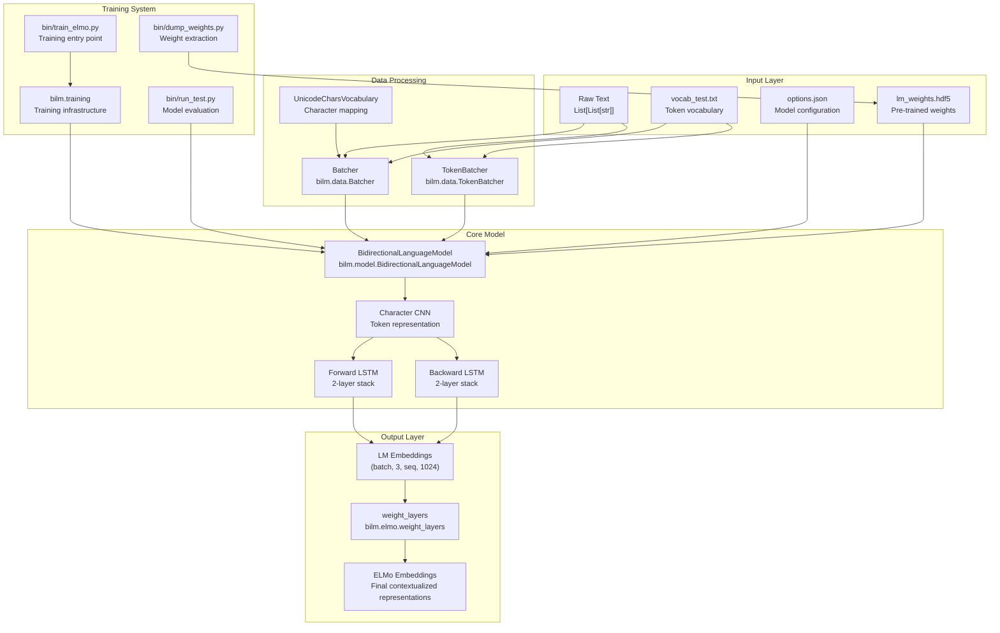

<!-- source: DeepWiki mcp.deepwiki.com · repo allenai/bilm-tf · page 1 Overview · fetched 2026-10-26 -->

# Overview

Relevant source files

The following files were used as context for generating this wiki page:

- [README.md](README.md)
- [bilm/__init__.py](bilm/__init__.py)
- [usage_character.py](usage_character.py)

This document provides a technical overview of the bilm-tf repository, a TensorFlow implementation for training bidirectional language models (biLMs) and generating ELMo (Embeddings from Language Models) representations. The system enables both training new language models on custom corpora and using pre-trained models to generate contextualized word embeddings for downstream NLP tasks.

For detailed installation and setup instructions, see [Getting Started](#2). For in-depth documentation of individual components, see [Core Components](#3).

## System Purpose

The bilm-tf repository implements the bidirectional language model architecture from "Deep contextualized word representations" (Peters et al., 2018). The system serves two primary functions:

1. **Training Infrastructure**: Complete pipeline for training bidirectional language models on large text corpora
2. **Inference Engine**: Efficient computation of ELMo embeddings from pre-trained models using three different usage patterns

The core innovation is generating context-dependent word representations by combining embeddings from multiple layers of bidirectional LSTM language models, weighted and combined through the `weight_layers` function.

Sources: [README.md:1-21](), [bilm/__init__.py:1-7]()

## System Architecture

This architecture shows the complete data flow from raw text input through the bidirectional language model to final ELMo embeddings. The system separates data processing, model computation, and output generation into distinct layers, with the `BidirectionalLanguageModel` serving as the central computational engine.

Sources: [bilm/__init__.py:2-5](), [README.md:44-65](), [usage_character.py:18-30]()

## Three Usage Patterns

```mermaid
graph TD
    subgraph "Pattern 1: Character Input"
        Text1["Raw Text"] --> Batcher1["Batcher(vocab_file, 50)"]
        Batcher1 --> CharIDs["Character IDs<br/>(batch, seq, 50)"]
        CharIDs --> BiLM1["BidirectionalLanguageModel<br/>use_character_inputs=True"]
        BiLM1 --> Embeddings1["LM Embeddings<br/>(batch, 3, seq, 1024)"]
        Embeddings1 --> WeightLayers1["weight_layers('input', embeddings_op)"]
        WeightLayers1 --> ELMo1["ELMo Output"]
    end
    
    subgraph "Pattern 2: Pre-computed Tokens"
        Text2["Raw Text"] --> TokenBatcher2["TokenBatcher(vocab_file)"]
        DumpTokenEmbeddings["dump_token_embeddings<br/>Pre-compute step"]
        TokenEmbeddingsHDF5["token_embeddings.hdf5<br/>Cached representations"]
        TokenBatcher2 --> TokenIDs["Token IDs<br/>(batch, seq)"]
        TokenIDs --> BiLM2["BidirectionalLanguageModel<br/>use_character_inputs=False"]
        TokenEmbeddingsHDF5 --> BiLM2
        BiLM2 --> Embeddings2["LM Embeddings"]
        Embeddings2 --> WeightLayers2["weight_layers"]
        WeightLayers2 --> ELMo2["ELMo Output"]
        DumpTokenEmbeddings --> TokenEmbeddingsHDF5
    end
    
    subgraph "Pattern 3: Cached Dataset"
        Dataset["Text Dataset<br/>One sentence per line"]
        Dataset --> DumpBiLMEmbeddings["dump_bilm_embeddings"]
        DumpBiLMEmbeddings --> CachedHDF5["cached_embeddings.hdf5<br/>Keyed by sentence_id"]
        CachedHDF5 --> DirectLoad["Direct HDF5 Load<br/>dataset[str(sentence_id)]"]
        DirectLoad --> PrecomputedELMo["Pre-computed ELMo<br/>(3, n_tokens, 1024)"]
    end
    
    %% Performance annotations
    Text1 -.->|"Most flexible<br/>Highest compute cost"| ELMo1
    Text2 -.->|"Fixed vocabulary<br/>Medium compute cost"| ELMo2
    Dataset -.->|"Pre-computed<br/>Lowest compute cost"| PrecomputedELMo
```

The three usage patterns provide different trade-offs between flexibility and computational efficiency. Pattern 1 handles arbitrary text with character-level processing, Pattern 2 optimizes inference for fixed vocabularies, and Pattern 3 pre-computes all embeddings for maximum inference speed.

Sources: [README.md:52-58](), [README.md:94-125](), [bilm/__init__.py:3-4]()

## Data Flow and Tensor Shapes

```mermaid
flowchart LR
    subgraph "Input Processing"
        RawSentences["List[List[str]]<br/>Tokenized sentences"]
        VocabFile["vocab_test.txt<br/>Token list"]
    end
    
    subgraph "Character Path"
        BatcherChar["Batcher(vocab_file, 50)"]
        CharTensor["Character Tensor<br/>(n_sentences, max_len+2, 50)"]
        CharCNN["Character CNN<br/>+ Highway layers"]
        TokenRepresentations["Token Representations<br/>(batch, seq, projection_dim)"]
    end
    
    subgraph "Token Path"
        BatcherToken["TokenBatcher(vocab_file)"]
        TokenTensor["Token IDs<br/>(n_sentences, max_len+2)"]
        EmbeddingLookup["Embedding Lookup<br/>From token_embeddings.hdf5"]
    end
    
    subgraph "BiLM Core"
        ForwardLSTM["Forward LSTM<br/>n_lstm_layers deep"]
        BackwardLSTM["Backward LSTM<br/>n_lstm_layers deep"]
        ConcatLayers["Concatenate<br/>Token + Forward + Backward"]
        LMEmbeddings["LM Embeddings<br/>(batch, 3, seq_len, 1024)"]
    end
    
    subgraph "ELMo Generation"
        WeightLayersFunc["weight_layers(name, lm_embeddings)<br/>Learned scalar weights"]
        WeightedSum["Weighted Sum<br/>+ Layer normalization"]
        FinalELMo["ELMo Embeddings<br/>(batch, seq_len, 1024)"]
    end
    
    %% Data flow
    RawSentences --> BatcherChar
    RawSentences --> BatcherToken
    VocabFile --> BatcherChar
    VocabFile --> BatcherToken
    
    BatcherChar --> CharTensor
    CharTensor --> CharCNN
    CharCNN --> TokenRepresentations
    
    BatcherToken --> TokenTensor
    TokenTensor --> EmbeddingLookup
    EmbeddingLookup --> TokenRepresentations
    
    TokenRepresentations --> ForwardLSTM
    TokenRepresentations --> BackwardLSTM
    ForwardLSTM --> ConcatLayers
    BackwardLSTM --> ConcatLayers
    TokenRepresentations --> ConcatLayers
    
    ConcatLayers --> LMEmbeddings
    LMEmbeddings --> WeightLayersFunc
    WeightLayersFunc --> WeightedSum
    WeightedSum --> FinalELMo
```

This diagram shows the complete tensor transformation pipeline from tokenized text to final ELMo embeddings. The key insight is that the system produces three representations (token-level, forward LSTM, backward LSTM) which are then weighted and combined by `weight_layers` to produce the final contextualized embeddings.

Sources: [README.md:66-83](), [usage_character.py:38-52](), [bilm/data.py:220]()

## Key Components and Responsibilities

| Component | File Location | Primary Responsibility | Key Methods/Attributes |
|-----------|---------------|----------------------|----------------------|
| `BidirectionalLanguageModel` | [bilm/model.py]() | Core biLM computation engine | `__call__()`, `_build()`, `_build_word_embeddings()` |
| `Batcher` | [bilm/data.py]() | Character-level input processing | `batch_sentences()`, character ID conversion |
| `TokenBatcher` | [bilm/data.py]() | Token-level input processing | `batch_sentences()`, token ID conversion |
| `weight_layers` | [bilm/elmo.py]() | ELMo embedding generation | Learned layer weighting, L2 regularization |
| `dump_token_embeddings` | [bilm/model.py]() | Pre-compute token representations | HDF5 caching for Pattern 2 usage |
| `dump_bilm_embeddings` | [bilm/model.py]() | Pre-compute full embeddings | HDF5 caching for Pattern 3 usage |
| Training System | [bilm/training.py]() | Model training infrastructure | Multi-GPU support, checkpointing |

The system architecture separates concerns cleanly: data processing components (`Batcher`, `TokenBatcher`) handle input transformation, the core model (`BidirectionalLanguageModel`) performs the biLM computation, and utility functions (`weight_layers`, dump functions) enable flexible usage patterns and caching strategies.

Sources: [bilm/__init__.py:2-5](), [README.md:108-115](), [README.md:118-125]()

---

