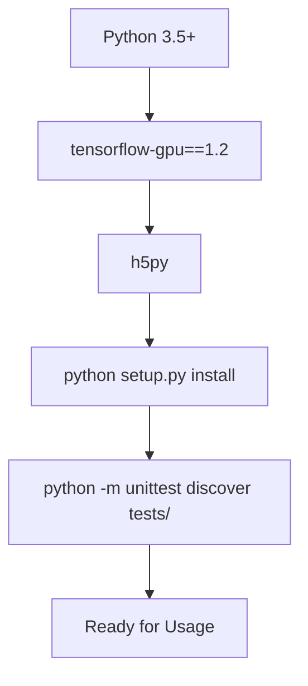
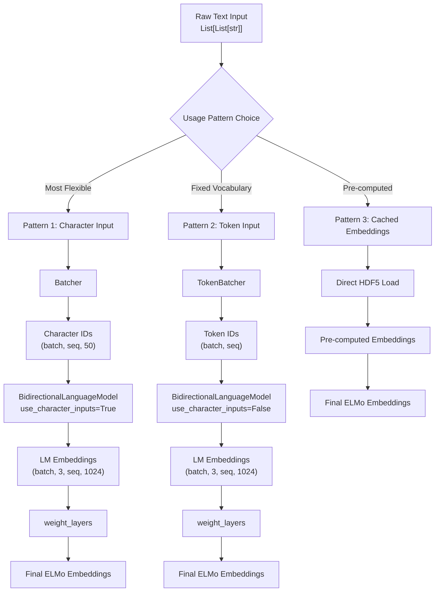
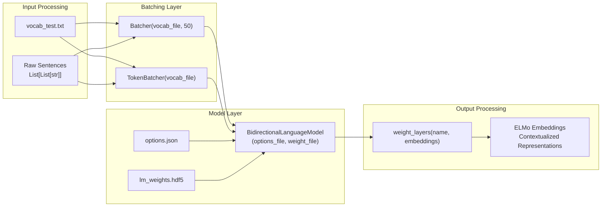

<!-- source: DeepWiki mcp.deepwiki.com · repo allenai/bilm-tf · page 2 Getting Started · fetched 2026-10-26 -->

# Getting Started

<details>
<summary>Relevant source files</summary>

The following files were used as context for generating this wiki page:

- [README.md](README.md)
- [setup.py](setup.py)
- [usage_character.py](usage_character.py)

</details>


This document provides installation instructions and initial usage guidance for the bilm-tf system. It covers the essential steps to set up the environment and introduces the three primary usage patterns for generating ELMo embeddings from bidirectional language models.

For detailed information about specific components, see [Core Components](#3). For training new models, see [Command Line Tools](#4).

## Prerequisites and Installation

The bilm-tf system requires Python 3.5 or later with specific dependencies for TensorFlow-based computation and HDF5 file handling.

### System Requirements

| Component | Version | Purpose |
|-----------|---------|---------|
| Python | 3.5+ | Runtime environment |
| TensorFlow | 1.2 | Neural network computation |
| h5py | Latest | HDF5 file operations |
| CUDA-compatible GPU | - | Recommended for performance |

### Package Installation

Install the required dependencies and bilm-tf package:

```bash
pip install tensorflow-gpu==1.2 h5py
python setup.py install
```

Verify the installation by running the test suite:

```bash
python -m unittest discover tests/
```

**Installation Flow**



Sources: [README.md:24-34](), [setup.py:19-22]()

### Docker Installation

For containerized deployment with GPU support:

```bash
sudo nvidia-docker run -t allennlp/bilm-tf:training-gpu
```

The Docker image includes all dependencies and requires `nvidia-docker` for GPU access.

Sources: [README.md:36-42]()

## Usage Patterns

The bilm-tf system supports three distinct usage patterns, each optimized for different performance and flexibility requirements.

### Pattern Overview



Sources: [README.md:52-64]()

### Pattern 1: Character-Level Input

The most general method that handles any input text by processing characters directly. This approach provides maximum flexibility but requires the most computation.

**Key Components:**
- `Batcher` class for character ID conversion
- `BidirectionalLanguageModel` with `use_character_inputs=True`
- `weight_layers` function for final ELMo computation

**Data Shape Flow:**
```
Raw Text → Batcher → (n_sentences, max_length + 2, 50) → BiLM → (n_sentences, 3, max_length, 1024)
```

Sources: [README.md:54](), [README.md:66-83](), [usage_character.py:1-80]()

### Pattern 2: Pre-computed Token Representations

Optimized for fixed vocabularies by caching context-independent token representations. This reduces computational cost but limits vocabulary flexibility.

**Key Components:**
- `TokenBatcher` class for token ID conversion
- `dump_token_embeddings` function for preprocessing
- `BidirectionalLanguageModel` with `use_character_inputs=False`

**Workflow:**
1. Create vocabulary file with unique tokens plus `<S>` and `</S>`
2. Run `dump_token_embeddings` to generate HDF5 token embeddings
3. Use `TokenBatcher` with pre-computed embeddings file

Sources: [README.md:55](), [README.md:98-116]()

### Pattern 3: Cached Dataset Embeddings

Pre-computes embeddings for entire datasets and stores them in HDF5 format. Optimal for smaller datasets or cross-framework usage.

**Key Components:**
- `dump_bilm_embeddings` function for batch processing
- HDF5 storage with `sentence_id` keys
- Direct embedding retrieval without model inference

**Storage Format:**
- Each sentence stored as `str(sentence_id)` dataset key
- Embeddings shape: `(3, n_tokens, 1024)` per sentence

Sources: [README.md:56](), [README.md:118-125]()

## Basic Workflow Components

The core workflow involves three primary components that transform raw text into contextualized embeddings.

### Component Interaction



Sources: [README.md:61-64](), [usage_character.py:18-26]()

### Required Files

Each usage pattern requires specific configuration and weight files:

| File Type | Purpose | Format | Source |
|-----------|---------|--------|--------|
| `options.json` | Model hyperparameters | JSON | Pre-trained or custom |
| `lm_weights.hdf5` | Model weights | HDF5 | Pre-trained or trained |
| `vocab_*.txt` | Vocabulary mapping | Text | Token per line |

### Vocabulary File Format

The vocabulary file structure is critical for proper tokenization:
- One token per line, separated by `\n`
- Must include special tokens: `<S>`, `</S>`, `<UNK>`
- Tokens cached as 50-character ID sequences
- Case-sensitive special tokens

Sources: [README.md:85-92]()

### Shape Conventions

Understanding data shapes through the pipeline:

| Stage | Shape | Description |
|-------|-------|-------------|
| Input Batch | `(n_sentences, max_length + 2, 50)` | Character IDs with padding |
| BiLM Output | `(n_sentences, 3, max_length, 1024)` | Multi-layer embeddings |
| ELMo Final | `(n_sentences, max_length, embed_dim)` | Weighted representations |

The `+2` in input shape accounts for special begin/end tokens added by `Batcher`.

Sources: [README.md:66-83]()

## Quick Start Example

Here's a minimal example using the character-level input pattern:

```python
# Core imports
from bilm import Batcher, BidirectionalLanguageModel, weight_layers
import tensorflow as tf

# Initialize components
batcher = Batcher(vocab_file, 50)
bilm = BidirectionalLanguageModel(options_file, weight_file)

# Create TensorFlow placeholders
character_ids = tf.placeholder('int32', shape=(None, None, 50))

# Build computation graph
embeddings_op = bilm(character_ids)
elmo_op = weight_layers('elmo', embeddings_op, l2_coef=0.0)

# Process text
tokenized_sentences = [sentence.split() for sentence in raw_sentences]
character_id_batch = batcher.batch_sentences(tokenized_sentences)

# Compute embeddings
with tf.Session() as sess:
    sess.run(tf.global_variables_initializer())
    elmo_embeddings = sess.run(
        elmo_op['weighted_op'],
        feed_dict={character_ids: character_id_batch}
    )
```

This example demonstrates the essential workflow from raw text to ELMo embeddings using the most flexible character-level input approach.

Sources: [usage_character.py:8-78]()

---

