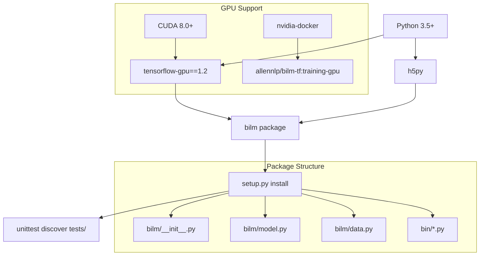
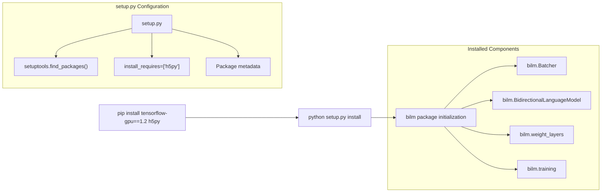
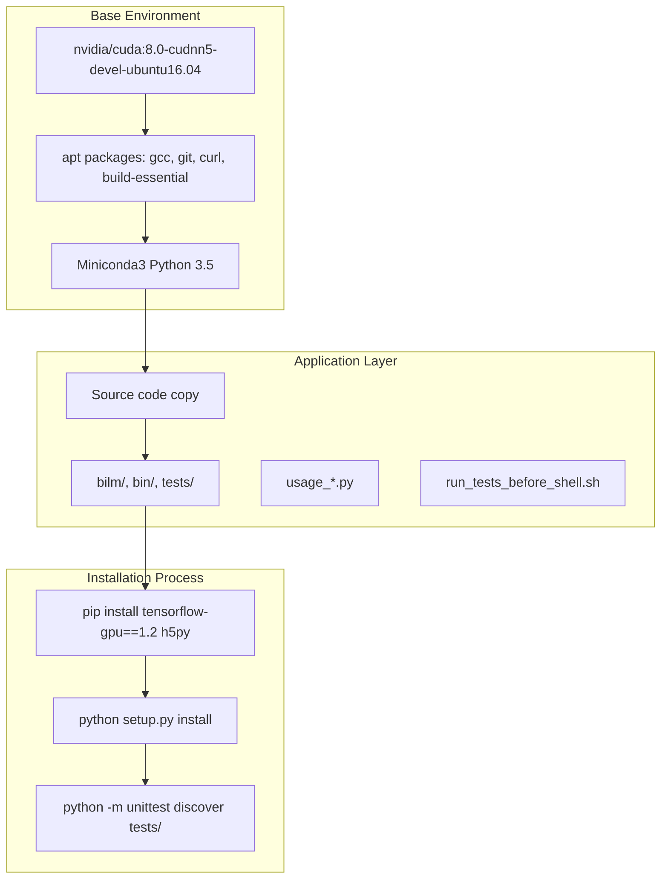
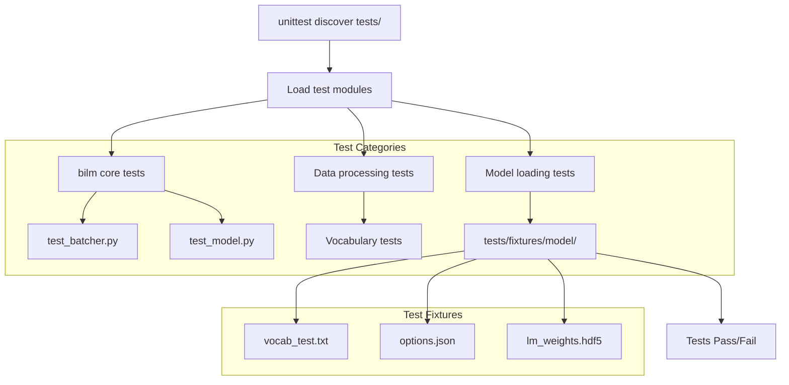
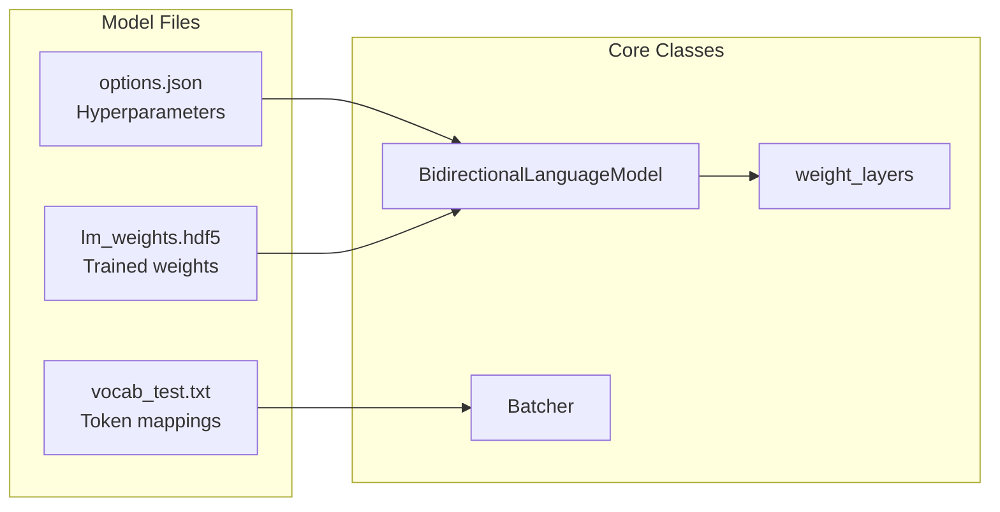

<!-- source: DeepWiki mcp.deepwiki.com · repo allenai/bilm-tf · page 2.1 Installation & Setup · fetched 2026-10-26 -->

# Installation & Setup

<details>
<summary>Relevant source files</summary>

The following files were used as context for generating this wiki page:

- [Dockerfile](Dockerfile)
- [README.md](README.md)
- [run_tests_before_shell.sh](run_tests_before_shell.sh)
- [setup.py](setup.py)
- [usage_character.py](usage_character.py)

</details>


This document provides comprehensive instructions for installing and configuring the bilm-tf system for both development and production environments. It covers Python package installation, Docker containerization, and system verification procedures.

For information about using the installed system, see [Usage Patterns](#2.2). For details about model configuration, see [Model Configuration](#5.1).

## System Requirements

The bilm-tf system requires specific versions of core dependencies to function correctly:

| Component | Version | Purpose |
|-----------|---------|---------|
| Python | 3.5+ | Runtime environment |
| TensorFlow | 1.2 | Neural network computation backend |
| h5py | Latest | HDF5 file format support for model weights |
| CUDA/GPU | 8.0+ | GPU acceleration (optional but recommended) |

**Installation Dependencies Flow**



Sources: [README.md:24-34](), [setup.py:19-22](), [Dockerfile:32-46]()

## Python Package Installation

### Standard Installation Process

The bilm-tf package follows a two-step installation process that first installs system dependencies, then builds the package from source:

```bash
# Step 1: Install core dependencies
pip install tensorflow-gpu==1.2 h5py

# Step 2: Install bilm package from source
python setup.py install
```

**Package Installation Workflow**



Sources: [README.md:24-29](), [setup.py:7-22]()

### Alternative: PyPI Installation

The package is also available via PyPI for simplified installation:

```bash
pip install bilm
```

This method automatically handles dependency resolution but may not include the latest development features.

Sources: [setup.py:8-9]()

## Docker Installation

### Container Setup

For users requiring a complete isolated environment, Docker containers provide GPU-accelerated bilm-tf installations:

```bash
# Run pre-built container with GPU support
sudo nvidia-docker run -t allennlp/bilm-tf:training-gpu
```

**Docker Environment Architecture**



### Docker Build Process

The Dockerfile implements a multi-stage build process:

1. **Base System Setup**: [Dockerfile:1-24]() - CUDA environment with Ubuntu 16.04
2. **Python Environment**: [Dockerfile:26-33]() - Miniconda installation with Python 3.5
3. **Source Code Integration**: [Dockerfile:35-42]() - Copy bilm source and examples
4. **Package Installation**: [Dockerfile:44-46]() - Install dependencies and build package
5. **Verification**: [Dockerfile:48-50]() - Run test suite before shell access

Sources: [Dockerfile:1-51](), [README.md:36-42]()

## Installation Verification

### Test Suite Execution

After installation, verify system functionality by running the comprehensive test suite:

```bash
python -m unittest discover tests/
```

The test suite validates core functionality including:
- Model loading and initialization
- Data processing pipelines
- ELMo embedding generation
- Training procedures

**Verification Process Flow**



### Docker Verification

The Docker container automatically runs verification tests through the `run_tests_before_shell.sh` script:

```bash
#!/usr/bin/env bash
set -e
PYTHONDONTWRITEBYTECODE=1 python -m unittest discover tests/
echo "Tests passed!"
/bin/bash
```

Sources: [README.md:31-34](), [run_tests_before_shell.sh:1-9](), [Dockerfile:48-50]()

## Configuration Files and Dependencies

### Required Model Assets

The bilm-tf system requires specific configuration files for operation:

| File Type | Purpose | Example Location |
|-----------|---------|------------------|
| `options.json` | Model hyperparameters and architecture | `tests/fixtures/model/options.json` |
| `lm_weights.hdf5` | Pre-trained model weights | `tests/fixtures/model/lm_weights.hdf5` |
| `vocab_*.txt` | Vocabulary mappings | `tests/fixtures/model/vocab_test.txt` |

### Pre-trained Model Downloads

Pre-trained models are available from the AllenNLP model repository. Each model consists of paired files:

- **Options File**: JSON configuration with hyperparameters
- **Weights File**: HDF5 format with trained parameters

Access pre-trained models at: https://allennlp.org/elmo

**Model Asset Dependencies**



Sources: [README.md:44-49](), [usage_character.py:12-16]()

## Troubleshooting Common Issues

### GPU Support Verification

Ensure CUDA compatibility for GPU acceleration:

```bash
# Check CUDA installation
nvidia-smi

# Verify TensorFlow GPU detection
python -c "import tensorflow as tf; print(tf.config.list_physical_devices('GPU'))"
```

### Version Compatibility

The system specifically requires TensorFlow 1.2 due to API dependencies. Newer versions may cause compatibility issues with the trained models and checkpoint formats.

### Docker GPU Access

Docker GPU support requires nvidia-docker runtime:

```bash
# Install nvidia-docker2
sudo apt-get install nvidia-docker2
sudo systemctl restart docker

# Test GPU access
sudo docker run --gpus all nvidia/cuda:8.0-runtime-ubuntu16.04 nvidia-smi
```

Sources: [README.md:38-39](), [Dockerfile:1]()

---

