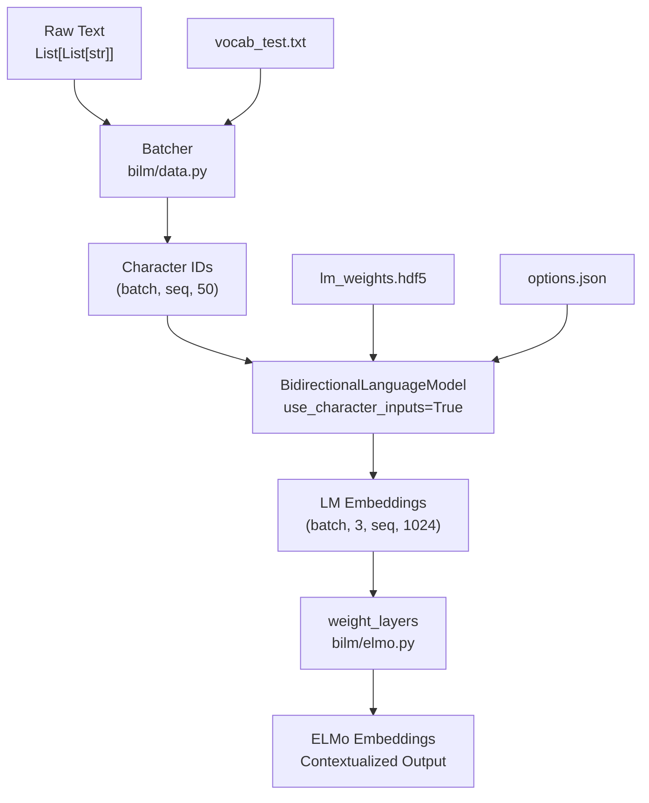
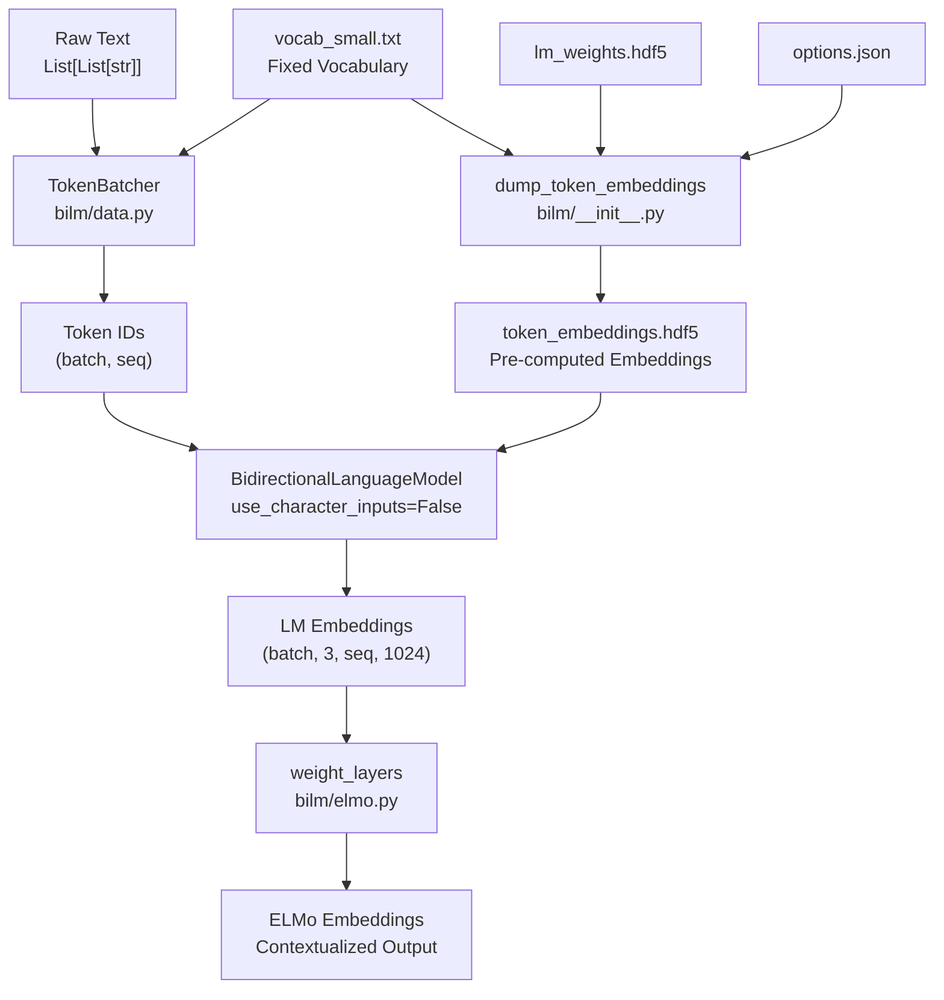
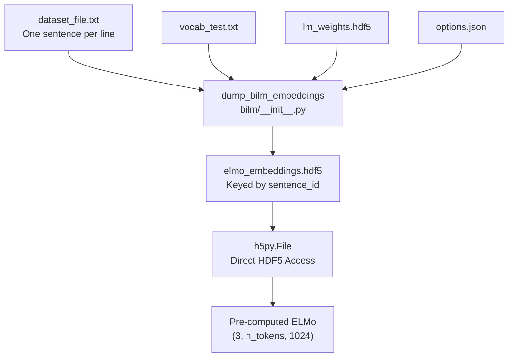

<!-- source: DeepWiki mcp.deepwiki.com · repo allenai/bilm-tf · page 2.2 Usage Patterns · fetched 2026-10-26 -->

# Usage Patterns

Relevant source files

The following files were used as context for generating this wiki page:

- [README.md](README.md)
- [usage_cached.py](usage_cached.py)
- [usage_character.py](usage_character.py)
- [usage_token.py](usage_token.py)

This document explains the three main usage patterns for generating ELMo embeddings with the bilm-tf system. Each pattern represents a different trade-off between computational flexibility, performance, and storage requirements. For details on the core model architecture, see [BidirectionalLanguageModel](#3.1). For information about data processing utilities, see [Data Processing](#3.2).

## Overview of Usage Patterns

The bilm-tf system provides three distinct approaches for integrating ELMo representations into downstream tasks:

1. **Character-level input processing** - Most general and flexible approach
2. **Pre-computed token embeddings** - Balanced approach for fixed vocabularies  
3. **Cached dataset embeddings** - Highest performance for static datasets

Each pattern involves different components and offers distinct advantages depending on your use case requirements.

## Pattern 1: Character-Level Input Processing

### Character-Level Data Flow

Sources: [README.md:54-58](), [usage_character.py:1-80]()

### Character-Level Implementation Details

This pattern uses the `Batcher` class to convert raw text into character-level representations. The process involves:

- **Input Processing**: Text is tokenized into `List[List[str]]` format
- **Character Mapping**: `Batcher` converts tokens to character IDs with shape `(n_sentences, max_sentence_length + 2, 50)`
- **Model Inference**: `BidirectionalLanguageModel` processes character inputs directly
- **ELMo Generation**: `weight_layers` computes final weighted representations

Key characteristics:
- Handles any input text, including out-of-vocabulary tokens
- Most computationally expensive approach
- Required for evaluation on unseen data
- Uses full character-based representation

Sources: [README.md:54-58](), [README.md:66-83](), [usage_character.py:18-26]()

## Pattern 2: Pre-Computed Token Embeddings

### Token-Level Data Flow

Sources: [README.md:98-116](), [usage_token.py:1-106]()

### Token-Level Implementation Details

This pattern optimizes performance by pre-computing context-independent token representations:

**Pre-computation Phase**:
- Create vocabulary file with all unique tokens including `<S>` and `</S>`
- Use `dump_token_embeddings` to generate token embedding file
- Requires fixed vocabulary - no fallback for out-of-vocabulary words

**Inference Phase**:
- `TokenBatcher` maps text to token IDs rather than character IDs
- `BidirectionalLanguageModel` loads pre-computed token embeddings via `embedding_weight_file` parameter
- Processes only the biLSTM layers, skipping character-level processing

Key characteristics:
- Faster inference than character-level processing
- Requires fixed, predetermined vocabulary
- Good compromise for large datasets with defined vocabularies
- Used for datasets like SNLI and SQuAD

Sources: [README.md:98-116](), [usage_token.py:39-62]()

## Pattern 3: Cached Dataset Embeddings

### Cached Embeddings Data Flow

Sources: [README.md:118-125](), [usage_cached.py:1-43]()

### Cached Embeddings Implementation Details

This pattern pre-computes all ELMo embeddings for an entire dataset:

**Pre-computation Phase**:
- Create dataset file with one tokenized sentence per line
- Use `dump_bilm_embeddings` to generate embeddings for all sentences
- Embeddings stored in HDF5 format with sentence ID as key

**Usage Phase**:
- Direct HDF5 file access using `h5py`
- Each sentence stored as dataset with key `str(sentence_id)`
- Embeddings have shape `(3, n_tokens, 1024)` representing the three biLM layers

Key characteristics:
- Highest performance - no model inference required
- Requires significant storage space
- Best for smaller datasets or when using ELMo in other frameworks
- Eliminates computational overhead during training/inference

Sources: [README.md:118-125](), [usage_cached.py:33-41]()

## Pattern Comparison and Selection

### Performance vs Flexibility Trade-offs

| Pattern | Flexibility | Performance | Storage | Use Case |
|---------|-------------|-------------|---------|----------|
| Character-level | Highest | Lowest | None | Unseen data, test evaluation |
| Pre-computed tokens | Medium | Medium | Token embeddings | Large datasets, fixed vocab |
| Cached dataset | Lowest | Highest | Full embeddings | Small datasets, cross-framework |

### Common Implementation Components

All patterns share these core components:

**Model Configuration**:
- `options.json` - Model hyperparameters and architecture settings
- `lm_weights.hdf5` - Pre-trained model weights
- Vocabulary file - Token-to-ID mapping

**Core Processing**:
- `BidirectionalLanguageModel` - Central model class
- `weight_layers` - Final ELMo representation computation
- TensorFlow session management and variable initialization

**Data Shapes**:
- Input varies by pattern: character IDs `(batch, seq, 50)` or token IDs `(batch, seq)`
- LM embeddings: `(batch, 3, seq, 1024)` representing token + forward + backward layers
- Final ELMo: `(batch, seq, embedding_dim)` after weighted combination

Sources: [README.md:52-64](), [usage_character.py:25-30](), [usage_token.py:56-67]()

---

