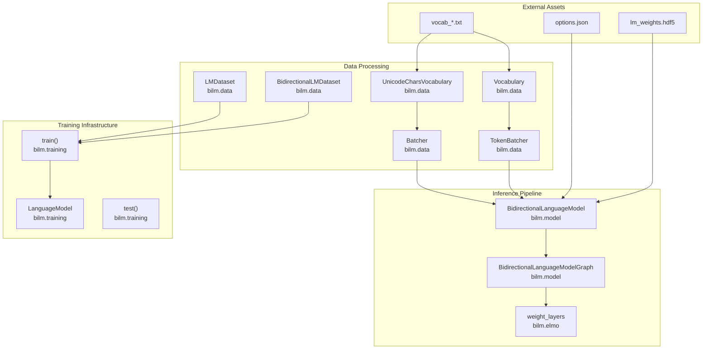
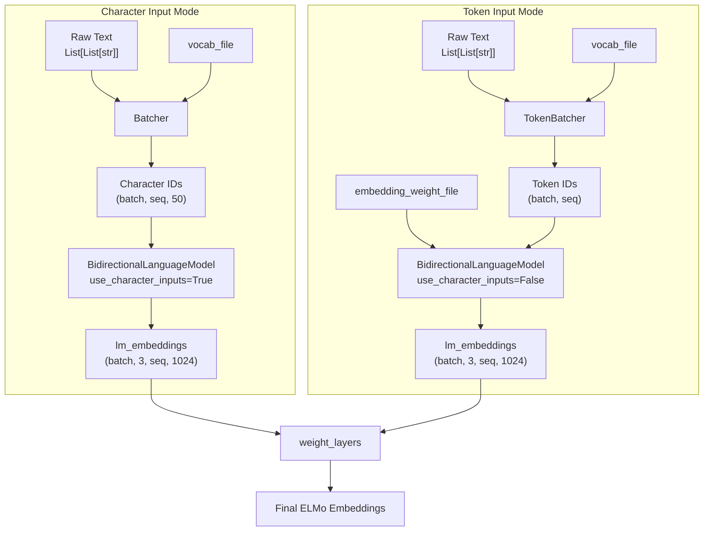
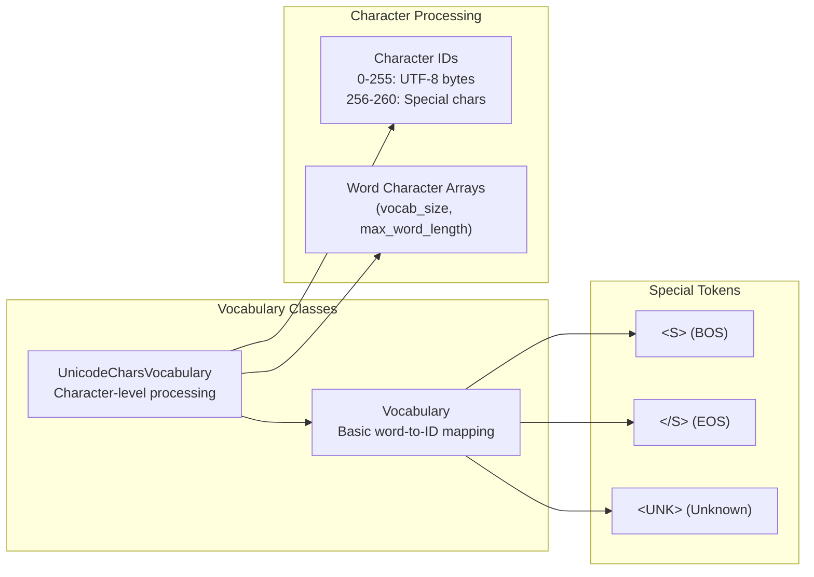
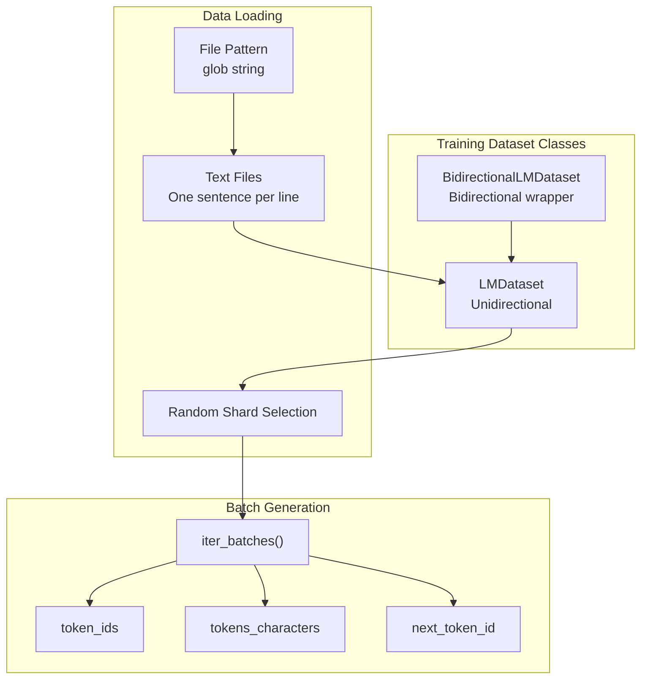
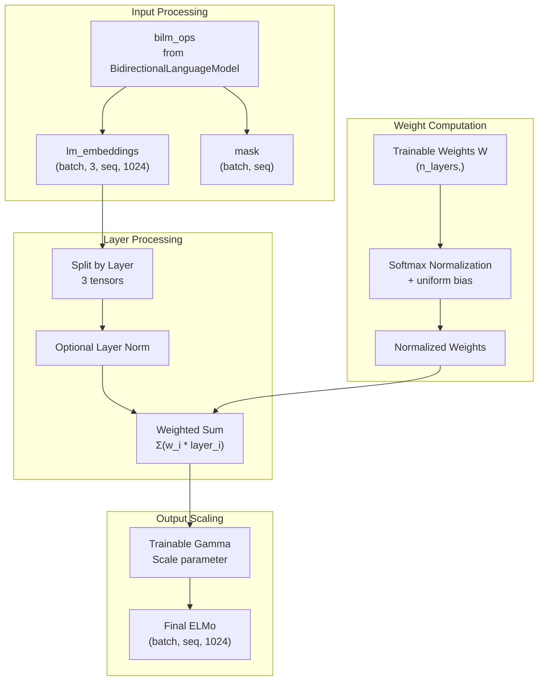
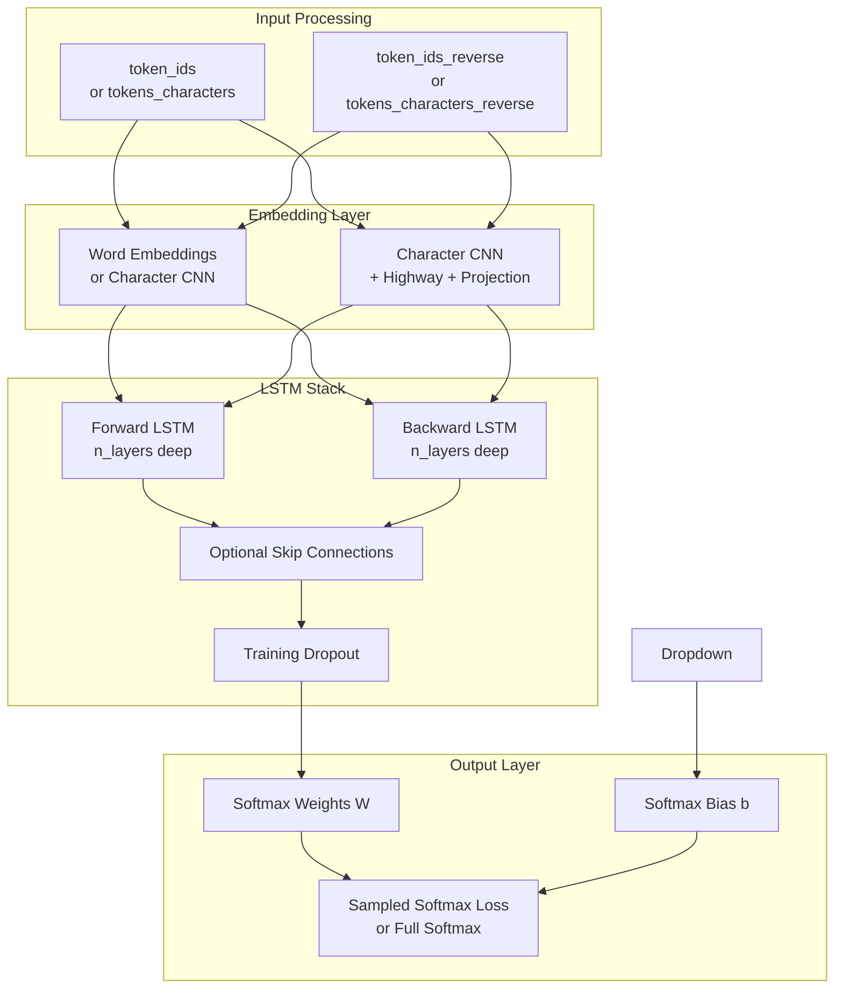

<!-- source: DeepWiki mcp.deepwiki.com · repo allenai/bilm-tf · page 3 Core Components · fetched 2026-10-26 -->

# Core Components

<details>
<summary>Relevant source files</summary>

The following files were used as context for generating this wiki page:

- [bilm/data.py](bilm/data.py)
- [bilm/elmo.py](bilm/elmo.py)
- [bilm/model.py](bilm/model.py)
- [bilm/training.py](bilm/training.py)
- [tests/test_elmo.py](tests/test_elmo.py)

</details>


This document covers the main architectural components that make up the bilm-tf system: the `BidirectionalLanguageModel` for inference, data processing utilities, ELMo embedding generation, and the training infrastructure. These components work together to enable both training bidirectional language models and using pre-trained models to generate contextualized ELMo embeddings.

For information about command-line tools and training scripts, see [Command Line Tools](#4). For model configuration and hyperparameters, see [Model Configuration](#5.1).

## System Architecture Overview



**Core Component Architecture**
Sources: [bilm/model.py:1-677](), [bilm/data.py:1-466](), [bilm/elmo.py:1-115](), [bilm/training.py:1-1109]()

## BidirectionalLanguageModel

The `BidirectionalLanguageModel` class is the primary interface for loading pre-trained bidirectional language models and generating contextualized embeddings. It supports two input modes: character-level processing (the default) and token-level processing with pre-computed embeddings.

### Core Interface

| Parameter | Type | Purpose |
|-----------|------|---------|
| `options_file` | str | Path to JSON file with model hyperparameters |
| `weight_file` | str | Path to HDF5 file with pre-trained weights |
| `use_character_inputs` | bool | If True, use character CNNs; if False, use token embeddings |
| `embedding_weight_file` | str | Required when `use_character_inputs=False` |
| `max_batch_size` | int | Maximum allowable batch size (default: 128) |

### Usage Patterns



**Input Processing Modes**
Sources: [bilm/model.py:14-113](), [bilm/data.py:193-261]()

### Internal Architecture

The `BidirectionalLanguageModel.__call__()` method creates a `BidirectionalLanguageModelGraph` that builds the computational graph:

1. **Character CNN Pipeline** (when `use_character_inputs=True`):
   - Character embeddings → Convolutions → Highway layers → Projection
2. **Token Embedding Pipeline** (when `use_character_inputs=False`):
   - Direct token embedding lookup
3. **Bidirectional LSTM Stack**:
   - Forward and backward LSTM layers with optional skip connections
4. **Output Processing**:
   - Concatenates token embeddings + forward outputs + backward outputs
   - Removes BOS/EOS tokens and applies sequence masking

### Return Values

The `__call__()` method returns a dictionary with TensorFlow operations:

| Key | Shape | Description |
|-----|-------|-------------|
| `lm_embeddings` | `(batch, 3, seq, 1024)` | Layer outputs: token + forward + backward |
| `lengths` | `(batch,)` | Sequence lengths without BOS/EOS |
| `mask` | `(batch, seq)` | Boolean mask for valid positions |
| `token_embeddings` | `(batch, seq, dim)` | Raw token embeddings |

Sources: [bilm/model.py:62-184](), [bilm/model.py:245-601]()

## Data Processing Components

The data processing system handles vocabulary management, text batching, and dataset iteration for both inference and training workflows.

### Vocabulary Management



**Vocabulary Architecture**
Sources: [bilm/data.py:10-191]()

#### Vocabulary Class Features

- **Word-to-ID mapping**: Bidirectional lookup between tokens and integer IDs
- **Special token handling**: Required `<S>`, `</S>`, and `<UNK>` tokens
- **Encoding/decoding**: Convert between text and ID sequences with BOS/EOS

#### UnicodeCharsVocabulary Features

- **Character-level representation**: Maps each word to character ID arrays
- **UTF-8 encoding**: Character IDs 0-255 from `ord(c)` for UTF-8 bytes
- **Special character IDs**: 256-260 for begin sentence, end sentence, begin word, end word, padding
- **Fixed-width arrays**: All words represented as `(max_word_length,)` arrays

### Text Batching

| Class | Input Type | Output Shape | Purpose |
|-------|------------|--------------|---------|
| `Batcher` | Character-based | `(batch, seq, 50)` | Character ID matrices |
| `TokenBatcher` | Token-based | `(batch, seq)` | Token ID matrices |

Both batchers:
- Add BOS/EOS tokens automatically
- Apply +1 offset to create padding ID of 0
- Handle variable-length sequences with padding

Sources: [bilm/data.py:193-261]()

### Dataset Management



**Dataset Processing Pipeline**
Sources: [bilm/data.py:315-461]()

#### LMDataset Features

- **Multi-file support**: Processes multiple text files via glob patterns
- **Random shard selection**: Randomly selects files for training diversity
- **Streaming processing**: Loads one file at a time to handle large datasets
- **Flexible iteration**: Supports both training (infinite) and test (single-pass) modes
- **Character/token dual support**: Generates both character and token representations

#### BidirectionalLMDataset Features

- **Forward/backward data**: Generates both normal and reversed token sequences
- **Synchronized batching**: Ensures corresponding forward/backward batches
- **Suffix handling**: Adds `_reverse` suffix to backward data keys

Sources: [bilm/data.py:435-461]()

## ELMo Embeddings

The `weight_layers` function combines the multiple layers from a bidirectional language model into final ELMo representations using learned scalar weights.

### Function Interface

```python
weight_layers(name, bilm_ops, l2_coef=None, use_top_only=False, do_layer_norm=False)
```

| Parameter | Type | Purpose |
|-----------|------|---------|
| `name` | str | Prefix for trainable variable names |
| `bilm_ops` | dict | Output from `BidirectionalLanguageModel()` |
| `l2_coef` | float | L2 regularization coefficient |
| `use_top_only` | bool | If True, only use the top LSTM layer |
| `do_layer_norm` | bool | Apply layer normalization to biLM layers |

### Layer Combination Process



**ELMo Layer Combination Process**
Sources: [bilm/elmo.py:4-113]()

### Trainable Parameters

1. **Layer weights (`W`)**: Softmax-normalized weights for each biLM layer
2. **Scale parameter (`gamma`)**: Global scaling factor for the weighted sum
3. **Regularization**: Optional L2 penalty on layer weights

### Return Values

| Key | Description |
|-----|-------------|
| `weighted_op` | Final ELMo embeddings tensor |
| `regularization_op` | L2 regularization loss terms |

The function automatically adds regularization terms to `tf.GraphKeys.REGULARIZATION_LOSSES` for integration with training loops.

Sources: [bilm/elmo.py:31-113]()

## Training System

The training infrastructure centers around the `LanguageModel` class, which implements the computational graph for training bidirectional language models from scratch.

### LanguageModel Architecture



**Training Model Architecture**
Sources: [bilm/training.py:30-531]()

### Key Training Components

#### Character CNN Processing
- **Convolutional filters**: Multiple filter widths (1-7) with varying numbers
- **Activation functions**: Configurable tanh or ReLU activation
- **Highway networks**: Optional highway layers for enhanced representation
- **Projection layer**: Projects CNN output to LSTM input dimension

#### LSTM Configuration
- **Multi-layer support**: Configurable number of LSTM layers
- **Projection**: Optional projection from hidden size to output size  
- **Skip connections**: ResidualWrapper for deep networks
- **Clipping**: Cell state and projection clipping for stability

#### Loss Computation
- **Bidirectional loss**: Average of forward and backward language modeling losses
- **Sampled softmax**: Efficient training with large vocabularies
- **Shared embeddings**: Optional weight sharing between embeddings and softmax

### Training Infrastructure

| Function | Purpose | Key Features |
|----------|---------|--------------|
| `train()` | Main training loop | Multi-GPU, gradient clipping, checkpointing |
| `test()` | Model evaluation | Perplexity computation on test data |
| `dump_weights()` | Weight extraction | Converts TensorFlow checkpoints to HDF5 |

#### Multi-GPU Training Features
- **Data parallelism**: Splits batches across multiple GPUs
- **Gradient averaging**: Averages gradients across GPU towers
- **Efficient batching**: Handles IndexedSlices for sparse gradients

Sources: [bilm/training.py:675-897](), [bilm/training.py:955-1044](), [bilm/training.py:1065-1109]()

---

