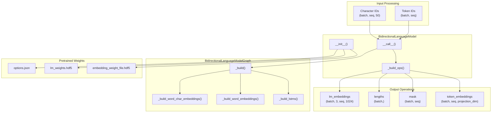
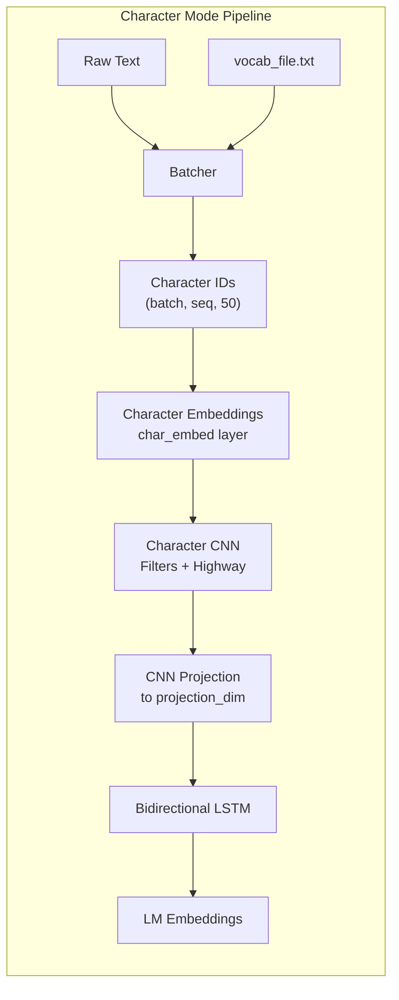
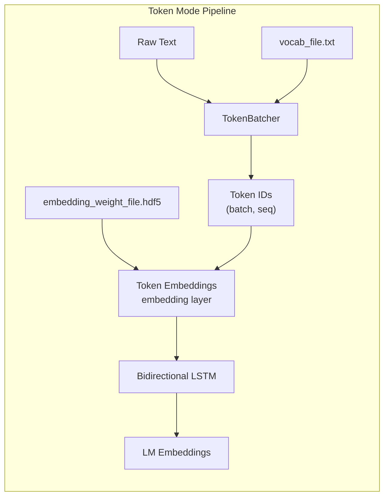
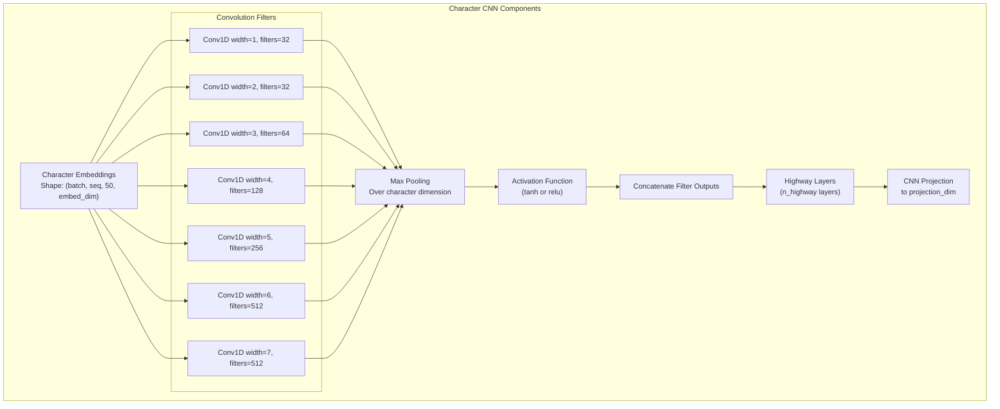
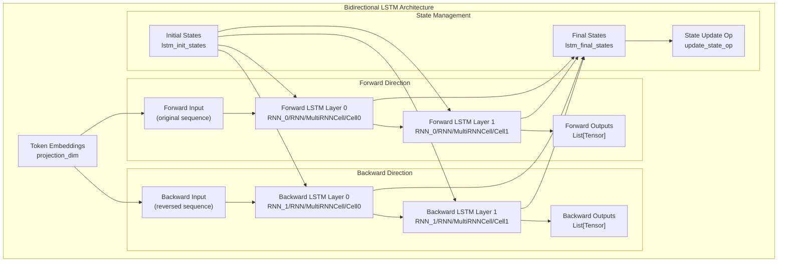
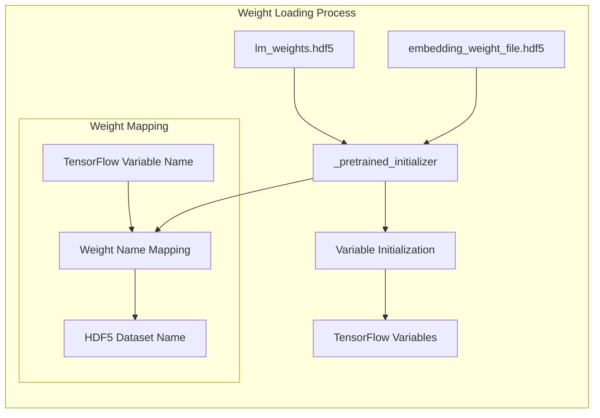
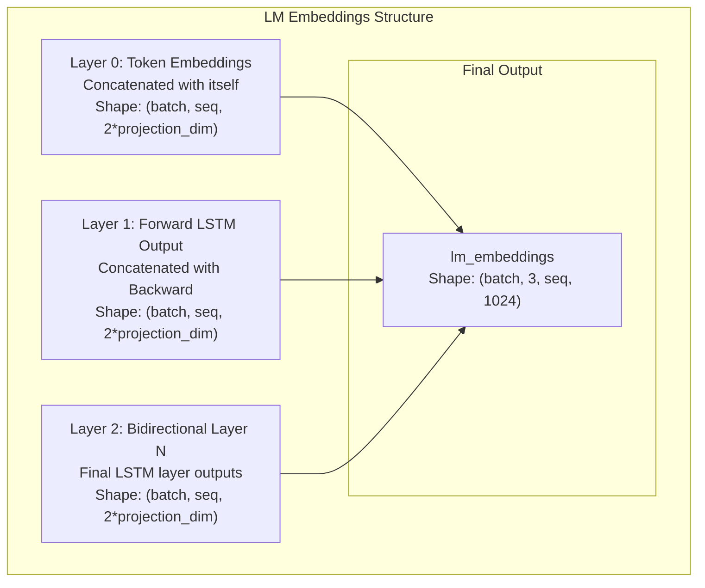

<!-- source: DeepWiki mcp.deepwiki.com · repo allenai/bilm-tf · page 3.1 BidirectionalLanguageModel · fetched 2026-10-26 -->

# BidirectionalLanguageModel

<details>
<summary>Relevant source files</summary>

The following files were used as context for generating this wiki page:

- [README.md](README.md)
- [bilm/model.py](bilm/model.py)
- [tests/test_model.py](tests/test_model.py)
- [usage_character.py](usage_character.py)

</details>


The `BidirectionalLanguageModel` class is the core component for loading and running pretrained bidirectional language models to generate contextualized embeddings. This class provides the computational graph and operations necessary for computing ELMo representations from either character-level or token-level inputs.

This documentation covers the architecture, configuration, and usage of the `BidirectionalLanguageModel` class. For information about training new models, see [Training System](#3.4). For details about processing the outputs into final ELMo embeddings, see [ELMo Embeddings](#3.3).

## Architecture Overview

The `BidirectionalLanguageModel` serves as a high-level interface that manages the underlying computational graph and pretrained weights. It supports two distinct input modes and maintains stateful LSTM layers for efficient batch processing.

### Core Architecture



Sources: [bilm/model.py:14-183](), [bilm/model.py:245-601]()

## Input Modes

The `BidirectionalLanguageModel` supports two input modes, controlled by the `use_character_inputs` parameter:

### Character Input Mode

When `use_character_inputs=True`, the model processes character-level representations:



Sources: [bilm/model.py:19](), [bilm/model.py:286-461](), [usage_character.py:18-30]()

### Token Input Mode

When `use_character_inputs=False`, the model uses precomputed token embeddings:



Sources: [bilm/model.py:20](), [bilm/model.py:463-474](), [tests/test_model.py:143-220]()

## Key Components

### Initialization Parameters

| Parameter | Type | Description |
|-----------|------|-------------|
| `options_file` | str | Path to JSON file containing model hyperparameters |
| `weight_file` | str | Path to HDF5 file containing pretrained weights |
| `use_character_inputs` | bool | Whether to use character-level (True) or token-level (False) inputs |
| `embedding_weight_file` | str | Path to precomputed token embeddings (required when `use_character_inputs=False`) |
| `max_batch_size` | int | Maximum allowable batch size for state management |

Sources: [bilm/model.py:15-42]()

### Character CNN Architecture

When using character inputs, the model applies a convolutional neural network to character embeddings:



Sources: [bilm/model.py:315-460]()

### Bidirectional LSTM Layers

The core of the model consists of stacked bidirectional LSTM layers:



Sources: [bilm/model.py:476-601]()

## Configuration and Weights

### Options File Structure

The `options.json` file contains model hyperparameters. Key sections include:

| Section | Parameters | Description |
|---------|------------|-------------|
| `char_cnn` | `n_characters`, `max_characters_per_token`, `filters`, `activation`, `embedding`, `n_highway` | Character CNN configuration |
| `lstm` | `dim`, `projection_dim`, `n_layers`, `cell_clip`, `proj_clip`, `use_skip_connections` | LSTM layer configuration |

Sources: [bilm/model.py:43-44](), [bilm/model.py:288-313]()

### Weight Loading

The model uses a custom getter function to load pretrained weights:



Sources: [bilm/model.py:186-242](), [bilm/model.py:261-266]()

## Output Structure

The `BidirectionalLanguageModel` returns a dictionary of TensorFlow operations:

### Return Dictionary

| Key | Shape | Description |
|-----|-------|-------------|
| `lm_embeddings` | `(batch, 3, seq_len, 1024)` | Concatenated token + forward + backward representations |
| `lengths` | `(batch,)` | Sequence lengths without BOS/EOS tokens |
| `mask` | `(batch, seq_len)` | Boolean mask for valid positions |
| `token_embeddings` | `(batch, seq_len, projection_dim)` | Raw token embeddings before LSTM processing |

Sources: [bilm/model.py:178-183]()

### Layer Composition

The `lm_embeddings` tensor contains three layers concatenated along axis 1:



Sources: [bilm/model.py:115-157]()

## Usage Patterns

### Basic Usage

```python
# Initialize model
bilm = BidirectionalLanguageModel(options_file, weight_file)

# Create placeholder
char_ids = tf.placeholder('int32', shape=(None, None, 50))

# Get operations
ops = bilm(char_ids)

# Run inference
with tf.Session() as sess:
    sess.run(tf.global_variables_initializer())
    embeddings = sess.run(ops['lm_embeddings'], 
                         feed_dict={char_ids: batch_data})
```

Sources: [usage_character.py:26-30](), [tests/test_model.py:62-66]()

### State Management

The model maintains stateful LSTM cells across batches for efficiency. The `max_batch_size` parameter determines the maximum state buffer size, and states are updated after each forward pass through the `update_state_op`.

Sources: [bilm/model.py:543-594](), [tests/test_model.py:102-131]()

---

