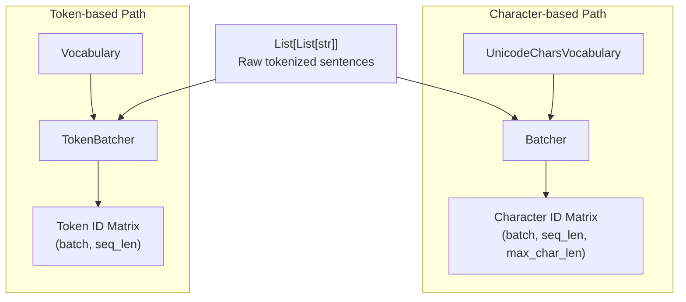
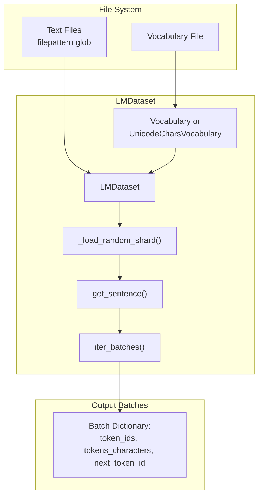
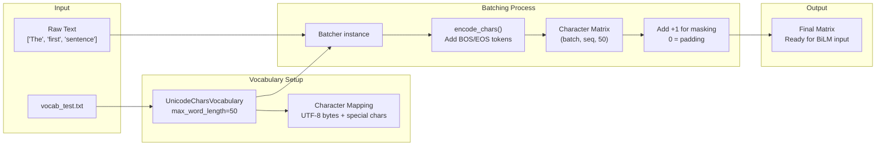
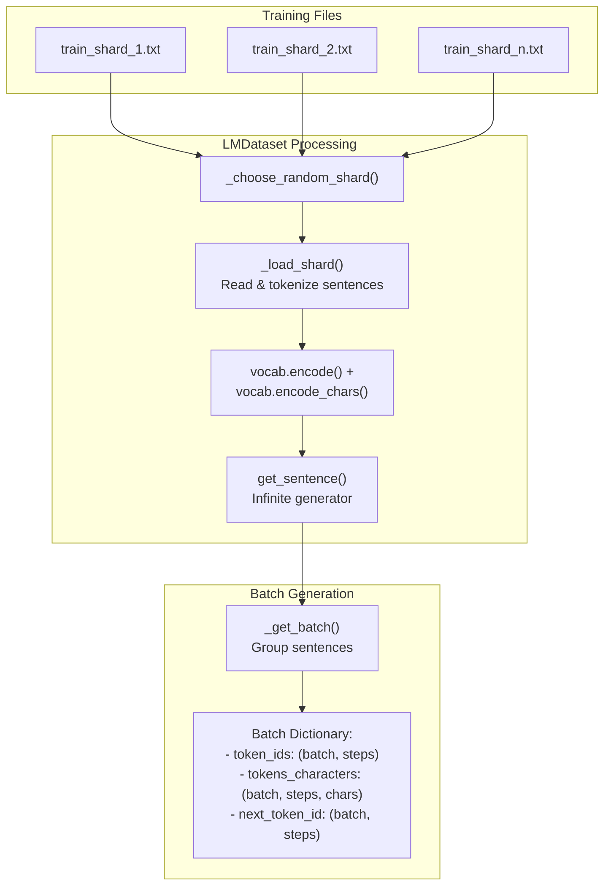

<!-- source: DeepWiki mcp.deepwiki.com · repo allenai/bilm-tf · page 3.2 Data Processing · fetched 2026-10-26 -->

# Data Processing

Relevant source files

The following files were used as context for generating this wiki page:

- [bilm/data.py](bilm/data.py)
- [tests/test_data.py](tests/test_data.py)

This document covers the data processing components in bilm-tf, which handle vocabulary management, text batching, and dataset preparation for training and inference. These components transform raw text inputs into the numerical representations required by the bidirectional language model.

For information about the core BiLM model architecture, see [BidirectionalLanguageModel](#3.1). For details on how processed data flows into ELMo embedding generation, see [ELMo Embeddings](#3.3).

## Vocabulary Management

The vocabulary system provides mapping between tokens and integer IDs, with support for both word-level and character-level representations.

### Vocabulary Class

The `Vocabulary` class provides basic token-to-ID mapping functionality:

| Property | Description | Special Token |
|----------|-------------|---------------|
| `bos` | Beginning of sentence ID | `<S>` |
| `eos` | End of sentence ID | `</S>` |
| `unk` | Unknown token ID | `<UNK>` |
| `size` | Total vocabulary size | - |

Key methods include `word_to_id()`, `id_to_word()`, `encode()` for converting sentences to ID sequences, and `decode()` for the reverse operation. The `encode()` method automatically adds BOS/EOS tokens and supports reverse ordering for backward language modeling.

### UnicodeCharsVocabulary Class

The `UnicodeCharsVocabulary` extends the base vocabulary with character-level representations. It maps each word to a fixed-length array of character IDs based on UTF-8 encoding:

| Character Range | Purpose |
|-----------------|---------|
| 0-255 | UTF-8 byte values |
| 256 | `<begin sentence>` |
| 257 | `<end sentence>` |
| 258 | `<begin word>` |
| 259 | `<end word>` |
| 260 | `<padding>` |

Each word is converted to a character array with format: `[<begin word>, char1, char2, ..., <end word>, <padding>...]` up to `max_word_length`.

**Sources:** [bilm/data.py:10-96](), [bilm/data.py:98-191]()

## Data Batching

The batching system converts lists of tokenized sentences into numerical matrices suitable for model input.

### Batcher vs TokenBatcher

### Batcher Class

The `Batcher` class creates character-level input matrices with shape `(n_sentences, max_length, max_token_length)`. It adds +1 to all character IDs to reserve 0 as a mask value for padding positions.

### TokenBatcher Class

The `TokenBatcher` class creates token-level input matrices with shape `(n_sentences, max_length)`. Like `Batcher`, it adds +1 to token IDs for masking purposes.

Both batchers automatically handle:
- Sentence length padding to the maximum length in the batch
- Addition of BOS/EOS tokens
- Conversion to numpy arrays with appropriate dtypes

**Sources:** [bilm/data.py:193-230](), [bilm/data.py:232-261]()

## Dataset Management

The dataset classes handle loading and streaming of training data from text files.

### LMDataset Architecture

### LMDataset Class

The `LMDataset` class manages streaming data from multiple text files:

- **File handling**: Loads files matching a glob pattern, randomly shuffling between shards
- **Sentence processing**: Converts raw text lines to token/character ID sequences
- **Batch generation**: Groups sentences into training batches via `iter_batches()`
- **Directional support**: Supports both forward and reverse token ordering

Key configuration options:
- `reverse`: Process sentences in reverse order for backward LM
- `test`: Iterate through data once vs. infinite streaming
- `shuffle_on_load`: Randomize sentence order within each file

### BidirectionalLMDataset Class

The `BidirectionalLMDataset` combines forward and reverse `LMDataset` instances to generate training batches for bidirectional language modeling. It merges batches by adding `_reverse` suffix to keys from the reverse dataset.

**Sources:** [bilm/data.py:315-434](), [bilm/data.py:435-461]()

## Data Processing Pipeline

### Character-Level Processing Flow

### Training Data Flow

**Sources:** [bilm/data.py:264-313](), [bilm/data.py:370-405](), [bilm/data.py:422-429]()

## Usage Patterns Integration

The data processing components support the three main usage patterns described in [Usage Patterns](#2.2):

1. **Character-level input**: Uses `Batcher` with `UnicodeCharsVocabulary` for maximum flexibility
2. **Token-level input**: Uses `TokenBatcher` with pre-computed token embeddings for faster processing  
3. **Cached embeddings**: Bypasses real-time processing entirely using pre-computed results

The `+1` offset applied by both `Batcher` and `TokenBatcher` ensures compatibility with the BiLM model's expectation that 0 represents masked/padded positions.

**Sources:** [bilm/data.py:110-114](), [bilm/data.py:226-227](), [bilm/data.py:257-258]()

---

