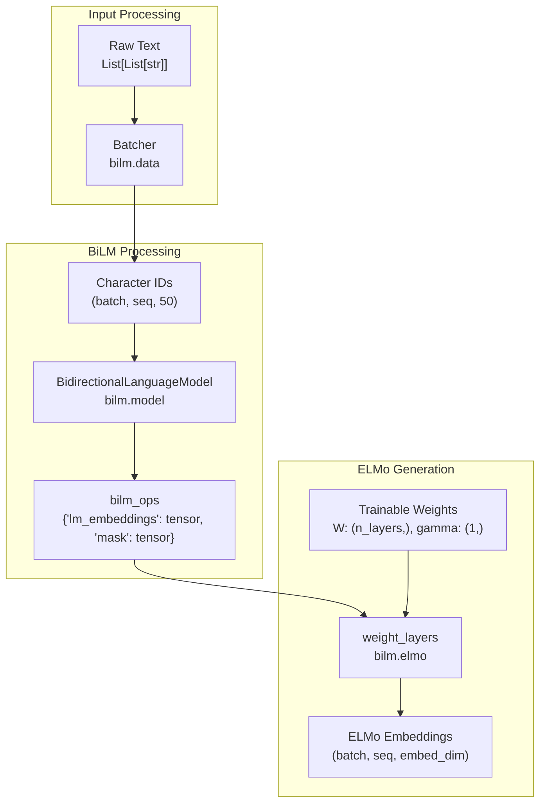
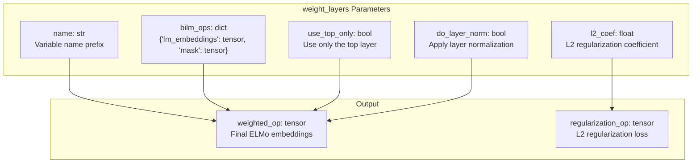
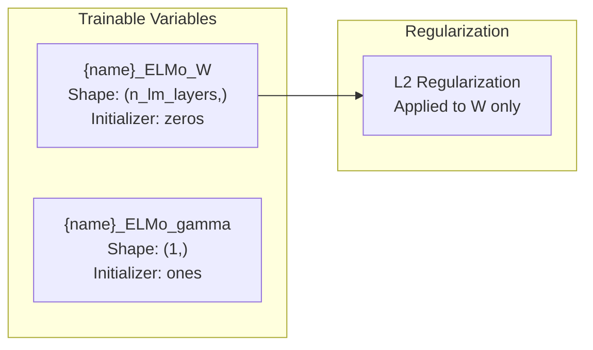
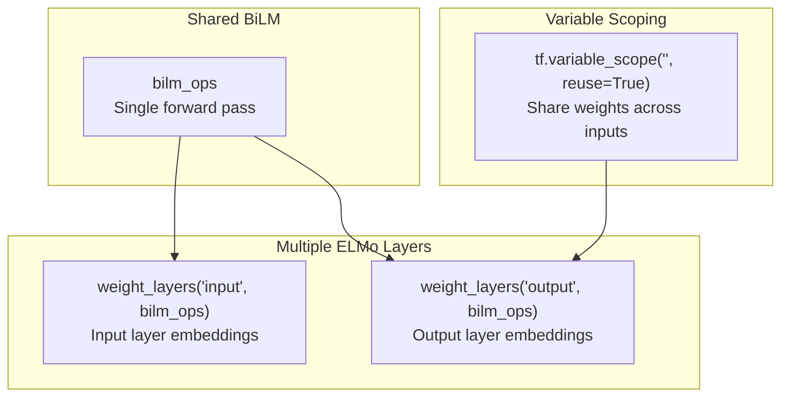

<!-- source: DeepWiki mcp.deepwiki.com · repo allenai/bilm-tf · page 3.3 ELMo Embeddings · fetched 2026-10-26 -->

# ELMo Embeddings

<details>
<summary>Relevant source files</summary>

The following files were used as context for generating this wiki page:

- [README.md](README.md)
- [bilm/elmo.py](bilm/elmo.py)
- [tests/test_elmo.py](tests/test_elmo.py)
- [usage_character.py](usage_character.py)

</details>


This document covers the generation of ELMo (Embeddings from Language Models) representations from bidirectional language model outputs. ELMo embeddings are contextualized word representations created by computing weighted combinations of internal biLM layer activations.

For information about the underlying bidirectional language model architecture, see [BidirectionalLanguageModel](#3.1). For data processing and batching, see [Data Processing](#3.2).

## Overview

ELMo embeddings are produced by the `weight_layers` function, which takes multi-layer representations from a trained bidirectional language model and combines them into task-specific contextualized embeddings. The core concept is that different layers of the biLM capture different types of linguistic information, and the optimal combination varies by downstream task.

## Architecture Overview

The ELMo embedding generation process fits into the larger system as follows:



Sources: [README.md:52-65](), [bilm/elmo.py:4-31](), [usage_character.py:32-52]()

## The weight_layers Function

The `weight_layers` function is the core component for generating ELMo embeddings. It computes a weighted linear combination of the biLM's internal layer representations.

### Function Signature and Parameters



Sources: [bilm/elmo.py:4-31]()

### Core Algorithm

The `weight_layers` function implements the following algorithm:

1. **Extract biLM outputs**: Gets `lm_embeddings` with shape `(batch, n_layers, seq_len, embed_dim)` and attention `mask`
2. **Create trainable weights**: 
   - `W`: Layer mixing weights with shape `(n_layers,)`
   - `gamma`: Scaling parameter with shape `(1,)`
3. **Normalize layer weights**: Apply softmax to `W + 1.0/n_layers` for balanced initialization
4. **Optional layer normalization**: Apply layer norm to each biLM layer if `do_layer_norm=True`
5. **Weighted combination**: Compute `sum(w_i * layer_i)` across all layers
6. **Scale output**: Multiply by `gamma` parameter

| Parameter | Default | Purpose |
|-----------|---------|---------|
| `l2_coef` | `None` | L2 regularization on layer weights |
| `use_top_only` | `False` | Skip weighting, use only top layer |
| `do_layer_norm` | `False` | Normalize each layer before weighting |

Sources: [bilm/elmo.py:38-113]()

## Implementation Details

### Trainable Variables

The function creates two types of trainable variables per call:



Sources: [bilm/elmo.py:68-108]()

### Layer Normalization

When `do_layer_norm=True`, the function applies custom layer normalization that respects the sequence mask:

- Computes mean and variance only over valid (non-masked) positions
- Uses `mask_float` to exclude padding tokens from normalization statistics
- Applies batch normalization with computed statistics

Sources: [bilm/elmo.py:50-59]()

## Usage Patterns

### Basic Usage

```python
# Get biLM representations
bilm_ops = model(character_ids)

# Create ELMo embeddings
elmo_ops = weight_layers('task_name', bilm_ops, l2_coef=0.001)

# Extract final embeddings
elmo_embeddings = elmo_ops['weighted_op']
regularization_loss = elmo_ops['regularization_op']
```

### Multiple ELMo Representations

For tasks requiring ELMo at multiple model layers:



Sources: [usage_character.py:38-52]()

## Configuration Options

### Performance vs Quality Trade-offs

| Option | Performance | Quality | Use Case |
|--------|-------------|---------|----------|
| `use_top_only=True` | Fastest | Lower | Quick prototyping |
| `use_top_only=False` | Slower | Higher | Production systems |
| `do_layer_norm=True` | Slowest | Highest | Research applications |

### Regularization Settings

- `l2_coef=None` or `l2_coef=0.0`: No regularization
- `l2_coef=0.001`: Light regularization (typical)
- `l2_coef=0.01`: Strong regularization (small datasets)

Sources: [bilm/elmo.py:20-24](), [tests/test_elmo.py:117-124]()

## Testing and Validation

The system includes comprehensive tests that validate:

- Correct tensor shapes and operations
- Proper masking behavior for variable-length sequences  
- Layer normalization implementation
- Regularization term computation
- Variable sharing across multiple `weight_layers` calls

The test suite creates fixtures with known weights and verifies that the computed ELMo embeddings match analytical expectations.

Sources: [tests/test_elmo.py:17-125]()

---

