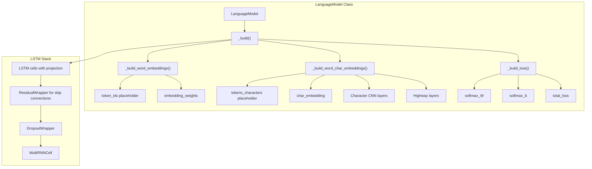
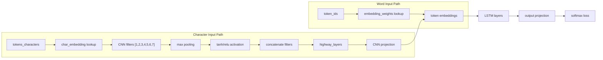
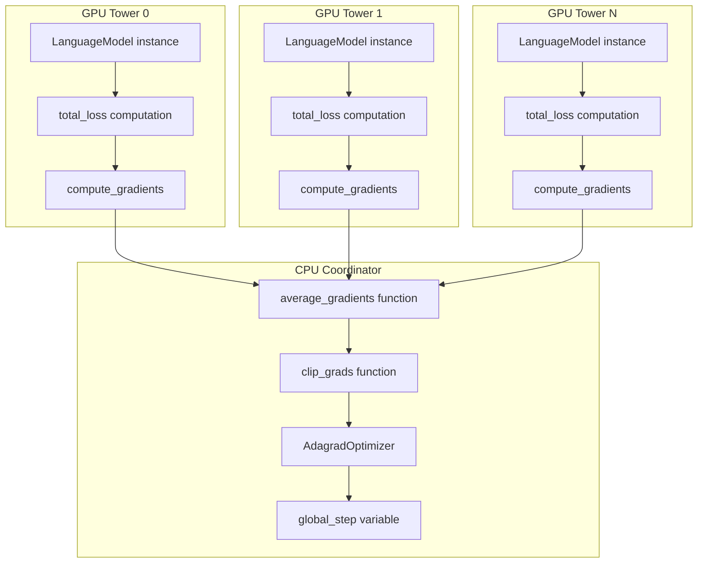
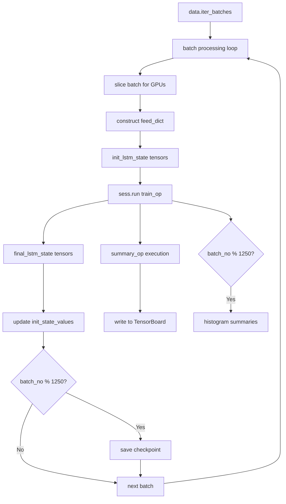
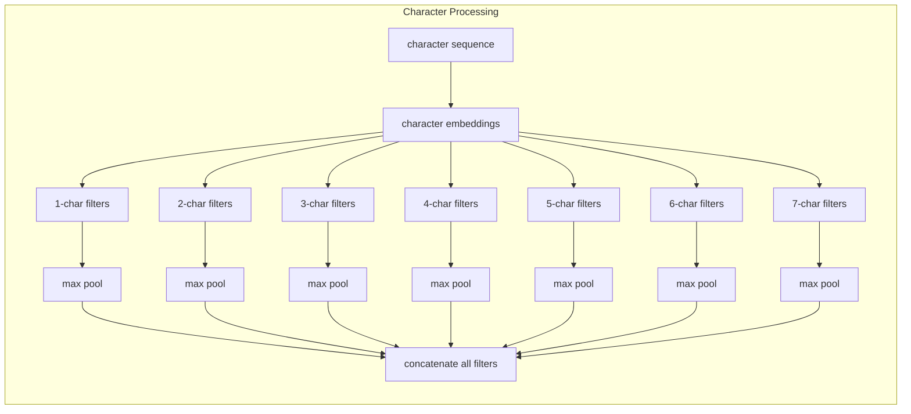
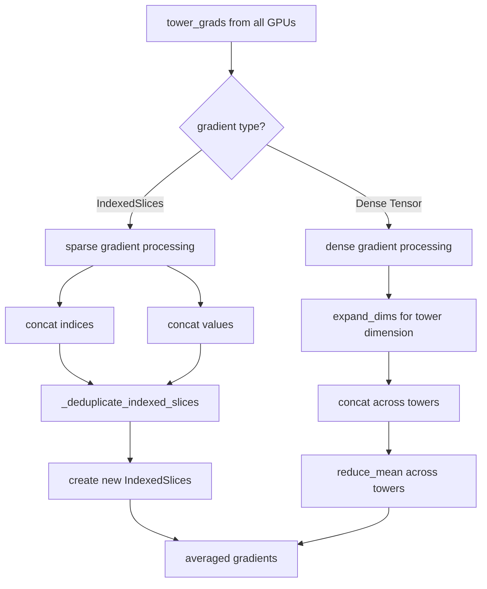

<!-- source: DeepWiki mcp.deepwiki.com · repo allenai/bilm-tf · page 3.4 Training System · fetched 2026-10-26 -->

# Training System

<details>
<summary>Relevant source files</summary>

The following files were used as context for generating this wiki page:

- [bilm/training.py](bilm/training.py)
- [tests/test_training.py](tests/test_training.py)

</details>


The Training System provides the core infrastructure for training bidirectional language models in the bilm-tf repository. This system handles model architecture definition, multi-GPU distributed training, gradient computation and clipping, checkpointing, and evaluation. The training system supports both character-level and word-level inputs, with configurable LSTM architectures and bidirectional processing.

For information about using pre-trained models for inference, see [BidirectionalLanguageModel](#3.1). For data preparation and batching utilities, see [Data Processing](#3.2).

## Core Architecture

The training system is built around the `LanguageModel` class which constructs the TensorFlow computational graph for neural language modeling. This class supports both unidirectional and bidirectional language models with configurable architectures.

### LanguageModel Class Structure



**Sources:** [bilm/training.py:55-72](), [bilm/training.py:325-431]()

### Input Processing Architecture

The system supports two input modalities: word tokens and character sequences. The character CNN architecture processes variable-length character sequences into fixed-size token representations.



**Sources:** [bilm/training.py:74-104](), [bilm/training.py:105-324]()

## Training Infrastructure

The training system implements distributed multi-GPU training with gradient averaging and sophisticated state management for LSTM networks.

### Multi-GPU Training Setup



**Sources:** [bilm/training.py:675-744](), [bilm/training.py:532-586]()

### Training Loop Flow

The training loop manages LSTM state persistence across batches, distributed batch processing, and periodic checkpointing and evaluation.



**Sources:** [bilm/training.py:763-897]()

## Model Configuration Options

The `LanguageModel` class accepts a comprehensive options dictionary that controls all aspects of model architecture and training behavior.

### Key Configuration Parameters

| Parameter Category | Key Options | Description |
|-------------------|-------------|-------------|
| **Model Architecture** | `bidirectional` | Enable bidirectional processing |
| | `n_tokens_vocab` | Vocabulary size |
| | `batch_size` | Training batch size |
| | `unroll_steps` | LSTM unroll length |
| **LSTM Configuration** | `lstm.dim` | LSTM hidden state size |
| | `lstm.projection_dim` | Output projection dimension |
| | `lstm.n_layers` | Number of LSTM layers |
| | `lstm.use_skip_connections` | Enable residual connections |
| | `lstm.cell_clip` | Cell state clipping value |
| | `lstm.proj_clip` | Projection clipping value |
| **Character CNN** | `char_cnn.filters` | CNN filter specifications |
| | `char_cnn.n_highway` | Number of highway layers |
| | `char_cnn.activation` | Activation function |
| **Training** | `dropout` | Dropout probability |
| | `learning_rate` | Optimizer learning rate |
| | `n_epochs` | Training epochs |
| | `sample_softmax` | Use sampled softmax loss |

**Sources:** [bilm/training.py:40-54](), [bilm/training.py:107-131]()

### Character CNN Architecture Options

The character CNN processes character sequences through multiple convolutional filters with different widths:



**Sources:** [bilm/training.py:175-221]()

## Gradient Processing

The training system implements sophisticated gradient clipping and averaging mechanisms for stable multi-GPU training.

### Gradient Averaging Process

The `average_gradients` function handles both dense and sparse (IndexedSlices) gradients across multiple GPU towers:



**Sources:** [bilm/training.py:532-586](), [bilm/training.py:627-642]()

## Evaluation System

The `test` function provides perplexity evaluation on held-out datasets using trained model checkpoints.

### Test Evaluation Flow

```mermaid
graph TD
    LoadModel[load LanguageModel with test options] --> LoadCheckpoint[restore from checkpoint]
    LoadCheckpoint --> InitTestState[initialize LSTM states]
    InitTestState --> TestLoop[iterate test batches]
    TestLoop --> ComputeLoss[compute total_loss]
    ComputeLoss --> UpdateStates[update LSTM states]
    UpdateStates --> AccumLoss[accumulate batch losses]
    AccumLoss --> CheckDone{more batches?}
    CheckDone -->|Yes| TestLoop
    CheckDone -->|No| FinalPerplexity[compute final perplexity]
    FinalPerplexity --> ReturnResult[return exp(avg_loss)]
```

**Sources:** [bilm/training.py:955-1044]()

## Utility Functions

The training system provides several utility functions for model management and weight extraction.

### Key Utility Functions

| Function | Purpose | Key Features |
|----------|---------|--------------|
| `dump_weights` | Extract trained weights to HDF5 | Converts TensorFlow variables to HDF5 format |
| `load_options_latest_checkpoint` | Load model configuration | Reads options.json and finds latest checkpoint |
| `clip_grads` | Gradient clipping with summaries | Global norm clipping with TensorBoard logging |
| `print_variable_summary` | Debug model variables | Pretty-prints all TensorFlow variables |

**Sources:** [bilm/training.py:1065-1108](), [bilm/training.py:1047-1062](), [bilm/training.py:926-952](), [bilm/training.py:24-27]()

---

