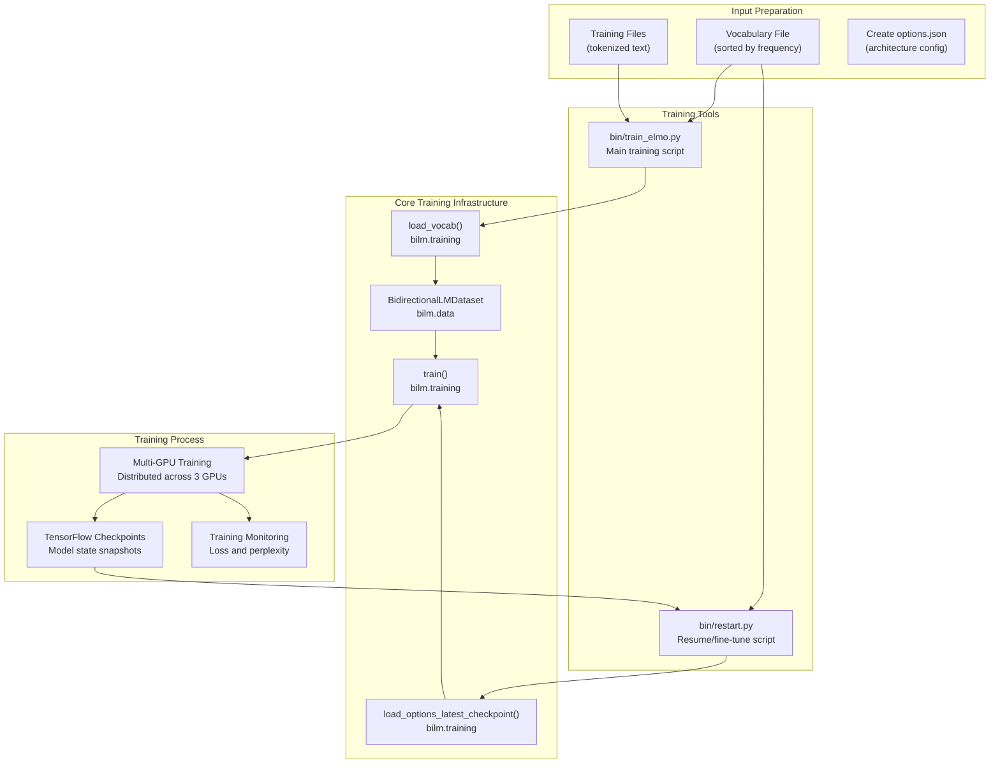
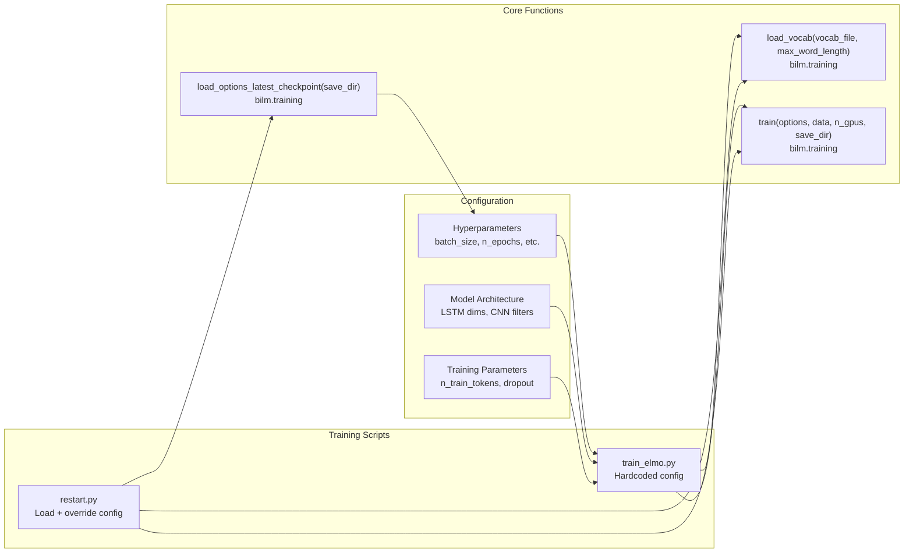

<!-- source: DeepWiki mcp.deepwiki.com · repo allenai/bilm-tf · page 4.1 Training Tools · fetched 2026-10-26 -->

# Training Tools

Relevant source files

The following files were used as context for generating this wiki page:

- [README.md](README.md)
- [bin/restart.py](bin/restart.py)
- [bin/train_elmo.py](bin/train_elmo.py)
- [usage_character.py](usage_character.py)

This document covers the command-line tools provided for training bidirectional language models (biLMs) in the bilm-tf system. These tools enable users to train new ELMo models from scratch or fine-tune existing models on custom datasets.

For information about model evaluation and testing, see [Evaluation & Utilities](#4.2). For details about the underlying training system architecture, see [Training System](#3.4).

## Overview

The bilm-tf repository provides two primary training tools:
- `train_elmo.py` - Main training script for training biLMs from scratch
- `restart.py` - Tool for resuming training from existing checkpoints or fine-tuning pre-trained models

Both tools utilize the core training infrastructure from the `bilm.training` module and require prepared datasets with vocabulary files.

## Main Training Script

The primary training tool is located at [bin/train_elmo.py](). This script implements the complete training pipeline used to create the original ELMo models.

### Core Functionality

The training script performs the following operations:
1. Loads vocabulary from the specified vocabulary file using `load_vocab` [bin/train_elmo.py:12]()
2. Defines model architecture and training hyperparameters [bin/train_elmo.py:21-55]()
3. Creates a `BidirectionalLMDataset` for data loading [bin/train_elmo.py:58-59]()
4. Initiates training using the `train` function [bin/train_elmo.py:63]()

### Training Configuration

The script includes hardcoded hyperparameters that match the original ELMo model:

| Parameter | Value | Description |
|-----------|-------|-------------|
| `batch_size` | 128 | Batch size per GPU |
| `n_gpus` | 3 | Number of GPUs for distributed training |
| `n_train_tokens` | 768,648,884 | Total tokens in 1B Word Benchmark |
| `n_epochs` | 10 | Training epochs |
| `unroll_steps` | 20 | LSTM unroll steps |

The model architecture is configured with:
- Bidirectional LSTM with 2 layers of 4096 dimensions [bin/train_elmo.py:39-45]()
- Character CNN with 7 filter sizes [bin/train_elmo.py:24-35]()
- Highway networks and dropout regularization [bin/train_elmo.py:35,37]()

Sources: [bin/train_elmo.py:1-75](), [README.md:162-176]()

## Training Resumption Tool

The restart script [bin/restart.py]() enables resuming training from existing checkpoints or fine-tuning pre-trained models on new datasets.

### Key Features

The restart tool provides:
- Automatic loading of previous training options and checkpoint files [bin/restart.py:10]()
- Parameter override capabilities for batch size, epochs, and token counts [bin/restart.py:34-39]()
- Support for both unidirectional and bidirectional language models [bin/restart.py:25-28]()

### Usage Parameters

The restart script accepts the following command-line arguments:

| Argument | Type | Description |
|----------|------|-------------|
| `--save_dir` | string | Directory containing checkpoint files |
| `--vocab_file` | string | Path to vocabulary file |
| `--train_prefix` | string | Prefix pattern for training files |
| `--n_gpus` | int | Number of GPUs (default: 1) |
| `--batch_size` | int | Override batch size (optional) |
| `--n_train_tokens` | int | Override token count (optional) |
| `--n_epochs` | int | Override epoch count (optional) |

Sources: [bin/restart.py:1-59](), [README.md:218-223]()

## Training Workflow

The following diagram illustrates the training process flow and the relationship between the training tools and core components:

This diagram shows how the training tools coordinate data preparation, model configuration, and the core training infrastructure to produce trained models.

Sources: [bin/train_elmo.py:10-63](), [bin/restart.py:9-42](), [README.md:127-176]()

## Data Requirements and Setup

Both training tools require specific data preparation following the bilm-tf conventions:

### Vocabulary File Format
- Text file with one token per line [README.md:145]()
- Must include special tokens: `<S>`, `</S>`, and `<UNK>` [README.md:145]()
- Tokens sorted in descending order by frequency [README.md:147]()
- Special tokens should appear first in the file [README.md:147]()

### Training Data Format
- Multiple files containing pre-tokenized text [README.md:151-153]()
- One sentence per line with whitespace-separated tokens [README.md:153]()
- No special begin/end tokens in training data [README.md:154]()
- Random split across multiple files for efficient loading [README.md:151-152]()

### Training Configuration Workflow

The following diagram shows the relationship between configuration files, training scripts, and the training process:

This diagram illustrates how training configuration flows from hardcoded parameters or loaded checkpoints through the training scripts to the core training functions.

Sources: [bin/train_elmo.py:11-63](), [bin/restart.py:10-42](), [README.md:138-161]()

## Multi-GPU Training Support

Both training tools support distributed multi-GPU training through the underlying `train` function:

- Default configuration uses 3 GPUs [bin/train_elmo.py:16]()
- Restart tool accepts `--n_gpus` parameter for customization [bin/restart.py:50-51]()
- GPU visibility controlled via `CUDA_VISIBLE_DEVICES` environment variable [README.md:171]()
- Batch size specified per GPU, with total effective batch size multiplied by GPU count

The training process automatically distributes computation across available GPUs while maintaining gradient synchronization and model consistency.

Sources: [bin/train_elmo.py:15-16](), [bin/restart.py:50-51](), [README.md:165-176]()

---

