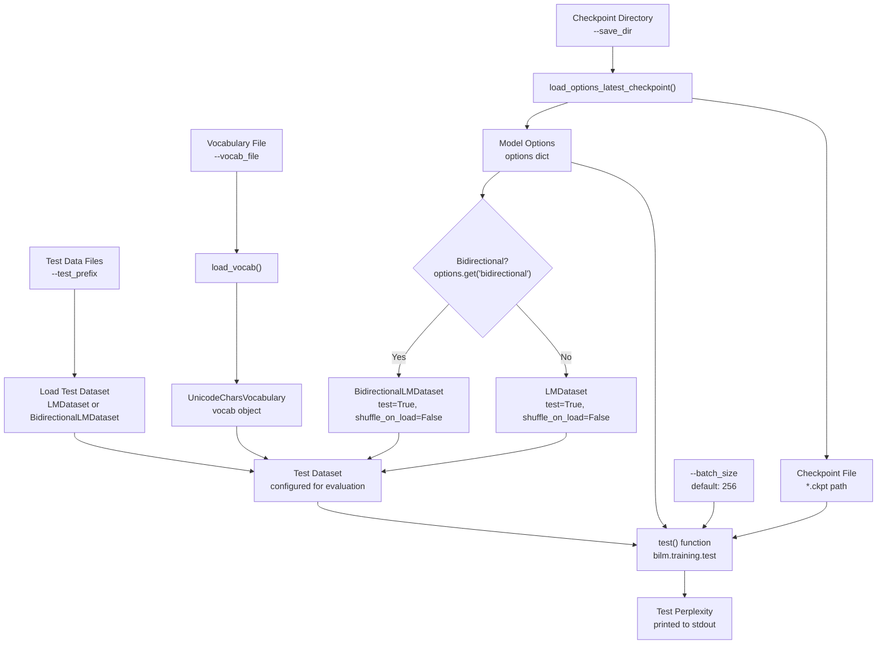
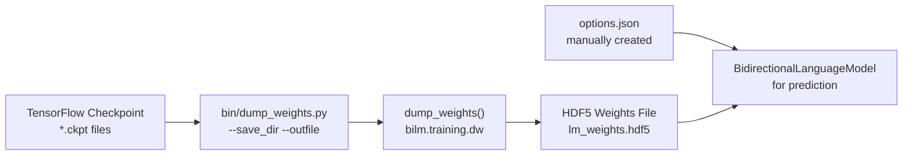
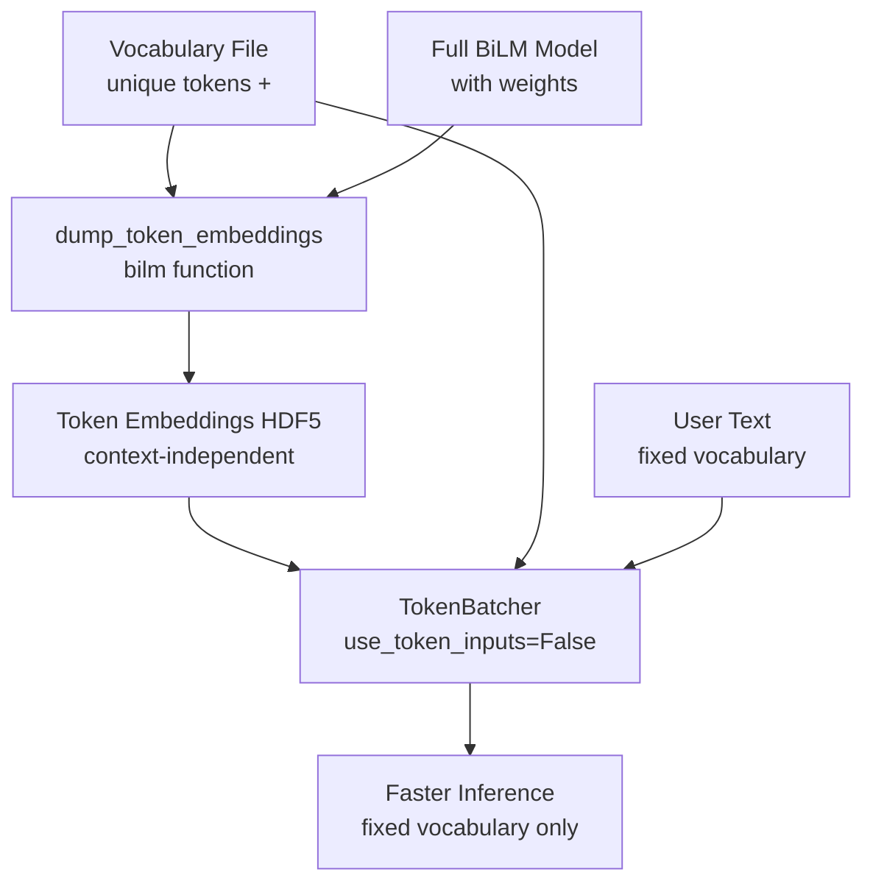
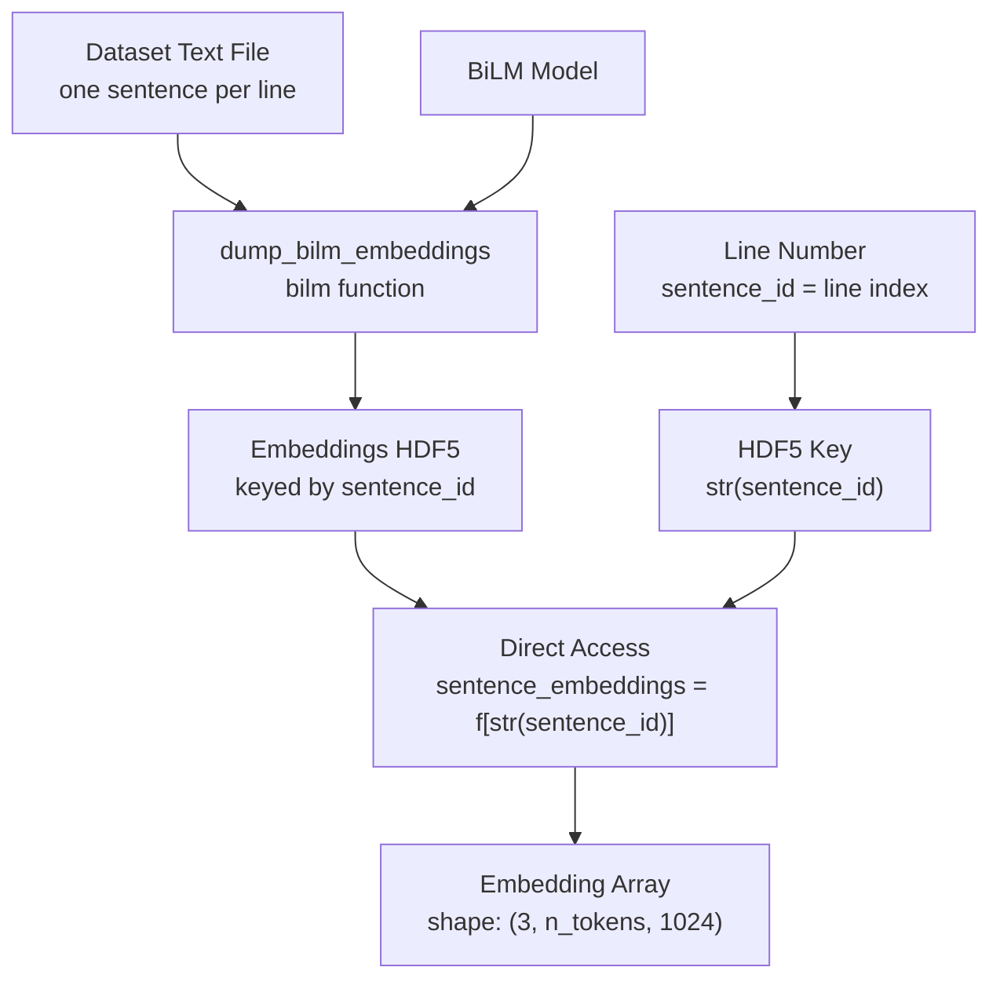
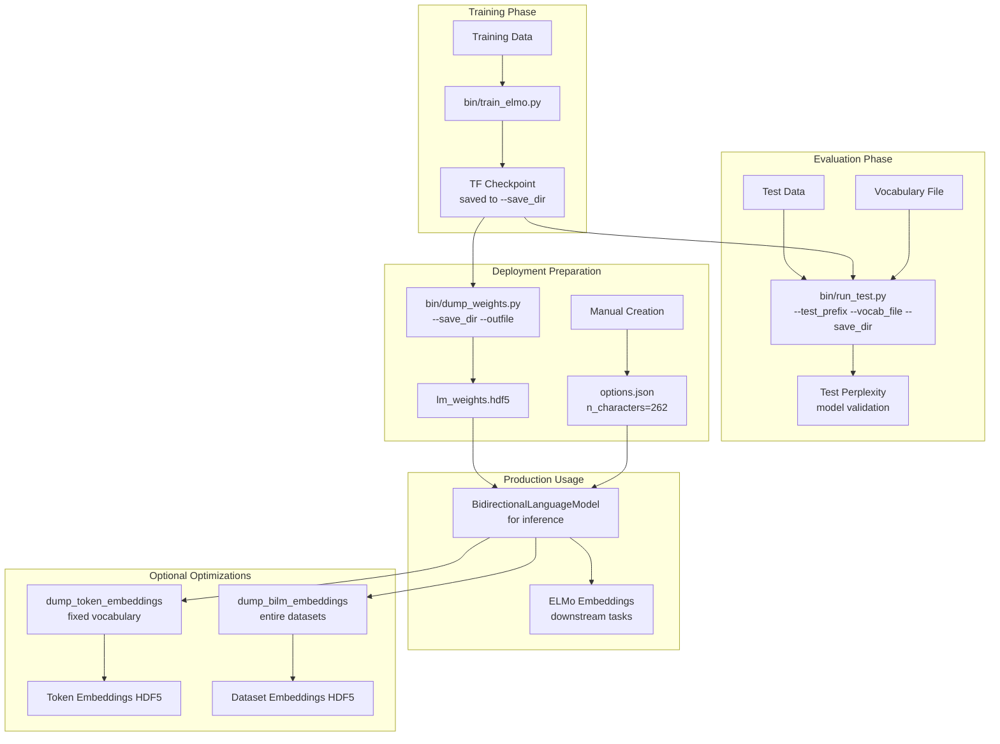

<!-- source: DeepWiki mcp.deepwiki.com · repo allenai/bilm-tf · page 4.2 Evaluation & Utilities · fetched 2026-10-26 -->

# Evaluation & Utilities

<details>
<summary>Relevant source files</summary>

The following files were used as context for generating this wiki page:

- [README.md](README.md)
- [bin/dump_weights.py](bin/dump_weights.py)
- [bin/run_test.py](bin/run_test.py)
- [usage_character.py](usage_character.py)

</details>


This page documents the evaluation scripts and utility tools provided in the bilm-tf system for testing trained models, converting model formats, and extracting embeddings. These tools support the complete workflow from model training through deployment and usage.

For information about training tools, see [Training Tools](#4.1). For model configuration details, see [Model Configuration](#5.1).

## Model Evaluation

The primary evaluation tool is the `run_test.py` script, which computes perplexity metrics on held-out test data to assess model performance.

### Test Perplexity Evaluation

The `run_test.py` script loads a trained model checkpoint and evaluates it against test data:

```bash
python bin/run_test.py \
    --test_prefix='/path/to/test/data/*' \
    --vocab_file /path/to/vocab.txt \
    --save_dir /path/to/checkpoint \
    --batch_size 256
```

The evaluation process follows this workflow:



**Key Components:**

- **`load_options_latest_checkpoint()`**: Loads model configuration and finds the latest checkpoint file
- **`load_vocab()`**: Creates vocabulary object with proper character limit handling
- **Dataset Selection**: Chooses between `LMDataset` and `BidirectionalLMDataset` based on model type
- **`test()` Function**: Performs the actual perplexity computation

Sources: [bin/run_test.py:1-44](), [bilm/training.py](), [README.md:178-188]()

## Weight Conversion Utilities

### Checkpoint to HDF5 Conversion

The `dump_weights.py` script converts TensorFlow checkpoint files to HDF5 format for use in prediction:



**Usage:**
```bash
python bin/dump_weights.py \
    --save_dir /path/to/checkpoint \
    --outfile /path/to/weights.hdf5
```

**Important Notes:**
- Requires manual creation of `options.json` file with model hyperparameters
- Must set `n_characters=262` in `options.json` for prediction (vs. 261 during training)
- Enables model deployment without TensorFlow checkpoint dependencies

Sources: [bin/dump_weights.py:1-16](), [README.md:190-203]()

## Embedding Extraction Utilities

The system provides utilities for pre-computing and caching embeddings at different levels of the model pipeline.

### Token Embedding Extraction

The `dump_token_embeddings` function pre-computes context-independent token representations:



**Workflow:**
1. Create vocabulary file with all unique tokens
2. Run `dump_token_embeddings` with full model
3. Use `TokenBatcher` with the output HDF5 file
4. Pass `use_token_inputs=False` to `BidirectionalLanguageModel`

**Limitations:**
- No fallback to character inputs for OOV words
- Only suitable for fixed, defined vocabularies

Sources: [README.md:98-116](), [usage_token.py]()

### Full Dataset Embedding Extraction

The `dump_bilm_embeddings` function processes entire datasets and caches complete embeddings:



**Storage Format:**
- HDF5 file with sentence-level datasets
- Keys: `str(sentence_id)` where `sentence_id` is 0-indexed line number
- Values: Shape `(3, n_tokens, 1024)` arrays (3 layers, token count, embedding dimension)

**Use Cases:**
- Smaller datasets where file size is manageable
- Integration with non-TensorFlow frameworks
- Scenarios requiring pre-computed embeddings

Sources: [README.md:118-125](), [usage_cached.py]()

## Utility Workflows

### Complete Model Deployment Pipeline

The following diagram shows how evaluation and utility tools work together in a complete model lifecycle:



### Character Limit Configuration

An important utility consideration is the character limit configuration that differs between training and prediction:

| Phase | `n_characters` Value | Reason |
|-------|---------------------|--------|
| Training | 261 | No padding token needed; batches filled to exact size |
| Prediction | 262 | Padding token required for variable-length sentences |

**Implementation Details:**
- Training uses `UnicodeCharsVocabulary` with fixed 261 character embeddings
- Prediction requires padding in `Batcher` for variable sentence lengths
- Must be manually set in `options.json` during deployment preparation

Sources: [README.md:260-271](), [bilm/data.py:220]()

## Error Handling and Troubleshooting

### Common Issues

**Serialization Warnings:**
The system may produce warnings about `lstm_output_embeddings` serialization that can be safely ignored.

**State Carryover:**
Due to stateful LSTM implementation, slight non-determinism may occur between runs, especially in first batches.

**Vocabulary Mismatches:**
Training and prediction vocabularies may differ, but prediction vocabulary should include `<S>`, `</S>`, and `<UNK>` tokens.

Sources: [README.md:245-248](), [README.md:277-283]()

---

