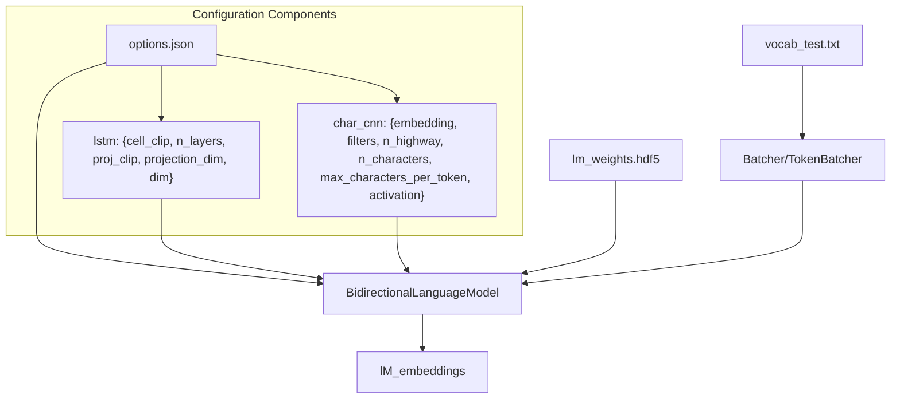
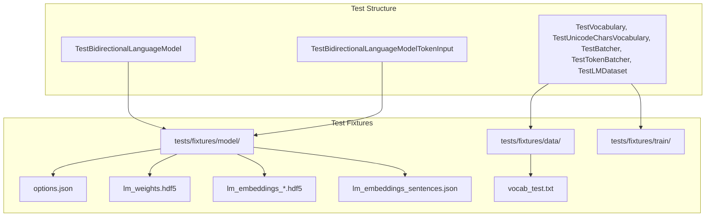
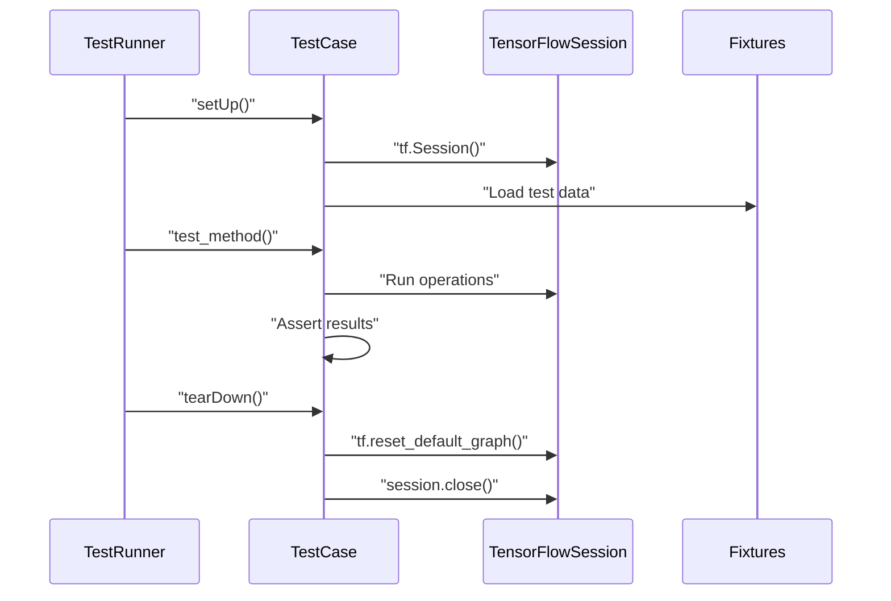
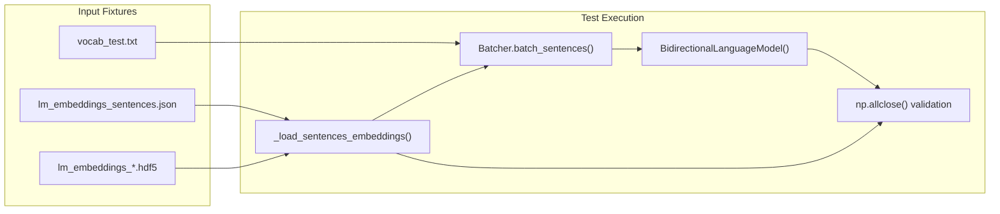

<!-- source: DeepWiki mcp.deepwiki.com · repo allenai/bilm-tf · page 5 Configuration & Testing · fetched 2026-10-26 -->

# Configuration & Testing

Relevant source files

The following files were used as context for generating this wiki page:

- [tests/fixtures/model/options.json](tests/fixtures/model/options.json)
- [tests/test_data.py](tests/test_data.py)
- [tests/test_model.py](tests/test_model.py)

This document covers the configuration system and testing framework for the bilm-tf repository. It explains how model hyperparameters are specified, how the system validates correctness through comprehensive testing, and the relationship between configuration files and model behavior.

For detailed model configuration options, see [Model Configuration](#5.1). For comprehensive testing procedures and test suite documentation, see [Testing Framework](#5.2).

## Configuration System

The bilm-tf system uses JSON configuration files to specify model architecture and hyperparameters. The primary configuration mechanism centers around `options.json` files that define the complete model specification.

### Configuration Flow Architecture

Sources: [tests/fixtures/model/options.json:1-2](), [tests/test_model.py:59-63]()

The configuration system follows a hierarchical structure where the `BidirectionalLanguageModel` class accepts an `options_file` parameter that points to a JSON configuration file containing nested configuration objects for different model components.

### Core Configuration Parameters

| Component | Parameters | Purpose |
|-----------|------------|---------|
| `lstm` | `cell_clip`, `use_skip_connections`, `n_layers`, `proj_clip`, `projection_dim`, `dim` | LSTM architecture and clipping |
| `char_cnn` | `embedding.dim`, `filters`, `n_highway`, `n_characters`, `max_characters_per_token`, `activation` | Character-level CNN processing |

Sources: [tests/fixtures/model/options.json:1-2]()

## Testing Framework

The bilm-tf testing framework provides comprehensive validation of model behavior, data processing, and embedding generation. The test suite is organized around core component validation and uses fixtures to ensure reproducible test conditions.

### Testing Architecture

Sources: [tests/test_model.py:15](), [tests/test_data.py:10-11]()

### Component Testing Coverage

The testing framework validates the following core components:

#### Model Testing
- **Character Input Path**: Tests `BidirectionalLanguageModel` with character-level inputs via `Batcher`
- **Token Input Path**: Tests `BidirectionalLanguageModel` with pre-computed token embeddings via `TokenBatcher`  
- **Embedding Validation**: Compares generated embeddings against expected fixtures with tolerance `atol=1.0e-6`
- **State Management**: Validates LSTM state updates and batch size handling

Sources: [tests/test_model.py:51-101](), [tests/test_model.py:143-220]()

#### Data Processing Testing
- **Vocabulary Management**: Tests `Vocabulary` and `UnicodeCharsVocabulary` encoding and decoding
- **Batching Logic**: Validates `Batcher` and `TokenBatcher` sentence batching with proper padding
- **Dataset Iteration**: Tests `LMDataset` and `BidirectionalLMDataset` batch generation

Sources: [tests/test_data.py:14-38](), [tests/test_data.py:101-187](), [tests/test_data.py:202-364]()

### Test Execution Patterns

Sources: [tests/test_model.py:44-49](), [tests/test_model.py:134-141]()

The testing framework follows a consistent pattern where each test class manages TensorFlow session lifecycle, loads appropriate fixtures, executes model operations, and validates results against expected outputs. This ensures isolation between tests and reproducible validation of system behavior.

### Testing Data Flow

Testing Data Flow Architecture shows how test data flows through the validation process:

Sources: [tests/test_model.py:18-40](), [tests/test_model.py:74-100]()

## Configuration-Testing Integration

The configuration and testing systems are tightly integrated, with test fixtures providing canonical examples of valid configuration files and expected model behavior. This integration ensures that configuration changes are automatically validated through the comprehensive test suite.

The `TestBidirectionalLanguageModel` class specifically validates that models instantiated with fixture configurations produce expected embeddings, creating a direct validation path from configuration to model behavior.

Sources: [tests/test_model.py:59-60](), [tests/fixtures/model/options.json:1-2]()

---

