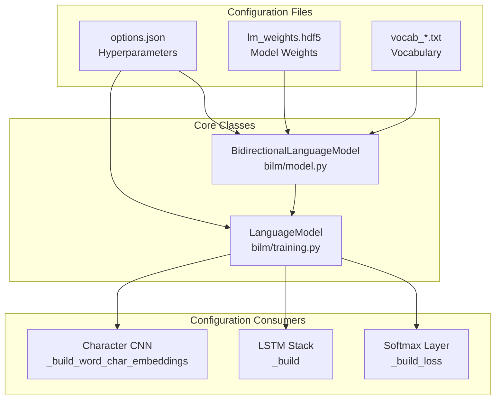
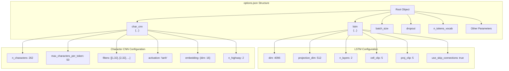
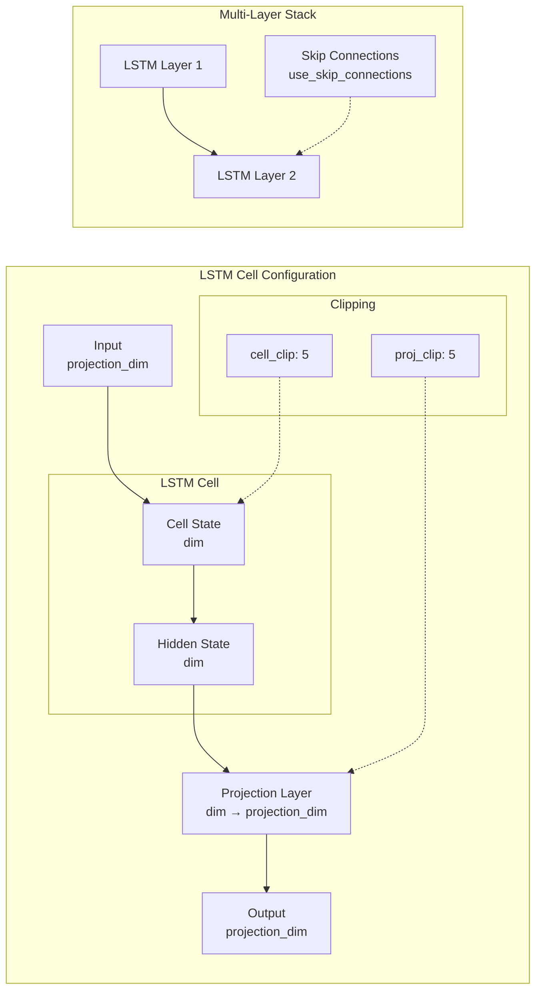
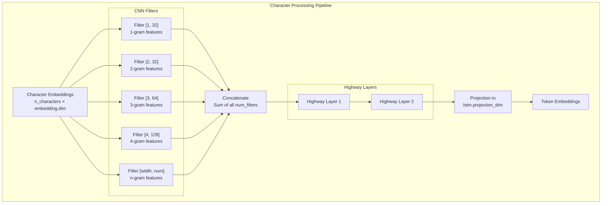
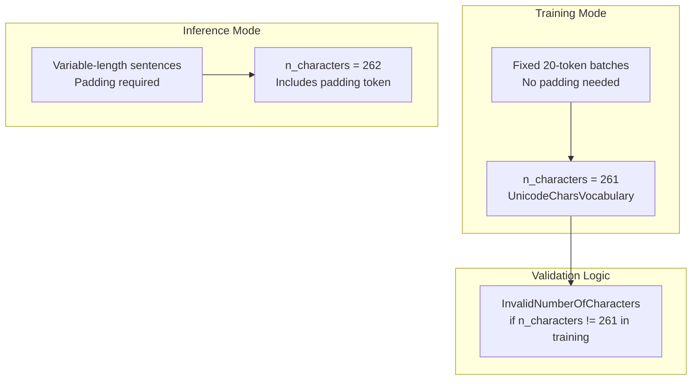
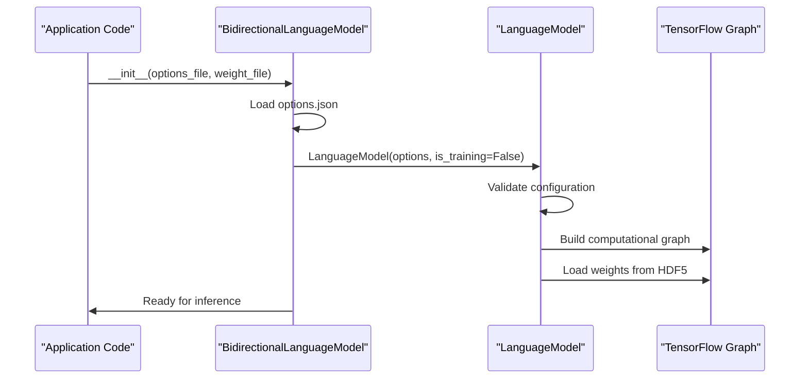

<!-- source: DeepWiki mcp.deepwiki.com · repo allenai/bilm-tf · page 5.1 Model Configuration · fetched 2026-10-26 -->

# Model Configuration

<details>
<summary>Relevant source files</summary>

The following files were used as context for generating this wiki page:

- [README.md](README.md)
- [bilm/training.py](bilm/training.py)
- [tests/fixtures/model/options.json](tests/fixtures/model/options.json)
- [usage_character.py](usage_character.py)

</details>


This document covers the model configuration system in bilm-tf, including the structure of configuration files, available hyperparameters, and how configuration options control model architecture and training behavior. For information about the training process itself, see [Training System](#3.4). For testing configuration, see [Testing Framework](#5.2).

## Configuration System Overview

The bilm-tf system uses JSON configuration files (`options.json`) to specify all model hyperparameters and architectural choices. These configuration files work in conjunction with HDF5 weight files to define complete pre-trained models that can be loaded for inference or fine-tuning.



Sources: [bilm/training.py:30-72](), [bilm/model.py](), [README.md:47-49](), [usage_character.py:15-16]()

## Configuration File Structure

Configuration files are JSON documents with a hierarchical structure containing the following main sections:

| Section | Purpose | Required |
|---------|---------|----------|
| `lstm` | LSTM architecture parameters | Yes |
| `char_cnn` | Character CNN configuration | Optional* |
| Training parameters | Batch size, dropout, etc. | Yes |
| Vocabulary parameters | Token/character counts | Yes |

*Required when using character inputs

### Basic Configuration Template



Sources: [bilm/training.py:43-54](), [bilm/training.py:107-131](), [tests/fixtures/model/options.json:1]()

## LSTM Configuration

The `lstm` section controls the bidirectional LSTM architecture that forms the core of the language model.

### LSTM Parameters

| Parameter | Type | Purpose | Example Value |
|-----------|------|---------|---------------|
| `dim` | int | Hidden state size | 4096 |
| `projection_dim` | int | Output projection size | 512 |
| `n_layers` | int | Number of LSTM layers | 2 |
| `cell_clip` | float | Cell state clipping value | 5 |
| `proj_clip` | float | Projection clipping value | 5 |
| `use_skip_connections` | bool | Enable residual connections | true |

The relationship between `dim` and `projection_dim` is crucial: when `projection_dim < dim`, the LSTM uses a projection layer to reduce dimensionality. When they are equal, no projection is used.



Sources: [bilm/training.py:43-54](), [bilm/training.py:332-334](), [bilm/training.py:368-376](), [bilm/training.py:378-386]()

## Character CNN Configuration

The `char_cnn` section configures the character-level input processing when `use_character_inputs=True`.

### Character CNN Parameters

| Parameter | Type | Purpose | Default |
|-----------|------|---------|---------|
| `n_characters` | int | Character vocabulary size | 262 (inference), 261 (training) |
| `max_characters_per_token` | int | Maximum characters per token | 50 |
| `embedding.dim` | int | Character embedding dimension | 16 |
| `filters` | list | CNN filter specifications | [[1,32], [2,32], ...] |
| `activation` | str | Activation function | "tanh" or "relu" |
| `n_highway` | int | Number of highway layers | 2 |

### Filter Configuration

The `filters` parameter specifies convolutional filters as `[width, num_filters]` pairs:



Sources: [bilm/training.py:105-147](), [bilm/training.py:175-221](), [bilm/training.py:234-323]()

## Training Configuration Parameters

These parameters control the training process and model behavior during both training and inference.

### Core Training Parameters

| Parameter | Type | Purpose | Typical Value |
|-----------|------|---------|---------------|
| `batch_size` | int | Training batch size | 128 |
| `unroll_steps` | int | LSTM unroll length | 20 |
| `n_tokens_vocab` | int | Vocabulary size | 793471 |
| `dropout` | float | Dropout probability | 0.1 |
| `bidirectional` | bool | Use bidirectional LSTM | true |
| `n_epochs` | int | Training epochs | 10 |
| `n_train_tokens` | int | Total training tokens | 768648884 |

### Advanced Training Parameters

| Parameter | Type | Purpose | Default |
|-----------|------|---------|---------|
| `share_embedding_softmax` | bool | Share embedding/softmax weights | false |
| `sample_softmax` | bool | Use sampled softmax | true |
| `n_negative_samples_batch` | int | Negative samples for sampled softmax | 8192 |
| `learning_rate` | float | Learning rate | 0.2 |
| `all_clip_norm_val` | float | Gradient clipping value | 5.0 |

Sources: [bilm/training.py:675-681](), [bilm/training.py:787-790](), [bilm/training.py:64-70](), [bilm/training.py:688-691]()

## Configuration Validation and Constraints

### Character Count Constraint

The `n_characters` parameter has different values for training vs. inference due to padding requirements:

- **Training**: `n_characters = 261` (no padding token needed)
- **Inference**: `n_characters = 262` (includes padding token)



Sources: [bilm/training.py:143-146](), [README.md:261-270](), [README.md:195]()

### Architecture Constraints

Several configuration parameters have interdependencies:

1. **Character inputs + shared embeddings**: Cannot use `share_embedding_softmax=true` with character inputs
2. **Projection dimension**: Must be ≤ LSTM hidden dimension
3. **Filter constraints**: Total CNN filters must match or be projected to `lstm.projection_dim`

Sources: [bilm/training.py:66-68](), [bilm/training.py:248](), [bilm/training.py:238-239]()

## Configuration Loading and Usage

### Configuration File Loading



### Example Configuration Files

A minimal configuration for testing:
```json
{
  "lstm": {
    "cell_clip": 3,
    "use_skip_connections": false,
    "n_layers": 2, 
    "proj_clip": 3,
    "projection_dim": 16,
    "dim": 64
  },
  "char_cnn": {
    "embedding": {"dim": 4},
    "filters": [[1, 4], [2, 8], [3, 16], [4, 32], [5, 64]],
    "n_highway": 2,
    "n_characters": 262,
    "max_characters_per_token": 50,
    "activation": "relu"
  }
}
```

A production-scale configuration:
```json
{
  "lstm": {
    "cell_clip": 5,
    "use_skip_connections": true,
    "n_layers": 2,
    "proj_clip": 5, 
    "projection_dim": 512,
    "dim": 4096
  },
  "char_cnn": {
    "embedding": {"dim": 16},
    "filters": [[1,32], [2,32], [3,64], [4,128], [5,256], [6,512], [7,512]],
    "n_highway": 2,
    "n_characters": 262,
    "max_characters_per_token": 50,
    "activation": "tanh"
  }
}
```

Sources: [tests/fixtures/model/options.json:1](), [README.md:192-195](), [bilm/training.py:676-681](), [usage_character.py:15]()

---

