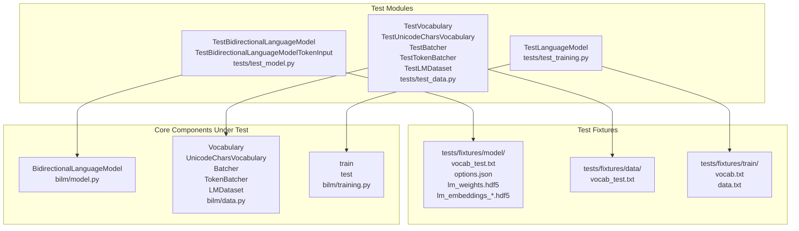
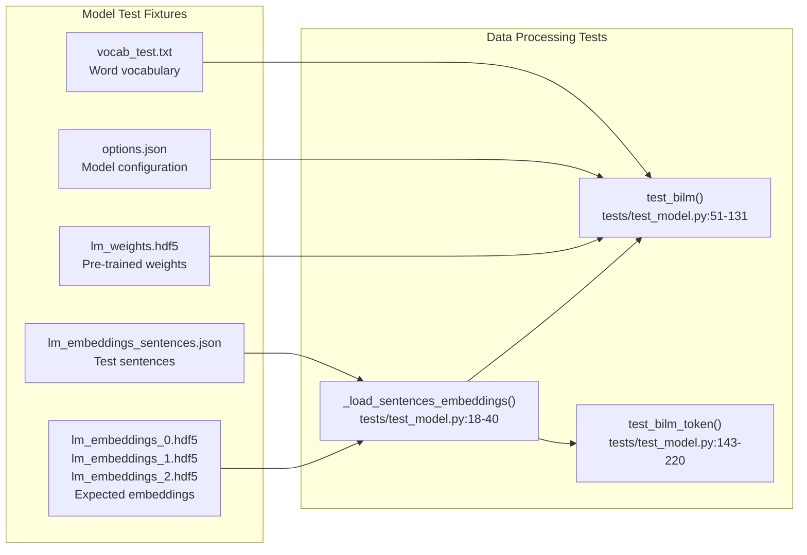
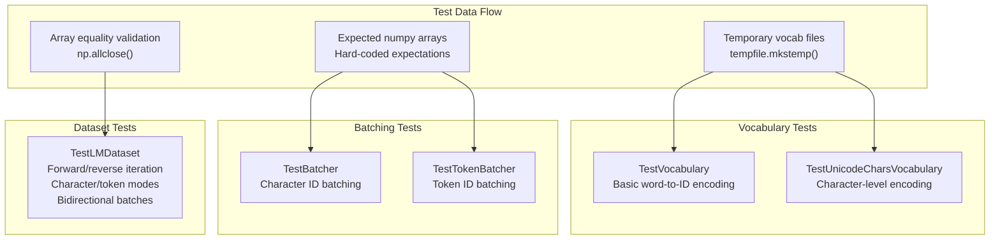
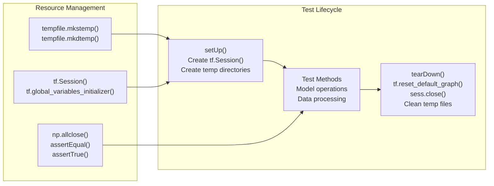

<!-- source: DeepWiki mcp.deepwiki.com · repo allenai/bilm-tf · page 5.2 Testing Framework · fetched 2026-10-26 -->

# Testing Framework

Relevant source files

The following files were used as context for generating this wiki page:

- [tests/test_data.py](tests/test_data.py)
- [tests/test_model.py](tests/test_model.py)
- [tests/test_training.py](tests/test_training.py)

This document covers the comprehensive testing framework for the bilm-tf repository, including unit tests for core components, integration tests for end-to-end workflows, and test fixtures that validate model behavior. The testing framework ensures correctness of the bidirectional language model implementation, data processing pipeline, and training system.

For information about model configuration validation, see [Model Configuration](#5.1). For API reference details, see [API Reference](#6.1).

## Test Suite Architecture

The testing framework is organized into three main test modules that correspond to the core system components:

**Sources:** [tests/test_model.py:1-225](), [tests/test_data.py:1-371](), [tests/test_training.py:1-153]()

## Test Fixtures and Expected Data

The testing framework relies on pre-computed fixtures that contain expected model outputs for validation:

**Sources:** [tests/test_model.py:18-40](), [tests/test_model.py:51-131](), [tests/test_model.py:143-220]()

## Core Component Testing

### BidirectionalLanguageModel Testing

The model tests validate both character-level and token-level input processing:

| Test Class | Purpose | Key Methods |
|------------|---------|-------------|
| `TestBidirectionalLanguageModel` | Character input processing | `test_bilm()` |
| `TestBidirectionalLanguageModelTokenInput` | Token input with embeddings | `test_bilm_token()` |

**Character Input Test Flow:**
1. Load sentences from `lm_embeddings_sentences.json`
2. Create `Batcher` with `vocab_test.txt` and 50 character limit
3. Load `BidirectionalLanguageModel` with `options.json` and `lm_weights.hdf5`
4. Process 10 batches of 3 sentences each
5. Compare generated embeddings against expected values from HDF5 files
6. Validate LSTM state management and batch size handling

**Token Input Test Flow:**
1. Generate unique vocabulary from test sentences
2. Use `dump_token_embeddings()` to create pre-computed token embeddings
3. Create `TokenBatcher` for token-level processing
4. Load model with `use_character_inputs=False` and `embedding_weight_file`
5. Validate identical output to character-level processing

**Sources:** [tests/test_model.py:43-131](), [tests/test_model.py:133-220]()

### Data Processing Testing

The data tests ensure correct vocabulary encoding, batching, and dataset iteration:

**Key Test Validations:**
- Vocabulary encoding: `vocab.encode()` produces correct token IDs [tests/test_data.py:22-34]()
- Character encoding: `word_to_char_ids()` handles Unicode correctly [tests/test_data.py:48-59]()
- Batch formation: Character arrays match expected shapes [tests/test_data.py:181-186]()
- Dataset iteration: Forward/reverse/bidirectional modes produce correct batches [tests/test_data.py:338-363]()

**Sources:** [tests/test_data.py:14-98](), [tests/test_data.py:101-200](), [tests/test_data.py:202-363]()

### Training System Testing

The training tests validate end-to-end model training and evaluation:

| Training Configuration | Test Method | Validation |
|------------------------|-------------|------------|
| Single direction, no chars | `test_train_single_direction()` | Perplexity < 20.0 |
| Bidirectional with chars | `test_train_bilm_chars()` | Perplexity < 20.0 |
| Shared embedding/softmax | `test_train_shared_softmax_embedding()` | Configuration validation |
| Skip connections | `test_train_skip_connections()` | Architecture validation |

**Training Test Pattern:**
1. Generate vocabulary and dataset from `tests/fixtures/train/`
2. Configure training options (batch size, LSTM dimensions, etc.)
3. Execute `train()` function with temporary directories
4. Reset TensorFlow graph and load checkpoint with `load_options_latest_checkpoint()`
5. Run `test()` function and validate perplexity threshold

**Sources:** [tests/test_training.py:80-147]()

## Test Execution and Integration

### Session Management and Setup

All test classes implement proper TensorFlow session lifecycle management:

**Sources:** [tests/test_model.py:44-49](), [tests/test_data.py:15-21](), [tests/test_training.py:18-26]()

### Assertion Patterns

The tests use consistent validation patterns:

- **Embedding Validation:** `np.allclose(actual, expected, atol=1.0e-6)` for floating-point comparisons
- **Array Equality:** `(array1 == array2).all()` for exact integer matches  
- **Perplexity Bounds:** `self.assertTrue(perplexity < 20.0)` for training effectiveness
- **Variable Counting:** `len(tf.trainable_variables()) == 0` for inference-only models
- **State Validation:** LSTM state arrays have expected zero padding

**Sources:** [tests/test_model.py:94-100](), [tests/test_data.py:26-27](), [tests/test_training.py:88-89]()

---

