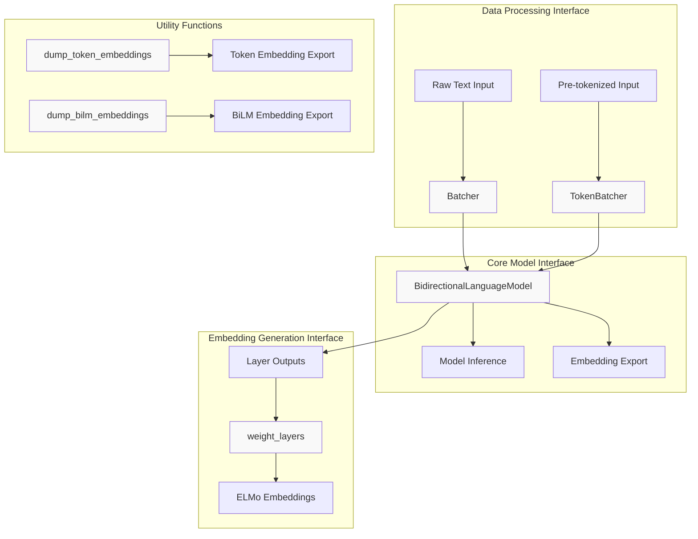
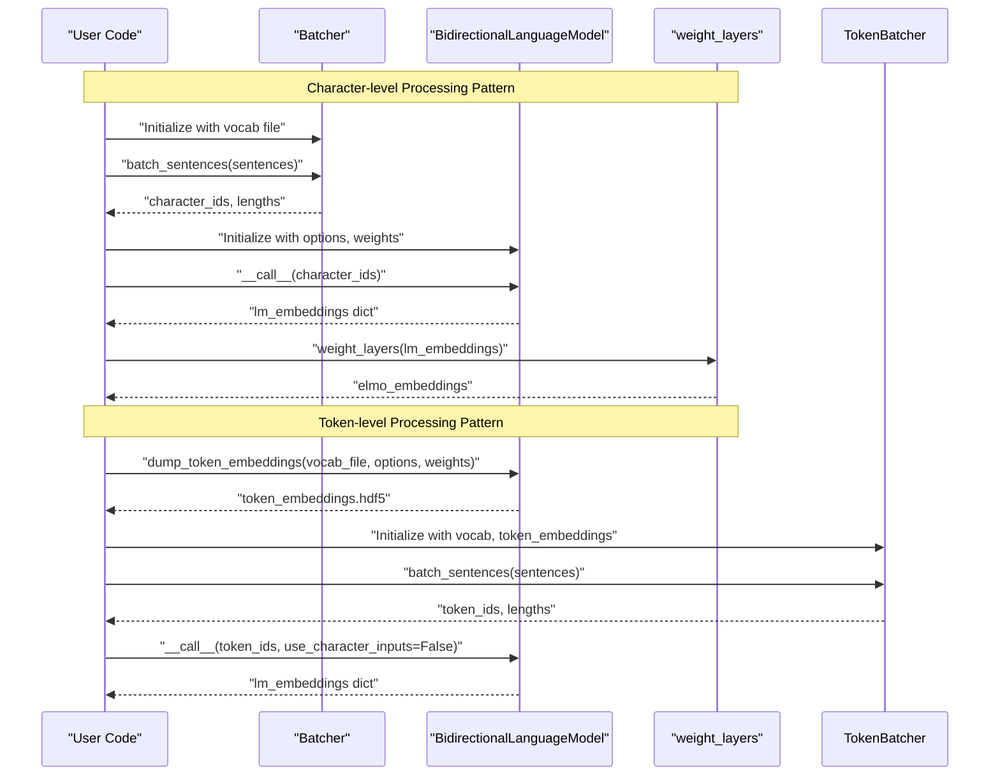
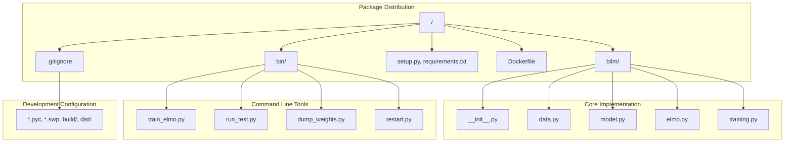

<!-- source: DeepWiki mcp.deepwiki.com · repo allenai/bilm-tf · page 6 Reference · fetched 2026-10-26 -->

# Reference

<details>
<summary>Relevant source files</summary>

The following files were used as context for generating this wiki page:

- [.gitignore](.gitignore)
- [LICENSE](LICENSE)
- [bilm/__init__.py](bilm/__init__.py)

</details>


This page provides comprehensive reference documentation for the bilm-tf repository, including API documentation, license information, and development resources. The reference materials are organized to help developers understand the public interfaces, legal requirements, and technical specifications of the bilm-tf system.

For detailed API documentation of specific classes and functions, see [API Reference](#6.1). For licensing terms and legal information, see [License & Legal](#6.2).

## Public API Overview

The bilm-tf package exposes a clean public API through its main package interface. The following diagram shows the mapping between high-level functionality and the specific code entities that implement them:



**Public API Code Entity Mapping**

Sources: [bilm/__init__.py:1-7]()

The public API consists of six main entities imported in the package initialization:

| Functionality | Code Entity | Source Module | Purpose |
|---------------|-------------|---------------|---------|
| Character-level batching | `Batcher` | `bilm.data` | Converts raw text to character ID tensors |
| Token-level batching | `TokenBatcher` | `bilm.data` | Converts tokenized text to token ID tensors |
| Core language model | `BidirectionalLanguageModel` | `bilm.model` | Main BiLM implementation for generating embeddings |
| ELMo weight combination | `weight_layers` | `bilm.elmo` | Combines BiLM layers into final ELMo representations |  
| Token embedding export | `dump_token_embeddings` | `bilm.model` | Exports token-level embeddings to HDF5 |
| BiLM embedding export | `dump_bilm_embeddings` | `bilm.model` | Exports full BiLM embeddings to HDF5 |

## API Usage Patterns

The following diagram illustrates how the public API entities work together in typical usage scenarios:



**API Interaction Flow**

Sources: [bilm/__init__.py:2-5]()

## Development Resources

### Repository Structure

The bilm-tf repository follows standard Python package conventions with specific organization for TensorFlow-based deep learning projects:



**Repository Organization**

Sources: [.gitignore:1-10](), [bilm/__init__.py:1-7]()

### Development Patterns

The codebase follows several important development patterns:

| Pattern | Implementation | Files |
|---------|----------------|-------|
| Public API Isolation | Clean import interface in `__init__.py` | [bilm/__init__.py:1-7]() |
| Build Artifact Exclusion | Git ignores Python bytecode and build directories | [.gitignore:1-10]() |
| Modular Architecture | Separate modules for data, model, embeddings, training | [bilm/__init__.py:2-5]() |

## License Information

The bilm-tf project is distributed under the Apache License 2.0, which provides broad permissions for use, modification, and distribution while maintaining copyright notices and disclaimers.

### Key License Terms

| Aspect | Requirement |
|--------|-------------|
| **Usage Rights** | Commercial and private use permitted |
| **Modification Rights** | Modification and distribution permitted |
| **Attribution** | Must include license and copyright notices |
| **Warranty** | No warranty provided ("AS IS" basis) |
| **Liability** | No liability for damages |

### License Compliance

When using or redistributing bilm-tf:

1. **Include License Text**: The Apache License 2.0 text must be included
2. **Maintain Copyright Notices**: Original copyright notices must be preserved  
3. **Document Changes**: Modified files should carry prominent change notices
4. **Include NOTICE File**: If present, NOTICE file contents must be included in distributions

For complete license terms and conditions, see [License & Legal](#6.2).

Sources: [LICENSE:1-202]()

## Package Metadata

The bilm-tf package provides the following public interface contracts:

### Import Structure
```python
from bilm import Batcher, TokenBatcher
from bilm import BidirectionalLanguageModel
from bilm import dump_token_embeddings, dump_bilm_embeddings  
from bilm import weight_layers
```

### Version Compatibility
- **Python**: 3.5+
- **TensorFlow**: 1.2+
- **File Formats**: HDF5 for model weights and embeddings

Sources: [bilm/__init__.py:1-7]()

---

