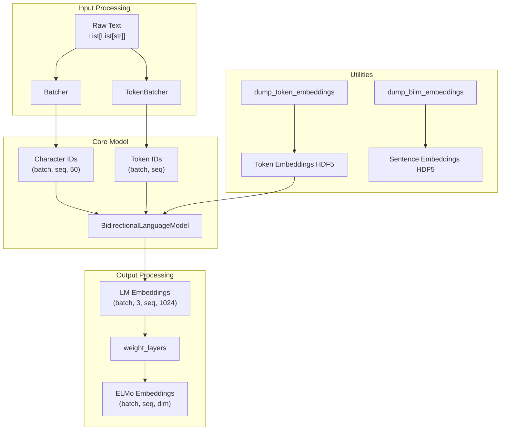
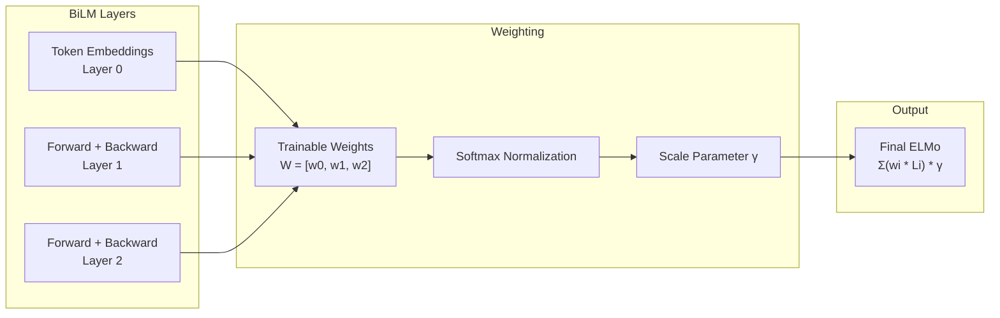
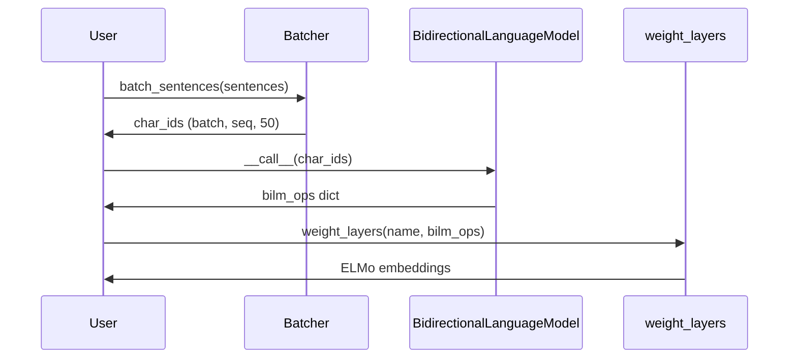
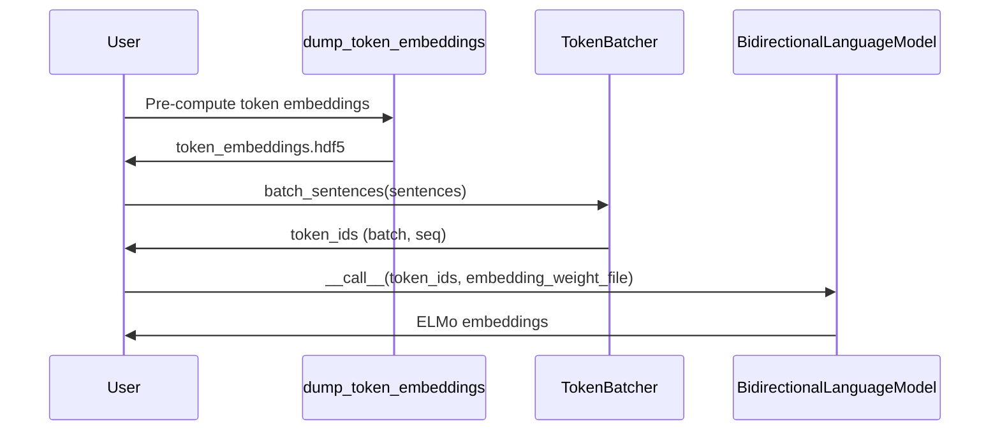
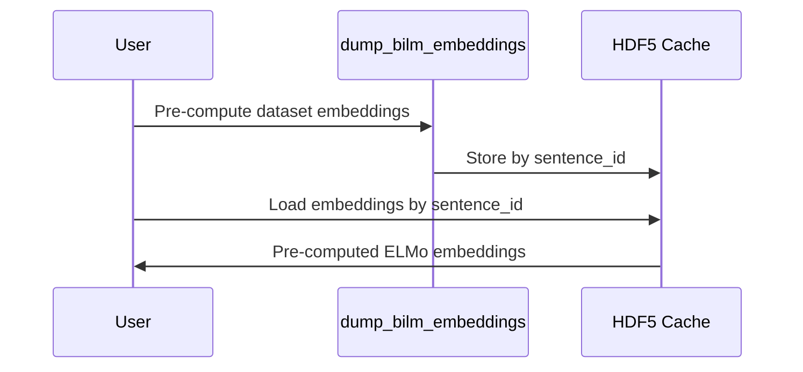

<!-- source: DeepWiki mcp.deepwiki.com · repo allenai/bilm-tf · page 6.1 API Reference · fetched 2026-10-26 -->

# API Reference

<details>
<summary>Relevant source files</summary>

The following files were used as context for generating this wiki page:

- [bilm/__init__.py](bilm/__init__.py)
- [bilm/data.py](bilm/data.py)
- [bilm/elmo.py](bilm/elmo.py)
- [bilm/model.py](bilm/model.py)
- [tests/test_elmo.py](tests/test_elmo.py)

</details>


This document provides complete API reference documentation for the `bilm` package, covering all public classes and functions available for generating ELMo embeddings from bidirectional language models. For installation and basic usage patterns, see [Getting Started](#2). For detailed documentation of internal components and architecture, see [Core Components](#3).

The `bilm` package exposes a minimal but complete API consisting of three main classes and three utility functions for different usage scenarios.

## Public API Overview

The `bilm` package provides the following public interface:

| Component | Type | Purpose |
|-----------|------|---------|
| `BidirectionalLanguageModel` | Class | Main interface for loading pre-trained models and computing embeddings |
| `Batcher` | Class | Converts raw text to character-level input matrices |
| `TokenBatcher` | Class | Converts raw text to token-level input matrices |
| `weight_layers` | Function | Combines BiLM layers into final ELMo representations |
| `dump_token_embeddings` | Function | Pre-computes token embeddings for efficiency |
| `dump_bilm_embeddings` | Function | Pre-computes sentence embeddings for datasets |

**API Components Relationship**


Sources: [bilm/__init__.py:1-7](), [bilm/model.py:14-113](), [bilm/data.py:193-261](), [bilm/elmo.py:4-113]()

## BidirectionalLanguageModel

The primary class for loading pre-trained bidirectional language models and computing contextualized embeddings.

### Constructor

```python
BidirectionalLanguageModel(
    options_file: str,
    weight_file: str, 
    use_character_inputs=True,
    embedding_weight_file=None,
    max_batch_size=128
)
```

**Parameters:**
- `options_file`: Path to JSON file containing model hyperparameters and architecture configuration
- `weight_file`: Path to HDF5 file containing pre-trained model weights
- `use_character_inputs`: If `True`, expects character-level inputs from `Batcher`. If `False`, expects token-level inputs from `TokenBatcher`
- `embedding_weight_file`: Required when `use_character_inputs=False`. Path to HDF5 file with pre-computed token embeddings
- `max_batch_size`: Maximum allowable batch size for memory allocation

### __call__ Method

```python
def __call__(self, ids_placeholder) -> dict
```

Returns a dictionary of TensorFlow operations for computing embeddings:

**Return Value:**
```python
{
    'lm_embeddings': tf.Tensor,    # Shape: (batch, 3, seq_len, 1024)
    'lengths': tf.Tensor,          # Shape: (batch,) 
    'token_embeddings': tf.Tensor, # Shape: (batch, seq_len, projection_dim)
    'mask': tf.Tensor             # Shape: (batch, seq_len)
}
```

**Input Requirements:**
- When `use_character_inputs=True`: `ids_placeholder` shape `(batch, seq_len, 50)`
- When `use_character_inputs=False`: `ids_placeholder` shape `(batch, seq_len)`

Sources: [bilm/model.py:14-113](), [bilm/model.py:62-83](), [bilm/model.py:115-183]()

## Data Processing Classes

### Batcher

Converts tokenized sentences into character-level input matrices suitable for character-based BiLM processing.

```python
class Batcher:
    def __init__(self, lm_vocab_file: str, max_token_length: int)
    def batch_sentences(self, sentences: List[List[str]]) -> np.ndarray
```

**Parameters:**
- `lm_vocab_file`: Path to vocabulary file (one token per line)
- `max_token_length`: Maximum characters per token (typically 50)

**Input Format:**
```python
sentences = [
    ['The', 'first', 'sentence', '.'],
    ['Another', 'sentence']
]
```

**Output Shape:** `(batch_size, max_seq_len, max_token_length)`

### TokenBatcher

Converts tokenized sentences into token-level input matrices for token-based BiLM processing.

```python
class TokenBatcher:
    def __init__(self, lm_vocab_file: str)
    def batch_sentences(self, sentences: List[List[str]]) -> np.ndarray
```

**Output Shape:** `(batch_size, max_seq_len)`

Sources: [bilm/data.py:193-261](), [bilm/data.py:208-229](), [bilm/data.py:243-260]()

## weight_layers Function

Combines multiple BiLM layers into final ELMo representations using learned weights.

```python
def weight_layers(
    name: str,
    bilm_ops: dict,
    l2_coef=None,
    use_top_only=False,
    do_layer_norm=False
) -> dict
```

**Parameters:**
- `name`: String prefix for trainable variable names
- `bilm_ops`: Dictionary returned by `BidirectionalLanguageModel.__call__()`
- `l2_coef`: L2 regularization coefficient for weights (None for no regularization)
- `use_top_only`: If `True`, only use the top BiLM layer
- `do_layer_norm`: If `True`, apply layer normalization to each BiLM layer

**Return Value:**
```python
{
    'weighted_op': tf.Tensor,      # Final ELMo embeddings
    'regularization_op': tf.Tensor # L2 regularization loss
}
```

**ELMo Weighting Process**


Sources: [bilm/elmo.py:4-113](), [tests/test_elmo.py:25-116]()

## Utility Functions

### dump_token_embeddings

Pre-computes token embeddings for all vocabulary items to enable token-based BiLM usage.

```python
def dump_token_embeddings(
    vocab_file: str,
    options_file: str, 
    weight_file: str,
    outfile: str
)
```

Creates an HDF5 file containing embeddings for each vocabulary token, which can be used as `embedding_weight_file` parameter.

### dump_bilm_embeddings

Pre-computes BiLM embeddings for an entire dataset to enable fast cached lookups.

```python
def dump_bilm_embeddings(
    vocab_file: str,
    dataset_file: str,
    options_file: str,
    weight_file: str, 
    outfile: str
)
```

Creates an HDF5 file with embeddings keyed by sentence ID for efficient batch processing.

Sources: [bilm/model.py:603-676]()

## Usage Patterns

The API supports three primary usage patterns with different performance characteristics:

**Character-Level Processing (Most Flexible)**


**Token-Level Processing (Pre-computed)**


**Cached Processing (Fastest)**


Sources: [bilm/model.py:14-113](), [bilm/data.py:193-261](), [bilm/elmo.py:4-113]()

## Data Structures

### Model Configuration (options.json)

The options file defines the BiLM architecture:

```python
{
    "char_cnn": {
        "n_characters": 262,
        "max_characters_per_token": 50,
        "filters": [[1, 32], [2, 32], [3, 64], [4, 128], [5, 256], [6, 512], [7, 512]],
        "activation": "tanh",
        "embedding": {"dim": 16},
        "n_highway": 2
    },
    "lstm": {
        "dim": 4096,
        "projection_dim": 512,
        "n_layers": 2,
        "cell_clip": 3,
        "proj_clip": 3,
        "use_skip_connections": True
    }
}
```

### Embedding Tensor Shapes

| Tensor | Shape | Description |
|--------|-------|-------------|
| `lm_embeddings` | `(batch, 3, seq_len, 1024)` | All BiLM layers concatenated |
| `token_embeddings` | `(batch, seq_len, projection_dim)` | Token-level embeddings from CNN |
| `lengths` | `(batch,)` | Sequence lengths excluding BOS/EOS |
| `mask` | `(batch, seq_len)` | Boolean mask for valid positions |
| Final ELMo | `(batch, seq_len, dim)` | Weighted combination of layers |

Sources: [bilm/model.py:115-183](), [bilm/model.py:286-461](), [bilm/elmo.py:38-113]()

---

