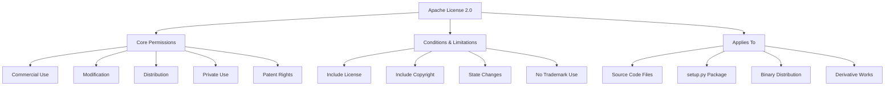
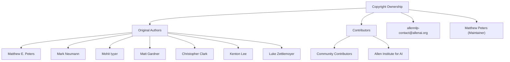
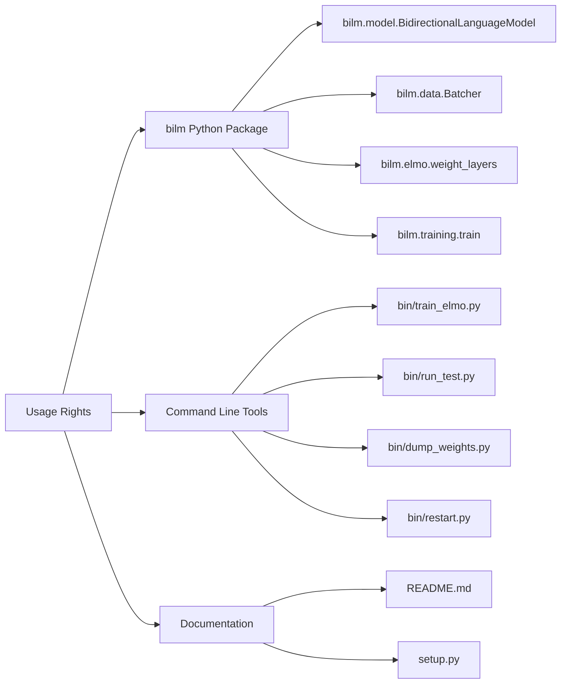
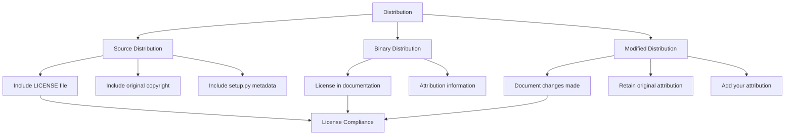
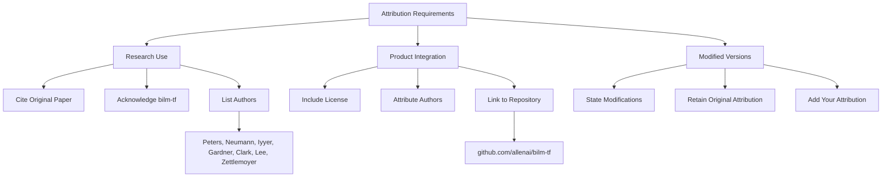
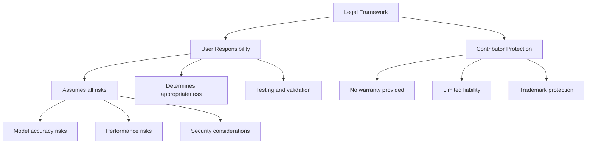

<!-- source: DeepWiki mcp.deepwiki.com · repo allenai/bilm-tf · page 6.2 License & Legal · fetched 2026-10-26 -->

# License & Legal

<details>
<summary>Relevant source files</summary>

The following files were used as context for generating this wiki page:

- [LICENSE](LICENSE)
- [setup.py](setup.py)

</details>


This document provides comprehensive license information and legal details for the bilm-tf project. It covers the software license terms, copyright ownership, usage rights, distribution requirements, and attribution obligations. For API usage details and technical implementation, see [API Reference](#6.1).

## License Overview

The bilm-tf project is released under the **Apache License 2.0**, a permissive open-source license that allows both commercial and non-commercial use, modification, and distribution of the software.

| License Type | Apache License 2.0 |
|--------------|-------------------|
| **License File** | [LICENSE:1-202]() |
| **Package Declaration** | [setup.py:18]() |
| **OSI Classification** | [setup.py:24]() |
| **Effective Date** | January 2004 |

The Apache 2.0 license provides users with broad permissions while maintaining appropriate protections for contributors and maintaining attribution requirements.

**License Structure and Application**



Sources: [LICENSE:1-202](), [setup.py:18](), [setup.py:24]()

## Copyright and Authorship

The bilm-tf project is authored by a team of researchers and developers primarily affiliated with the Allen Institute for Artificial Intelligence.

**Primary Authors and Contributors**

| Role | Name(s) |
|------|---------|
| **Authors** | Matthew E. Peters, Mark Neumann, Mohit Iyyer, Matt Gardner, Christopher Clark, Kenton Lee, Luke Zettlemoyer |
| **Maintainer** | Matthew Peters |
| **Contact** | allennlp-contact@allenai.org |
| **Organization** | Allen Institute for Artificial Intelligence |

**Copyright Ownership Structure**



Sources: [setup.py:42-44]()

## Usage Rights and Permissions

Under the Apache License 2.0, users receive extensive rights to use, modify, and distribute the bilm-tf software.

**Granted Permissions**

| Permission | Description | License Section |
|------------|-------------|-----------------|
| **Use** | Run the software for any purpose | [LICENSE:66-72]() |
| **Modify** | Create derivative works and modifications | [LICENSE:66-72]() |
| **Distribute** | Share original or modified versions | [LICENSE:89-128]() |
| **Sublicense** | Include in projects with different licenses | [LICENSE:66-72]() |
| **Commercial Use** | Use in commercial products and services | [LICENSE:66-72]() |
| **Patent Rights** | Protection from patent claims by contributors | [LICENSE:74-87]() |

**Rights Application to Code Components**



Sources: [LICENSE:66-87](), [setup.py:7-45]()

## Distribution Requirements

When distributing bilm-tf or derivative works, specific conditions must be met to comply with the Apache License 2.0.

**Required Inclusions for Distribution**

| Requirement | File/Content | Applies To |
|-------------|--------------|------------|
| **License Text** | [LICENSE:1-202]() | All distributions |
| **Copyright Notice** | Original copyright statements | Source distributions |
| **Attribution Notice** | Author information from [setup.py:42-44]() | All distributions |
| **Change Documentation** | Notice of modifications | Modified versions |
| **NOTICE File** | If present, include attribution notices | All distributions |

**Distribution Compliance Flow**



Sources: [LICENSE:89-128](), [setup.py:18](), [setup.py:42-44]()

## Attribution Requirements

Proper attribution is essential when using bilm-tf in research, products, or derivative works.

**Required Attribution Elements**



**Recommended Attribution Text**

For research papers:
```
This work uses ELMo embeddings from the bilm-tf implementation by 
Peters et al. (https://github.com/allenai/bilm-tf)
```

For software products:
```
This product includes software developed by the Allen Institute for 
Artificial Intelligence (https://github.com/allenai/bilm-tf).
Licensed under the Apache License 2.0.
```

Sources: [setup.py:10](), [setup.py:42-44](), [LICENSE:89-128]()

## Legal Limitations and Disclaimers

The Apache License 2.0 includes important limitations on liability and warranty disclaimers that users must understand.

**Key Legal Limitations**

| Limitation Type | Description | License Section |
|----------------|-------------|-----------------|
| **No Warranty** | Software provided "AS IS" without warranties | [LICENSE:143-151]() |
| **Liability Limitation** | Contributors not liable for damages | [LICENSE:153-163]() |
| **Trademark Restriction** | No permission to use contributor trademarks | [LICENSE:138-141]() |
| **Patent Termination** | Patent license terminates if you sue | [LICENSE:81-87]() |

**Risk and Responsibility Framework**



Sources: [LICENSE:143-163](), [LICENSE:138-141]()

---

