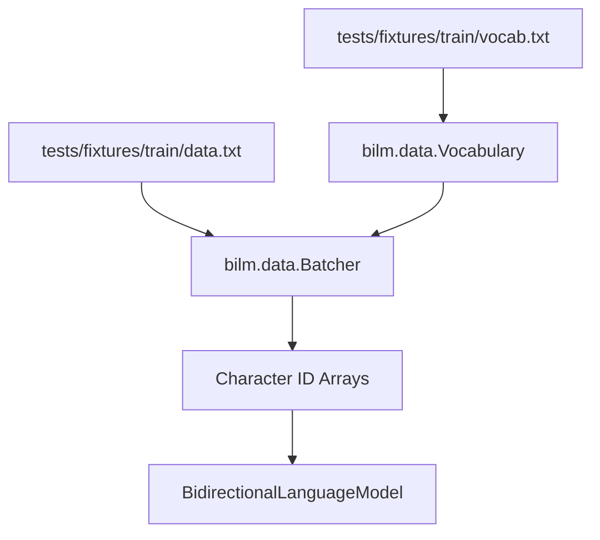
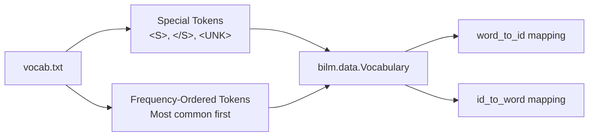
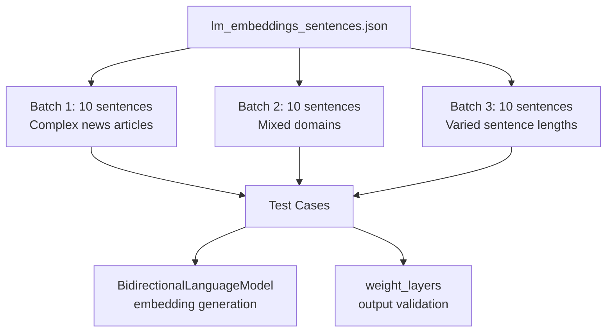
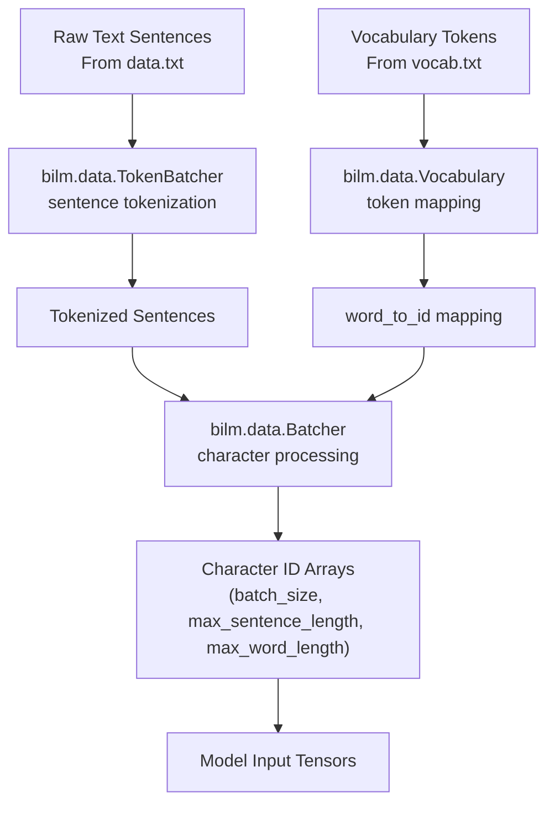
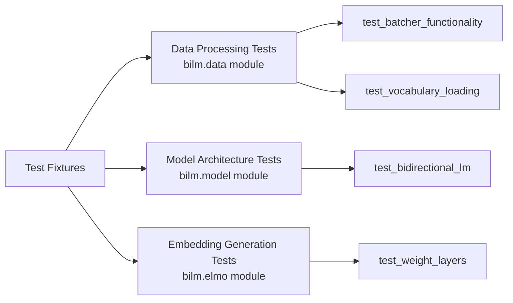

<!-- source: DeepWiki mcp.deepwiki.com · repo allenai/bilm-tf · page 7 Examples & Fixtures · fetched 2026-10-26 -->

# Examples & Fixtures

Relevant source files

The following files were used as context for generating this wiki page:

- [tests/fixtures/model/lm_embeddings_sentences.json](tests/fixtures/model/lm_embeddings_sentences.json)
- [tests/fixtures/train/data.txt](tests/fixtures/train/data.txt)
- [tests/fixtures/train/vocab.txt](tests/fixtures/train/vocab.txt)

This page documents the test fixtures, example data, and reference implementations provided in the bilm-tf repository. These resources demonstrate proper data formatting, provide testing infrastructure, and serve as templates for users implementing their own bilm-tf workflows.

For information about configuration options and model parameters, see [Model Configuration](#5.1). For details about the core training system, see [Training System](#3.4).

## Test Data Fixtures

The repository includes several fixture files that demonstrate the expected data formats and provide test cases for system validation.

### Training Data Format

The training data fixture shows the expected text format for model training:

| File | Purpose | Format |
|------|---------|---------|
| `tests/fixtures/train/data.txt` | Example training sentences | One sentence per line, tokenized |
| `tests/fixtures/train/vocab.txt` | Example vocabulary file | One token per line, frequency-ordered |

The training data consists of simple sentences about neural language models, demonstrating the plain text format expected by the `Batcher` class:

**Training Data Structure**
The fixture demonstrates proper sentence formatting where each line contains a complete sentence with standard tokenization. The content focuses on neural language modeling concepts, providing domain-relevant training examples.

Sources: [tests/fixtures/train/data.txt:1-5]()

### Vocabulary Structure

The vocabulary fixture illustrates the expected token ordering and special token handling:

**Special Token Requirements**
The vocabulary must begin with three special tokens in this exact order:
- `<S>` - Sentence start marker
- `</S>` - Sentence end marker  
- `<UNK>` - Unknown word token

**Token Frequency Ordering**
Following the special tokens, words are ordered by frequency with most common tokens first. This ordering optimizes memory usage and processing efficiency in the `Vocabulary` class.

Sources: [tests/fixtures/train/vocab.txt:1-33]()

## Model Testing Fixtures

### Embedding Test Data

The model testing fixtures provide more complex sentence structures for validating embedding generation:

| Component | File | Content Type |
|-----------|------|--------------|
| Test sentences | `tests/fixtures/model/lm_embeddings_sentences.json` | JSON array of sentence batches |

**Sentence Complexity Characteristics**
The test sentences demonstrate various linguistic patterns:
- Long sentences with complex punctuation
- News article excerpts with proper nouns
- Questions and exclamations
- Technical terminology and numbers
- Multiple sentence types within batches

Sources: [tests/fixtures/model/lm_embeddings_sentences.json:1]()

## Data Processing Examples

### Character-Level Processing Pipeline

The fixtures demonstrate the complete data processing pipeline from raw text to model input:

**Processing Steps**
1. Raw sentences are tokenized using standard whitespace splitting
2. Vocabulary provides word-to-ID mapping with OOV handling
3. `Batcher` converts words to character-level representations
4. Character IDs are padded to consistent array dimensions

Sources: [tests/fixtures/train/data.txt:1-5](), [tests/fixtures/train/vocab.txt:1-33]()

## Testing Infrastructure Integration

### Fixture Usage Patterns

The test fixtures integrate with the testing framework to validate system components:

**Test Coverage Areas**
- Data format validation and parsing
- Vocabulary construction and token mapping
- Character-level batch generation
- Model input tensor shapes and types
- Embedding output dimensions and values

Sources: [tests/fixtures/train/data.txt:1-5](), [tests/fixtures/train/vocab.txt:1-33](), [tests/fixtures/model/lm_embeddings_sentences.json:1]()

## Data Format Requirements

### Input Text Specifications

| Requirement | Description | Example |
|-------------|-------------|---------|
| Encoding | UTF-8 text encoding | Standard Unicode characters |
| Tokenization | Whitespace-separated tokens | `"neural language models use"` |
| Sentence boundaries | One sentence per line | Each line is complete sentence |
| Special characters | Preserved in tokenization | Punctuation, hyphens, quotes |

### Vocabulary File Specifications  

| Component | Format | Requirements |
|-----------|--------|--------------|
| Special tokens | First 3 lines | `<S>`, `</S>`, `<UNK>` in order |
| Word tokens | Subsequent lines | One token per line, frequency-ordered |
| Token count | Total vocabulary size | Determines model embedding dimensions |

**Vocabulary Construction Guidelines**
The vocabulary should include all tokens that appear in training data, with rare words potentially replaced by `<UNK>` during preprocessing. The frequency ordering enables efficient batching and memory usage optimization.

Sources: [tests/fixtures/train/vocab.txt:1-33]()