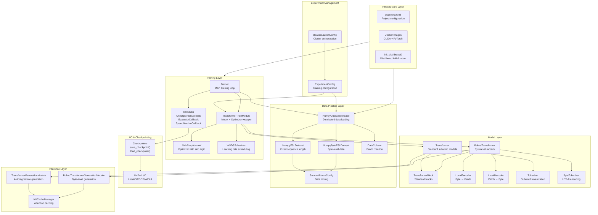
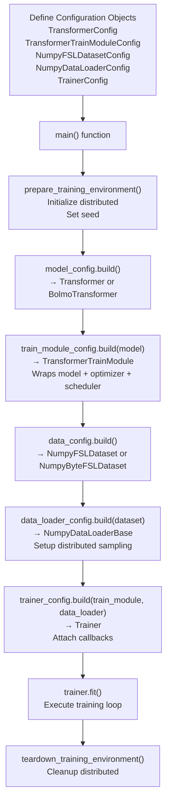
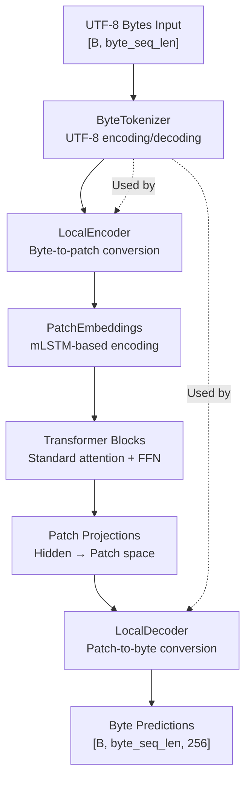

<!-- source: DeepWiki mcp.deepwiki.com · repo allenai/bolmo-core · page 1 Overview · fetched 2026-10-26 -->

# Overview

<details>
<summary>Relevant source files</summary>

The following files were used as context for generating this wiki page:

- [README.md](README.md)
- [docs/source/index.rst](docs/source/index.rst)
- [docs/source/overview/installation.rst](docs/source/overview/installation.rst)
- [docs/source/overview/introduction.rst](docs/source/overview/introduction.rst)

</details>


This document provides an introduction to the Bolmo-Core repository, explaining its dual purpose as both a distributed training framework (OLMo-Core) and an implementation of byte-level language models (Bolmo). This page covers the project's goals, key features, system architecture, and the relationship between major components.

For installation and setup instructions, see [Getting Started](#1.1). For details on the repository organization, see [Project Structure](#1.2).

---

## What is OLMo-Core and Bolmo?

**OLMo-Core** is a Python library that provides building blocks for large-scale distributed training of language models with PyTorch. It is designed for performance, API stability, and serves as a foundation for LLM research at the Allen Institute for AI (AI2) and other organizations.

**Bolmo** is the first family of competitive, fully open byte-level language models built using the OLMo-Core framework. Unlike traditional language models that rely on subword tokenizers (BPE, WordPiece, etc.), Bolmo operates directly on raw UTF-8 bytes. This repository is a fork of OLMo-Core that implements the complete Bolmo architecture and training pipeline.

The relationship between OLMo-Core and Bolmo:
- **OLMo-Core** provides the training infrastructure: `Trainer`, distributed utilities, data loading, checkpointing, and standard transformer implementations
- **Bolmo** extends OLMo-Core with byte-level components: `BolmoTransformer`, `LocalEncoder`, `LocalDecoder`, and byte-level datasets
- Both standard subword models and Bolmo byte-level models can be trained using the same core training infrastructure

**Sources:** [README.md:1-34](), [docs/source/index.rst:6-10](), [docs/source/overview/introduction.rst:1-8]()

---

## Key Features

### OLMo-Core Framework
- **Efficient Training System**: Highly optimized `Trainer` class with callback-based architecture for checkpointing, evaluation, and monitoring
- **Distributed Training**: Support for tensor parallelism (TP), context parallelism (CP), pipeline parallelism (PP), FSDP, and expert parallelism (EP)
- **Flexible Data Pipeline**: Numpy-based datasets with support for fixed/variable sequence lengths, packing, padding, and sophisticated data mixing
- **Unified I/O**: Abstract I/O layer supporting local filesystems, S3, GCS, WEKA, and R2
- **Experiment Management**: Beaker integration for cluster orchestration and job launching
- **Production-Ready**: Comprehensive testing, CI/CD pipelines, and Docker images

### Bolmo Models
- **Byte-Level Processing**: No subword tokenization required; operates on raw UTF-8 bytes
- **Universal Applicability**: Works seamlessly across all languages, scripts, and domains
- **Competitive Performance**: Matches or exceeds state-of-the-art byte-level models and approaches subword model performance
- **Character Understanding**: Superior performance on character-level tasks
- **Efficient Byteifying**: Converts existing subword models to byte-level using <1% of pretraining budget
- **Post-Training via Task Arithmetic**: Apply adaptations without additional training

**Sources:** [README.md:24-30](), [docs/source/overview/introduction.rst:4-12]()

---

## System Architecture

The following diagram illustrates the high-level architecture of the OLMo-Core framework with Bolmo extensions:

**Figure 1: High-Level System Architecture**



**Sources:** [docs/source/overview/introduction.rst:9-12](), [README.md:1-45]()

---

## Core Components and Code Entities

The system is organized around several core abstractions. The following table maps conceptual components to their primary code entities:

| Component | Primary Classes/Functions | File Paths |
|-----------|--------------------------|------------|
| **Configuration System** | `Config` base class, dataclass-based configs with `.build()` methods | Throughout codebase |
| **Model Architecture** | `Transformer`, `BolmoTransformer`, `BolmoDistillTransformer` | `src/olmo_core/nn/transformer/` |
| **Transformer Blocks** | `TransformerBlock`, `TransformerBlockConfig` | `src/olmo_core/nn/transformer/block.py` |
| **Byte-Level Components** | `LocalEncoder`, `LocalDecoder`, `PatchEmbeddings` | `src/olmo_core/nn/transformer/model.py` |
| **Tokenization** | `Tokenizer`, `ByteTokenizer` | `src/olmo_core/data/tokenizer.py` |
| **Training Loop** | `Trainer`, `Trainer.fit()` | `src/olmo_core/train/trainer.py` |
| **Training Wrapper** | `TrainModule`, `TransformerTrainModule` | `src/olmo_core/train/train_module.py` |
| **Callbacks** | `Callback`, `CheckpointerCallback`, `EvaluatorCallback` | `src/olmo_core/train/callbacks/` |
| **Optimizer** | `SkipStepAdamW`, `SkipStepOptimizer` | `src/olmo_core/optim/` |
| **Learning Rate** | `WSDSScheduler`, `LRScheduler` | `src/olmo_core/optim/scheduler.py` |
| **Datasets** | `NumpyFSLDataset`, `NumpyByteFSLDataset`, `NumpyPackedFSLDataset` | `src/olmo_core/data/numpy_dataset.py` |
| **Data Loaders** | `NumpyDataLoaderBase`, `NumpyFSLDataLoader` | `src/olmo_core/data/data_loader.py` |
| **Data Mixing** | `SourceMixtureConfig`, `SourceMixtureDatasetConfig` | `src/olmo_core/data/source_mixture_dataset.py` |
| **Collation** | `DataCollator`, `ByteDataCollator` | `src/olmo_core/data/data_collator.py` |
| **Distributed Utils** | `init_distributed()`, `prepare_training_environment()` | `src/olmo_core/distributed/utils.py` |
| **Checkpointing** | `Checkpointer`, `save_checkpoint()`, `load_checkpoint()` | `src/olmo_core/distributed/checkpoint/` |
| **I/O Layer** | `clear_directory()`, `upload()`, `download()` | `src/olmo_core/io.py` |
| **Generation** | `TransformerGenerationModule`, `BolmoTransformerGenerationModule` | `src/olmo_core/nn/transformer/generation.py` |
| **Experiment Launch** | `BeakerLaunchConfig`, `BeakerLaunchConfig.launch()` | `src/olmo_core/launch/beaker/` |

**Sources:** [docs/source/overview/introduction.rst:11-17]()

---

## Training Workflow

The typical workflow for training models with this codebase follows a configuration-based pattern:

**Figure 2: Configuration-to-Execution Workflow**



**Sources:** [docs/source/overview/introduction.rst:14-50]()

### Workflow Steps

1. **Configuration Definition**: Define all experiment components using configuration classes. Each config class (e.g., `TransformerConfig`, `TrainerConfig`) is a dataclass that specifies parameters for that component.

2. **Environment Preparation**: Call `prepare_training_environment()` to initialize distributed training, set random seeds, and configure NCCL communication.

3. **Component Building**: Use the `.build()` method on each configuration object to instantiate the actual component:
   - `TransformerConfig.build()` → `Transformer` or `BolmoTransformer`
   - `TransformerTrainModuleConfig.build(model)` → `TransformerTrainModule`
   - Dataset and data loader configs build their respective components

4. **Training Execution**: Call `trainer.fit()` to begin the training loop. The trainer coordinates:
   - Forward and backward passes
   - Optimizer steps with skip-step logic
   - Learning rate scheduling
   - Callback execution (checkpointing, evaluation, monitoring)

5. **Environment Teardown**: Call `teardown_training_environment()` to clean up distributed resources.

**Sources:** [docs/source/overview/introduction.rst:14-40]()

---

## Bolmo-Specific Architecture

Bolmo extends the standard transformer architecture with byte-level processing components:

**Figure 3: Bolmo Byte-Level Architecture**



### Bolmo Components

- **`ByteTokenizer`**: Handles UTF-8 encoding/decoding without learned vocabulary. Each byte (0-255) is a token.

- **`LocalEncoder`**: Converts variable-length byte sequences into fixed-length patches using mLSTM layers. Handles boundary detection for valid UTF-8 sequences.

- **`PatchEmbeddings`**: Embeds patch representations using mLSTM layers from the xlstm library.

- **`Transformer` Blocks**: Standard transformer blocks process patch-level representations (same as subword models).

- **`LocalDecoder`**: Converts patch-level representations back to byte-level predictions, predicting 256-way distributions for each byte position.

**Sources:** [README.md:7-34]()

---

## Byteifying Process

Bolmo uses a two-stage training procedure called "byteifying" to convert existing subword models to byte-level models efficiently:

| Stage | Description | Token Count | Purpose | Training Scripts |
|-------|-------------|-------------|---------|-----------------|
| **Stage 1** | Subword-to-Byte Distillation | 9.8B tokens (≈43B bytes) | Learn local encoder/decoder weights while freezing global transformer | `bolmo_scripts/launch_stage1_*` |
| **Stage 2** | End-to-End Training | 39.3B tokens (≈173B bytes) | Train entire model to utilize byte-level information | `bolmo_scripts/launch_stage2_*` |

This approach requires less than 1% of the original pretraining budget to achieve competitive byte-level performance.

**Post-Training via Task Arithmetic**: Existing post-trained checkpoints can be converted to byte-level without additional training using the `instructify.py` script:

```bash
python3 src/examples/bolmo/instructify.py \
    --output=/path/to/output/ \
    --checkpoint-dir=/path/to/bolmo/checkpoint \
    --base-checkpoint-dir=/path/to/base-olmo/checkpoint \
    --instruct-checkpoint-dir=/path/to/post-trained-olmo/checkpoint \
    --alpha=1.0
```

**Sources:** [README.md:105-123]()

---

## Distributed Training Infrastructure

The framework supports multiple parallelism strategies that can be composed:

| Strategy | Abbreviation | Process Group | Purpose | Applied To |
|----------|--------------|---------------|---------|------------|
| **Data Parallelism** | DP | `dp_process_group` | Replicate model across devices | All model types |
| **Tensor Parallelism** | TP | `tp_process_group` | Shard weights across devices | Attention, FFN layers |
| **Context Parallelism** | CP | `cp_process_group` | Shard sequence length | Attention computation |
| **Pipeline Parallelism** | PP | `pp_process_group` | Shard layers across devices | Transformer layers |
| **Expert Parallelism** | EP | `ep_process_group` | Shard experts across devices | MoE models |
| **FSDP** | FSDP | `fsdp_process_group` | Fully shard parameters | All model types |

These strategies are initialized via `init_distributed()` and configured through the device mesh. For details on parallelism strategies, see [Parallelism Strategies](#5.1).

**Sources:** High-level diagrams provided in context

---

## Launch and Execution

Training jobs can be launched in two ways:

### 1. Beaker Launch (Cluster Orchestration)

```python
from olmo_core.launch.beaker import BeakerLaunchConfig

launch_config = BeakerLaunchConfig(
    name="bolmo-training",
    clusters=["jupiter", "pluto"],
    # ... other configuration
)
launch_config.launch(follow=True)
```

The `BeakerLaunchConfig` handles job submission to compute clusters, manages resource allocation, and provides job monitoring. For more details, see [Beaker Launch](#7.1).

### 2. Manual Launch with torchrun

```bash
torchrun --nproc-per-node=8 train_script.py --config config.yaml
```

The `torchrun` launcher initializes multiple processes per node for distributed training. This is useful for local development or manual cluster management.

**Sources:** [docs/source/overview/introduction.rst:41-49]()

---

## Model Variants

The repository includes several model variants built on the core infrastructure:

| Model Class | Description | Use Case |
|-------------|-------------|----------|
| `Transformer` | Standard transformer with subword tokenization | General language modeling |
| `NormalizedTransformer` | nGPT architecture with normalized representations | Improved training stability |
| `MoETransformer` | Mixture-of-experts with expert routing | Large-scale models with sparsity |
| `BolmoTransformer` | Byte-level model with local encoders/decoders | Tokenization-free language modeling |
| `BolmoDistillTransformer` | Bolmo with teacher model for distillation | Stage 1 byteifying |

All models share the same training infrastructure and can be configured through their respective `*Config` classes. For detailed architecture information, see [Model Architecture](#2).

**Sources:** [README.md:36-44](), High-level diagrams provided in context

---

## Repository Organization

The repository is organized as follows:

```
bolmo-core/
├── src/olmo_core/          # Main library code
│   ├── nn/                 # Neural network modules (models, blocks, attention)
│   ├── train/              # Training system (Trainer, callbacks)
│   ├── data/               # Data pipeline (datasets, loaders, mixing)
│   ├── distributed/        # Distributed utilities and checkpointing
│   ├── optim/              # Optimizers and schedulers
│   ├── launch/             # Experiment launching (Beaker, torchrun)
│   └── io.py               # Unified I/O layer
├── src/examples/           # Example scripts and tutorials
│   ├── bolmo/              # Bolmo-specific examples (byteifying, instructify)
│   ├── huggingface/        # HuggingFace integration and conversion
│   └── train_llm.py        # Standard training script example
├── bolmo_scripts/          # Bolmo training scripts (Stage 1, Stage 2)
├── src/test/               # Test suite
├── docs/                   # Documentation (Sphinx)
└── pyproject.toml          # Project configuration and dependencies
```

For a detailed explanation of the repository structure, see [Project Structure](#1.2).

**Sources:** [README.md:47-67]()

---

## Next Steps

- **Installation**: Follow [Getting Started](#1.1) to install the framework and dependencies
- **Training**: See [Training System](#3) for details on the training loop and callbacks
- **Models**: Explore [Model Architecture](#2) for transformer implementations
- **Data**: Learn about the data pipeline in [Data Pipeline](#4)
- **Distributed**: Understand distributed training in [Distributed Training](#5)
- **Bolmo**: Deep dive into byte-level models in [Bolmo Byte-Level Models](#10)

**Sources:** [docs/source/index.rst:1-86]()

---

