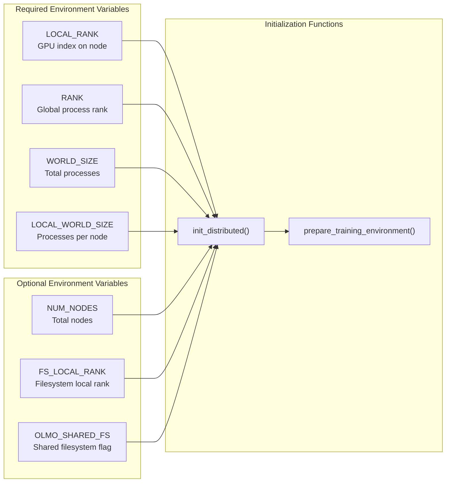
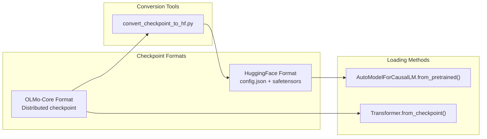
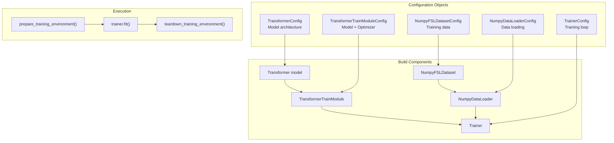
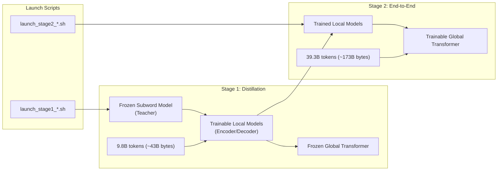

<!-- source: DeepWiki mcp.deepwiki.com · repo allenai/bolmo-core · page 1.1 Getting Started · fetched 2026-10-26 -->

# Getting Started

<details>
<summary>Relevant source files</summary>

The following files were used as context for generating this wiki page:

- [.github/actions/setup-venv/action.yml](.github/actions/setup-venv/action.yml)
- [.github/workflows/docker.yml](.github/workflows/docker.yml)
- [.github/workflows/main.yml](.github/workflows/main.yml)
- [.github/workflows/pr_checks.yml](.github/workflows/pr_checks.yml)
- [Makefile](Makefile)
- [README.md](README.md)
- [docs/source/index.rst](docs/source/index.rst)
- [docs/source/overview/installation.rst](docs/source/overview/installation.rst)
- [docs/source/overview/introduction.rst](docs/source/overview/introduction.rst)
- [pyproject.toml](pyproject.toml)
- [src/Dockerfile](src/Dockerfile)
- [src/olmo_core/distributed/utils.py](src/olmo_core/distributed/utils.py)

</details>


This page guides you through installing OLMo-Core/Bolmo, setting up your environment, and running your first training and inference examples. For detailed information about the project structure and architecture, see [Project Structure](#1.2). For development and contribution setup, see [Development Setup](#8.1).

---

## Prerequisites

Before installing OLMo-Core, ensure you have the following:

| Requirement | Version | Notes |
|-------------|---------|-------|
| Python | ≥ 3.11 | Required by the package |
| PyTorch | ≥ 2.6.0 | Must be installed separately according to your hardware |
| CUDA | 12.6+ recommended | For GPU training and inference |
| Operating System | Linux preferred | Developed and tested primarily on Linux |

**Important**: Install [PyTorch](https://pytorch.org) first according to the official instructions specific to your operating system and hardware before proceeding with OLMo-Core installation.

**Sources**: [pyproject.toml:13-26](), [README.md:49-50]()

---

## Installation Methods

### From PyPI (For Users)

For general usage, install the stable release from PyPI:

```bash
pip install ai2-olmo-core
```

This installs the core package with minimal dependencies suitable for basic training and inference tasks.

**Sources**: [docs/source/index.rst:14-16](), [pyproject.toml:5-26]()

### From Source (Recommended for Development)

For development or to access the latest features including Bolmo:

```bash
git clone https://github.com/allenai/bolmo-core.git
cd bolmo-core
pip install -e .[all]
```

The `-e` flag installs in editable mode, and `[all]` includes all optional dependencies for full functionality.

**Sources**: [README.md:52-57]()

---

## Optional Dependencies

OLMo-Core supports various optional features through additional dependencies:

```mermaid
graph TB
    Core["ai2-olmo-core<br/>(core package)"]
    
    subgraph "Attention Backends"
        FlashAttn["flash-attn<br/>Efficient attention"]
        RingFlash["ring-flash-attn<br/>Context parallel attention"]
        TE["TransformerEngine<br/>FP8 training"]
    end
    
    subgraph "Alternative Architectures"
        Mamba["mamba_ssm<br/>State-space models"]
        XLSTM["xlstm<br/>Extended LSTM (mLSTM)"]
        FLA["flash-linear-attention<br/>Linear attention"]
    end
    
    subgraph "Optimization"
        TorchAO["torchao<br/>Float8 training"]
        LigerKernel["liger-kernel<br/>Fused loss functions"]
        GroupedGEMM["grouped_gemm<br/>MoE kernels"]
    end
    
    subgraph "Experiment Management"
        Beaker["beaker-py<br/>Cluster orchestration"]
        WandB["wandb<br/>Experiment tracking"]
        Comet["comet_ml<br/>Experiment tracking"]
    end
    
    Core --> FlashAttn
    Core --> RingFlash
    Core --> TE
    Core --> Mamba
    Core --> XLSTM
    Core --> FLA
    Core --> TorchAO
    Core --> LigerKernel
    Core --> GroupedGEMM
    Core --> Beaker
    Core --> WandB
    Core --> Comet
```



### Installation Commands for Optional Dependencies

| Feature | Install Command | Use Case |
|---------|----------------|----------|
| All dependencies | `pip install ai2-olmo-core[all]` | Complete functionality |
| Development tools | `pip install ai2-olmo-core[dev]` | Testing, linting, docs |
| Beaker integration | `pip install ai2-olmo-core[beaker]` | Cluster job launching |
| Mamba architecture | `pip install ai2-olmo-core[mamba]` | State-space models |
| xLSTM architecture | `pip install ai2-olmo-core[xlstm]` | mLSTM layers (used in Bolmo) |
| FLA architecture | `pip install ai2-olmo-core[fla]` | Fast linear attention |
| Evaluation | `pip install ai2-olmo-core[eval]` | In-loop evaluations |
| TorchAO | `pip install ai2-olmo-core[torchao]` | Float8 training |
| HuggingFace | `pip install ai2-olmo-core[transformers]` | HF model conversion |

**Sources**: [pyproject.toml:33-75](), [README.md:60-66](), [docs/source/overview/installation.rst:11-17]()

---

## Environment Setup

### Distributed Training Environment Variables

OLMo-Core expects specific environment variables for distributed training:



**Manual Setup Example**:
```bash
# Single-node, 8 GPUs
export LOCAL_RANK=0
export RANK=0
export WORLD_SIZE=8
export LOCAL_WORLD_SIZE=8
export NUM_NODES=1
```

**Automatic Setup**: When using `torchrun`, these variables are set automatically.

**Sources**: [src/olmo_core/distributed/utils.py:19-25](), [src/olmo_core/distributed/utils.py:30-131]()

### Cluster-Specific Configuration

When running on AI2 clusters (Jupiter, Pluto, Augusta), `init_distributed()` automatically configures NCCL settings:

| Cluster | Auto-Configuration |
|---------|-------------------|
| Jupiter | InfiniBand HCA settings, socket interface |
| Pluto | InfiniBand HCA exclusions |
| Augusta | FastRAK networking, NCCL tuning, TCPx optimizations |

**Sources**: [src/olmo_core/distributed/utils.py:52-112]()

---

## Quick Start: Inference

### Using Bolmo with HuggingFace

The simplest way to use Bolmo models for inference:

```python
from transformers import AutoModelForCausalLM, AutoTokenizer

device = "cuda"
bolmo = AutoModelForCausalLM.from_pretrained(
    "allenai/Bolmo-7B", 
    trust_remote_code=True
).to(device)
tokenizer = AutoTokenizer.from_pretrained(
    "allenai/Bolmo-7B", 
    trust_remote_code=True
)

message = ["Language modeling is "]
input_ids = tokenizer(message, return_tensors="pt")["input_ids"].to(device)

# max_new_tokens is the amount of bytes to generate
response = bolmo.generate(
    input_ids, 
    max_new_tokens=256, 
    do_sample=True, 
    temperature=0.1
)
print(tokenizer.decode(response[0], skip_special_tokens=True))
```

**Sources**: [README.md:72-86]()

### Loading Native OLMo-Core Checkpoints



**Checkpoint Conversion** (OLMo-Core → HuggingFace):
```bash
python3 src/examples/huggingface/convert_checkpoint_to_hf.py \
    -i /path/to/bolmo/checkpoint \
    -o /path/to/hf/checkpoint \
    -s 65536 \
    --dtype float32 \
    --skip-validation
```

**Sources**: [README.md:88-102]()

---

## Quick Start: Training

### Minimal Training Configuration



### Basic Training Script Structure

A minimal training script follows this pattern:

```python
from olmo_core.nn.transformer import TransformerConfig
from olmo_core.train import TrainerConfig, prepare_training_environment, teardown_training_environment

def main():
    # 1. Build model
    model_config = TransformerConfig.llama2_1B(
        vocab_size=50280,
        compile=True
    )
    model = model_config.build()
    
    # 2. Build train module (wraps model + optimizer)
    train_module_config = TransformerTrainModuleConfig(
        model=model_config,
        # ... optimizer, scheduler config
    )
    train_module = train_module_config.build(model)
    
    # 3. Build dataset and data loader
    dataset_config = NumpyFSLDatasetConfig(
        source_paths=["path/to/data"],
        # ... data config
    )
    dataset = dataset_config.build()
    
    data_loader_config = NumpyDataLoaderConfig(
        global_batch_size=2048,
        seed=0,
    )
    data_loader = data_loader_config.build(
        dataset, 
        dp_process_group=train_module.dp_process_group
    )
    
    # 4. Build trainer
    trainer_config = TrainerConfig(
        save_folder="checkpoints/",
        max_epochs=1,
        # ... callback configs
    )
    trainer = trainer_config.build(train_module, data_loader)
    
    # 5. Train
    trainer.fit()

if __name__ == "__main__":
    prepare_training_environment(seed=0)
    main()
    teardown_training_environment()
```

**Sources**: [docs/source/overview/introduction.rst:14-52]()

### Launching with torchrun

```bash
# Single-node training with 8 GPUs
torchrun --nproc-per-node=8 train_script.py

# Multi-node training (run on each node)
torchrun \
    --nproc-per-node=8 \
    --nnodes=4 \
    --node-rank=$NODE_RANK \
    --master-addr=$MASTER_ADDR \
    --master-port=$MASTER_PORT \
    train_script.py
```

The `torchrun` utility automatically sets required environment variables like `LOCAL_RANK`, `RANK`, `WORLD_SIZE`, etc.

**Sources**: [docs/source/overview/introduction.rst:47-49]()

---

## Bolmo Training: Two-Stage Byteifying

Bolmo uses a specialized two-stage training procedure to convert subword models to byte-level:



**Stage 1** trains local encoder/decoder models while keeping the global transformer frozen. Training scripts are located at `bolmo_scripts/launch_stage1_*`.

**Stage 2** fine-tunes the entire model end-to-end. Training scripts are located at `bolmo_scripts/launch_stage2_*`.

**Sources**: [README.md:104-111]()

---

## Verification

### Verify Installation

Check that the package is properly installed:

```bash
python -c "import olmo_core; print(olmo_core.__version__)"
```

### Verify GPU Access

```bash
python -c "import torch; print(f'CUDA available: {torch.cuda.is_available()}'); print(f'GPU count: {torch.cuda.device_count()}')"
```

### Run Test Suite

```bash
# Run all tests (requires dev dependencies)
pytest src/test/

# Run only GPU tests (requires GPU)
pytest -m gpu src/test/
```

**Sources**: [pyproject.toml:164-179](), [.github/workflows/main.yml:39-56]()

---

## Docker Images

Pre-built Docker images with all dependencies are available:

```bash
# Pull the latest image
docker pull ghcr.io/allenai/olmo-core:latest

# Or build locally
make docker-image
```

**Image Contents**:
- CUDA 12.6 or 12.8
- PyTorch 2.7+
- All optional dependencies (flash-attn, TransformerEngine, etc.)
- MLNX OFED drivers for InfiniBand
- Optimized NCCL configuration

**Sources**: [Makefile:72-89](), [src/Dockerfile:1-138](), [.github/workflows/docker.yml:26-89]()

---

## Next Steps

| Topic | Documentation |
|-------|---------------|
| Understanding the codebase organization | [Project Structure](#1.2) |
| Model architectures and variants | [Model Architecture](#2) |
| Training system components | [Training System](#3) |
| Data pipeline and mixing | [Data Pipeline](#4) |
| Distributed training setup | [Distributed Training](#5) |
| Launching experiments on Beaker | [Beaker Launch](#7.1) |
| Bolmo architecture details | [Bolmo Architecture](#10.1) |
| Complete training examples | See `src/examples/` directory |
| Development and testing | [Development Setup](#8.1) |

**Sources**: [docs/source/overview/introduction.rst:51-52]()

---

