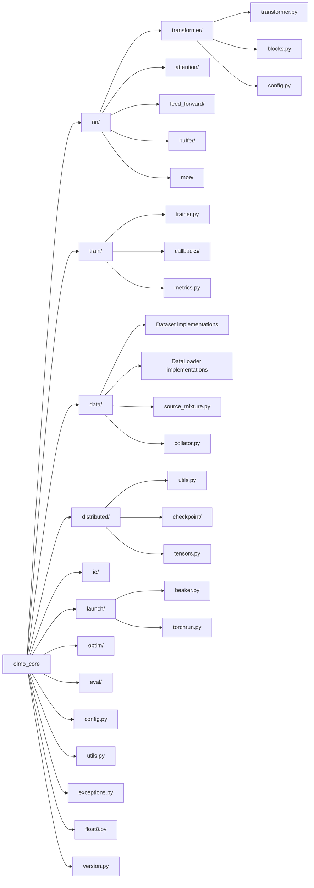
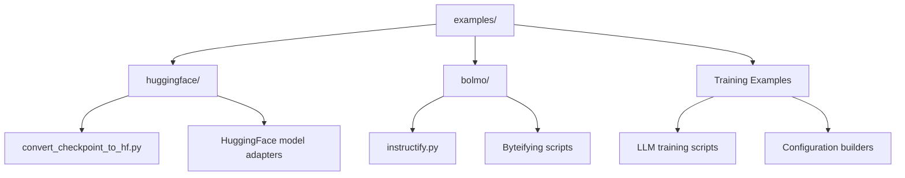
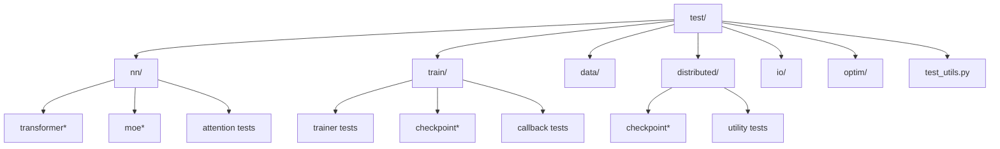
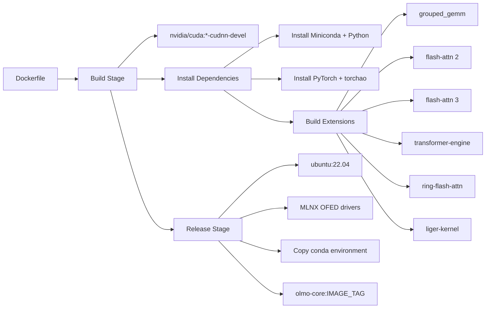
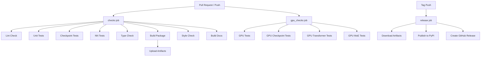

<!-- source: DeepWiki mcp.deepwiki.com · repo allenai/bolmo-core · page 1.2 Project Structure · fetched 2026-10-26 -->

# Project Structure

<details>
<summary>Relevant source files</summary>

The following files were used as context for generating this wiki page:

- [.github/actions/setup-venv/action.yml](.github/actions/setup-venv/action.yml)
- [.github/workflows/docker.yml](.github/workflows/docker.yml)
- [.github/workflows/main.yml](.github/workflows/main.yml)
- [.github/workflows/pr_checks.yml](.github/workflows/pr_checks.yml)
- [Makefile](Makefile)
- [README.md](README.md)
- [docs/source/index.rst](docs/source/index.rst)
- [docs/source/overview/installation.rst](docs/source/overview/installation.rst)
- [docs/source/overview/introduction.rst](docs/source/overview/introduction.rst)
- [pyproject.toml](pyproject.toml)
- [src/Dockerfile](src/Dockerfile)
- [src/olmo_core/distributed/utils.py](src/olmo_core/distributed/utils.py)

</details>


## Purpose and Scope

This document explains the organization of the Bolmo-core repository, including the directory structure, key modules, and the relationships between core components, examples, and tests. For information about installation and getting started, see [Getting Started](#1.1). For an introduction to the project's purpose and features, see [Overview](#1).

---

## Repository Layout

The repository follows a standard Python project structure with source code, tests, documentation, and build configurations organized into distinct directories.

### Top-Level Directory Structure

```mermaid
graph TB
    Root["/"]
    
    Root --> Src["src/"]
    Root --> Docs["docs/"]
    Root --> Github[".github/"]
    Root --> Config["Configuration Files"]
    
    Src --> OlmoCore["olmo_core/"]
    Src --> Examples["examples/"]
    Src --> Test["test/"]
    Src --> Scripts["scripts/"]
    Src --> Dockerfile["Dockerfile"]
    
    OlmoCore --> NN["nn/"]
    OlmoCore --> Train["train/"]
    OlmoCore --> Data["data/"]
    OlmoCore --> Distributed["distributed/"]
    OlmoCore --> IO["io/"]
    OlmoCore --> Launch["launch/"]
    OlmoCore --> Optim["optim/"]
    OlmoCore --> Eval["eval/"]
    OlmoCore --> Utils["Core modules"]
    
    Examples --> Huggingface["huggingface/"]
    Examples --> Bolmo["bolmo/"]
    Examples --> Training["Training scripts"]
    
    Test --> NNTests["nn/"]
    Test --> TrainTests["train/"]
    Test --> DataTests["data/"]
    Test --> DistTests["distributed/"]
    
    Github --> Workflows["workflows/"]
    Github --> Actions["actions/"]
    
    Workflows --> MainYml["main.yml"]
    Workflows --> DockerYml["docker.yml"]
    
    Config --> Pyproject["pyproject.toml"]
    Config --> Makefile["Makefile"]
    Config --> Readme["README.md"]
    
    Docs --> Source["source/"]
    Source --> ApiDocs["API Reference"]
    Source --> Guides["Guides"]
```



**Sources:** [pyproject.toml:86-89](), [.github/workflows/main.yml:1-278]()

---

## Source Code Organization

All source code resides in the `src/` directory, which contains the main `olmo_core` package, example scripts, tests, and build files.

### Package Structure

The project is configured as a Python package named `ai2-olmo-core`, with the main module `olmo_core` located at `src/olmo_core/`.

| Directory | Purpose |
|-----------|---------|
| `src/olmo_core/` | Core library modules |
| `src/examples/` | Example scripts and training configurations |
| `src/test/` | Test suite |
| `src/scripts/` | Utility scripts for releases, Beaker, etc. |
| `src/Dockerfile` | Docker image definition |

**Sources:** [pyproject.toml:86-89](), [pyproject.toml:5-26]()

---

## Core Package Structure (`olmo_core`)

The `olmo_core` package is organized into functionally distinct modules, each handling a specific aspect of the training and inference pipeline.

### Main Modules



**Sources:** [pyproject.toml:86-89]()

### Module Responsibilities

| Module | Purpose | Key Components |
|--------|---------|----------------|
| `nn/` | Model architecture implementations | `Transformer`, `TransformerBlock`, attention mechanisms, feed-forward networks, MoE blocks |
| `train/` | Training system | `Trainer`, `TrainModule`, callbacks (checkpointing, evaluation, monitoring) |
| `data/` | Data pipeline | Dataset classes (`NumpyFSLDataset`, `NumpyPackedFSLDataset`), data loaders, source mixing, collators |
| `distributed/` | Distributed training utilities | Process group management, distributed initialization, checkpointing |
| `io/` | Unified I/O system | Support for local filesystems, S3, GCS, WEKA, R2 |
| `launch/` | Experiment orchestration | `BeakerLaunchConfig` for cluster launches |
| `optim/` | Optimizers and schedulers | `AdamW`, `SkipStepOptimizer`, learning rate schedulers |
| `eval/` | Evaluation system | Evaluator interface and implementations |
| `config.py` | Configuration base class | `Config` class for all configuration objects |
| `utils.py` | Common utilities | Device management, seeding, tensor operations |
| `exceptions.py` | Custom exceptions | `OLMoError`, `OLMoEnvironmentError`, etc. |
| `float8.py` | Float8 training support | Integration with torchao for FP8 training |

**Sources:** Based on high-level architecture diagrams provided

---

## Examples and Scripts

The `src/examples/` directory contains practical examples demonstrating various use cases.

### Examples Directory Structure



| Example Type | Location | Purpose |
|--------------|----------|---------|
| HuggingFace Integration | `examples/huggingface/` | Converting checkpoints to HF format, model adapters |
| Bolmo Post-Training | `examples/bolmo/instructify.py` | Task arithmetic for post-training without additional training |
| Training Scripts | `examples/` | Complete training examples with configuration builders |

**Sources:** [README.md:91-123]()

### Scripts Directory

The `src/scripts/` directory contains utility scripts for release management, Beaker operations, and other development tasks.

**Sources:** Inferred from repository structure

---

## Test Organization

Tests are located in `src/test/` and are organized to mirror the structure of the main package. The test suite uses pytest with custom markers for GPU and distributed tests.

### Test Structure



### Test Categories

The CI/CD pipeline organizes tests into several categories:

| Category | Test Pattern | GPU Required | Description |
|----------|--------------|--------------|-------------|
| General Tests | `src/test/` (excluding patterns below) | No | Unit tests for core functionality |
| Checkpoint Tests | `src/test/*/checkpoint*` | No | Checkpoint saving/loading tests |
| Neural Network Tests | `src/test/nn/` | No | Model architecture tests |
| GPU Tests | Tests marked with `@pytest.mark.gpu` | Yes (2 GPUs) | Tests requiring CUDA |
| GPU Checkpoint Tests | `src/test/distributed/checkpoint*` with GPU marker | Yes (2 GPUs) | Distributed checkpoint tests on GPU |
| GPU Transformer Tests | `src/test/nn/transformer*` with GPU marker | Yes (2 GPUs) | Transformer model tests on GPU |
| GPU MoE Tests | `src/test/nn/moe*` with GPU marker | Yes (2 GPUs) | Mixture-of-experts tests on GPU |

**Sources:** [.github/workflows/main.yml:39-159](), [pyproject.toml:164-179]()

### Test Execution

Tests can be run using pytest with various markers:

```bash
# Run all non-GPU tests
pytest src/test/

# Run GPU tests only
pytest -m gpu src/test/

# Run specific test category
pytest src/test/nn/
```

**Sources:** [pyproject.toml:164-179](), [.github/workflows/main.yml:39-159]()

---

## Configuration Files

The repository includes several key configuration files at the root level.

### `pyproject.toml`

The main project configuration file defining package metadata, dependencies, and tool configurations.

| Section | Purpose |
|---------|---------|
| `[project]` | Package name (`ai2-olmo-core`), version, dependencies |
| `[project.optional-dependencies]` | Optional dependency groups: `dev`, `beaker`, `comet`, `eval`, `torchao`, `transformers`, `wandb`, `mamba`, `xlstm`, `fla`, `all` |
| `[tool.setuptools]` | Package discovery configuration |
| `[tool.black]`, `[tool.isort]`, `[tool.ruff]` | Code formatting and linting rules |
| `[tool.mypy]` | Type checking configuration |
| `[tool.pytest.ini_options]` | Test configuration, markers, and filters |

**Sources:** [pyproject.toml:1-180]()

### `Makefile`

Provides convenient commands for common development tasks:

| Target | Command | Purpose |
|--------|---------|---------|
| `make checks` | - | Run all checks (style, lint, type) |
| `make style` | `isort`, `black` | Format code |
| `make lint-check` | `ruff check` | Check linting |
| `make type-check` | `mypy` | Type checking |
| `make build` | `python -m build` | Build package distributions |
| `make docs` | `sphinx-autobuild` | Build and serve documentation |
| `make docker-image` | Docker build with args | Build Docker image |
| `make beaker-image` | Docker + Beaker push | Push image to Beaker |

**Sources:** [Makefile:1-112]()

### Dependency Groups

Optional dependencies are organized by functionality:

| Group | Dependencies | Purpose |
|-------|--------------|---------|
| `dev` | black, isort, mypy, pytest, sphinx, etc. | Development and testing tools |
| `beaker` | beaker-py, GitPython | Beaker cluster integration |
| `comet` | comet_ml | Comet ML logging |
| `eval` | ai2-olmo-eval | Evaluation framework |
| `torchao` | torchao | Float8 training |
| `transformers` | transformers | HuggingFace integration |
| `wandb` | wandb | Weights & Biases logging |
| `mamba` | mamba_ssm, causal_conv1d, triton | Mamba architecture support |
| `xlstm` | xlstm | xLSTM architecture support (used in Bolmo) |
| `fla` | flash-linear-attention | Fast linear attention |
| `all` | All of the above | Install everything |

**Sources:** [pyproject.toml:33-75]()

---

## Build and Deployment

The repository includes comprehensive build and deployment infrastructure for Docker images and CI/CD.

### Docker Build Pipeline



**Sources:** [src/Dockerfile:1-138](), [Makefile:40-112]()

### Docker Image Variants

Images are built with specific CUDA and PyTorch versions:

| Component | Default Version | Configurable |
|-----------|----------------|--------------|
| CUDA | 12.8.1 | `CUDA_VERSION` |
| PyTorch | 2.8.0 | `TORCH_VERSION` |
| Python | 3.11 | `PYTHON_VERSION` |
| flash-attn | 2.8.2 | `FLASH_ATTN_VERSION` |
| transformer-engine | 2.6.0.post1 | `TE_VERSION` |
| liger-kernel | 0.6.2 | `LIGER_KERNEL_VERSION` |

**Sources:** [Makefile:50-61](), [src/Dockerfile:44-86]()

### CI/CD Workflows



**Sources:** [.github/workflows/main.yml:1-278]()

### CI/CD Job Configurations

**CPU Tests:**
- Run on `ubuntu-latest`
- Use Python virtual environment with caching
- Execute various test suites in parallel
- Validate code quality (lint, type, style)
- Build documentation

**GPU Tests:**
- Run on Beaker clusters via Gantry
- Use pre-built Docker images with CUDA support
- Require 2 GPUs (H100 or A100)
- Test distributed training functionality

**Release Workflow:**
- Triggered on version tags (`v*.*.*`)
- Builds package distributions
- Publishes to PyPI
- Creates GitHub release with changelog
- Sends Slack notifications

**Sources:** [.github/workflows/main.yml:26-278]()

---

## Distributed Training Environment Variables

The `olmo_core.distributed.utils` module defines and validates several environment variables required for distributed training:

| Environment Variable | Purpose | Set By |
|---------------------|---------|--------|
| `LOCAL_RANK` | Local rank within node | torchrun |
| `NUM_NODES` | Number of nodes in job | Launch script or cluster |
| `LOCAL_WORLD_SIZE` | Number of processes per node | torchrun |
| `OLMO_SHARED_FS` | Indicates shared filesystem | User or `init_distributed()` |
| `FS_LOCAL_RANK` | Filesystem-local rank | User (if no shared FS) |
| `BEAKER_NODE_HOSTNAME` | Node hostname in Beaker | Beaker |

**Sources:** [src/olmo_core/distributed/utils.py:19-25](), [src/olmo_core/distributed/utils.py:133-156]()

### Cluster-Specific Configuration

The `init_distributed()` function automatically configures NCCL settings for different AI2 clusters:

| Cluster | Detection | Special Configuration |
|---------|-----------|----------------------|
| Jupiter | Hostname contains "jupiter" | Set `NCCL_IB_HCA`, conditionally set `NCCL_SOCKET_IFNAME` for multi-node |
| Pluto | Hostname contains "pluto" | Set `NCCL_IB_HCA` |
| Augusta | Hostname contains "augusta" | Extensive NCCL tuning (20+ environment variables) for optimized A3+ performance |

**Sources:** [src/olmo_core/distributed/utils.py:52-112]()

---

## Development Workflow

The typical development workflow involves:

1. **Setup:** Install dependencies using the development extras:
   ```bash
   pip install -e .[dev]
   ```

2. **Code Quality:** Run checks before committing:
   ```bash
   make style        # Format code
   make checks       # Run all checks
   ```

3. **Testing:** Run appropriate test suites:
   ```bash
   pytest src/test/                    # Local tests
   pytest -m gpu src/test/             # GPU tests (requires GPU)
   ```

4. **Documentation:** Build and preview documentation:
   ```bash
   make docs
   ```

5. **Building:** Create distribution packages:
   ```bash
   make build
   ```

**Sources:** [Makefile:1-112](), [pyproject.toml:33-56]()

---

