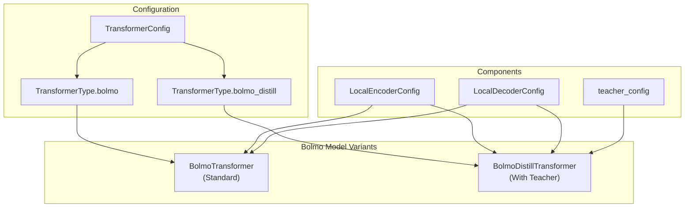
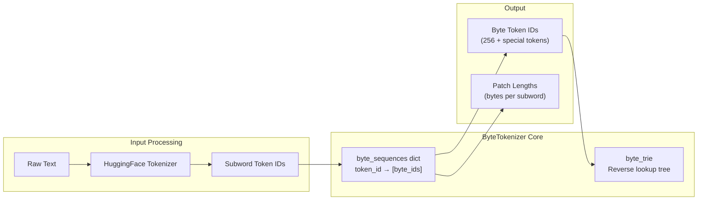
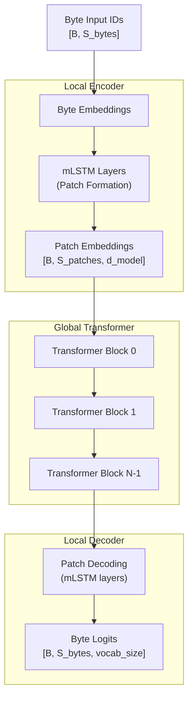
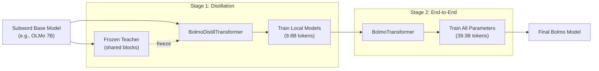

<!-- source: DeepWiki mcp.deepwiki.com · repo allenai/bolmo-core · page 10 Bolmo Byte-Level Models · fetched 2026-10-26 -->

# Bolmo Byte-Level Models

<details>
<summary>Relevant source files</summary>

The following files were used as context for generating this wiki page:

- [README.md](README.md)
- [docs/source/index.rst](docs/source/index.rst)
- [docs/source/overview/installation.rst](docs/source/overview/installation.rst)
- [docs/source/overview/introduction.rst](docs/source/overview/introduction.rst)
- [src/olmo_core/data/tokenizer.py](src/olmo_core/data/tokenizer.py)
- [src/olmo_core/nn/transformer/config.py](src/olmo_core/nn/transformer/config.py)
- [src/olmo_core/nn/transformer/model.py](src/olmo_core/nn/transformer/model.py)

</details>


## Purpose and Scope

This page provides a comprehensive overview of **Bolmo**, the first fully-open byte-level language model family that achieves competitive performance with state-of-the-art subword-based models. Bolmo operates directly on raw UTF-8 bytes rather than subword tokens, eliminating the need for language-specific tokenizers while maintaining strong performance across diverse languages and domains.

This page covers the core concepts, model variants, byte tokenization, and basic usage patterns. For detailed architectural information, see [Bolmo Architecture](#10.1). For the training procedure, see [Byteifying Process](#10.2). For applying post-training adaptations, see [Task Arithmetic for Post-Training](#10.3).

**Sources:** [README.md:1-165]()

---

## What is Byte-Level Modeling?

Traditional language models operate on **subword tokens** produced by tokenizers like BPE or WordPiece. These tokenizers split text into frequent substrings, which vary across languages and domains. Byte-level models instead process the raw **UTF-8 byte representation** of text, treating each byte (0-255) as a fundamental unit.

### Advantages of Byte-Level Models

| Aspect | Subword Models | Byte-Level Models (Bolmo) |
|--------|----------------|---------------------------|
| **Tokenization** | Requires trained tokenizer | Direct UTF-8 encoding |
| **Vocabulary** | Language/domain specific (50K-100K tokens) | Fixed 256 bytes + special tokens |
| **Multilingual** | Performance varies by language | Universal across all languages |
| **Character Tasks** | Struggles with character-level reasoning | Superior character understanding |
| **Tokenizer Attacks** | Vulnerable to adversarial inputs | Immune to tokenization issues |

**Sources:** [README.md:24-31]()

---

## Bolmo Model Variants

The codebase implements two Bolmo model types, both built on the hierarchical architecture that combines local byte-to-patch encoding with global transformer processing.

### Model Types



**Sources:** [src/olmo_core/nn/transformer/config.py:96-104](), [src/olmo_core/nn/transformer/config.py:396-445]()

### BolmoTransformer

The standard Bolmo model implementation with local encoder/decoder and global transformer blocks.

**Key Configuration Fields:**
- `name`: Set to `TransformerType.bolmo`
- `local_encoder`: Required `LocalEncoderConfig` for byte-to-patch encoding
- `local_decoder`: Required `LocalDecoderConfig` for patch-to-byte decoding
- `vocab_size`: Byte vocabulary size (typically 256 + special tokens)

**Sources:** [src/olmo_core/nn/transformer/config.py:396-421]()

### BolmoDistillTransformer

Extended Bolmo model that includes a teacher model for distillation during training. Used in Stage 1 of the byteifying process where local models learn from a frozen subword teacher.

**Additional Configuration Fields:**
- `teacher_config`: `TransformerConfig` for the teacher model
- `share_blocks_between_teacher_and_student`: Whether to share transformer blocks
- `use_teacher_embs_with_vocab_size`: Optional vocabulary size for teacher embeddings

**Sources:** [src/olmo_core/nn/transformer/config.py:422-445]()

---

## Byte Tokenization System

Bolmo uses a specialized `ByteTokenizer` that maps between subword tokens and byte sequences, enabling training data compatibility with existing tokenized datasets.

### ByteTokenizer Architecture



**Sources:** [src/olmo_core/data/tokenizer.py:196-271](), [src/olmo_core/data/tokenizer.py:273-331]()

### ByteTokenizerConfig

Extends `TokenizerConfig` with byte-level specific settings:

| Field | Type | Description |
|-------|------|-------------|
| `special_tokens` | `list[str]` | Special token strings (e.g., `["<bos>", "<eos>", "<pad>"]`) |
| `special_tokens_first` | `bool` | Whether special tokens come before byte IDs in vocab |
| `original_identifier` | `str` | HuggingFace identifier of source tokenizer |
| `bpe_token_end_id` | `int` | Optional marker for BPE token boundaries |

**Factory Methods:**
- `ByteTokenizerConfig.from_tokenizer_config(tokenizer_config)`: Convert from standard tokenizer
- `ByteTokenizerConfig.blt()`: BLT-style byte tokenizer configuration
- `ByteTokenizerConfig.hnet()`: HNet-style configuration

**Sources:** [src/olmo_core/data/tokenizer.py:196-271]()

### Key ByteTokenizer Methods

```python
# Encoding: text → subword tokens → byte tokens
byte_tokens = byte_tokenizer.encode(text, add_special_tokens=False)

# Decoding: byte tokens → bytes → text
decoded_text = byte_tokenizer.decode(byte_tokens)

# Convert subword tokens to bytes
byte_tokens, patch_lengths = byte_tokenizer.get_tokens_and_patch_lengths(
    original_input_ids, 
    add_bos=True, 
    strip_pad=True
)

# Expand byte IDs back to subword token IDs (for evaluation)
expanded_tokens = byte_tokenizer.expand_byte_ids(byte_ids)

# Get space-based patch boundaries
patch_lengths = byte_tokenizer.get_space_patch_lengths(
    byte_tokens, 
    max_patch_length=16,
    kind="strict_end_before_space"
)
```

**Sources:** [src/olmo_core/data/tokenizer.py:330-486]()

---

## Hierarchical Architecture Overview

Bolmo uses a three-level hierarchical architecture that processes bytes through local encoding, global reasoning, and local decoding.

### Architecture Flow



The **local encoder** compresses variable-length byte sequences into fixed-size patch embeddings. The **global transformer** processes patches using standard self-attention. The **local decoder** expands patches back to byte-level predictions.

For detailed architectural specifications, see [Bolmo Architecture](#10.1).

**Sources:** [README.md:7-8]()

---

## Training Overview

Bolmo models are trained using a two-stage **byteifying** procedure that converts existing subword models to byte-level models using less than 1% of the original pretraining compute.

### Two-Stage Training Pipeline

| Stage | Name | Purpose | Data Volume | Model Updates |
|-------|------|---------|-------------|---------------|
| **Stage 1** | Subword-to-Byte Distillation | Train local encoder/decoder with frozen global model | 9.8B tokens (≈43B bytes) | Local encoder/decoder only |
| **Stage 2** | End-to-End Training | Fine-tune entire model on byte-level data | 39.3B tokens (≈173B bytes) | All parameters |



For complete training details and scripts, see [Byteifying Process](#10.2).

**Sources:** [README.md:105-111]()

---

## Configuration Example

Building a Bolmo model requires configuring the local encoder/decoder along with the standard transformer components:

```python
from olmo_core.nn.transformer import TransformerConfig, TransformerType
from olmo_core.nn.bolmo.config import LocalEncoderConfig, LocalDecoderConfig, BolmoConfig
from olmo_core.data.tokenizer import ByteTokenizerConfig

# Configure byte tokenizer
byte_tokenizer_config = ByteTokenizerConfig.from_tokenizer_config(
    TokenizerConfig.dolma2()
)

# Configure local encoder (bytes → patches)
local_encoder = LocalEncoderConfig(
    config=BolmoConfig(
        d_model=4096,
        n_layers=2,
        max_patch_length=16,
        # ... other Bolmo-specific settings
    )
)

# Configure local decoder (patches → bytes)  
local_decoder = LocalDecoderConfig(
    config=BolmoConfig(
        d_model=4096,
        n_layers=2,
        max_patch_length=16,
        # ... other Bolmo-specific settings
    )
)

# Build Bolmo transformer
bolmo_config = TransformerConfig(
    d_model=4096,
    vocab_size=byte_tokenizer_config.vocab_size,
    n_layers=32,
    block=block_config,
    lm_head=lm_head_config,
    name=TransformerType.bolmo,
    local_encoder=local_encoder,
    local_decoder=local_decoder,
)

model = bolmo_config.build(init_device="meta")
```

**Sources:** [src/olmo_core/nn/transformer/config.py:396-421]()

---

## Usage Examples

### Inference with HuggingFace

Bolmo models on HuggingFace include a `ByteTokenizer` and can be used directly:

```python
from transformers import AutoModelForCausalLM, AutoTokenizer

device = "cuda"
bolmo = AutoModelForCausalLM.from_pretrained(
    "allenai/Bolmo-7B", 
    trust_remote_code=True
).to(device)
tokenizer = AutoTokenizer.from_pretrained(
    "allenai/Bolmo-7B", 
    trust_remote_code=True
)

# Tokenizer encodes text directly to byte IDs
input_ids = tokenizer(["Hello world"], return_tensors="pt")["input_ids"].to(device)

# Generate operates at byte level
# max_new_tokens specifies number of bytes to generate
response = bolmo.generate(
    input_ids, 
    max_new_tokens=256,
    do_sample=True, 
    temperature=0.1
)

print(tokenizer.decode(response[0], skip_special_tokens=True))
```

**Sources:** [README.md:72-86]()

### Loading Bolmo Checkpoints

Converting between olmo-core and HuggingFace formats:

```bash
# olmo-core → HuggingFace
python3 src/examples/huggingface/convert_checkpoint_to_hf.py \
    -i /path/to/bolmo/checkpoint \
    -o /path/to/bolmo/checkpoint/in/hf/format \
    -s 65536 \
    --dtype float32 \
    --skip-validation
```

Original olmo-core checkpoints are available in the `olmo_core/` subdirectory on HuggingFace model pages.

**Sources:** [README.md:88-101]()

---

## Released Models

| Model | Parameters | Base Model | HuggingFace | Key Features |
|-------|-----------|------------|-------------|--------------|
| **Bolmo-7B** | 7.6B | OLMo 3 7B | [allenai/Bolmo-7B](https://huggingface.co/allenai/Bolmo-7B) | Competitive with OLMo 3 7B on most benchmarks |
| **Bolmo-1B** | 1.5B | OLMo 2 1B | [allenai/Bolmo-1B](https://huggingface.co/allenai/Bolmo-1B) | Strong performance in 1B parameter class |

### Performance Highlights (Bolmo 7B)

| Task Category | Bolmo 7B | OLMo 3 7B (Source) | Improvement Area |
|--------------|----------|-------------------|------------------|
| Character Understanding (CUTE) | **78.6** | 56.9 | +21.7 points (better) |
| Multilingual Character (EXECUTE) | **71.6** | 55.1 | +16.5 points (better) |
| Code | 41.0 | 40.1 | Comparable |
| Math | 48.9 | 55.3 | Slightly lower |
| MC STEM | 65.5 | 66.3 | Comparable |
| MC Non-STEM | 75.8 | 77.7 | Comparable |

Bolmo significantly outperforms its source model on character-level tasks while maintaining competitive performance on standard language understanding benchmarks.

**Sources:** [README.md:36-43](), [README.md:128-142]()

---

## File Organization

Key files for Bolmo implementation:

| Path | Description |
|------|-------------|
| [src/olmo_core/nn/transformer/model.py:1318-1738]() | `BolmoTransformer` and `BolmoDistillTransformer` classes |
| [src/olmo_core/nn/transformer/config.py:96-104]() | `TransformerType.bolmo` and `.bolmo_distill` enums |
| [src/olmo_core/nn/transformer/config.py:326-331]() | Bolmo-specific config fields |
| [src/olmo_core/data/tokenizer.py:196-486]() | `ByteTokenizerConfig` and `ByteTokenizer` |
| [src/olmo_core/nn/bolmo/]() | Local encoder/decoder implementations (see [Bolmo Architecture](#10.1)) |
| [bolmo_scripts/]() | Training scripts for Stage 1 and Stage 2 (see [Byteifying Process](#10.2)) |
| [src/examples/bolmo/instructify.py]() | Task arithmetic for post-training (see [Task Arithmetic](#10.3)) |

**Sources:** [README.md:1-165]()

---

## Next Steps

- **[Bolmo Architecture](#10.1)**: Deep dive into local encoder/decoder design, mLSTM layers, and patch formation strategies
- **[Byteifying Process](#10.2)**: Complete training procedure including Stage 1 distillation and Stage 2 end-to-end training
- **[Task Arithmetic for Post-Training](#10.3)**: Apply instruction tuning or other post-training adaptations to Bolmo without additional training

For general model architecture concepts, see [Transformer Models](#2.1). For data pipeline details, see [Data Pipeline](#4).

**Sources:** [README.md:1-165]()

---

