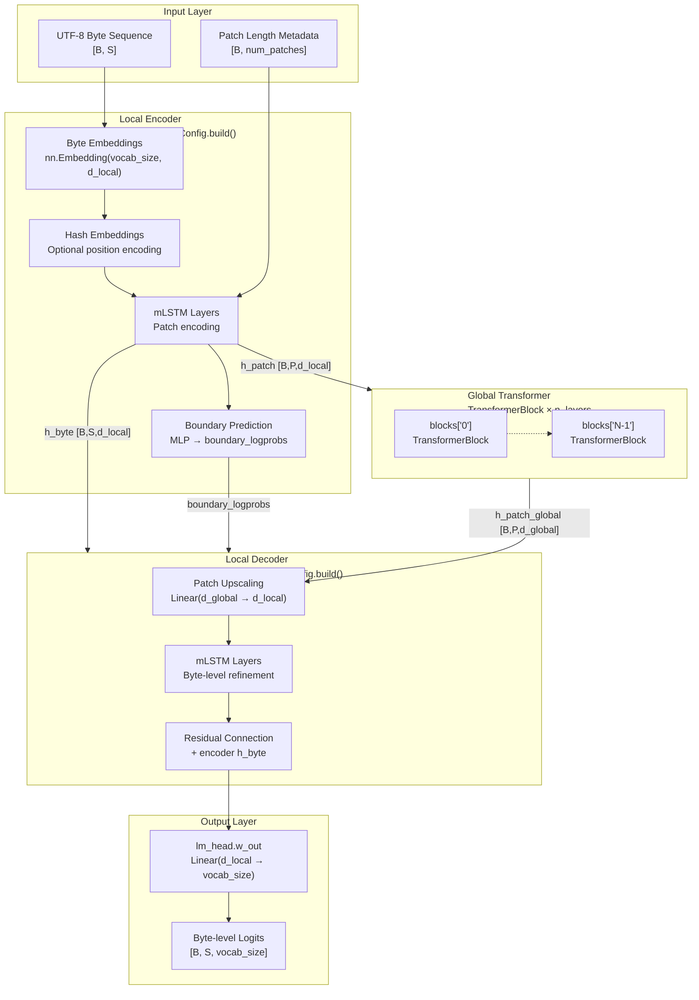
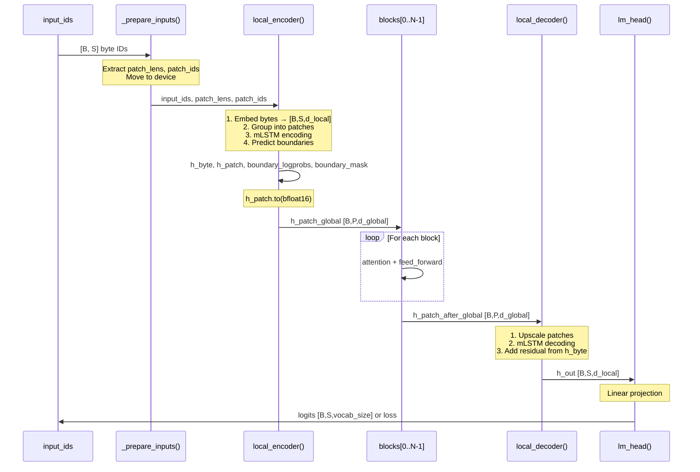
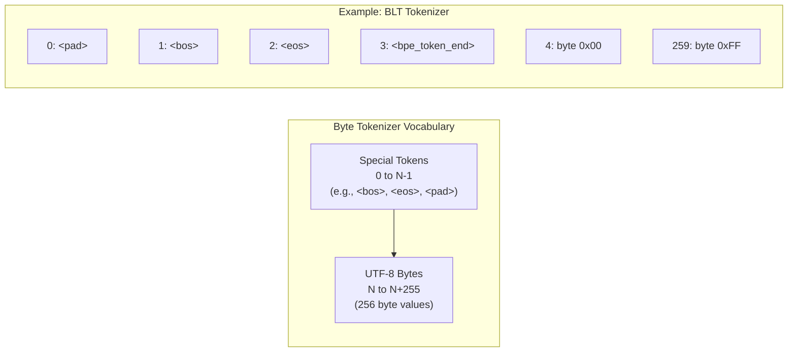
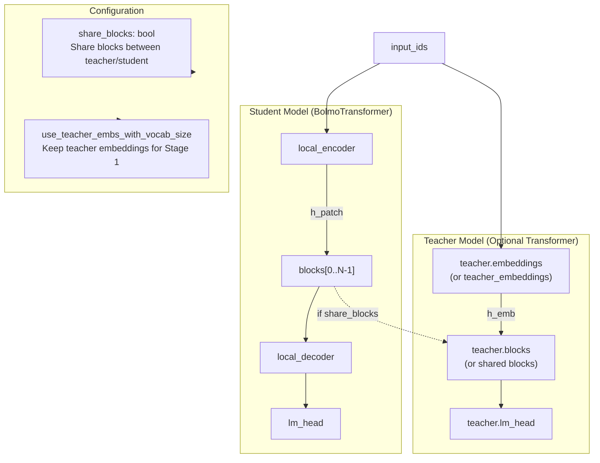
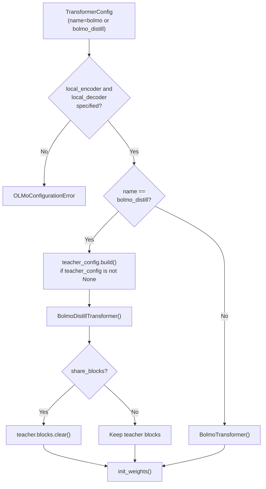

<!-- source: DeepWiki mcp.deepwiki.com · repo allenai/bolmo-core · page 10.1 Bolmo Architecture · fetched 2026-10-26 -->

# Bolmo Architecture

<details>
<summary>Relevant source files</summary>

The following files were used as context for generating this wiki page:

- [src/olmo_core/data/tokenizer.py](src/olmo_core/data/tokenizer.py)
- [src/olmo_core/nn/transformer/config.py](src/olmo_core/nn/transformer/config.py)
- [src/olmo_core/nn/transformer/model.py](src/olmo_core/nn/transformer/model.py)

</details>


## Purpose and Scope

This document describes the architecture of Bolmo (Byte-level Language Model), a hierarchical transformer that operates directly on UTF-8 bytes rather than subword tokens. Bolmo employs a three-stage architecture: a local encoder that converts bytes to patches, a global transformer that processes patch representations, and a local decoder that converts patches back to byte-level predictions.

For information about training Bolmo models (including the two-stage byteifying procedure), see [Byteifying Process](#10.2). For details on the base transformer architecture that Bolmo extends, see [Transformer Models](#2.1).

---

## Architecture Overview

Bolmo implements a hierarchical byte-level language model with three main components operating in sequence:

| Component | Input | Output | Purpose |
|-----------|-------|--------|---------|
| **Local Encoder** | UTF-8 bytes | Patch embeddings | Groups bytes into variable-length patches and embeds them |
| **Global Transformer** | Patch embeddings | Contextualized patches | Applies standard transformer blocks to patch-level representations |
| **Local Decoder** | Contextualized patches | Byte-level logits | Expands patches back to byte-level predictions |

The key innovation is the **patch abstraction**: bytes are dynamically grouped into patches based on linguistic boundaries (e.g., word boundaries, BPE token boundaries), allowing the global transformer to operate on higher-level units while maintaining byte-level input/output granularity.

**Sources:** [src/olmo_core/nn/transformer/model.py:1110-1414](), [src/olmo_core/nn/transformer/config.py:96-104]()

---

## Component Architecture



**Sources:** [src/olmo_core/nn/transformer/model.py:1146-1157](), [src/olmo_core/nn/bolmo/config.py]()

---

## BolmoTransformer Class

The `BolmoTransformer` class extends the base `Transformer` class, replacing the standard embedding layer with a local encoder and adding a local decoder before the LM head.

### Key Attributes

```python
# In BolmoTransformer.__init__
self.embeddings = None  # Replaced by local_encoder
self.local_encoder = local_encoder.build(vocab_size, d_global_model=d_model)
self.local_decoder = local_decoder.build(vocab_size, d_global_model=d_model)
self.blocks = nn.ModuleDict()  # Standard transformer blocks (n_layers)
self.lm_head = lm_head.build(
    d_model=local_decoder.d_model,  # Note: uses d_local, not d_global
    vocab_size=vocab_size,
    init_device=init_device
)
```

### Dimensionality Flow

| Stage | Dimension | Shape |
|-------|-----------|-------|
| Input bytes | - | `[B, S]` |
| Local encoder byte outputs | `d_local` | `[B, S, d_local]` |
| Local encoder patch outputs | `d_local` | `[B, P, d_local]` |
| After upscaling to global | `d_global` | `[B, P, d_global]` |
| Global transformer outputs | `d_global` | `[B, P, d_global]` |
| After downscaling to local | `d_local` | `[B, P, d_local]` |
| Local decoder outputs | `d_local` | `[B, S, d_local]` |
| LM head logits | `vocab_size` | `[B, S, vocab_size]` |

**Note:** `P` represents the number of patches, which is typically much smaller than `S` (the number of bytes). The ratio `S/P` represents the average patch length.

**Sources:** [src/olmo_core/nn/transformer/model.py:1110-1164](), [src/olmo_core/nn/transformer/model.py:1150-1157]()

---

## Forward Pass Flow



### Forward Method Signature

The forward pass in `BolmoTransformer.forward()` [src/olmo_core/nn/transformer/model.py:1351-1413]() accepts:

**Key Parameters:**
- `input_ids`: Byte token IDs, shape `[batch_size, seq_len]`
- `patch_lens`: Optional patch length metadata from dataset
- `expanded_input_ids`: Optional for boundary prediction during training
- `labels`: Optional for loss computation
- `bolmo_config`: Optional configuration for patching strategy

**Sources:** [src/olmo_core/nn/transformer/model.py:1351-1413](), [src/olmo_core/nn/transformer/model.py:1381-1386]()

---

## Local Encoder Details

The local encoder performs byte-to-patch conversion with several key steps:

### Byte Embedding

```python
# From LocalEncoder implementation
h_byte = self.embedding(input_ids)  # [B, S, d_local]

# Optional hash embeddings for positional information
if self.hash_embeddings is not None:
    for hash_emb in self.hash_embeddings:
        h_byte = h_byte + hash_emb(input_ids)
```

### Patch Grouping

Patches are formed by grouping consecutive bytes based on:

1. **Dolma2 patching**: Uses BPE token boundaries from the original tokenizer
2. **Space patching**: Groups bytes based on whitespace boundaries (spacelike characters)
3. **Fixed-length patching**: Groups bytes into fixed-size chunks (used in some configurations)

The patch grouping uses `patch_lens` metadata [src/olmo_core/nn/transformer/model.py:1297-1311]():

```python
if patch_lens is not None:
    if bolmo_config.patching == "space":
        patch_lens = kwargs["space_patch_lens"]
    
    patch_lens = move_to_device(patch_lens, self.device)
    patch_ids = bolmo_utils.lengths_to_ids(patch_lens, input_ids.shape[-1])
```

### mLSTM Processing

The local encoder uses mLSTM (modified LSTM) layers to encode patches. These layers process the byte-level embeddings and produce:
- `h_byte`: Byte-level hidden states `[B, S, d_local]`
- `h_patch`: Patch-level hidden states `[B, P, d_local]`

### Boundary Prediction

During training with `teacher_force_boundaries=False`, the encoder predicts patch boundaries:
- `boundary_logprobs`: Log probabilities for boundary locations
- `boundary_mask`: Mask indicating valid boundary positions

**Sources:** [src/olmo_core/nn/bolmo/config.py:LocalEncoderConfig](), [src/olmo_core/nn/transformer/model.py:1381-1386]()

---

## Local Decoder Details

The local decoder expands patch representations back to byte-level outputs:

### Patch Upscaling

```python
# From LocalDecoder implementation
# Input: h_patch_after_global [B, P, d_global]
# Upscale patches from d_global to d_local
h_patch = self.patch_upscale(h_patch_after_global)  # [B, P, d_local]
```

### mLSTM Decoding

The decoder uses mLSTM layers to expand patch-level representations to byte-level:

```python
# Process through mLSTM layers
h_decoded = self.mlstm_layers(h_patch, patch_residuals)
```

### Residual Connection

A crucial aspect of the decoder is the residual connection from the encoder's byte-level outputs:

```python
# Add residual from encoder
h_out = h_decoded + h_byte  # Both [B, S, d_local]
```

This residual connection allows the model to preserve fine-grained byte-level information that might be lost in the patch-level representation.

**Sources:** [src/olmo_core/nn/bolmo/config.py:LocalDecoderConfig](), [src/olmo_core/nn/transformer/model.py:1401-1408]()

---

## ByteTokenizer

The `ByteTokenizer` class [src/olmo_core/data/tokenizer.py:273-487]() handles conversion between:
- Original subword token IDs (from HuggingFace tokenizer)
- Byte-level token IDs (UTF-8 bytes + special tokens)

### Vocabulary Structure



### Key Methods

| Method | Purpose |
|--------|---------|
| `patch_ids_to_byte_ids()` | Convert original token IDs to byte sequences |
| `expand_byte_ids()` | Re-tokenize byte sequences back to original tokens (for generation) |
| `get_tokens_and_patch_lengths()` | Convert original tokens to bytes with patch metadata |
| `get_space_patch_lengths()` | Compute patch boundaries based on whitespace |

### Byte Trie for Detokenization

The tokenizer builds a trie structure for efficient longest-match detokenization:

```python
# From ByteTokenizer.__init__
self.byte_trie = {}
for token_id, byte_sequence in self.byte_sequences.items():
    current_dict = self.byte_trie
    for byte in byte_sequence[::-1]:  # Stored in reverse order
        if byte not in current_dict:
            current_dict[byte] = {}
        current_dict = current_dict[byte]
    current_dict[ByteTokenizer.TOKEN_ID_KEY] = token_id
```

This enables `expand_byte_ids()` to greedily reconstruct original tokens from byte sequences during generation.

**Sources:** [src/olmo_core/data/tokenizer.py:273-487](), [src/olmo_core/data/tokenizer.py:303-311](), [src/olmo_core/data/tokenizer.py:330-361]()

---

## BolmoDistillTransformer

The `BolmoDistillTransformer` class [src/olmo_core/nn/transformer/model.py:1416-1680]() extends `BolmoTransformer` to support knowledge distillation from a teacher model.

### Architecture Components



### Key Attributes

```python
# In BolmoDistillTransformer.__init__
self.teacher: Optional[Transformer]  # Teacher model (can be None)
self.share_blocks: bool  # Whether to share blocks with teacher
self.use_teacher_embs_with_vocab_size: Optional[int]  # For Stage 1 distillation
self.teacher_embeddings: Optional[nn.Embedding]  # Teacher embeddings if preserved
```

### Teacher Forward Pass

The `teacher_forward()` method [src/olmo_core/nn/transformer/model.py:1491-1580]() provides special handling:

1. **Optional inputs_embeds**: Can pass pre-computed embeddings instead of token IDs
2. **Block sharing**: Uses student blocks if `share_blocks=True`
3. **Hidden state collection**: Returns intermediate hidden states at specified layers
4. **Skip blocks option**: Can skip transformer blocks and return only embeddings

### Distillation Loss Computation

The distillation forward pass [src/olmo_core/nn/transformer/model.py:1582-1680]() computes multiple loss components:

```python
# Loss components computed in forward()
distill_loss = F.mse_loss(student_hidden, teacher_hidden)  # Hidden state matching
boundary_ce_loss = F.cross_entropy(boundary_logits, boundary_labels)  # Boundary prediction
student_ce_loss = F.cross_entropy(student_logits, labels)  # Standard CE loss
```

Total loss is a weighted combination based on the training stage.

**Sources:** [src/olmo_core/nn/transformer/model.py:1416-1680](), [src/olmo_core/nn/transformer/model.py:1491-1580](), [src/olmo_core/nn/transformer/config.py:328-331]()

---

## Configuration and Initialization

### TransformerConfig for Bolmo

Bolmo models use `TransformerConfig` with `name=TransformerType.bolmo` or `TransformerType.bolmo_distill`:

```python
# From TransformerConfig
config = TransformerConfig(
    name=TransformerType.bolmo,  # or bolmo_distill
    d_model=2048,  # Global dimension
    vocab_size=260,  # 4 special tokens + 256 bytes
    n_layers=16,
    block=TransformerBlockConfig(...),
    lm_head=LMHeadConfig(...),
    local_encoder=LocalEncoderConfig(
        d_model=512,  # Local dimension
        # ... other encoder params
    ),
    local_decoder=LocalDecoderConfig(
        d_model=512,  # Local dimension (matches encoder)
        # ... other decoder params
    ),
)
```

### Required Components

| Component | Required For | Purpose |
|-----------|-------------|---------|
| `local_encoder` | Both variants | Converts bytes to patches |
| `local_decoder` | Both variants | Converts patches to bytes |
| `teacher_config` | `bolmo_distill` only | Teacher model configuration |
| `share_blocks_between_teacher_and_student` | `bolmo_distill` only | Memory optimization flag |
| `use_teacher_embs_with_vocab_size` | `bolmo_distill` optional | Preserve teacher embeddings for Stage 1 |

### Initialization Flow



### Special Initialization Considerations

1. **No embeddings in BolmoTransformer**: The `embeddings` attribute is set to `None` since the local encoder handles embedding
2. **LM head dimension**: Uses `local_decoder.d_model` instead of `d_model` (global dimension)
3. **Block sharing**: When `share_blocks=True`, the teacher's blocks are cleared to save memory [src/olmo_core/nn/transformer/model.py:1435-1436]()
4. **Teacher embeddings**: Can be preserved for Stage 1 distillation using `use_teacher_embs_with_vocab_size`

**Sources:** [src/olmo_core/nn/transformer/config.py:396-445](), [src/olmo_core/nn/transformer/model.py:1127-1144](), [src/olmo_core/nn/transformer/model.py:1416-1437]()

---

## Patching Strategies

Bolmo supports multiple patching strategies configured via `BolmoConfig`:

### Dolma2 Patching

Uses BPE token boundaries from the Dolma2 tokenizer:

```python
# From BolmoTransformer initialization
self.space_mask_dolma2 = bolmo_utils.get_dolma2_space_mask()
self.eos_token_dolma2 = 100257
```

Original token IDs are converted to byte sequences, with patches corresponding to original BPE tokens. Requires `original_input_ids` and `patch_lens` metadata.

### Space Patching

Groups bytes based on whitespace boundaries using `ByteTokenizer.get_space_patch_lengths()`:

```python
# Different space detection strategies:
# - "spacebyte": Boundary before spacelike characters
# - "spacebyte_end_before_space": Boundary before next space
# - "strict_end_before_space": Boundary at strict whitespace transitions
```

Computed dynamically from byte sequences using `space_patch_lens` metadata.

### Boundary Detection Attributes

```python
# From BolmoTransformer.__init__
self.space_mask_bolmo = bolmo_utils.get_bolmo_space_mask()
self.end_of_subword_token_bolmo = 3
self.eos_token_bolmo = 1
self.vocab_size_bolmo = 260  # 4 special + 256 bytes
```

**Sources:** [src/olmo_core/nn/transformer/model.py:1159-1165](), [src/olmo_core/data/tokenizer.py:432-486](), [src/olmo_core/nn/bolmo/utils.py]()

---

## Memory and Compute Considerations

### Parameter Count

```python
# From BolmoTransformer
@cached_property
def num_params(self) -> int:
    return sum(p.numel() for p in self.parameters())

@cached_property  
def num_non_embedding_params(self) -> int:
    # Counts embeddings in local_encoder
    num_embeddings = 0
    hash_embeddings = self.local_encoder.hash_embeddings or []
    for embedding_module in [self.local_encoder.embedding] + list(hash_embeddings):
        num_embeddings += embedding_module.weight.numel()
    return self.num_params - num_embeddings
```

### Computational Efficiency

**Advantages:**
- Global transformer operates on `P` patches (typically `P << S`)
- Patch compression ratio (e.g., 5-10x) reduces quadratic attention cost
- Local encoder/decoder use linear-complexity mLSTM layers

**Trade-offs:**
- Additional compute in local encoder/decoder
- Increased memory for byte-level representations
- Boundary prediction overhead during training

### FSDP Wrapping

Bolmo overrides `apply_fsdp()` [src/olmo_core/nn/transformer/model.py:1167-1248]() to wrap:
1. `local_encoder` with its own FSDP wrapping strategy
2. `local_decoder` with its own FSDP wrapping strategy  
3. Transformer blocks (standard wrapping)
4. LM head

**Sources:** [src/olmo_core/nn/transformer/model.py:1250-1267](), [src/olmo_core/nn/transformer/model.py:1167-1248]()

---

