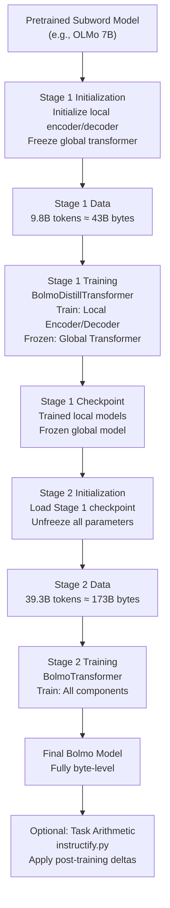
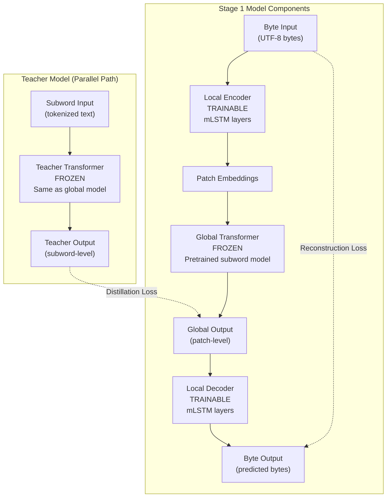
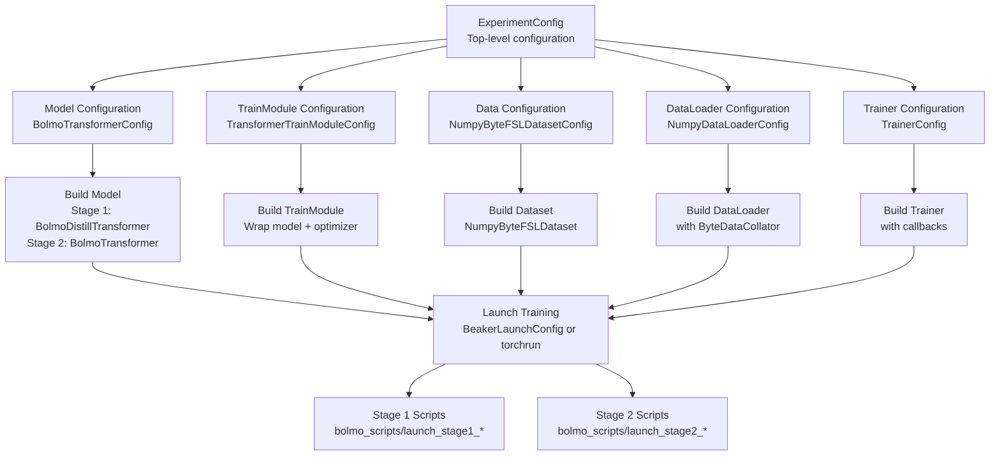

<!-- source: DeepWiki mcp.deepwiki.com · repo allenai/bolmo-core · page 10.2 Byteifying Process · fetched 2026-10-26 -->

# Byteifying Process

<details>
<summary>Relevant source files</summary>

The following files were used as context for generating this wiki page:

- [README.md](README.md)
- [docs/source/index.rst](docs/source/index.rst)
- [docs/source/overview/installation.rst](docs/source/overview/installation.rst)
- [docs/source/overview/introduction.rst](docs/source/overview/introduction.rst)

</details>


## Purpose and Scope

This document describes the two-stage **byteifying** training procedure used to convert existing subword-level language models (like OLMo) into byte-level Bolmo models. Byteifying enables competitive byte-level language models to be created using less than 1% of the original pretraining budget.

For details on the Bolmo architecture itself, see [Bolmo Architecture](#10.1). For applying post-training adaptations to byteified models without additional training, see [Task Arithmetic for Post-Training](#10.3).

**Sources:** [README.md:1-165]()

---

## Overview of Byteifying

Byteifying is a two-stage training procedure that transforms a pretrained subword-level transformer model into a byte-level model by adding and training byte-level local encoder/decoder components while leveraging the knowledge already learned by the global transformer.

The process consists of:

1. **Stage 1 (Subword-to-Byte Distillation)**: Train only the local encoder and decoder while keeping the global transformer frozen. This stage learns to map between byte sequences and the subword-level representations the global model expects.

2. **Stage 2 (End-to-End Training)**: Unfreeze the entire model and train end-to-end, allowing the global transformer to adapt to byte-level inputs and the local models to refine their mappings.

### Byteifying Training Flow



**Sources:** [README.md:105-123]()

---

## Stage 1: Subword-to-Byte Distillation

### Purpose and Architecture

Stage 1 focuses on learning the byte-to-patch mapping through distillation. The `BolmoDistillTransformer` model architecture is used, which combines:

- **Frozen Global Transformer**: The pretrained subword model remains completely frozen
- **Trainable Local Encoder**: Learns to encode byte sequences into patch embeddings
- **Trainable Local Decoder**: Learns to decode patch representations back into byte sequences
- **Teacher Model**: The original subword model provides target representations for distillation

### Stage 1 Training Components



**Sources:** [README.md:107-108]()

### Training Configuration

Stage 1 training uses the following characteristics:

| Parameter | Value | Description |
|-----------|-------|-------------|
| **Training Duration** | 9.8B tokens | Approximately 43B bytes processed |
| **Frozen Components** | Global Transformer | All transformer blocks remain frozen |
| **Trainable Components** | Local Encoder, Local Decoder | Only byte-level components are trained |
| **Model Class** | `BolmoDistillTransformer` | Specialized distillation variant |
| **Loss Functions** | Distillation + Reconstruction | Matches teacher outputs and reconstructs bytes |

### Stage 1 Launch Scripts

Training scripts for Stage 1 are located in the repository at:
- `bolmo_scripts/launch_stage1_*` - Launch configurations for different model sizes

These scripts configure:
- Model architecture with frozen global transformer
- Smaller learning rates appropriate for distillation
- Data loading for byte-level sequences
- Checkpoint saving for Stage 1 outputs

**Sources:** [README.md:107-108]()

---

## Stage 2: End-to-End Training

### Purpose and Architecture

Stage 2 unfreezes all model parameters and trains the complete Bolmo model end-to-end. This allows:

- The global transformer to adapt its representations to byte-level inputs
- The local encoder/decoder to refine their byte-patch mappings
- The entire model to learn cohesive byte-level language modeling

The `BolmoTransformer` model architecture is used (without the separate teacher model).

### Stage 2 Training Flow

```mermaid
flowchart LR
    Stage1CP["Stage 1 Checkpoint<br/>Trained local models<br/>Frozen global model"]
    
    Stage1CP --> LoadModel["Load Model<br/>BolmoTransformer.from_checkpoint()"]
    
    LoadModel --> UnfreezeAll["Unfreeze All Parameters<br/>requires_grad=True for all"]
    
    UnfreezeAll --> BuildTrainModule["Build TrainModule<br/>TransformerTrainModule<br/>with optimizer & scheduler"]
    
    BuildTrainModule --> BuildDataLoader["Build DataLoader<br/>NumpyByteFSLDataset<br/>ByteDataCollator"]
    
    BuildDataLoader --> BuildTrainer["Build Trainer<br/>with callbacks"]
    
    BuildTrainer --> Stage2Training["Stage 2 Training Loop<br/>39.3B tokens ≈ 173B bytes<br/>Full model optimization"]
    
    Stage2Training --> FinalCheckpoint["Final Bolmo Checkpoint<br/>Fully trained byte-level model"]
```



**Sources:** [README.md:110-111]()

### Training Configuration

Stage 2 training uses the following characteristics:

| Parameter | Value | Description |
|-----------|-------|-------------|
| **Training Duration** | 39.3B tokens | Approximately 173B bytes processed |
| **Frozen Components** | None | All parameters are trainable |
| **Model Class** | `BolmoTransformer` | Standard Bolmo without distillation |
| **Loss Function** | Cross-entropy | Standard language modeling loss |
| **Learning Rate** | Standard LM rates | Higher than Stage 1 distillation |

### Stage 2 Launch Scripts

Training scripts for Stage 2 are located at:
- `bolmo_scripts/launch_stage2_*` - Launch configurations for different model sizes

These scripts configure:
- Full model training with all parameters unfrozen
- Standard language modeling objectives
- Larger training budgets (4x Stage 1)
- Checkpoint continuation from Stage 1

**Sources:** [README.md:110-111]()

---

## Training Data Requirements

### Data Format

Byteifying training requires data in the following formats:

**For Stage 1 (Distillation):**
- **Byte sequences**: Raw UTF-8 encoded text stored as numpy arrays
- **Subword sequences**: Parallel tokenized sequences for teacher model
- Both sequences represent the same underlying text

**For Stage 2 (End-to-End):**
- **Byte sequences only**: Raw UTF-8 encoded text stored as numpy arrays
- No parallel subword sequences needed

### Dataset Classes

Bolmo training uses specialized dataset implementations:

- `NumpyByteFSLDataset` - Fixed sequence length byte-level dataset
- `ByteDataCollator` - Collates byte sequences into batches with proper padding

### Token Budget Breakdown

| Stage | Token Count | Byte Count | Percentage of Pretraining |
|-------|-------------|------------|---------------------------|
| **Stage 1** | 9.8B tokens | ~43B bytes | ~0.2% |
| **Stage 2** | 39.3B tokens | ~173B bytes | ~0.8% |
| **Total** | 49.1B tokens | ~216B bytes | **~1.0%** |

For reference, the base OLMo models are typically trained on 3-5 trillion tokens, making byteifying extremely efficient.

### Data Source

Training data for Bolmo is available on HuggingFace:
- Dataset: `allenai/bolmo_mix`
- Contains pre-processed byte sequences ready for training

**Sources:** [README.md:45]()

---

## Launch and Configuration Example

### Configuration Flow



### Stage-Specific Configuration

**Stage 1 Key Differences:**
- Use `BolmoDistillTransformer` model class
- Freeze global transformer parameters explicitly
- Configure distillation loss alongside reconstruction loss
- Set lower learning rates for local model training
- Provide both byte and subword data paths

**Stage 2 Key Differences:**
- Use `BolmoTransformer` model class
- All parameters have `requires_grad=True`
- Standard cross-entropy loss only
- Standard learning rates for full model training
- Load checkpoint from Stage 1 for initialization

**Sources:** [README.md:107-111]()

---

## Checkpoint Management

### Stage 1 to Stage 2 Transition

The transition between stages involves:

1. **Save Stage 1 Checkpoint**: After Stage 1 training completes, save a checkpoint containing the trained local encoder/decoder and frozen global transformer

2. **Load into Stage 2**: Initialize Stage 2 training by loading the Stage 1 checkpoint:
   - Local encoder/decoder weights are loaded from Stage 1
   - Global transformer weights are loaded (but will now be trainable)
   - Optimizer state is reset for new training phase

3. **Continue Training**: Stage 2 training continues from the Stage 1 checkpoint with all parameters unfrozen

### Checkpoint Conversion

Final Bolmo checkpoints can be converted between formats:

**OLMo-core to HuggingFace:**
```bash
python3 src/examples/huggingface/convert_checkpoint_to_hf.py \
    -i /path/to/bolmo/checkpoint \
    -o /path/to/bolmo/checkpoint/in/hf/format \
    -s 65536 \
    --dtype float32 \
    --skip-validation
```

The conversion script is located at: `src/examples/huggingface/convert_checkpoint_to_hf.py`

**Sources:** [README.md:88-101]()

---

## Summary Table

| Aspect | Stage 1 | Stage 2 |
|--------|---------|---------|
| **Model Class** | `BolmoDistillTransformer` | `BolmoTransformer` |
| **Trainable Components** | Local Encoder, Local Decoder | All components |
| **Frozen Components** | Global Transformer | None |
| **Loss Function** | Distillation + Reconstruction | Cross-entropy |
| **Training Data** | 9.8B tokens (~43B bytes) | 39.3B tokens (~173B bytes) |
| **Teacher Model** | Required | Not used |
| **Learning Rate** | Lower (distillation) | Standard (full training) |
| **Launch Scripts** | `bolmo_scripts/launch_stage1_*` | `bolmo_scripts/launch_stage2_*` |
| **Purpose** | Learn byte-patch mapping | Adapt entire model to bytes |

**Sources:** [README.md:105-111]()

---

