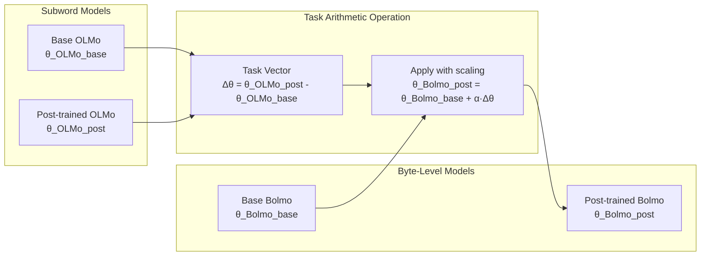
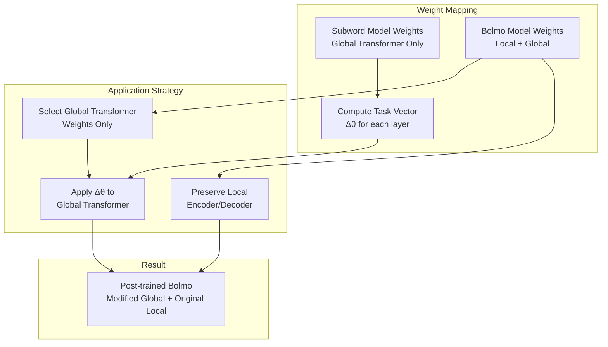
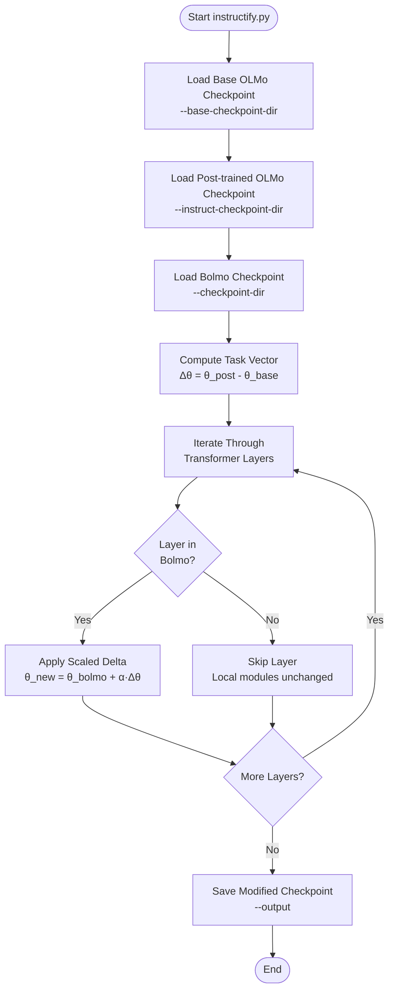
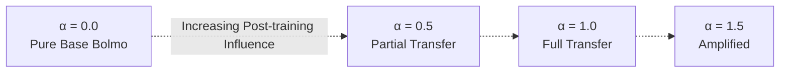
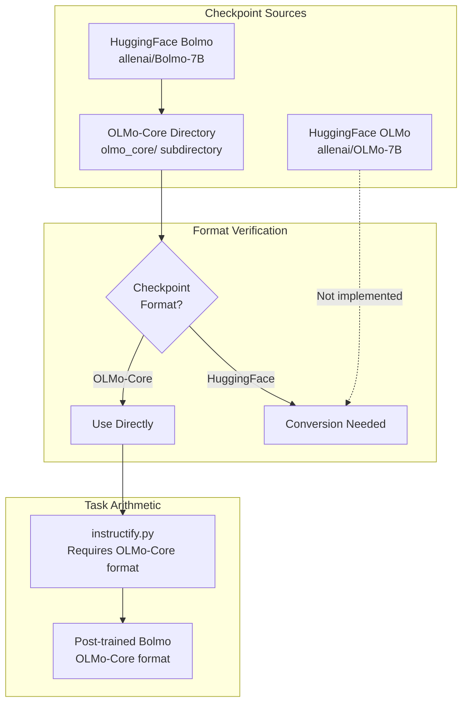

<!-- source: DeepWiki mcp.deepwiki.com · repo allenai/bolmo-core · page 10.3 Task Arithmetic for Post-Training · fetched 2026-10-26 -->

# Task Arithmetic for Post-Training

<details>
<summary>Relevant source files</summary>

The following files were used as context for generating this wiki page:

- [README.md](README.md)
- [docs/source/index.rst](docs/source/index.rst)
- [docs/source/overview/installation.rst](docs/source/overview/installation.rst)
- [docs/source/overview/introduction.rst](docs/source/overview/introduction.rst)

</details>


## Purpose and Scope

This page documents the task arithmetic approach for transferring post-training adaptations (such as instruction tuning, safety tuning, or domain adaptation) from subword-based models to Bolmo byte-level models without requiring additional training. This technique enables rapid creation of post-trained Bolmo variants by combining model weights through linear interpolation.

For information about the underlying Bolmo architecture, see [Bolmo Architecture](#10.1). For details about the initial byteifying training procedure, see [Byteifying Process](#10.2).

Sources: [README.md:113-123]()

## Overview of Task Arithmetic

Task arithmetic is a model weight manipulation technique that transfers capabilities from one model to another by computing and applying "task vectors". A task vector represents the difference between a base model and a post-trained variant, capturing the learned adaptations.

### Mathematical Formulation

The basic task arithmetic operation for transferring post-training adaptations to Bolmo follows this formula:

```
θ_Bolmo_post = θ_Bolmo_base + α * (θ_OLMo_post - θ_OLMo_base)
```

Where:
- `θ_Bolmo_post` = resulting post-trained Bolmo model weights
- `θ_Bolmo_base` = base Bolmo model weights (after byteifying)
- `θ_OLMo_post` = post-trained subword model weights (e.g., instruction-tuned)
- `θ_OLMo_base` = original base subword model weights
- `α` = scaling factor (typically 1.0)

The task vector `(θ_OLMo_post - θ_OLMo_base)` captures the adaptations learned during post-training and is added to the byte-level model weights.



**Diagram: Task Arithmetic for Bolmo Post-Training**

Sources: [README.md:113-123]()

## Why Task Arithmetic Works for Bolmo

Task arithmetic is particularly effective for Bolmo because:

1. **Shared Global Transformer**: The global transformer in Bolmo maintains structural similarity with the original subword model, allowing weight deltas to transfer meaningfully.

2. **Preserved Parameter Space**: Post-training typically modifies the transformer weights (attention and feed-forward layers), which have direct correspondences between subword and byte-level models.

3. **Local Models Remain Unchanged**: The local encoder and decoder modules, which handle byte-to-patch conversion, are not affected by the task vector since they don't exist in the subword model. Only the global transformer weights are modified.

4. **Efficient Alternative to Training**: Avoids the computational cost of repeating post-training procedures with byte-level data.



**Diagram: Weight Application Strategy for Bolmo**

Sources: [README.md:113-123]()

## Implementation: The instructify.py Script

The task arithmetic procedure is implemented in the `instructify.py` script, which performs the weight interpolation and saves the resulting checkpoint.

### Script Location and Usage

```bash
python3 src/examples/bolmo/instructify.py \
    --output=/path/to/output/ \
    --checkpoint-dir=/path/to/bolmo/checkpoint \
    --base-checkpoint-dir=/path/to/base-olmo/checkpoint \
    --instruct-checkpoint-dir=/path/to/post-trained-olmo/checkpoint \
    --alpha=1.0
```

### Process Flow



**Diagram: instructify.py Execution Flow**

Sources: [README.md:116-123]()

### Required Checkpoints

The script requires three checkpoint directories:

| Parameter | Description | Format |
|-----------|-------------|--------|
| `--checkpoint-dir` | Base Bolmo checkpoint (result of Stage 2 training) | OLMo-core checkpoint format |
| `--base-checkpoint-dir` | Original base subword model checkpoint | OLMo-core checkpoint format |
| `--instruct-checkpoint-dir` | Post-trained subword model checkpoint | OLMo-core checkpoint format |
| `--output` | Output directory for resulting Bolmo checkpoint | OLMo-core checkpoint format |

All checkpoints must be in the OLMo-core format, not HuggingFace format. For checkpoint format details, see [Checkpointing](#5.3).

Sources: [README.md:116-123]()

### Parameters

| Parameter | Type | Default | Description |
|-----------|------|---------|-------------|
| `--alpha` | float | 1.0 | Scaling factor for task vector. Values < 1.0 reduce the strength of post-training adaptations |
| `--output` | str | Required | Output directory path for the resulting checkpoint |
| `--checkpoint-dir` | str | Required | Path to base Bolmo checkpoint |
| `--base-checkpoint-dir` | str | Required | Path to base subword model checkpoint |
| `--instruct-checkpoint-dir` | str | Required | Path to post-trained subword model checkpoint |

### Alpha Scaling Parameter

The `alpha` parameter controls the strength of the transferred adaptations:

- **α = 1.0**: Full transfer of post-training adaptations (standard)
- **α < 1.0**: Partial transfer, preserving more of the base Bolmo behavior
- **α > 1.0**: Amplified transfer (may cause instability)



**Diagram: Effect of Alpha Parameter**

Sources: [README.md:122]()

## Use Cases

### Instruction Tuning Transfer

The most common use case: transferring instruction-following capabilities to Bolmo.

```bash
# Transfer instruction tuning from OLMo-Instruct to Bolmo
python3 src/examples/bolmo/instructify.py \
    --output=/models/bolmo-7b-instruct \
    --checkpoint-dir=/models/bolmo-7b-base \
    --base-checkpoint-dir=/models/olmo-7b-base \
    --instruct-checkpoint-dir=/models/olmo-7b-instruct \
    --alpha=1.0
```

### Safety Tuning Transfer

Transferring safety alignments and refusal behaviors:

```bash
# Transfer safety tuning to Bolmo
python3 src/examples/bolmo/instructify.py \
    --output=/models/bolmo-7b-safe \
    --checkpoint-dir=/models/bolmo-7b-base \
    --base-checkpoint-dir=/models/olmo-7b-base \
    --instruct-checkpoint-dir=/models/olmo-7b-safe \
    --alpha=1.0
```

### Domain Adaptation Transfer

Transferring domain-specific fine-tuning (e.g., medical, legal, code):

```bash
# Transfer code-specific adaptations
python3 src/examples/bolmo/instructify.py \
    --output=/models/bolmo-7b-code \
    --checkpoint-dir=/models/bolmo-7b-base \
    --base-checkpoint-dir=/models/olmo-7b-base \
    --instruct-checkpoint-dir=/models/olmo-7b-code \
    --alpha=1.0
```

Sources: [README.md:113-123]()

## Checkpoint Format Considerations

### OLMo-Core vs HuggingFace Checkpoints

The `instructify.py` script requires all checkpoints to be in the OLMo-core format. HuggingFace format checkpoints must be converted first.



**Diagram: Checkpoint Format Requirements**

For Bolmo models on HuggingFace, the original OLMo-core checkpoints are available in the `olmo_core/` subdirectory:
- [Bolmo-1B OLMo-core checkpoint](https://huggingface.co/allenai/Bolmo-1B/tree/main/olmo_core)
- [Bolmo-7B OLMo-core checkpoint](https://huggingface.co/allenai/Bolmo-7B/tree/main/olmo_core)

Sources: [README.md:88-101]()

### Distributed Checkpoint Handling

If working with distributed (sharded) checkpoints from FSDP or tensor parallel training, the `instructify.py` script handles unsharding automatically. The script:

1. Loads each checkpoint using the distributed checkpoint utilities
2. Unshards weights to full tensors on a single device
3. Performs task arithmetic on unsharded weights
4. Saves the result as a standard checkpoint

For details on distributed checkpointing, see [Checkpointing](#5.3).

Sources: [README.md:116-123]()

## Limitations and Considerations

### Scope of Transferred Capabilities

Task arithmetic transfers adaptations learned in the **global transformer** only. Capabilities that depend on tokenizer-specific behaviors or subword-level patterns may not transfer perfectly:

| Transferable | Limited Transfer |
|--------------|------------------|
| Instruction following templates | Tokenizer-specific formatting |
| Task-specific reasoning patterns | Vocabulary-dependent shortcuts |
| Safety refusal behaviors | Token-level alignment techniques |
| General language patterns | Character-level adversarial robustness |

### Performance Expectations

Task arithmetic provides a **fast approximation** of post-training but may not match the performance of native post-training on byte-level data:

- Typical performance: 90-95% of native post-training quality
- Advantages: Zero additional training cost, instant application
- Trade-off: Slightly lower alignment quality compared to full post-training

For production deployments requiring highest quality, consider native post-training on byte-level data after initial task arithmetic transfer.

### Model Size Compatibility

The base and post-trained subword models must have **identical architectures**:
- Same number of layers
- Same hidden dimension
- Same attention configuration
- Same feed-forward dimension

Models with different architectures cannot be combined using task arithmetic.

Sources: [README.md:113-123]()

## Verification and Validation

After applying task arithmetic, validate the resulting model:

### Quick Validation

```python
from transformers import AutoModelForCausalLM, AutoTokenizer

# Load the post-trained Bolmo model
device = "cuda"
model = AutoModelForCausalLM.from_pretrained(
    "/path/to/output/hf_format",
    trust_remote_code=True
).to(device)
tokenizer = AutoTokenizer.from_pretrained(
    "/path/to/output/hf_format",
    trust_remote_code=True
)

# Test instruction following
message = ["Explain quantum computing in simple terms."]
input_ids = tokenizer(message, return_tensors="pt")["input_ids"].to(device)
response = model.generate(input_ids, max_new_tokens=256, temperature=0.7)
print(tokenizer.decode(response[0], skip_special_tokens=True))
```

### Comprehensive Evaluation

For thorough validation, run standard post-training evaluation benchmarks:
- Instruction following (e.g., AlpacaEval, MT-Bench)
- Safety evaluations (e.g., ToxiGen, BBQ)
- Task-specific metrics relevant to the post-training objective

Sources: [README.md:73-86]()

## Summary

Task arithmetic provides an efficient method to transfer post-training adaptations to Bolmo byte-level models without additional training:

1. **Compute task vector**: `Δθ = θ_post - θ_base` from subword models
2. **Apply to Bolmo**: `θ_Bolmo_post = θ_Bolmo_base + α·Δθ`
3. **Implementation**: Use `instructify.py` script with three checkpoints
4. **Result**: Post-trained Bolmo model with transferred capabilities

This approach enables rapid creation of instruction-tuned, safety-aligned, or domain-adapted Bolmo variants at minimal computational cost.

Sources: [README.md:113-123]()

---

