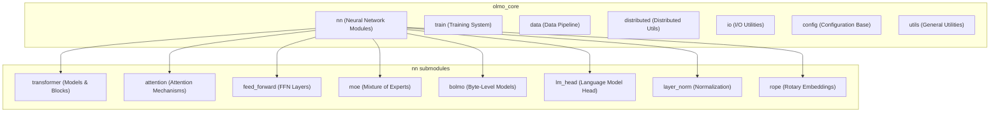
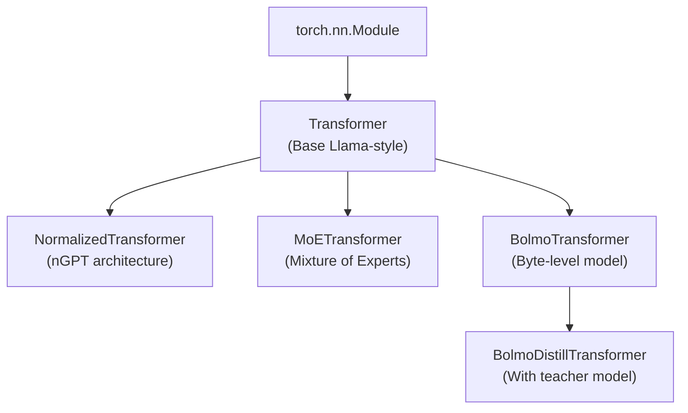
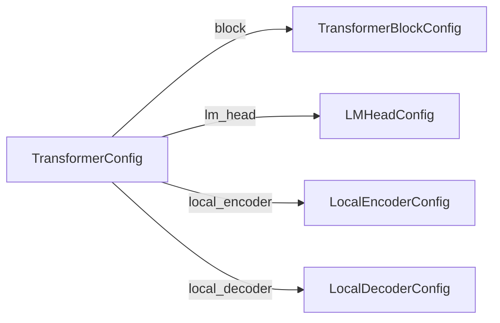
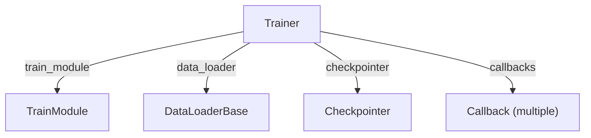
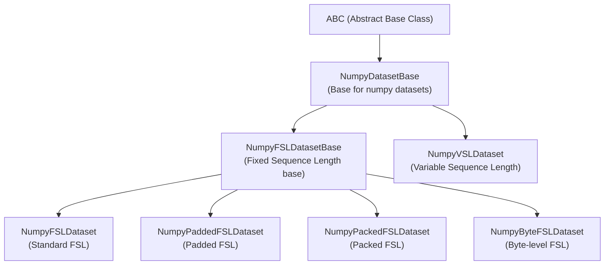
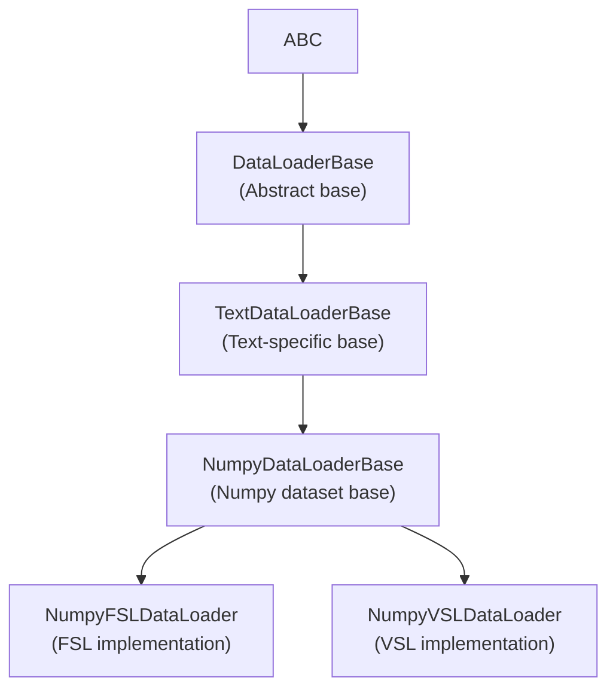

<!-- source: DeepWiki mcp.deepwiki.com · repo allenai/bolmo-core · page 11 API Reference · fetched 2026-10-26 -->

# API Reference

<details>
<summary>Relevant source files</summary>

The following files were used as context for generating this wiki page:

- [CHANGELOG.md](CHANGELOG.md)
- [src/olmo_core/data/__init__.py](src/olmo_core/data/__init__.py)
- [src/olmo_core/data/collator.py](src/olmo_core/data/collator.py)
- [src/olmo_core/data/data_loader.py](src/olmo_core/data/data_loader.py)
- [src/olmo_core/data/numpy_dataset.py](src/olmo_core/data/numpy_dataset.py)
- [src/olmo_core/data/tokenizer.py](src/olmo_core/data/tokenizer.py)
- [src/olmo_core/nn/transformer/config.py](src/olmo_core/nn/transformer/config.py)
- [src/olmo_core/nn/transformer/model.py](src/olmo_core/nn/transformer/model.py)
- [src/olmo_core/train/__init__.py](src/olmo_core/train/__init__.py)
- [src/olmo_core/train/common.py](src/olmo_core/train/common.py)
- [src/olmo_core/train/config.py](src/olmo_core/train/config.py)
- [src/olmo_core/train/trainer.py](src/olmo_core/train/trainer.py)
- [src/olmo_core/version.py](src/olmo_core/version.py)
- [src/test/data/data_loader_test.py](src/test/data/data_loader_test.py)

</details>


This page provides comprehensive API documentation for OLMo-Core and Bolmo, organized by module with links to source code. The API is designed around a modular architecture where configuration classes (inheriting from `Config`) can be used to build their corresponding runtime objects.

For conceptual overviews of each system, see:
- Model architecture details: [Model Architecture](#2)
- Training system usage: [Training System](#3)
- Data pipeline setup: [Data Pipeline](#4)
- Distributed training concepts: [Distributed Training](#5)
- Inference usage: [Inference and Generation](#6)

---

## Core Package Structure

The OLMo-Core package is organized into the following major modules:



**Sources:** [src/olmo_core/data/__init__.py:1-98](), [src/olmo_core/train/__init__.py:1-157]()

---

## Version Information

**Current Version:** `2.3.0`

The version is defined in [src/olmo_core/version.py:1-17]() and follows semantic versioning.

```python
# Access version programmatically
from olmo_core.version import VERSION, VERSION_SHORT
```

**Sources:** [src/olmo_core/version.py:1-17](), [CHANGELOG.md:1-563]()

---

## Model Architecture API

### Transformer Models

The core transformer model classes implement the forward pass and parameter initialization logic.

#### Model Class Hierarchy



**Sources:** [src/olmo_core/nn/transformer/model.py:82-1431]()

| Class | Location | Description |
|-------|----------|-------------|
| `Transformer` | [model.py:82-814]() | Base transformer implementation with standard architecture |
| `NormalizedTransformer` | [model.py:817-1005]() | nGPT architecture with normalized hidden states |
| `MoETransformer` | [model.py:1008-1090]() | Transformer with mixture-of-experts layers |
| `BolmoTransformer` | [model.py:1093-1357]() | Byte-level model with local encoder/decoder |
| `BolmoDistillTransformer` | [model.py:1360-1431]() | Bolmo with teacher model for distillation |

#### Key Transformer Methods

| Method | Parameters | Returns | Description |
|--------|------------|---------|-------------|
| `__init__` | `d_model`, `vocab_size`, `n_layers`, `block`, `lm_head`, ... | - | Initialize model parameters |
| `forward` | `input_ids`, `labels=None`, `ignore_index=-100`, ... | `Tensor` or `LMOutputWithLoss` | Forward pass through model |
| `init_weights` | `max_seq_len=None`, `device=None`, ... | `Generator` | Initialize all model weights |
| `apply_tp` | `tp_mesh`, `float8_enabled=None` | - | Apply tensor parallelism |
| `apply_cp` | `cp_mesh`, `load_balancer`, ... | - | Apply context parallelism |
| `apply_fsdp` | `dp_mesh=None`, `param_dtype=None`, ... | - | Apply FSDP (Fully Sharded Data Parallel) |
| `apply_compile` | - | - | Apply `torch.compile()` to blocks |

**Sources:** [src/olmo_core/nn/transformer/model.py:82-814]()

#### Transformer Properties

```python
# Important read-only properties
model.device          # torch.device: Current device
model.pp_enabled      # bool: Pipeline parallelism enabled
model.tp_enabled      # bool: Tensor parallelism enabled
model.fsdp_enabled    # bool: FSDP enabled
model.fp8_enabled     # bool: Float8 training enabled
model.is_moe          # bool: Whether model uses MoE
model.num_params      # int: Total parameter count
model.num_non_embedding_params  # int: Non-embedding params
```

**Sources:** [src/olmo_core/nn/transformer/model.py:174-203]()

### Transformer Configuration

#### TransformerConfig

The main configuration class for building transformer models.



**Sources:** [src/olmo_core/nn/transformer/config.py:303-546]()

| Field | Type | Description |
|-------|------|-------------|
| `d_model` | `int` | Model dimensionality |
| `vocab_size` | `int` | Vocabulary size |
| `n_layers` | `int` | Number of transformer layers |
| `block` | `TransformerBlockConfig` | Block configuration |
| `lm_head` | `LMHeadConfig` | Language model head config |
| `name` | `TransformerType` | Model variant (`default`, `normalized`, `moe`, `bolmo`) |
| `dtype` | `DType` | Parameter data type |
| `init_method` | `InitMethod` | Weight initialization method |
| `init_std` | `float` | Initialization standard deviation |
| `block_overrides` | `Dict[int, TransformerBlockConfig]` | Per-layer block configs |

**Key Methods:**
- `build(init_device="cpu") -> Transformer`: Construct the model
- `num_params: int`: Calculate total parameters
- `num_active_params: int`: Calculate active parameters (for MoE)
- `num_flops_per_token(seq_len) -> int`: Estimate FLOPs per token

**Sources:** [src/olmo_core/nn/transformer/config.py:303-546]()

#### TransformerBlockConfig

Configuration for individual transformer blocks.

| Field | Type | Description |
|-------|------|-------------|
| `attention` | `AttentionConfig` | Attention mechanism config |
| `layer_norm` | `LayerNormConfig` | Layer normalization config |
| `feed_forward` | `FeedForwardConfig` | Dense FFN config (optional) |
| `feed_forward_moe` | `MoEConfig` | Sparse MoE FFN config (optional) |
| `name` | `TransformerBlockType` | Block variant |
| `dropout` | `float` | Dropout probability |

**Sources:** [src/olmo_core/nn/transformer/config.py:168-301]()

#### Type Enumerations

```python
# Model variants
class TransformerType(StrEnum):
    default = "default"         # Standard Transformer
    normalized = "normalized"   # NormalizedTransformer (nGPT)
    moe = "moe"                # MoETransformer
    bolmo = "bolmo"            # BolmoTransformer
    bolmo_distill = "bolmo_distill"  # BolmoDistillTransformer

# Block variants
class TransformerBlockType(StrEnum):
    default = "default"              # TransformerBlock
    reordered_norm = "reordered_norm"  # ReorderedNormTransformerBlock
    normalized = "normalized"        # NormalizedTransformerBlock
    moe = "moe"                     # MoETransformerBlock
    moe_hybrid = "moe_hybrid"       # MoEHybridTransformerBlock
    mamba = "mamba"                 # MambaBlock
    xlstm = "xlstm"                 # XLSTMBlock
    fla = "fla"                     # FLABlock

# Parallelism wrapping strategies
class TransformerDataParallelWrappingStrategy(StrEnum):
    full = "full"              # Wrap each block and LM head
    blocks = "blocks"          # Wrap blocks only
    fine_grained = "fine_grained"  # Wrap submodules within blocks

# Activation checkpointing modes
class TransformerActivationCheckpointingMode(StrEnum):
    full = "full"              # Checkpoint every block
    selected_blocks = "selected_blocks"  # Checkpoint selected blocks
    selected_modules = "selected_modules"  # Checkpoint selected modules
    selected_ops = "selected_ops"  # Checkpoint specific operations
    budget = "budget"          # Budget-based checkpointing
```

**Sources:** [src/olmo_core/nn/transformer/config.py:37-161]()

---

## Training System API

### Trainer

The main training loop coordinator.

#### Trainer Class



**Sources:** [src/olmo_core/train/trainer.py:89-1330]()

| Field | Type | Description |
|-------|------|-------------|
| `train_module` | `TrainModule` | Model + optimizer wrapper |
| `data_loader` | `DataLoaderBase` | Training data loader |
| `device` | `torch.device` | Default training device |
| `save_folder` | `str` | Checkpoint save location |
| `checkpointer` | `Checkpointer` | Checkpoint manager |
| `callbacks` | `Dict[str, Callback]` | Training callbacks |
| `max_duration` | `Duration` | Maximum training duration |
| `global_step` | `int` | Current training step (1-based) |
| `epoch` | `int` | Current epoch (1-based) |

#### Key Trainer Methods

| Method | Parameters | Returns | Description |
|--------|------------|---------|-------------|
| `fit()` | - | - | Run the training loop |
| `record_metric()` | `name: str`, `value: Tensor`, `reduce_type: ReduceType`, ... | - | Log a training metric |
| `save_checkpoint()` | `checkpoint_type: str` | - | Save checkpoint synchronously |
| `save_checkpoint_async()` | `checkpoint_type: str` | `Future` | Save checkpoint asynchronously |
| `load_checkpoint()` | `path: PathOrStr`, `load_optimizer_state: bool`, ... | - | Load a checkpoint |
| `cancel_run()` | `reason: str`, `no_sync: bool` | - | Cancel the training run |
| `add_callback()` | `name: str`, `callback: Callback` | - | Add a callback |

**Sources:** [src/olmo_core/train/trainer.py:628-1330]()

#### Trainer Properties

```python
# Batch size properties
trainer.global_batch_size    # int: Total batch size in tokens
trainer.rank_batch_size      # int: Batch size per rank
trainer.tokens_per_batch     # int: Tokens per batch (same as global_batch_size)

# Step/epoch properties
trainer.steps_per_epoch      # Optional[int]: Steps per epoch if known
trainer.max_steps            # int: Maximum training steps
trainer.max_tokens           # int: Maximum training tokens
trainer.training_complete    # bool: Whether training is complete
trainer.is_canceled          # bool: Whether run was canceled

# State properties
trainer.checkpoint_loaded    # bool: Whether checkpoint was loaded
trainer.training_progress    # TrainingProgress: Current progress info
```

**Sources:** [src/olmo_core/train/trainer.py:381-598]()

### TrainerConfig

Configuration for building the `Trainer`.

| Field | Type | Description |
|-------|------|-------------|
| `save_folder` | `str` | Checkpoint save directory (local or URL) |
| `work_dir` | `Optional[str]` | Local working directory |
| `load_path` | `Optional[str]` | Alternative checkpoint load path |
| `load_strategy` | `LoadStrategy` | Checkpoint loading strategy |
| `max_duration` | `Duration` | Training duration |
| `checkpointer` | `CheckpointerConfig` | Checkpointer configuration |
| `callbacks` | `Dict[str, Callback]` | Training callbacks |
| `metrics_collect_interval` | `int` | Metric collection frequency |
| `no_checkpoints` | `bool` | Disable checkpointing (for benchmarking) |
| `no_evals` | `bool` | Disable evaluations (for benchmarking) |

**Key Methods:**
- `build(train_module, data_loader, ...) -> Trainer`: Build trainer instance
- `with_callback(name, callback) -> TrainerConfig`: Add callback, return new config
- `with_recommended_evals(...) -> TrainerConfig`: Add evaluation callbacks

**Sources:** [src/olmo_core/train/config.py:26-202]()

### Training Common Types

#### Duration

Represents a training duration in steps, epochs, or tokens.

```python
# Create duration instances
Duration.steps(1000)              # 1000 training steps
Duration.epochs(3)                # 3 epochs
Duration.tokens(1_000_000_000)    # 1B tokens
Duration.chinchilla_tokens(1.0, model_params=1_000_000_000)  # Chinchilla optimal
```

| Method | Parameters | Returns | Description |
|--------|------------|---------|-------------|
| `steps(steps)` | `steps: int` | `Duration` | Create from steps |
| `epochs(epochs)` | `epochs: int` | `Duration` | Create from epochs |
| `tokens(tokens)` | `tokens: int` | `Duration` | Create from tokens |
| `chinchilla_tokens(multiple, model_params)` | `multiple: float`, `model_params: int` | `Duration` | Chinchilla-optimal tokens |
| `due(step, tokens, epoch)` | `step: int`, `tokens: int`, `epoch: int` | `bool` | Check if duration elapsed |

**Sources:** [src/olmo_core/train/common.py:35-105]()

#### LoadStrategy

Enumeration for checkpoint loading behavior.

```python
class LoadStrategy(StrEnum):
    if_available = "if_available"  # Load if exists, else train from scratch
    always = "always"              # Load or raise error
    never = "never"                # Never load
```

**Sources:** [src/olmo_core/train/common.py:107-128]()

#### ReduceType

Defines how metrics are reduced across distributed ranks.

```python
class ReduceType(StrEnum):
    mean = "mean"        # Average across ranks
    sum = "sum"          # Sum across ranks
    max = "max"          # Maximum across ranks
    l2_norm = "l2_norm"  # L2 norm reduction
```

**Sources:** [src/olmo_core/train/common.py:130-155]()

#### StepSkipRange

Defines a range of training steps to skip.

```python
@dataclass
class StepSkipRange:
    start: int  # First step to skip (1-based)
    stop: int   # Endpoint (exclusive)
```

**Sources:** [src/olmo_core/train/common.py:242-249]()

### Training Environment Functions

| Function | Parameters | Description |
|----------|------------|-------------|
| `prepare_training_environment()` | `seed=None`, `backend="cpu:gloo,cuda:nccl"`, ... | Initialize distributed training environment |
| `teardown_training_environment()` | - | Cleanup after training |

**Sources:** [src/olmo_core/train/__init__.py:85-157]()

---

## Data Pipeline API

### Datasets

#### Dataset Class Hierarchy



**Sources:** [src/olmo_core/data/numpy_dataset.py:104-1353]()

#### NumpyDatasetBase

Base class for numpy array-backed token ID datasets.

| Property/Method | Type | Description |
|-----------------|------|-------------|
| `paths` | `Tuple[PathOrStr, ...]` | Paths to numpy arrays |
| `pad_token_id` | `int` | Padding token ID |
| `eos_token_id` | `int` | End-of-sentence token ID |
| `vocab_size` | `int` | Vocabulary size |
| `dtype` | `NumpyUIntTypes` | Numpy data type |
| `max_sequence_length` | `int` | Maximum sequence length |
| `fingerprint` | `str` | Dataset content hash |
| `work_dir` | `Path` | Working directory |
| `prepare()` | - | Prepare dataset (preprocessing) |
| `__len__()` | `int` | Number of instances |
| `__getitem__(index)` | `Dict[str, Any]` | Get instance by index |

**Sources:** [src/olmo_core/data/numpy_dataset.py:104-362]()

#### NumpyFSLDataset

Fixed sequence length dataset that chunks tokens into contiguous blocks.

```python
dataset = NumpyFSLDataset(
    "path/to/tokens.npy",
    sequence_length=2048,
    pad_token_id=0,
    eos_token_id=1,
    vocab_size=50000,
    max_target_sequence_length=4096  # For sequence length warmup
)
```

| Field | Type | Description |
|-------|------|-------------|
| `sequence_length` | `int` | Tokens per instance |
| `max_target_sequence_length` | `Optional[int]` | Upper bound for warmup |
| `label_mask_paths` | `Optional[List[PathOrStr]]` | Label mask files |

**Sources:** [src/olmo_core/data/numpy_dataset.py:449-687]()

#### NumpyVSLDataset

Variable sequence length dataset for curriculum learning.

| Field | Type | Description |
|-------|------|-------------|
| `min_sequence_length` | `int` | Minimum sequence length |
| `max_sequence_length` | `int` | Maximum sequence length |
| `curriculum` | `VSLCurriculum` | VSL curriculum strategy |

**VSL Curriculum Types:**
- `VSLNaturalCurriculum`: Natural document distribution
- `VSLGrowthCurriculum`: Progressive growth
- `VSLGrowP2Curriculum`: Power-of-2 growth
- `VSLGrowLinearCurriculum`: Linear growth

**Sources:** [src/olmo_core/data/numpy_dataset.py:1283-1353]()

### Data Loaders

#### Data Loader Class Hierarchy



**Sources:** [src/olmo_core/data/data_loader.py:52-770]()

#### DataLoaderBase

Abstract base class for all data loaders.

| Property/Method | Type | Description |
|-----------------|------|-------------|
| `global_batch_size` | `int` | Total batch size across all ranks |
| `rank_batch_size` | `int` | Batch size per rank |
| `total_batches` | `Optional[int]` | Total batches per epoch |
| `epoch` | `int` | Current epoch (1-based) |
| `batches_processed` | `int` | Batches processed in current epoch |
| `reshuffle(epoch)` | - | Prepare for new epoch |
| `reset()` | - | Reset after epoch |
| `state_dict()` | `Dict[str, Any]` | Get state for checkpointing |
| `load_state_dict(state_dict)` | - | Restore state |
| `get_mock_batch()` | `Dict[str, Any]` | Get dummy batch for dry-run |

**Sources:** [src/olmo_core/data/data_loader.py:52-257]()

#### NumpyFSLDataLoader

Data loader for fixed sequence length datasets.

```python
loader = NumpyFSLDataLoader(
    dataset,
    global_batch_size=1024,  # in tokens
    collator=DataCollator(pad_token_id=0),
    work_dir="/tmp/work",
    seed=42,
    shuffle=True,
    num_threads=4,
    num_workers=2
)
```

**Sources:** [src/olmo_core/data/data_loader.py:570-746]()

#### NumpyDataLoaderConfig

Configuration builder for numpy data loaders.

```python
from olmo_core.data import NumpyDataLoaderConfig

config = NumpyDataLoaderConfig(
    global_batch_size=1024,
    seed=42,
    num_threads=4
)
loader = config.build(dataset)
```

**Sources:** [src/olmo_core/data/data_loader.py:46]()

### Data Collators

#### DataCollator

Default collator for batching instances.

```python
from olmo_core.data import DataCollator, PaddingDirection

collator = DataCollator(
    pad_token_id=0,
    pad_direction=PaddingDirection.right,
    label_ignore_index=-100
)

batch = collator(instances)  # Returns Dict[str, torch.Tensor]
```

| Field | Type | Description |
|-------|------|-------------|
| `pad_token_id` | `int` | Token ID for padding |
| `pad_direction` | `PaddingDirection` | `left` or `right` |
| `label_ignore_index` | `int` | Label value to ignore in loss |

**Batch Keys:**
- `input_ids`: Token IDs `(batch_size, seq_len)`
- `attention_mask`: Attention mask (optional)
- `label_mask`: Label masking (optional)
- `doc_lens`: Document lengths (optional)
- `metadata`: Instance metadata (optional)

**Sources:** [src/olmo_core/data/collator.py:24-159]()

#### ByteDataCollator

Collator for byte-level models (Bolmo).

```python
byte_collator = ByteDataCollator(
    pad_token_id=0,
    pad_direction=PaddingDirection.right
)
```

**Additional Batch Keys:**
- `original_input_ids`: Original BPE token IDs
- `expanded_input_ids`: Expanded byte IDs
- `patch_lens`: Patch (token) lengths
- `space_patch_lens`: Space-aware patch lengths
- `bpe_merges`: BPE merge operations

**Sources:** [src/olmo_core/data/collator.py:162-259]()

### Tokenizers

#### TokenizerConfig

Configuration for tokenizers.

```python
from olmo_core.data import TokenizerConfig, TokenizerName

# Predefined tokenizers
tokenizer = TokenizerConfig.dolma2()
tokenizer = TokenizerConfig.gpt2()
tokenizer = TokenizerConfig.from_hf("meta-llama/Llama-3.2-1B")

# Custom tokenizer
tokenizer = TokenizerConfig(
    vocab_size=50000,
    eos_token_id=1,
    pad_token_id=0,
    bos_token_id=2,
    identifier="custom/tokenizer"
)
```

| Field | Type | Description |
|-------|------|-------------|
| `vocab_size` | `int` | Vocabulary size |
| `eos_token_id` | `int` | End-of-sentence token |
| `pad_token_id` | `int` | Padding token |
| `bos_token_id` | `Optional[int]` | Begin-of-sentence token |
| `identifier` | `Optional[str]` | HuggingFace identifier or path |

**Sources:** [src/olmo_core/data/tokenizer.py:44-194]()

#### ByteTokenizerConfig

Configuration for byte-level tokenizers (Bolmo).

```python
from olmo_core.data import ByteTokenizerConfig

# From existing tokenizer
byte_tokenizer = ByteTokenizerConfig.from_tokenizer_config(tokenizer_config)

# BLT-style
byte_tokenizer = ByteTokenizerConfig.blt()

# Build tokenizer instance
tokenizer = byte_tokenizer.build()  # Returns ByteTokenizer
```

**Sources:** [src/olmo_core/data/tokenizer.py:196-271]()

---

## Distributed Training API

### Checkpointing

#### Checkpointer

Manages distributed checkpoint saving and loading.

```python
from olmo_core.train import Checkpointer, CheckpointerConfig

checkpointer = CheckpointerConfig(
    save_folder="checkpoints/",
    save_async=True,
    save_num_checkpoints_to_keep=3
).build()

# Save checkpoint
checkpointer.save_checkpoint(
    dir="step-1000",
    model_or_trainer=trainer,
    save_model=True
)

# Load checkpoint  
checkpointer.load_checkpoint(
    dir="step-1000",
    model_or_trainer=trainer,
    load_optimizer_state=True
)
```

| Method | Parameters | Description |
|--------|------------|-------------|
| `save_checkpoint()` | `dir: str`, `model_or_trainer`, `save_model: bool`, ... | Save checkpoint synchronously |
| `save_checkpoint_async()` | `dir: str`, `model_or_trainer`, `save_model: bool`, ... | Save checkpoint asynchronously |
| `load_checkpoint()` | `dir: PathOrStr`, `model_or_trainer`, `load_optimizer_state: bool`, ... | Load checkpoint |
| `unshard_checkpoint()` | `load_path: PathOrStr`, `save_path: PathOrStr`, ... | Convert distributed checkpoint to consolidated format |

**Sources:** Checkpointer is referenced in [src/olmo_core/train/trainer.py:134-140]() and [src/olmo_core/train/config.py:19]()

#### CheckpointerConfig

Configuration for the checkpointer.

| Field | Type | Description |
|-------|------|-------------|
| `save_folder` | `Optional[str]` | Checkpoint directory |
| `save_overwrite` | `Optional[bool]` | Overwrite existing checkpoints |
| `save_async` | `bool` | Use async saving |
| `save_num_checkpoints_to_keep` | `Optional[int]` | Number of checkpoints to retain |
| `save_interval` | `int` | Steps between checkpoints |
| `ephemeral_save_interval` | `Optional[int]` | Steps between ephemeral checkpoints |

**Sources:** [src/olmo_core/train/config.py:19]()

### Distributed Utilities

Key distributed training functions are available through the `olmo_core.distributed.utils` module:

| Function | Description |
|----------|-------------|
| `init_distributed(backend, timeout, ...)` | Initialize distributed process group |
| `is_distributed() -> bool` | Check if running distributed |
| `get_rank() -> int` | Get global rank |
| `get_world_size() -> int` | Get total number of ranks |
| `get_local_rank() -> int` | Get local (node) rank |
| `get_fs_local_rank() -> int` | Get filesystem-local rank |
| `barrier()` | Synchronization barrier |
| `all_reduce_value(value, op, ...)` | All-reduce operation |

**Sources:** Functions are used throughout [src/olmo_core/train/trainer.py]() and [src/olmo_core/data/data_loader.py]()

---

## Configuration System API

### Config Base Class

All configuration classes inherit from `Config`.

```python
from olmo_core.config import Config
from dataclasses import dataclass

@dataclass
class MyConfig(Config):
    field1: int
    field2: str
    
    def build(self):
        # Build logic here
        pass
```

| Method | Returns | Description |
|--------|---------|-------------|
| `as_dict(exclude_none=False, recurse=True)` | `Dict[str, Any]` | Convert to dictionary |
| `validate()` | - | Validate configuration (override in subclass) |
| `replace(**kwargs)` | `Config` | Create copy with updated fields |
| `apply(fn: Callable)` | `Config` | Apply function to config |

**Sources:** The `Config` class is used as a base throughout [src/olmo_core/nn/transformer/config.py](), [src/olmo_core/train/config.py](), and [src/olmo_core/data/]()

### Common Enumerations

#### DType

```python
from olmo_core.config import DType

DType.float32    # torch.float32
DType.float16    # torch.float16
DType.bfloat16   # torch.bfloat16
```

#### StrEnum

Base class for string enumerations used throughout the codebase.

**Examples:**
- `DurationUnit`: `steps`, `epochs`, `tokens`
- `LoadStrategy`: `if_available`, `always`, `never`
- `ReduceType`: `mean`, `sum`, `max`, `l2_norm`
- `TransformerType`: `default`, `normalized`, `moe`, `bolmo`
- `PaddingDirection`: `left`, `right`

**Sources:** [src/olmo_core/train/common.py:16-155](), [src/olmo_core/nn/transformer/config.py:37-161]()

---

## Module Exports Summary

### olmo_core.nn.transformer

```python
from olmo_core.nn.transformer import (
    # Models
    Transformer,
    NormalizedTransformer, 
    MoETransformer,
    
    # Configuration
    TransformerConfig,
    TransformerBlockConfig,
    TransformerType,
    TransformerBlockType,
    TransformerDataParallelWrappingStrategy,
    TransformerActivationCheckpointingMode,
    
    # Blocks (various implementations)
    TransformerBlock,
    NormalizedTransformerBlock,
    MoETransformerBlock,
    # ... and more
)
```

**Sources:** [src/olmo_core/nn/transformer/model.py:70-76](), [src/olmo_core/nn/transformer/config.py]()

### olmo_core.train

```python
from olmo_core.train import (
    # Core
    Trainer,
    TrainerConfig,
    prepare_training_environment,
    teardown_training_environment,
    
    # Checkpointing
    Checkpointer,
    CheckpointerConfig,
    
    # Common types
    Duration,
    DurationUnit,
    LoadStrategy,
    ReduceType,
    MetricMergeStrategy,
    StepSkipRange,
)
```

**Sources:** [src/olmo_core/train/__init__.py:66-79]()

### olmo_core.data

```python
from olmo_core.data import (
    # Datasets
    NumpyDatasetBase,
    NumpyFSLDataset,
    NumpyPaddedFSLDataset,
    NumpyPackedFSLDataset,
    NumpyVSLDataset,
    NumpyByteFSLDataset,
    
    # Data loaders
    DataLoaderBase,
    NumpyDataLoaderBase,
    NumpyFSLDataLoader,
    NumpyVSLDataLoader,
    NumpyDataLoaderConfig,
    
    # Collators
    DataCollator,
    ByteDataCollator,
    PaddingDirection,
    
    # Tokenizers
    TokenizerConfig,
    ByteTokenizerConfig,
    ByteTokenizer,
    TokenizerName,
    
    # Curricula
    VSLCurriculum,
    VSLCurriculumConfig,
    
    # Configuration
    NumpyDatasetConfig,
    NumpyFSLDatasetConfig,
    # ... and more dataset configs
)
```

**Sources:** [src/olmo_core/data/__init__.py:55-97]()

---

## API Usage Examples

### Complete Training Setup

```python
from olmo_core.train import (
    prepare_training_environment,
    teardown_training_environment,
    TrainerConfig,
    Duration,
)
from olmo_core.nn.transformer import TransformerConfig
from olmo_core.data import TokenizerConfig

# 1. Initialize environment
prepare_training_environment(seed=42)

# 2. Build model config
tokenizer = TokenizerConfig.dolma2()
model_config = TransformerConfig(
    d_model=2048,
    vocab_size=tokenizer.vocab_size,
    n_layers=16,
    # ... other params
)

# 3. Build train module and data loader
# (Implementation specific to your setup)

# 4. Build trainer
trainer = TrainerConfig(
    save_folder="checkpoints/",
    max_duration=Duration.steps(10000)
).build(train_module, data_loader)

# 5. Train
trainer.fit()

# 6. Cleanup
teardown_training_environment()
```

### Custom Metric Recording

```python
import torch

# Record a custom metric
trainer.record_metric(
    name="custom/my_metric",
    value=torch.tensor(0.5),
    reduce_type=ReduceType.mean,
    namespace="train"
)
```

### Checkpoint Management

```python
# Save checkpoint manually
trainer.save_checkpoint("manual-checkpoint")

# Save async (non-blocking)
future = trainer.save_checkpoint_async("manual-checkpoint-async")

# Load from specific path
trainer.load_checkpoint(
    "checkpoints/step-5000",
    load_optimizer_state=True
)
```

**Sources:** Examples are based on patterns in [src/olmo_core/train/trainer.py]() and [src/test/data/data_loader_test.py:20-449]()

---

## Key Interfaces & Protocols

### Iterator Protocol (Data Loaders)

All data loaders implement Python's iterator protocol:

```python
# Prepare for epoch
loader.reshuffle(epoch=1)

# Iterate
for batch in loader:
    # Process batch
    pass

# Reset after epoch
loader.reset()
```

### State Dict Protocol (Checkpointing)

Models, optimizers, and data loaders support state dict protocol:

```python
# Save state
state = {
    "model": model.state_dict(),
    "optimizer": optimizer.state_dict(),
    "data_loader": data_loader.state_dict(),
}

# Load state
model.load_state_dict(state["model"])
optimizer.load_state_dict(state["optimizer"])
data_loader.load_state_dict(state["data_loader"])
```

### Callback Protocol

Custom callbacks must inherit from `Callback` and implement desired hook methods:

```python
from olmo_core.train.callbacks import Callback

class MyCallback(Callback):
    def pre_train(self):
        # Called before training starts
        pass
    
    def post_step(self, step: int, metrics: Dict[str, Tensor]):
        # Called after each step
        pass
    
    def post_train(self):
        # Called after training completes
        pass
```

**Sources:** Callback interface patterns are used throughout [src/olmo_core/train/trainer.py:628-1330]()