<!-- source: DeepWiki mcp.deepwiki.com · repo allenai/bolmo-core · page 2 Model Architecture · fetched 2026-10-26 -->

# Model Architecture

<details>
<summary>Relevant source files</summary>

The following files were used as context for generating this wiki page:

- [src/olmo_core/data/tokenizer.py](src/olmo_core/data/tokenizer.py)
- [src/olmo_core/nn/feed_forward.py](src/olmo_core/nn/feed_forward.py)
- [src/olmo_core/nn/layer_norm.py](src/olmo_core/nn/layer_norm.py)
- [src/olmo_core/nn/lm_head.py](src/olmo_core/nn/lm_head.py)
- [src/olmo_core/nn/transformer/__init__.py](src/olmo_core/nn/transformer/__init__.py)
- [src/olmo_core/nn/transformer/block.py](src/olmo_core/nn/transformer/block.py)
- [src/olmo_core/nn/transformer/config.py](src/olmo_core/nn/transformer/config.py)
- [src/olmo_core/nn/transformer/init.py](src/olmo_core/nn/transformer/init.py)
- [src/olmo_core/nn/transformer/model.py](src/olmo_core/nn/transformer/model.py)
- [src/test/nn/layer_norm_test.py](src/test/nn/layer_norm_test.py)
- [src/test/nn/lm_head_test.py](src/test/nn/lm_head_test.py)
- [src/test/nn/transformer/model_test.py](src/test/nn/transformer/model_test.py)

</details>


This page provides a comprehensive overview of the transformer model architecture in OLMo-Core, covering model variants, transformer blocks, and core components. This documentation focuses on the structural design and implementation details of the models themselves.

For information about:
- Specific attention mechanisms and feed-forward implementations, see [Attention and Feed-Forward](#2.3)
- Tokenization strategies, see [Tokenizers](#2.4)
- Weight initialization schemes, see [Weight Initialization](#2.5)
- Training these models, see [Training System](#3)

---

## Model Hierarchy

The codebase implements a flexible hierarchy of transformer models built around a common base architecture. All models inherit from `nn.Module` and share a common interface defined through configuration classes.

### Model Class Hierarchy

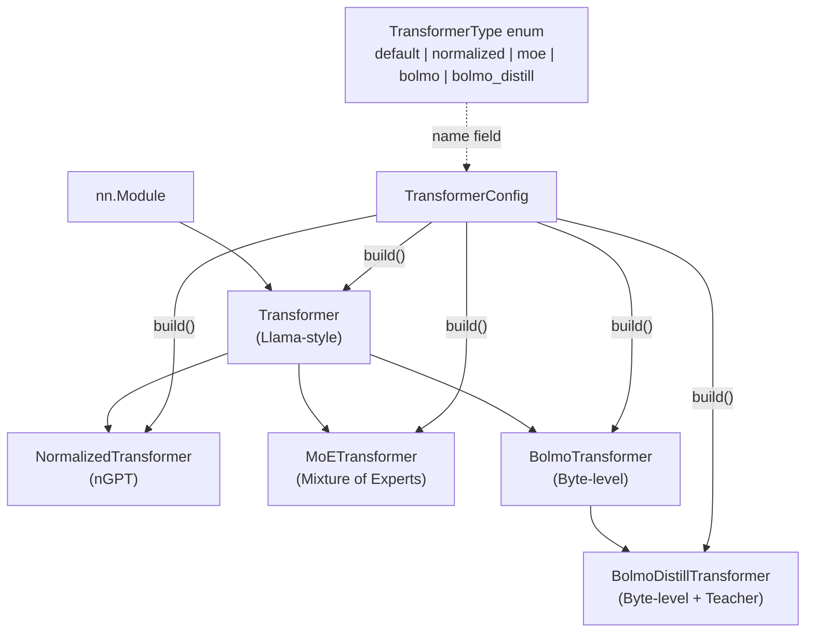

**Sources:** [src/olmo_core/nn/transformer/model.py:82-896](), [src/olmo_core/nn/transformer/config.py:76-105](), [src/olmo_core/nn/transformer/config.py:333-467]()

### Transformer Base Model

The `Transformer` class implements the standard "Llama-style" architecture with the following structure:

| Component | Type | Description |
|-----------|------|-------------|
| `embeddings` | `nn.Embedding` | Token embeddings (vocab_size × d_model) |
| `blocks` | `nn.ModuleDict` | Dictionary of transformer blocks indexed by layer number |
| `lm_head` | `LMHead` | Final language modeling head with optional layer norm |
| `_cache` | `BufferCache` | Shared buffer cache for RoPE and other buffers |

**Key attributes:**
- `d_model`: Model dimensionality
- `vocab_size`: Vocabulary size
- `n_layers`: Number of transformer layers
- `n_attn_heads`: Number of attention heads
- `dtype`: Model data type (typically `torch.float32` or `torch.bfloat16`)

**Sources:** [src/olmo_core/nn/transformer/model.py:82-164]()

### Model Variants

#### NormalizedTransformer (nGPT)

The `NormalizedTransformer` implements the nGPT architecture with normalized weights and activations:

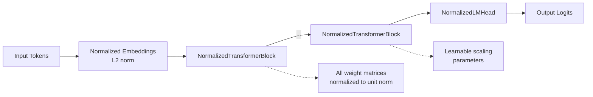

**Key differences from base Transformer:**
- Uses `NormalizedTransformerBlock` with L2-normalized weights
- Requires `init_method=InitMethod.normalized`
- Calls `normalize_matrices()` after each optimizer step
- Uses `NormalizedLMHead` with scaling parameter

**Sources:** [src/olmo_core/nn/transformer/model.py:897-945](), [src/olmo_core/nn/transformer/config.py:86-89]()

#### MoETransformer (Mixture of Experts)

The `MoETransformer` replaces some or all feed-forward layers with mixture-of-experts modules:

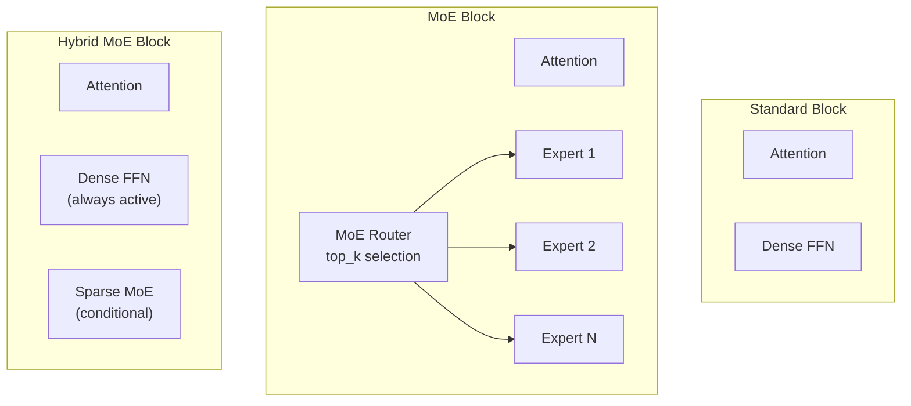

**Key features:**
- Supports pure MoE (`MoETransformerBlock`) or hybrid dense+MoE (`MoEHybridTransformerBlock`)
- Implements load balancing and z-loss auxiliary losses
- Supports expert parallelism (`apply_ep()`) for sharding experts across GPUs
- Tracks routing metrics for monitoring expert utilization

**Sources:** [src/olmo_core/nn/transformer/model.py:948-1078](), [src/olmo_core/nn/transformer/config.py:91-94]()

---

## Transformer Block Architecture

Transformer blocks are the fundamental building units of the models. The codebase provides multiple block implementations with different architectural choices.

### Block Type Hierarchy

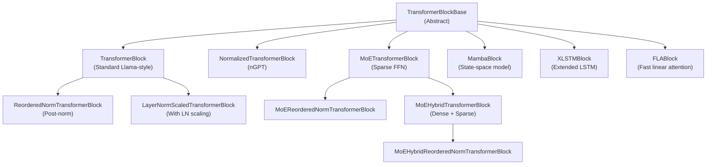

**Sources:** [src/olmo_core/nn/transformer/block.py:34-92](), [src/olmo_core/nn/transformer/config.py:107-167]()

### Standard TransformerBlock

The `TransformerBlock` implements the standard pre-norm architecture:

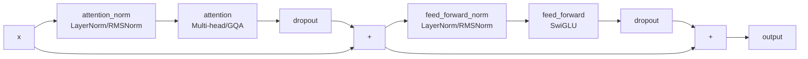

**Forward pass equation:**
```
h = x + dropout(attention(attention_norm(x)))
out = h + dropout(feed_forward(feed_forward_norm(h)))
```

**Key components:**
| Component | Default Type | Purpose |
|-----------|-------------|---------|
| `attention_norm` | `LayerNormConfig` | Normalization before attention |
| `attention` | `AttentionConfig` | Multi-head or grouped-query attention |
| `feed_forward_norm` | `LayerNormConfig` | Normalization before FFN |
| `feed_forward` | `FeedForwardConfig` | SwiGLU feed-forward network |
| `dropout` | `nn.Dropout` | Optional dropout (default 0.0) |

**Sources:** [src/olmo_core/nn/transformer/block.py:94-204]()

### Block Configuration

Blocks are built from a declarative configuration:

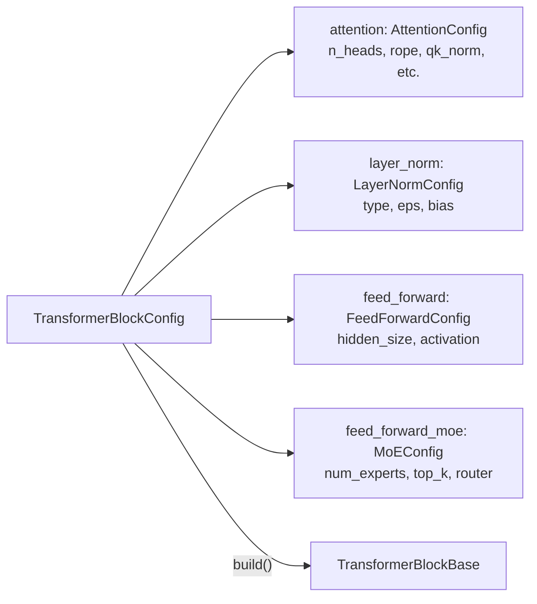

**Configuration example:**
```python
# Standard block
block_config = TransformerBlockConfig(
    name=TransformerBlockType.default,
    attention=AttentionConfig(n_heads=32, rope=RoPEConfig()),
    layer_norm=LayerNormConfig(name=LayerNormType.rms, bias=False),
    feed_forward=FeedForwardConfig(hidden_size=14336, bias=False)
)

# MoE block
moe_block_config = TransformerBlockConfig(
    name=TransformerBlockType.moe,
    attention=AttentionConfig(...),
    layer_norm=LayerNormConfig(...),
    feed_forward_moe=MoEConfig(num_experts=64, top_k=8)
)
```

**Sources:** [src/olmo_core/nn/transformer/config.py:168-301]()

### Block Variants

#### ReorderedNormTransformerBlock

Applies layer normalization *after* attention and FFN instead of before (post-norm):

```
h = x + dropout(attention_norm(attention(x)))
out = h + dropout(feed_forward_norm(feed_forward(h)))
```

This variant is used in OLMo-2 models.

**Sources:** [src/olmo_core/nn/transformer/block.py:258-275]()

#### LayerNormScaledTransformerBlock

Applies LayerNorm Scaling (LNS) by multiplying each LayerNorm output by `1/sqrt(layer_id)` where `layer_id` is 1-based:

```python
ln_scale = 1.0 / sqrt(block_idx + 1)
h = x + dropout(attention(attention_norm(x) * ln_scale))
out = h + dropout(feed_forward(feed_forward_norm(h) * ln_scale))
```

**Sources:** [src/olmo_core/nn/transformer/block.py:206-256]()

#### NormalizedTransformerBlock (nGPT)

Implements the nGPT block with L2-normalized activations and learnable interpolation parameters:

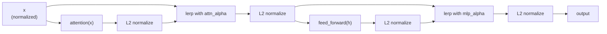

**Key features:**
- No LayerNorm modules (uses L2 normalization)
- Learnable `attn_alpha` and `mlp_alpha` parameters for interpolation
- All weight matrices must be normalized after each optimizer step

**Sources:** [src/olmo_core/nn/transformer/block.py:277-402]()

#### MoE Blocks

MoE blocks replace the dense FFN with a mixture of experts:

| Block Type | Attention Norm | FFN Type | FFN Norm |
|------------|---------------|----------|----------|
| `MoETransformerBlock` | Pre-norm | Sparse MoE | Pre-norm |
| `MoEReorderedNormTransformerBlock` | Post-norm | Sparse MoE | Post-norm |
| `MoEHybridTransformerBlock` | Pre-norm | Dense + Sparse | Pre-norm (dense), Pre-norm (sparse) |
| `MoEHybridReorderedNormTransformerBlock` | Post-norm | Dense + Sparse | Post-norm (dense), Post-norm (sparse) |

**Hybrid forward pass:**
```
# Separate forward paths
h = x + dropout(attention_norm(attention(x)))
dense_out = feed_forward(feed_forward_norm(h))
sparse_out = feed_forward_moe(feed_forward_moe_norm(h))
out = h + dropout(dense_out) + dropout(sparse_out)

# Or combined forward for better parallelism with EP/TP
out = combined_forward(x)  # Fuses dense and sparse computation
```

**Sources:** [src/olmo_core/nn/transformer/block.py:404-857]()

---

## Core Architectural Components

### Embeddings

Token embeddings are standard PyTorch `nn.Embedding` layers:

```python
self.embeddings = nn.Embedding(vocab_size, d_model, dtype=dtype, device=init_device)
```

**Initialization:**
- Standard: Truncated normal with std=0.02
- Llama: Normal distribution
- Normalized (nGPT): Normal with std=d_model^(-0.5)

**Sources:** [src/olmo_core/nn/transformer/model.py:121](), [src/olmo_core/nn/transformer/init.py:68-89]()

### Language Model Head

The LM head projects hidden states to vocabulary logits and computes loss:

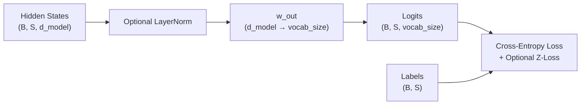

**LMHead implementations:**

| Type | Features |
|------|----------|
| `LMHead` | Standard linear projection with optional layer norm and bias |
| `NormalizedLMHead` | nGPT variant with L2-normalized weights and learnable scaling |

**Loss implementations:**

| Implementation | Description | Use Case |
|----------------|-------------|----------|
| `LMLossImplementation.default` | Computes logits then loss separately | Memory-intensive, returns logits |
| `LMLossImplementation.fused_linear` | Fuses linear + loss computation | Memory-efficient, no logits returned |

**Key features:**
- Supports `logits_to_keep` parameter to compute loss only on subset of positions
- Handles tensor parallelism with proper loss reduction
- Optional z-loss regularization: `z_loss = log(sum(exp(logits)))^2`

**Sources:** [src/olmo_core/nn/lm_head.py:154-422](), [src/olmo_core/nn/lm_head.py:424-475]()

### Feed-Forward Networks

Feed-forward networks use SwiGLU activation:

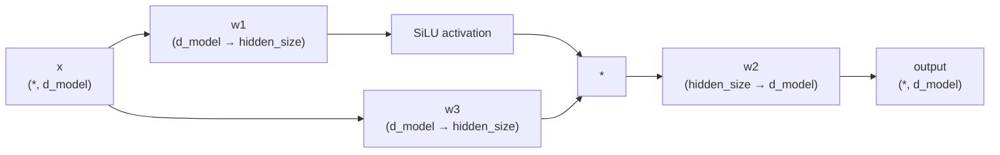

**Forward equation:**
```
out = w2(silu(w1(x)) * w3(x))
```

**Variants:**
- `FeedForward`: Standard implementation with configurable activation
- `NormalizedFeedForward`: nGPT variant with L2-normalized weights and scaling parameters

**Sources:** [src/olmo_core/nn/feed_forward.py:105-173](), [src/olmo_core/nn/feed_forward.py:175-241]()

### Layer Normalization

The codebase provides multiple layer norm implementations:

| Type | Implementation | Use Case |
|------|----------------|----------|
| `LayerNorm` | Standard PyTorch LayerNorm | General purpose |
| `RMSNorm` | Root Mean Square normalization | Llama-style models, no bias/centering |
| `FusedRMSNorm` | Triton-based fused RMSNorm | GPU optimization |
| `L2Norm` | L2 normalization of last dimension | nGPT models |

**RMSNorm equation:**
```
out = x * rsqrt(mean(x^2) + eps) * weight
```

**Sources:** [src/olmo_core/nn/layer_norm.py:104-291]()

---

## Model Construction Flow

The model construction process follows a builder pattern using configuration objects:

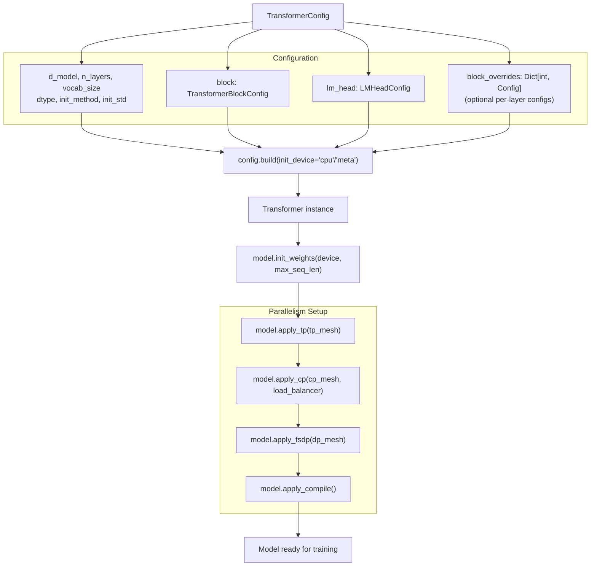

**Sources:** [src/olmo_core/nn/transformer/config.py:333-467](), [src/olmo_core/nn/transformer/model.py:223-319]()

### Configuration Builders

The `TransformerConfig` class provides convenient builder methods for common model sizes:

**OLMo-2 models:**
- `olmo2_30M()`, `olmo2_190M()`, `olmo2_370M()`, `olmo2_600M()`, `olmo2_760M()`, `olmo2_1B()`, `olmo2_3B()`, `olmo2_7B()`, `olmo2_13B()`, `olmo2_32B()`

**OLMo-3 models:**
- `olmo3_190M()`, `olmo3_7B()` (with sliding window attention)

**Llama-style models:**
- `llama2_271M()`, `llama2_1B()`, `llama2_7B()`, `llama2_13B()`

**MoE models:**
- `smallmoe()`, `small_hybrid_moe()`, `olmoe_1B_7B()`

**nGPT models:**
- `ngpt_271M()`, `ngpt_1B()`

**Example usage:**
```python
config = TransformerConfig.olmo2_7B(
    vocab_size=100_278,
    use_flash=True,
    rope_theta=500_000
)
model = config.build(init_device="meta")
model.init_weights(device="cuda", max_seq_len=4096)
```

**Sources:** [src/olmo_core/nn/transformer/config.py:567-878]()

---

## Forward Pass

The transformer forward pass processes input token IDs through the model:

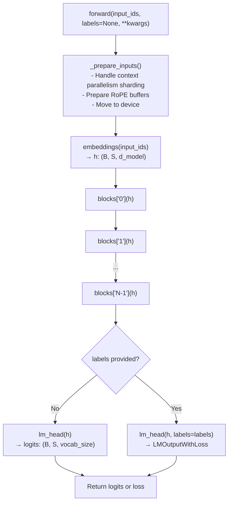

**Method signature:**
```python
def forward(
    self,
    input_ids: torch.Tensor,  # (batch_size, seq_len)
    *,
    labels: Optional[torch.Tensor] = None,  # (batch_size, seq_len)
    ignore_index: int = -100,
    loss_reduction: Literal["mean", "sum", "none"] = "mean",
    z_loss_multiplier: Optional[float] = None,
    loss_div_factor: Optional[Union[torch.Tensor, float]] = None,
    return_logits: Optional[bool] = None,
    logits_to_keep: Union[int, torch.Tensor] = 0,
    **kwargs,
) -> Union[torch.Tensor, LMOutputWithLoss]
```

**Key features:**
- Pipeline parallelism: Supports missing embeddings or lm_head for intermediate stages
- Context parallelism: Automatically shards inputs along sequence dimension
- Intra-document masking: Supports `doc_lens` and `cu_doc_lens` for document boundaries
- Dynamic shape marking: Calls `mark_dynamic()` when compiled

**Sources:** [src/olmo_core/nn/transformer/model.py:464-537](), [src/olmo_core/nn/transformer/model.py:321-462]()

---

## Parallelism Integration

Models support multiple parallelism strategies that can be composed:

### Supported Parallelism Modes

| Strategy | Method | Purpose | Applied To |
|----------|--------|---------|------------|
| Tensor Parallel (TP) | `apply_tp(tp_mesh)` | Shard weights across GPUs | Attention, FFN, embeddings, LM head |
| Context Parallel (CP) | `apply_cp(cp_mesh, load_balancer)` | Shard sequences across GPUs | Attention (ring attention) |
| Pipeline Parallel (PP) | `apply_pp(pp_mesh)` | Shard layers across GPUs | Per-block preparation |
| Expert Parallel (EP) | `apply_ep(ep_mesh)` | Shard experts across GPUs | MoE blocks only |
| FSDP | `apply_fsdp(dp_mesh)` | Fully Sharded Data Parallel | All parameters |
| DDP | `apply_ddp(dp_mesh)` | Distributed Data Parallel | All parameters |

### Application Order

The parallelism methods should be applied in this order:

```mermaid
graph LR
    Build["build(init_device='meta')"]
    TP["apply_tp()"]
    CP["apply_cp()"]
    PP["apply_pp()"]
    EP["apply_ep()<br/>(MoE only)"]
    FP8["apply_fp8()"]
    AC["apply_activation_checkpointing()"]
    Compile["apply_compile()"]
    FSDP["apply_fsdp() / apply_ddp()"]
    Init["init_weights()"]
    
    Build --> TP
    TP --> CP
    CP --> PP
    PP --> EP
    EP --> FP8
    FP8 --> AC
    AC --> Compile
    Compile --> FSDP
    FSDP --> Init
```

**Sources:** [src/olmo_core/nn/transformer/model.py:539-846]()

### Tensor Parallelism

Tensor parallelism shards weight matrices across GPUs:

**Sharding strategy:**
- Embeddings: Rowwise parallel (output sharded on sequence dim)
- Attention Q/K/V: Colwise parallel (heads sharded)
- Attention output: Rowwise parallel
- FFN w1/w3: Colwise parallel
- FFN w2: Rowwise parallel
- LM head: Colwise parallel (vocab sharded)

**Example:**
```python
from torch.distributed.tensor import init_device_mesh

mesh = init_device_mesh("cuda", (world_size,), mesh_dim_names=("tp",))
model.apply_tp(mesh["tp"])
```

**Sources:** [src/olmo_core/nn/transformer/model.py:567-602]()

### Activation Checkpointing

Multiple activation checkpointing modes are supported:

| Mode | Description |
|------|-------------|
| `full` | Checkpoint every block |
| `selected_blocks` | Checkpoint blocks at `block_interval` |
| `selected_modules` | Checkpoint specific module patterns (supports globs) |
| `selected_ops` | Checkpoint specific operations within blocks |
| `budget` | Use torch compile's memory budget feature |

**Example:**
```python
# Checkpoint every 4th block
model.apply_activation_checkpointing(
    mode=TransformerActivationCheckpointingMode.selected_blocks,
    block_interval=4
)

# Checkpoint specific modules
model.apply_activation_checkpointing(
    mode=TransformerActivationCheckpointingMode.selected_modules,
    modules=["blocks.*.attention", "blocks.*.feed_forward"]
)
```

**Sources:** [src/olmo_core/nn/transformer/model.py:623-720]()

---

## Properties and Utilities

### Model Metrics

The `Transformer` class provides several utility properties:

| Property | Description |
|----------|-------------|
| `num_params` | Total number of parameters |
| `num_trainable_params` | Number of trainable parameters (excludes frozen) |
| `num_non_embedding_params` | Parameters excluding embeddings |
| `num_flops_per_token(seq_len)` | Approximate FLOPs per token |
| `pp_enabled` | Whether pipeline parallelism is active |
| `tp_enabled` | Whether tensor parallelism is active |
| `fsdp_enabled` | Whether FSDP is active |
| `fp8_enabled` | Whether FP8 training is active |
| `is_moe` | Whether model uses MoE (overridden in `MoETransformer`) |

**FLOP calculation:**
```python
flop_per_token = 6 * num_non_embedding_params + 12 * n_layers * n_heads * head_dim * seq_len
```

**Sources:** [src/olmo_core/nn/transformer/model.py:848-879]()

### Post-Training Hooks

Models provide lifecycle hooks called during training:

| Hook | When Called | Purpose |
|------|-------------|---------|
| `post_batch(dry_run=False)` | After final backward before optimizer step | Auxiliary loss finalization |
| `post_optim_step()` | After optimizer step | Weight normalization, FP8 scale precomputation |

**nGPT example:**
```python
# After optimizer.step()
model.post_optim_step()  # Calls normalize_matrices() on NormalizedTransformer
```

**Sources:** [src/olmo_core/nn/transformer/model.py:881-895](), [src/olmo_core/nn/transformer/model.py:941-944]()

---

## Summary

The OLMo-Core model architecture provides:

1. **Flexible model hierarchy** with `Transformer`, `NormalizedTransformer`, `MoETransformer`, and Bolmo variants
2. **Multiple block types** including standard, reordered-norm, MoE, hybrid, and alternative architectures (Mamba, XLSTM, FLA)
3. **Composable components** with attention, FFN, layer norm, and LM head modules
4. **Configuration-based construction** using declarative config objects with builder methods
5. **Comprehensive parallelism support** for TP, CP, PP, EP, FSDP, and DDP
6. **Optimization features** including activation checkpointing, FP8, and torch.compile integration

All components are designed to be modular, configurable, and compatible with distributed training strategies.

---

