<!-- source: DeepWiki mcp.deepwiki.com · repo allenai/bolmo-core · page 2.1 Transformer Models · fetched 2026-10-26 -->

# Transformer Models

<details>
<summary>Relevant source files</summary>

The following files were used as context for generating this wiki page:

- [src/olmo_core/data/tokenizer.py](src/olmo_core/data/tokenizer.py)
- [src/olmo_core/nn/transformer/config.py](src/olmo_core/nn/transformer/config.py)
- [src/olmo_core/nn/transformer/model.py](src/olmo_core/nn/transformer/model.py)

</details>


This document describes the transformer model implementations in OLMo-Core, including the base `Transformer` class and its specialized variants. These classes represent the top-level model architecture that orchestrates embeddings, transformer blocks, and the language modeling head.

For information about the internal block architecture, see [Transformer Blocks](#2.2). For attention mechanisms and feed-forward networks, see [Attention and Feed-Forward](#2.3). For tokenization, see [Tokenizers](#2.4). For weight initialization strategies, see [Weight Initialization](#2.5).

---

## Transformer Class Hierarchy

The codebase provides multiple transformer implementations, each optimized for different use cases. All variants inherit from the base `Transformer` class.

**Class Hierarchy Diagram**

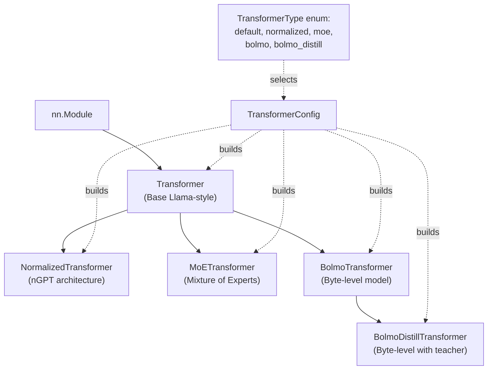

**Sources:** [src/olmo_core/nn/transformer/model.py:82-1100](), [src/olmo_core/nn/transformer/config.py:76-105]()

---

## Base Transformer Class

The `Transformer` class at [src/olmo_core/nn/transformer/model.py:82-895]() provides the standard Llama-style transformer implementation with the following components:

### Core Components

| Component | Type | Description |
|-----------|------|-------------|
| `embeddings` | `nn.Embedding` | Token embeddings (vocab_size × d_model) |
| `blocks` | `nn.ModuleDict` | Dictionary of transformer blocks indexed by layer number |
| `lm_head` | `LMHeadConfig.build()` | Language modeling head for logit computation |

**Component Initialization Diagram**

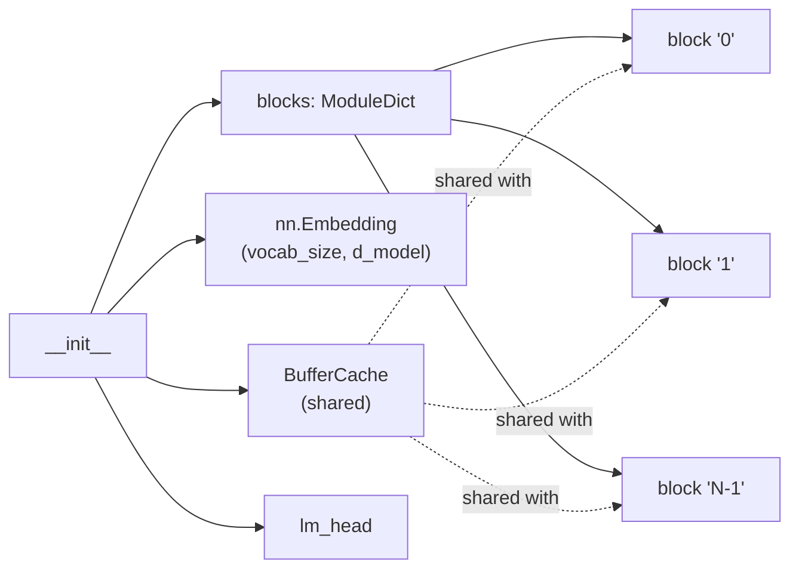

**Sources:** [src/olmo_core/nn/transformer/model.py:96-161]()

### Forward Pass

The forward method at [src/olmo_core/nn/transformer/model.py:464-537]() implements the standard transformer forward pass:

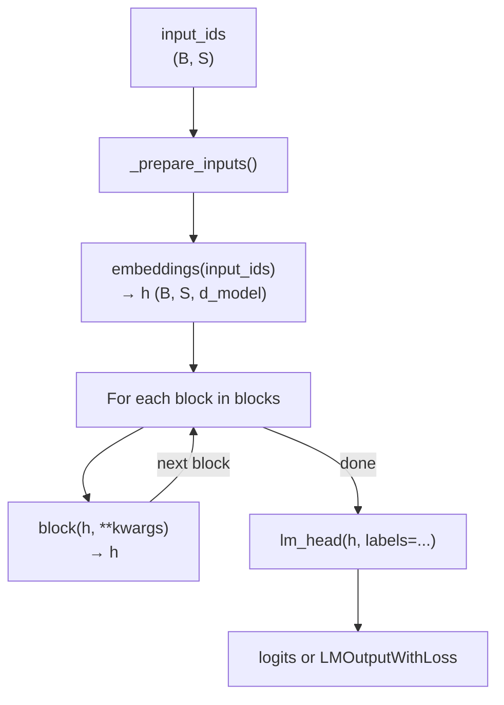

The `_prepare_inputs()` method at [src/olmo_core/nn/transformer/model.py:321-462]() handles:
- Moving inputs to device
- Context parallelism sharding (if enabled)
- Document-level masking preparation
- RoPE buffer initialization
- Loss configuration

**Sources:** [src/olmo_core/nn/transformer/model.py:321-537]()

### Initialization and Configuration

**Weight Initialization Flow**

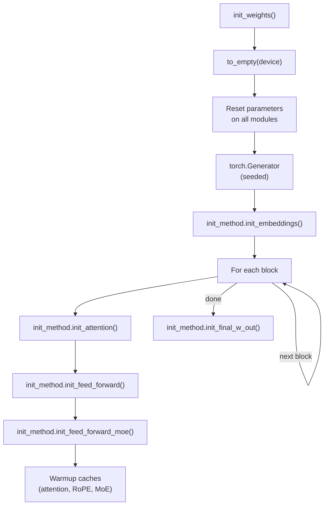

**Sources:** [src/olmo_core/nn/transformer/model.py:223-319]()

### Key Properties

| Property | Type | Description |
|----------|------|-------------|
| `num_params` | `int` | Total parameter count (cached) |
| `num_non_embedding_params` | `int` | Parameters excluding embeddings |
| `num_trainable_params` | `int` | Parameters with `requires_grad=True` |
| `device` | `torch.device` | Device where model parameters reside |
| `pp_enabled` | `bool` | Whether pipeline parallelism is active |
| `tp_enabled` | `bool` | Whether tensor parallelism is active |
| `fp8_enabled` | `bool` | Whether FP8 training is active |
| `fsdp_enabled` | `bool` | Whether FSDP is active |
| `is_moe` | `bool` | Whether model uses Mixture of Experts |
| `compile_enabled` | `bool` | Whether torch.compile is active |

**Sources:** [src/olmo_core/nn/transformer/model.py:174-208](), [src/olmo_core/nn/transformer/model.py:848-879]()

---

## NormalizedTransformer

The `NormalizedTransformer` at [src/olmo_core/nn/transformer/model.py:897-983]() implements the nGPT architecture with L2-normalized weights and activations.

### Key Differences from Base Transformer

**Normalization Lifecycle**

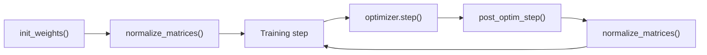

The `normalize_matrices()` method at [src/olmo_core/nn/transformer/model.py:947-960]() normalizes:
- Embedding weights
- All block weights (via `block.normalize_matrices()`)
- LM head weights

### Validation

The model validates that all blocks are `NormalizedTransformerBlock` instances at [src/olmo_core/nn/transformer/model.py:933-938]().

**Sources:** [src/olmo_core/nn/transformer/model.py:897-983]()

---

## MoETransformer

The `MoETransformer` at [src/olmo_core/nn/transformer/model.py:985-1086]() extends the base transformer with Mixture of Experts support.

### Additional Functionality

**MoE-Specific Methods**

| Method | Purpose |
|--------|---------|
| `compute_auxiliary_metrics()` | Aggregate load balancing, routing, and z-loss metrics across MoE blocks |
| `reset_auxiliary_metrics()` | Clear accumulated metrics |
| `apply_ep()` | Apply expert parallelism to MoE blocks |
| `prepare_experts_for_fsdp()` | Wrap expert parameters with FSDP |
| `prepare_experts_for_ddp()` | Wrap expert parameters with DDP |
| `post_batch()` | Post-batch cleanup for MoE routing |

**Auxiliary Metrics Flow**

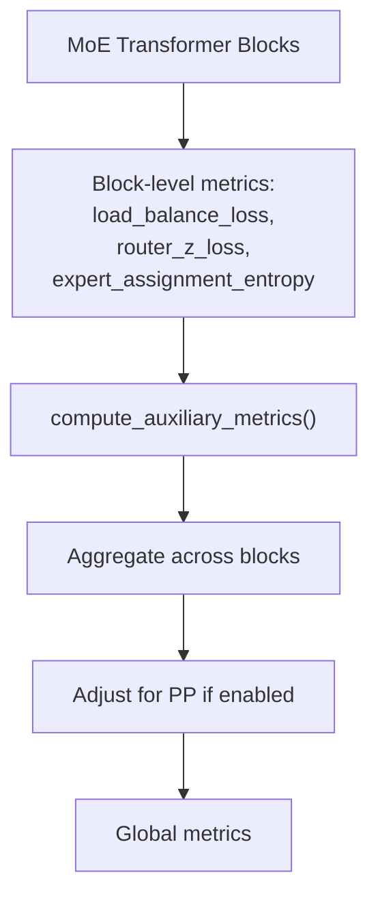

**Sources:** [src/olmo_core/nn/transformer/model.py:985-1086]()

---

## BolmoTransformer

The `BolmoTransformer` at [src/olmo_core/nn/transformer/model.py:1110-1414]() implements byte-level language modeling with hierarchical architecture.

### Architecture Overview

**Bolmo Component Structure**

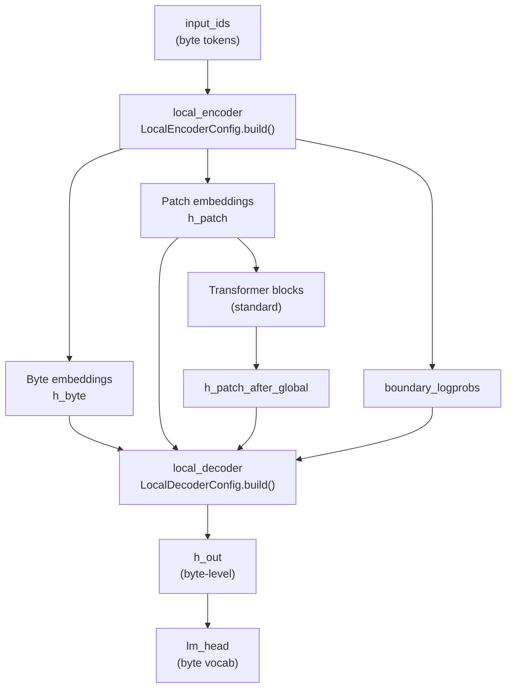

### Key Differences from Base Transformer

| Component | Base Transformer | BolmoTransformer |
|-----------|-----------------|------------------|
| `embeddings` | `nn.Embedding` | `None` (replaced by local_encoder) |
| `lm_head` | Uses `d_model` | Uses `local_decoder.d_model` (local dimension) |
| Input | Token IDs | Byte IDs |
| Additional Components | - | `local_encoder`, `local_decoder` |

### Special Inputs

The `_prepare_inputs()` method at [src/olmo_core/nn/transformer/model.py:1269-1335]() handles Bolmo-specific inputs:

| Input | Purpose |
|-------|---------|
| `patch_lens` | Length of each patch in bytes |
| `patch_ids` | Patch boundaries derived from `patch_lens` |
| `original_input_ids` | Original subword tokens (for teacher forcing) |
| `expanded_input_ids` | Expanded byte sequence |
| `teacher_inputs_embeds` | Teacher embeddings for distillation |

**Sources:** [src/olmo_core/nn/transformer/model.py:1110-1414]()

---

## BolmoDistillTransformer

The `BolmoDistillTransformer` at [src/olmo_core/nn/transformer/model.py:1416-1697]() extends `BolmoTransformer` with knowledge distillation support.

### Teacher Model Integration

**Teacher-Student Architecture**

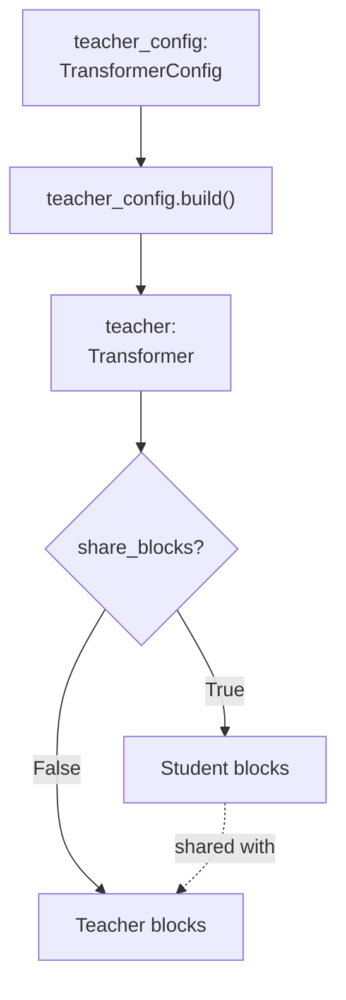

### Distillation Forward Pass

The `teacher_forward()` method at [src/olmo_core/nn/transformer/model.py:1491-1587]() provides:
- Optional block execution (`skip_blocks=True`)
- Intermediate hidden state extraction (`hidden_states_to_return`)
- Support for custom input embeddings (`inputs_embeds`)
- Optional BOS token zeroing (`zero_bos`)

**Distillation Flow**

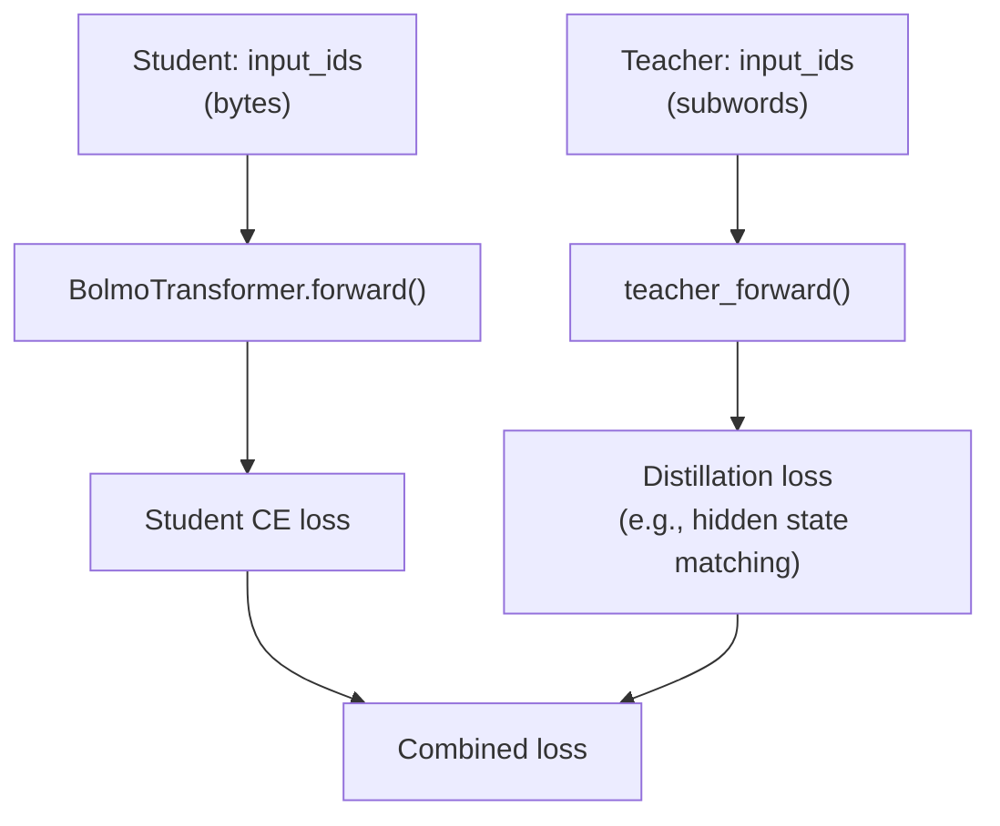

### Teacher Embeddings

When `use_teacher_embs_with_vocab_size` is set, the model maintains separate `teacher_embeddings` at [src/olmo_core/nn/transformer/model.py:1425-1433]() for distilling from Stage 1 local decoder transfer.

**Sources:** [src/olmo_core/nn/transformer/model.py:1416-1697]()

---

## Model Building and Configuration

### TransformerConfig

The `TransformerConfig` class at [src/olmo_core/nn/transformer/config.py:304-546]() provides a declarative way to build transformer models.

**Configuration to Model Flow**

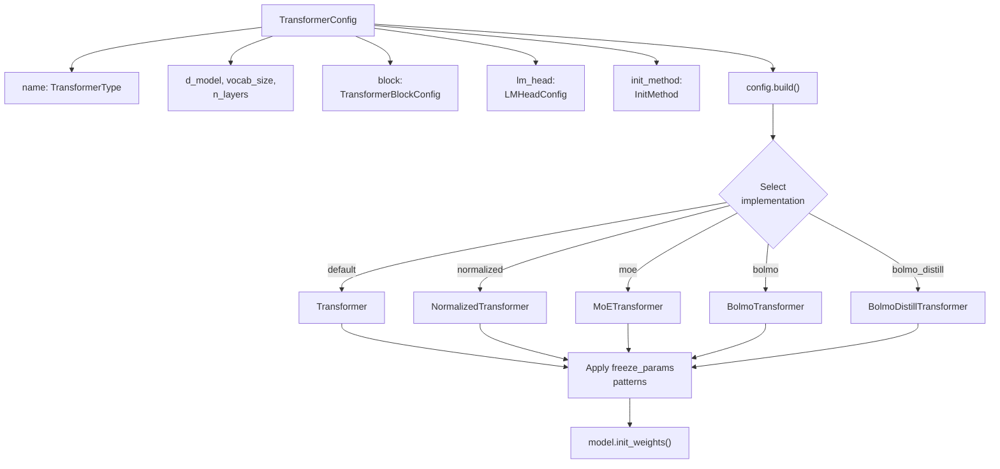

**Sources:** [src/olmo_core/nn/transformer/config.py:304-467]()

### Preset Configurations

The `TransformerConfig` class provides numerous preset factory methods:

| Method | Description | Model Type |
|--------|-------------|------------|
| `olmo2_30M()` | 30M OLMo2 model | Standard |
| `olmo2_190M()` | 190M OLMo2 model | Standard |
| `olmo2_1B()` | 1B OLMo2 model | Standard |
| `olmo2_7B()` | 7B OLMo2 model | Standard |
| `olmo2_13B()` | 13B OLMo2 model | Standard |
| `olmo3_190M()` | 190M OLMo3 with sliding window | Standard |
| `olmo3_7B()` | 7B OLMo3 with sliding window | Standard |
| `smallmoe()` | Small MoE model | MoE |
| `olmoe_1B_7B()` | OLMoE 1B-7B model | MoE |
| `ngpt_271M()` | 271M nGPT model | Normalized |
| `ngpt_1B()` | 1B nGPT model | Normalized |
| `llama2_1B()` | 1B Llama2-like model | Standard |
| `llama2_7B()` | 7B Llama2-like model | Standard |
| `llama3_8B()` | 8B Llama3-like model | Standard |

**Sources:** [src/olmo_core/nn/transformer/config.py:568-1038]()

### Llama-like Configurations

The `llama_like()` factory method at [src/olmo_core/nn/transformer/config.py:1041-1143]() provides flexible configuration:

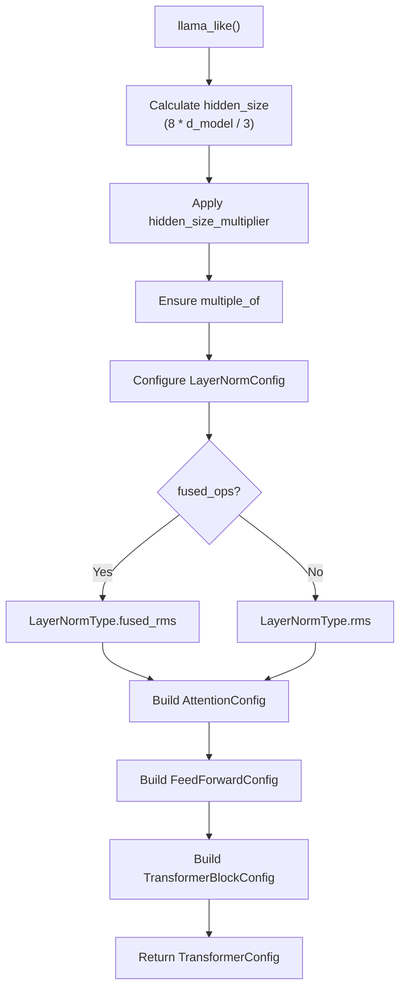

**Sources:** [src/olmo_core/nn/transformer/config.py:1041-1143]()

---

## Parallelism and Optimization

The transformer models support various parallelism and optimization strategies through dedicated `apply_*` methods.

### Parallelism Methods

**Parallelism Application Order**

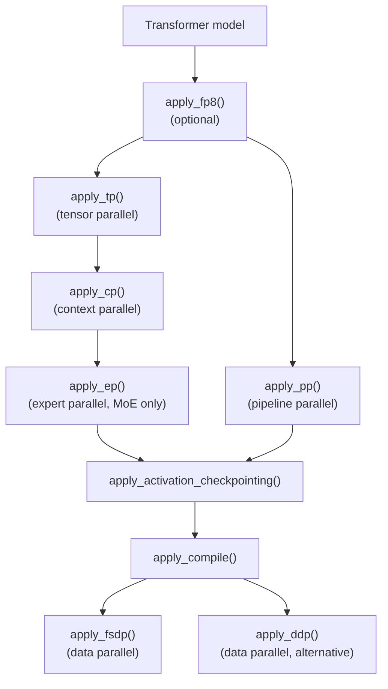

| Method | Location | Purpose |
|--------|----------|---------|
| `apply_fp8()` | [model.py:539-555]() | Enable FP8 training on linear layers |
| `apply_tp()` | [model.py:567-601]() | Shard weights across GPUs |
| `apply_cp()` | [model.py:603-621]() | Shard sequences across GPUs |
| `apply_pp()` | [model.py:557-565]() | Prepare for pipeline parallelism stages |
| `apply_ep()` | [model.py:1043-1048]() | Shard MoE experts across GPUs |
| `apply_activation_checkpointing()` | [model.py:623-719]() | Trade compute for memory |
| `apply_compile()` | [model.py:721-737]() | Enable torch.compile |
| `apply_fsdp()` | [model.py:739-813]() | Fully Sharded Data Parallel |
| `apply_ddp()` | [model.py:815-846]() | Distributed Data Parallel |

**Sources:** [src/olmo_core/nn/transformer/model.py:539-846]()

### Tensor Parallelism

The `apply_tp()` method at [src/olmo_core/nn/transformer/model.py:567-601]() applies tensor parallelism:

1. Parallelizes embeddings with `RowwiseParallel` (output sharded on dim 1)
2. Applies TP to all transformer blocks
3. Applies TP to LM head

### Context Parallelism

The `apply_cp()` method at [src/olmo_core/nn/transformer/model.py:603-621]() prepares for context parallelism:

1. Creates a `RingAttentionLoadBalancer` from config
2. Applies CP to all blocks
3. Applies CP to LM head

The actual sharding happens in `_prepare_inputs()` at [src/olmo_core/nn/transformer/model.py:372-443]().

### FSDP Configuration

The `apply_fsdp()` method at [src/olmo_core/nn/transformer/model.py:739-813]() supports different wrapping strategies:

| Strategy | Description |
|----------|-------------|
| `full` | Wrap each block and LM head separately |
| `blocks` | Wrap each block but not LM head separately |
| `fine_grained` | Additional wrapping within blocks |

For MoE models, expert preparation must be done separately via `prepare_experts_for_fsdp()`.

**Sources:** [src/olmo_core/nn/transformer/model.py:739-813](), [src/olmo_core/nn/transformer/config.py:37-56]()

---

## Lifecycle Hooks

The transformer provides hooks for training integration:

**Training Lifecycle Integration**

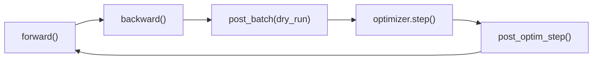

| Hook | Purpose | Models |
|------|---------|--------|
| `post_batch()` | Called after backward pass, before optimizer step | `Transformer`, `MoETransformer` |
| `post_optim_step()` | Called after optimizer step | `Transformer`, `NormalizedTransformer` |

### MoE Post-Batch Hook

For `MoETransformer`, `post_batch()` at [src/olmo_core/nn/transformer/model.py:1080-1086]() calls `feed_forward_moe.post_batch()` on each MoE block to:
- Clear token routing statistics
- Reset capacity counters
- Prepare for next batch

### Normalized Transformer Post-Optim Hook

For `NormalizedTransformer`, `post_optim_step()` at [src/olmo_core/nn/transformer/model.py:980-982]() calls `normalize_matrices()` to maintain L2 normalization after weight updates. For FP8-enabled models, it precomputes dynamic scales for FSDP.

**Sources:** [src/olmo_core/nn/transformer/model.py:881-894](), [src/olmo_core/nn/transformer/model.py:980-983](), [src/olmo_core/nn/transformer/model.py:1080-1086]()

---

## Model Utilities

### Parameter Counting

| Property | Formula | Notes |
|----------|---------|-------|
| `num_params` | Total of all `p.numel()` | Cached on first access |
| `num_non_embedding_params` | `num_params - embeddings.weight.numel()` | Excludes embedding layer |
| `num_trainable_params` | Sum where `p.requires_grad` | Excludes frozen params |

For `BolmoTransformer`, `num_non_embedding_params` excludes local encoder embeddings including hash embeddings.

**Sources:** [src/olmo_core/nn/transformer/model.py:848-858](), [src/olmo_core/nn/transformer/model.py:1258-1267]()

### FLOPs Estimation

The `num_flops_per_token()` method at [src/olmo_core/nn/transformer/model.py:860-879]() estimates FLOPs using:

```
flop_per_token = 6 * num_non_embedding_params + 12 * n * h * q * t
```

where:
- `n` = number of layers
- `h` = number of attention heads  
- `q` = head dimension
- `t` = sequence length

**Sources:** [src/olmo_core/nn/transformer/model.py:860-879]()

### Device Management

The `device` property at [src/olmo_core/nn/transformer/model.py:195-203]() automatically detects the device by checking parameter locations, falling back to `get_default_device()` if no parameters exist.

**Sources:** [src/olmo_core/nn/transformer/model.py:195-203]()

---

