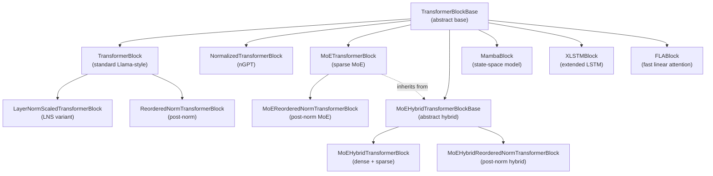
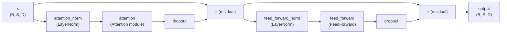
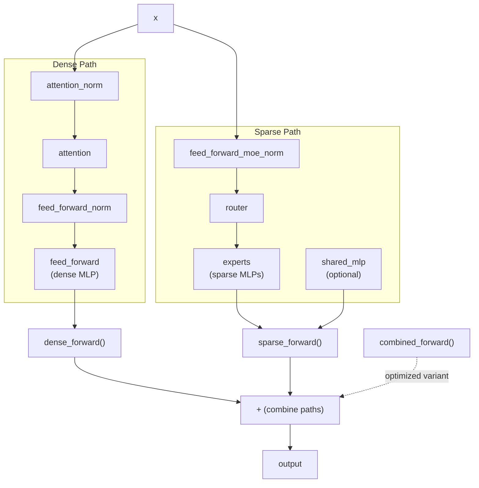
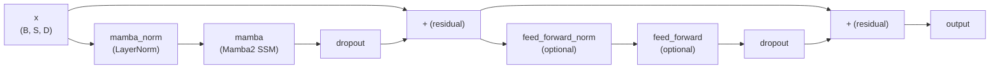
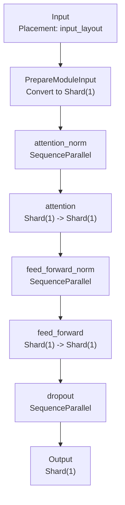

<!-- source: DeepWiki mcp.deepwiki.com · repo allenai/bolmo-core · page 2.2 Transformer Blocks · fetched 2026-10-26 -->

# Transformer Blocks

<details>
<summary>Relevant source files</summary>

The following files were used as context for generating this wiki page:

- [src/olmo_core/nn/feed_forward.py](src/olmo_core/nn/feed_forward.py)
- [src/olmo_core/nn/fla.py](src/olmo_core/nn/fla.py)
- [src/olmo_core/nn/layer_norm.py](src/olmo_core/nn/layer_norm.py)
- [src/olmo_core/nn/lm_head.py](src/olmo_core/nn/lm_head.py)
- [src/olmo_core/nn/mamba.py](src/olmo_core/nn/mamba.py)
- [src/olmo_core/nn/transformer/__init__.py](src/olmo_core/nn/transformer/__init__.py)
- [src/olmo_core/nn/transformer/block.py](src/olmo_core/nn/transformer/block.py)
- [src/olmo_core/nn/transformer/init.py](src/olmo_core/nn/transformer/init.py)
- [src/test/nn/layer_norm_test.py](src/test/nn/layer_norm_test.py)
- [src/test/nn/lm_head_test.py](src/test/nn/lm_head_test.py)
- [src/test/nn/transformer/model_test.py](src/test/nn/transformer/model_test.py)

</details>


## Purpose and Scope

Transformer blocks are the core computational units that compose transformer models in OLMo-Core. Each block represents one layer of the transformer, typically containing attention mechanisms and feed-forward networks combined with normalization and residual connections. This page documents the various block implementations including standard transformer blocks, Mixture-of-Experts (MoE) variants, and alternative architectures like Mamba, XLSTM, and FLA.

For details about the internal components used within blocks (attention mechanisms, feed-forward networks, layer normalization), see [Attention and Feed-Forward](#2.3). For information about how blocks are assembled into complete transformer models, see [Transformer Models](#2.1). For weight initialization strategies applied to blocks, see [Weight Initialization](#2.5).

---

## Block Hierarchy

All transformer block implementations inherit from `TransformerBlockBase`, which defines the common interface for forward passes and parallelism application. The hierarchy supports standard dense blocks, MoE blocks with expert routing, and alternative architectures that replace attention with state-space models or linear attention.

**Block Class Hierarchy**



Sources: [src/olmo_core/nn/transformer/block.py:34-1155]()

### TransformerBlockBase Interface

`TransformerBlockBase` at [src/olmo_core/nn/transformer/block.py:34-92]() defines the abstract interface that all blocks must implement:

| Method | Purpose |
|--------|---------|
| `forward()` | Run the block on input tensor of shape `(batch_size, seq_len, d_model)` |
| `apply_tp()` | Apply tensor parallelism with specified device mesh and input layout |
| `apply_cp()` | Apply context parallelism with specified device mesh and load balancer |
| `apply_fsdp()` | Apply FSDP with optional fine-grained wrapping strategy |
| `apply_pp()` | Apply pipeline parallelism (optional, mainly for MoE) |
| `apply_compile()` | Apply PyTorch compilation (default implementation available) |

The abstract base also defines `is_moe` property which returns `True` for MoE variants and `False` otherwise.

Sources: [src/olmo_core/nn/transformer/block.py:34-92]()

---

## Standard Transformer Blocks

### TransformerBlock (Llama-Style)

`TransformerBlock` at [src/olmo_core/nn/transformer/block.py:94-204]() implements the standard pre-norm transformer architecture used in models like LLaMA. This is the most commonly used block type in OLMo-Core.

**Architecture:**
- **Pre-normalization pattern**: LayerNorm is applied before each sub-layer (attention and feed-forward)
- **Residual connections**: Output of each sub-layer is added to its input
- **Optional dropout**: Applied after both attention and feed-forward

**Component Composition:**



**Initialization Parameters:**

| Parameter | Type | Description |
|-----------|------|-------------|
| `d_model` | `int` | Model dimensionality |
| `block_idx` | `int` | Block position within model (0 to n_layers-1) |
| `n_layers` | `int` | Total number of layers in the model |
| `attention` | `AttentionConfig` | Configuration for building attention module |
| `feed_forward` | `FeedForwardConfig` | Configuration for building feed-forward module |
| `layer_norm` | `LayerNormConfig` | Configuration for building both layer norms |
| `dropout` | `float` | Dropout probability (default: 0.0) |
| `init_device` | `str` | Device for parameter initialization (default: "cpu") |
| `cache` | `Optional[BufferCache]` | Optional buffer cache for sharing across blocks |

**Forward Pass:**

The forward pass at [src/olmo_core/nn/transformer/block.py:131-140]() implements:

```
h = x + dropout(attention(attention_norm(x), **kwargs))
return h + dropout(feed_forward(feed_forward_norm(h)))
```

Sources: [src/olmo_core/nn/transformer/block.py:94-204]()

### LayerNormScaledTransformerBlock

`LayerNormScaledTransformerBlock` at [src/olmo_core/nn/transformer/block.py:206-256]() extends `TransformerBlock` with LayerNorm Scaling (LNS). Each LayerNorm output is multiplied by `1 / sqrt(layer_id)` where `layer_id` is 1-based.

This scaling helps stabilize training in very deep networks by preventing activation magnitudes from growing with depth.

**Key Differences:**
- Registers a buffer `ln_scale` with value `1.0 / sqrt(block_idx + 1)`
- Scales LayerNorm outputs before passing to attention and feed-forward

Sources: [src/olmo_core/nn/transformer/block.py:206-256]()

### ReorderedNormTransformerBlock

`ReorderedNormTransformerBlock` at [src/olmo_core/nn/transformer/block.py:258-275]() implements post-normalization instead of pre-normalization.

**Architecture Difference:**
```
# Pre-norm (TransformerBlock):
h = x + dropout(attention(attention_norm(x)))

# Post-norm (ReorderedNormTransformerBlock):
h = x + dropout(attention_norm(attention(x)))
```

This places normalization after the sub-layer instead of before, which can affect training dynamics.

Sources: [src/olmo_core/nn/transformer/block.py:258-275]()

### NormalizedTransformerBlock (nGPT)

`NormalizedTransformerBlock` at [src/olmo_core/nn/transformer/block.py:278-402]() implements the nGPT architecture, which enforces unit L2 norm on all hidden states and uses learnable interpolation parameters (`attn_alpha`, `mlp_alpha`) instead of LayerNorm.

**Architecture:**



```mermaid
graph LR
    Input["x (normalized)"]
    
    Attention["attention<br/>(NormalizedAttention)"]
    L2Norm1["l2_normalize"]
    Lerp1["lerp(x, attn_out, alpha)"]
    L2Norm2["l2_normalize"]
    
    FFN["feed_forward<br/>(NormalizedFeedForward)"]
    L2Norm3["l2_normalize"]
    Lerp2["lerp(h, ffn_out, alpha)"]
    L2Norm4["l2_normalize"]
    
    Output["output (normalized)"]
    
    Input --> Attention
    Attention --> L2Norm1
    Input --> Lerp1
    L2Norm1 --> Lerp1
    Lerp1 --> L2Norm2
    
    L2Norm2 --> FFN
    FFN --> L2Norm3
    L2Norm2 --> Lerp2
    L2Norm3 --> Lerp2
    Lerp2 --> L2Norm4
    L2Norm4 --> Output
```

**Key Components:**
- **No LayerNorm**: Uses L2 normalization instead
- **Learnable alpha parameters**: `attn_alpha` and `mlp_alpha` control interpolation
- **Matrix normalization**: After each optimizer step, `normalize_matrices()` must be called to re-normalize weights

**Alpha Parameters:**
- Initialized with scaling `1.0 / sqrt(d_model)`
- Used in linear interpolation: `torch.lerp(x, normalized_output, alpha * init_value / init_scaling)`

The `normalize_matrices()` method at [src/olmo_core/nn/transformer/block.py:388-398]() must be called after each training step to maintain unit norm constraints on attention and feed-forward weight matrices.

Sources: [src/olmo_core/nn/transformer/block.py:278-402]()

---

## MoE Transformer Blocks

Mixture-of-Experts (MoE) blocks replace the dense feed-forward network with a sparse routing mechanism that selects a subset of expert networks for each token.

### MoETransformerBlock

`MoETransformerBlock` at [src/olmo_core/nn/transformer/block.py:405-561]() replaces the dense `FeedForward` with a `MoEConfig`-based sparse MoE module.

**Architecture:**



```mermaid
graph LR
    Input["x"]
    
    AttentionNorm["attention_norm"]
    Attention["attention"]
    Dropout1["dropout"]
    Add1["+ (residual)"]
    
    FFMoENorm["feed_forward_norm"]
    Router["router<br/>(expert selection)"]
    Experts["experts<br/>(parallel MLPs)"]
    Dropout2["dropout"]
    Add2["+ (residual)"]
    
    Output["output"]
    
    Input --> AttentionNorm
    AttentionNorm --> Attention
    Attention --> Dropout1
    Input --> Add1
    Dropout1 --> Add1
    
    Add1 --> FFMoENorm
    FFMoENorm --> Router
    Router --> Experts
    Experts --> Dropout2
    Add1 --> Add2
    Dropout2 --> Add2
    
    Add2 --> Output
```

**Key Properties:**
- `is_moe` returns `True`
- `router` property provides access to the `MoERouter`
- `experts` property provides access to the expert MLPs
- `top_k` property returns number of experts selected per token
- `ep_enabled` and `tp_enabled` track parallelism state

**Metrics Collection:**

MoE blocks track routing metrics like expert utilization and load balance. The `compute_metrics()` method at [src/olmo_core/nn/transformer/block.py:467-470]() returns a dictionary of metrics with optional reduction strategies.

Sources: [src/olmo_core/nn/transformer/block.py:405-561]()

### MoEHybridTransformerBlock

`MoEHybridTransformerBlock` at [src/olmo_core/nn/transformer/block.py:604-872]() combines a dense feed-forward network with a sparse MoE module, allowing both to contribute to the output.

**Dual Feed-Forward Architecture:**



**Forward Methods:**

The hybrid block provides three forward implementations:

1. **`dense_forward()`** at [src/olmo_core/nn/transformer/block.py:770-772](): Standard attention + dense FFN path
2. **`sparse_forward()`** at [src/olmo_core/nn/transformer/block.py:774-779](): Only the sparse MoE path
3. **`combined_forward()`** at [src/olmo_core/nn/transformer/block.py:781-871](): Optimized fusion that overlaps dense computation with expert parallel communication

**Combined Forward Optimization:**

The `combined_forward()` method is an optimization for when expert parallelism (EP) or tensor parallelism (TP) is enabled. It overlaps dense operations with all-to-all communication:

```
1. Start expert permutation + all-to-all send
2. While waiting, compute attention (dense path)
3. Wait for all-to-all completion
4. Compute local experts
5. Start reverse all-to-all
6. While waiting, compute feed-forward (dense path)
7. Wait for reverse all-to-all
8. Combine sparse and dense outputs
```

The `use_combined_forward` property at [src/olmo_core/nn/transformer/block.py:626-633]() automatically enables combined forward when parallelism is active, but can be manually controlled.

Sources: [src/olmo_core/nn/transformer/block.py:604-872](), [src/test/nn/transformer/model_test.py:339-421]()

### MoEReorderedNormTransformerBlock

`MoEReorderedNormTransformerBlock` at [src/olmo_core/nn/transformer/block.py:564-601]() combines MoE with post-normalization pattern (similar to `ReorderedNormTransformerBlock`).

Similarly, `MoEHybridReorderedNormTransformerBlock` at [src/olmo_core/nn/transformer/block.py:875-978]() provides the hybrid MoE variant with post-normalization.

Sources: [src/olmo_core/nn/transformer/block.py:564-601](), [src/olmo_core/nn/transformer/block.py:875-978]()

---

## Alternative Architectures

Beyond standard transformer attention, OLMo-Core supports alternative sequence modeling architectures that can be used as drop-in replacements for transformer blocks.

### MambaBlock

`MambaBlock` at [src/olmo_core/nn/transformer/block.py:980-1060]() integrates Mamba2 state-space models, which provide an alternative to attention mechanisms with linear time complexity.

**Architecture:**



**Key Features:**
- **Optional feed-forward**: Can be `None` for pure Mamba architecture
- **State-space modeling**: Uses convolutional and SSM states instead of key-value cache
- **Cache management**: Integrates with `MambaCacheManager` at [src/olmo_core/nn/mamba.py:75-116]()

**Configuration:**

`MambaConfig` at [src/olmo_core/nn/mamba.py:118-138]() specifies:
- `chunk_size`: Size of chunks for parallel processing
- `d_conv`: Convolution kernel size
- `d_state`: State dimension
- `expand`: Expansion factor for hidden dimension

**Compilation:**

The `apply_compile()` method at [src/olmo_core/nn/transformer/block.py:1037-1041]() requires `dynamic=False` mode due to Mamba's dynamic shapes.

Sources: [src/olmo_core/nn/transformer/block.py:980-1060](), [src/olmo_core/nn/mamba.py:11-138]()

### XLSTMBlock

`XLSTMBlock` at [src/olmo_core/nn/transformer/block.py:1063-1112]() integrates Extended LSTM (xLSTM) models, which enhance traditional LSTMs with exponential gating and matrix memory.

The architecture is similar to `MambaBlock` with an optional feed-forward network, but uses xLSTM's specialized recurrence mechanism.

Sources: [src/olmo_core/nn/transformer/block.py:1063-1112]()

### FLABlock

`FLABlock` at [src/olmo_core/nn/transformer/block.py:1115-1155]() integrates Fast Linear Attention models from the FLA library, providing efficient linear attention mechanisms as an alternative to softmax attention.

Sources: [src/olmo_core/nn/transformer/block.py:1115-1155](), [src/olmo_core/nn/fla.py:14-88]()

---

## Parallelism Support

All transformer blocks implement methods to apply various parallelism strategies for distributed training. The parallelism methods must be called in a specific order to properly compose multiple strategies.

### Tensor Parallelism (TP)

**Method Signature:**
```python
def apply_tp(
    self,
    tp_mesh: DeviceMesh,
    *,
    input_layout: Placement,
    float8_enabled: bool = False
)
```

Tensor parallelism shards model parameters across the sequence dimension, enabling parallel computation within a layer.

**Standard Block TP Application:**

For `TransformerBlock` at [src/olmo_core/nn/transformer/block.py:142-178]():

1. **Prepare input**: Convert input layout to `Shard(1)` (shard on sequence dimension)
2. **Apply to layer norms**: Use `SequenceParallel()` plan
3. **Apply to attention**: Shard input and output on dimension 1
4. **Apply to feed-forward**: Shard input and output on dimension 1
5. **Apply to dropout**: Use `SequenceParallel()` plan

**MoE Block TP Application:**

For `MoETransformerBlock` at [src/olmo_core/nn/transformer/block.py:494-532](), the same pattern is used but additionally applies TP to the MoE module, which handles expert sharding.

**TP Layout Diagram:**



**Unsupported Variants:**
- `NormalizedTransformerBlock` raises `NotImplementedError` at [src/olmo_core/nn/transformer/block.py:347-354]()
- `NormalizedFeedForward` raises `NotImplementedError` at [src/olmo_core/nn/feed_forward.py:223-227]()

Sources: [src/olmo_core/nn/transformer/block.py:142-178](), [src/olmo_core/nn/transformer/block.py:494-532]()

### Context Parallelism (CP)

**Method Signature:**
```python
def apply_cp(
    self,
    cp_mesh: DeviceMesh,
    load_balancer: RingAttentionLoadBalancerType,
    head_stride: int = 1
)
```

Context parallelism shards the sequence dimension across devices, enabling processing of very long sequences. It delegates to the attention module's `apply_cp()` method.

For `TransformerBlock` at [src/olmo_core/nn/transformer/block.py:180-186]():
```python
def apply_cp(self, cp_mesh, load_balancer, head_stride=1):
    self.attention.apply_cp(cp_mesh, load_balancer, head_stride=head_stride)
```

MoE blocks additionally apply CP to the MoE module at [src/olmo_core/nn/transformer/block.py:534-541]().

Sources: [src/olmo_core/nn/transformer/block.py:180-186](), [src/olmo_core/nn/transformer/block.py:534-541]()

### FSDP (Fully Sharded Data Parallelism)

**Method Signature:**
```python
def apply_fsdp(
    self,
    dp_mesh: Optional[DeviceMesh] = None,
    prefetch_factor: int = 0,
    wrapping_strategy: TransformerDataParallelWrappingStrategy = TransformerDataParallelWrappingStrategy.full,
    **fsdp_kwargs
)
```

FSDP shards parameters, gradients, and optimizer states across the data-parallel dimension.

**Wrapping Strategies:**

| Strategy | Behavior |
|----------|----------|
| `full` | Single FSDP unit wrapping the entire block |
| `fine_grained` | Separate FSDP units for attention and feed-forward, enabling prefetching |

**Fine-Grained Wrapping with Prefetching:**

For `TransformerBlock` at [src/olmo_core/nn/transformer/block.py:195-201]():

```python
if wrapping_strategy == TransformerDataParallelWrappingStrategy.fine_grained:
    fsdp_att = fully_shard(self.attention, mesh=dp_mesh, **fsdp_kwargs)
    fsdp_mlp = fully_shard(self.feed_forward, mesh=dp_mesh, **fsdp_kwargs)
    fsdp_root = fully_shard(self, mesh=dp_mesh, **fsdp_kwargs)
    if prefetch_factor > 0:
        fsdp_root.set_modules_to_forward_prefetch([fsdp_att])
        fsdp_att.set_modules_to_forward_prefetch([fsdp_mlp])
```

This creates a prefetch chain: `root -> attention -> feed_forward`, reducing communication overhead.

**MoE Hybrid FSDP:**

For `MoEHybridTransformerBlockBase` at [src/olmo_core/nn/transformer/block.py:702-765](), FSDP wrapping is more complex:
- Router is forced to full precision (`MixedPrecisionPolicy(param_dtype=torch.float32)`)
- Different prefetch chains for `use_combined_forward=True` vs `False`
- Shared MLP (if present) is wrapped separately

Sources: [src/olmo_core/nn/transformer/block.py:188-204](), [src/olmo_core/nn/transformer/block.py:702-765]()

### Expert Parallelism (EP)

**Method Signature:**
```python
def apply_ep(self, ep_mesh: DeviceMesh, **kwargs)
```

Expert parallelism is specific to MoE blocks and shards experts across devices, enabling larger expert counts.

For `MoETransformerBlock` at [src/olmo_core/nn/transformer/block.py:490-492]():
```python
def apply_ep(self, ep_mesh: DeviceMesh, **kwargs):
    self.feed_forward_moe.apply_ep(ep_mesh, **kwargs)
    self._ep_enabled = True
```

Sources: [src/olmo_core/nn/transformer/block.py:490-492]()

### Pipeline Parallelism (PP)

**Method Signature:**
```python
def apply_pp(self, pp_mesh: DeviceMesh)
```

Pipeline parallelism shards layers across devices. For most blocks, this is a no-op (at [src/olmo_core/nn/transformer/block.py:62-63]()). For MoE blocks, it delegates to the MoE module at [src/olmo_core/nn/transformer/block.py:487-488]().

Sources: [src/olmo_core/nn/transformer/block.py:62-63](), [src/olmo_core/nn/transformer/block.py:487-488]()

---

## Forward Pass Details

### Standard Block Forward Signature

```python
def forward(
    self,
    x: torch.Tensor,
    *,
    loss_div_factor: Optional[Union[torch.Tensor, float]] = None,
    **kwargs
) -> torch.Tensor
```

**Parameters:**
- `x`: Input tensor of shape `(batch_size, seq_len, d_model)`
- `loss_div_factor`: Optional divisor for auxiliary losses (used by MoE for router loss)
- `**kwargs`: Additional arguments passed to attention (e.g., `attention_mask`, `position_ids`)

**Returns:** Output tensor of shape `(batch_size, seq_len, d_model)`

### Attention-Specific kwargs

The `**kwargs` are forwarded to the attention module and may include:

| Argument | Type | Purpose |
|----------|------|---------|
| `attention_mask` | `Optional[torch.Tensor]` | Mask to prevent attention to certain positions |
| `position_ids` | `Optional[torch.Tensor]` | Position indices for positional embeddings |
| `cu_seqlens` | `Optional[torch.Tensor]` | Cumulative sequence lengths for packed sequences |
| `max_seqlen` | `Optional[int]` | Maximum sequence length in batch |

### MambaBlock-Specific kwargs

For `MambaBlock` at [src/olmo_core/nn/transformer/block.py:1010-1035]():

| Argument | Type | Purpose |
|----------|------|---------|
| `sequence_start_indices` | `Optional[torch.Tensor]` | Starting positions of sequences in packed format |
| `cache_mask` | `Optional[MaskState]` | Mask state for cache management |
| `return_mixed_out` | `bool` | If True, return both final and intermediate outputs |

---

## Compilation Support

Blocks support PyTorch 2.0 compilation via the `apply_compile()` method at [src/olmo_core/nn/transformer/block.py:80-81]():

```python
def apply_compile(self):
    self.compile(fullgraph=False)
```

**Special Cases:**
- `MambaBlock` requires `dynamic=False` at [src/olmo_core/nn/transformer/block.py:1037-1041]() due to Mamba's use of dynamic shapes
- `XLSTMBlock` cannot use `torch.compile` and passes at [src/olmo_core/nn/transformer/block.py:1102-1103]()

Sources: [src/olmo_core/nn/transformer/block.py:80-81](), [src/olmo_core/nn/transformer/block.py:1037-1041]()

---

## Initialization

Block initialization is handled by `InitMethod` enum at [src/olmo_core/nn/transformer/init.py:29-216](), which provides several initialization strategies:

| Strategy | Description |
|----------|-------------|
| `normal` | Truncated normal with std=0.02 for all layers |
| `llama` | Output layers scaled by `std / sqrt(2 * num_blocks)` |
| `llama_depth` | Output layers scaled by `std / sqrt(2 * (block_idx + 1))` |
| `normalized` | nGPT-specific initialization with unit norm constraints |

**Key Initialization Methods:**

- `init_attention()` at [src/olmo_core/nn/transformer/init.py:103-134](): Initializes attention weight matrices
- `init_feed_forward()` at [src/olmo_core/nn/transformer/init.py:136-162](): Initializes feed-forward weight matrices  
- `init_feed_forward_moe()` at [src/olmo_core/nn/transformer/init.py:163-216](): Initializes MoE router and expert weights

All methods support distributed initialization by detecting `DTensor` and initializing full tensors before distributing.

Sources: [src/olmo_core/nn/transformer/init.py:29-216]()

---

## Usage Examples

### Building a Standard Block

```python
from olmo_core.nn.transformer import TransformerBlock
from olmo_core.nn.attention import AttentionConfig
from olmo_core.nn.feed_forward import FeedForwardConfig
from olmo_core.nn.layer_norm import LayerNormConfig

block = TransformerBlock(
    d_model=512,
    block_idx=0,
    n_layers=12,
    attention=AttentionConfig(n_heads=8),
    feed_forward=FeedForwardConfig(hidden_size=2048),
    layer_norm=LayerNormConfig(),
    dropout=0.1,
    init_device="cuda"
)
```

### Building an MoE Block

```python
from olmo_core.nn.transformer import MoETransformerBlock
from olmo_core.nn.moe import MoEConfig

moe_block = MoETransformerBlock(
    d_model=512,
    block_idx=0,
    n_layers=12,
    attention=AttentionConfig(n_heads=8),
    feed_forward_moe=MoEConfig(
        num_experts=8,
        top_k=2,
        hidden_size=1024
    ),
    layer_norm=LayerNormConfig(),
    init_device="cuda"
)
```

### Applying Parallelism

```python
import torch.distributed as dist
from torch.distributed import DeviceMesh

# Initialize device mesh
tp_mesh = dist.init_device_mesh("cuda", (2,), mesh_dim_names=("tp",))

# Apply tensor parallelism
block.apply_tp(tp_mesh, input_layout=Replicate())

# Apply FSDP with fine-grained wrapping
dp_mesh = dist.init_device_mesh("cuda", (4,), mesh_dim_names=("dp",))
block.apply_fsdp(
    dp_mesh,
    prefetch_factor=2,
    wrapping_strategy=TransformerDataParallelWrappingStrategy.fine_grained
)
```

Sources: [src/test/nn/transformer/model_test.py:159-189]()

---

